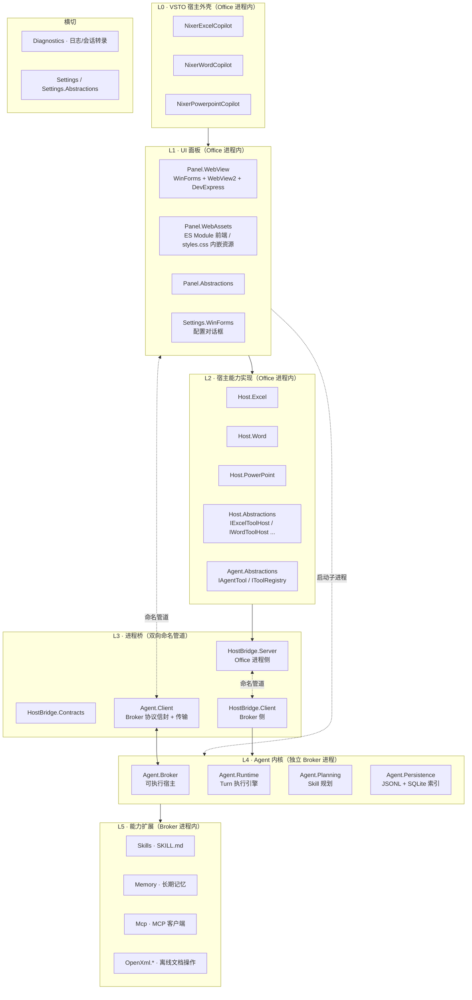
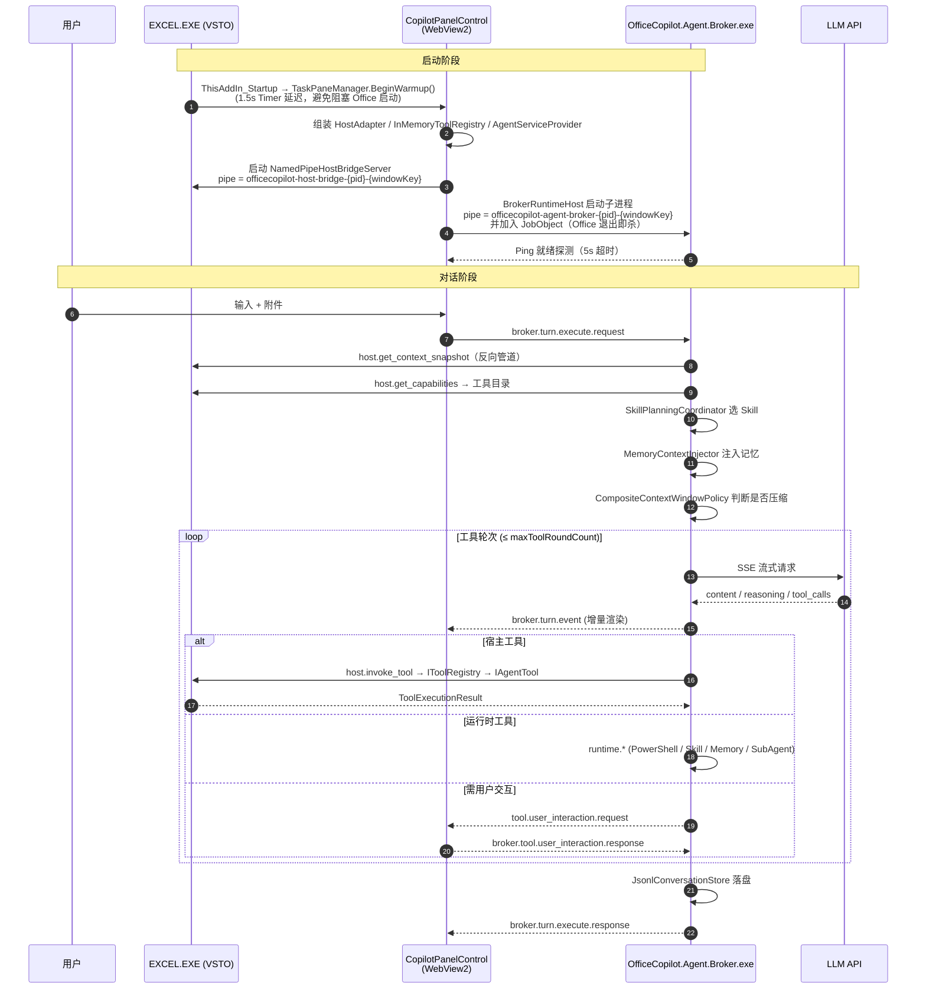

# NixerOfficeCopilot 代码结构说明与架构审查

> 初版：2026-08-24；本次修订：2026-08-27（批次 D、批次 F 全部落地，文档与代码现状一次性对齐）
>
> **阅读说明**：§6–§7 是 **2026-08-24 初审时的问题库**，已修复项均就地标注状态并保留原描述作为归档；实时进度以 [REMEDIATION_PLAN.md](REMEDIATION_PLAN.md) §7 的跟踪表为准。
> **代码分布与功能定位请查 [CODE_MAP.md](CODE_MAP.md)**（2026-08-29 实测口径）——本文 §2 / §5 的规模统计与目录速查已迁至该文档，此处保留的表格仅作历史归档。
> 当前剩余工作：E3/E4（legacy csproj → SDK），以及 §7.4 中剩余的命名与结构异味。
> 审查范围：解决方案内全部 **33** 个 C# 工程，**483** 个 `.cs` 文件，**85,709 行**（下表为 2026-08-24 口径，历经多轮减行后未重新统计）
> 统计口径：排除 `obj/`、`bin/`、`packages/`、`publish/`；行数为 `Get-Content | Measure-Object -Line`（不计文件末尾空行）
> 文件编码约定：**全仓库 UTF-8 无 BOM**

---

## 变更记录

| 日期 | 变更 | 对应条目 |
|---|---|---|
| 2026-08-24 | 建立 Git 仓库与 `.gitignore`，首次提交 `0c68f43` 作为重构前基线（638 个文件 / 991 KiB） | **P0-2 已解决** |
| 2026-08-24 | 删除 `OfficeCopilot.Agent.Runtime.Tests`、`OfficeCopilot.Agent.Persistence.Tests`（TFM 不兼容、不可运行） | **P0-3 已消解** |
| 2026-08-24 | 删除空壳的 `NixerExcelCopilotSetup` 安装工程目录 | P0-4 部分 |
| 2026-08-24 | 三个 VSTO 加载项的 `<Reference>`+`<HintPath>` 改为 `<ProjectReference>` | **P0-1 已解决（A2）** |
| 2026-08-24 | 删除 7 个 Phase-0 占位文件 | **D1–D7 已完成** |
| 2026-08-24 | 合并双重工具确认门（Broker 为唯一决策点，Host 侧凭元数据跳过） | **F1 已完成** |
| 2026-08-24 | 补齐 Broker 确认门的授权记录（"本会话/始终允许"真正生效） | **F2 已完成** |
| 2026-08-24 | `NormalizeSafetyPolicy` 尊重作者声明；三个 Word 导航工具改为只读 | **F3 已完成** |
| 2026-08-24 | `ToolDefinitionOverride` 增加 `RequiresConfirmation`（`bool?`），可按工具关闭确认 | **F4 已完成** |
| 2026-08-24 | Word 加载项与设置界面纳入用户工具设置（D-4 泛化） | **F5 已完成** |
| 2026-08-24 | 补全技能工具白名单（`allowedTools` 真正生效） | **F6 已完成** |
| 2026-08-24 | PowerPoint 工具目录补齐分组与选项，三宿主配置能力对齐 | **F7 已完成** |
| 2026-08-24 | 新增共享的 `ToolSafetyPolicy`，`RiskLevel` 改为可推导的四级 | **F8 已完成** |
| 2026-08-24 | 新增工具执行权限模式 TrustMode（提示确认 / 始终放行），按宿主（Excel/Word/PowerPoint）分别存于 `settings.json` | 见 §10；方案见 [TRUST_MODE_PLAN.md](TRUST_MODE_PLAN.md) |
| 2026-08-24 | 抽出 `ToolCatalogBuilder` / `ToolCatalogOptions`，三份工具目录骨架去重（D-5） | **F9 已完成** |
| 2026-08-24 | 工具测试页支持三个宿主，跨宿主工具给出明确的不可测试原因 | **F10 已完成** |
| 2026-08-24 | `AllowHighRiskTools` 升级为对 `critical` 级工具的硬门 | **F11 已完成** |
| 2026-08-31 | 堵住“绕过原生工具走 PowerShell”的四条逃逸口：`runtime.powershell` 升为 `critical`；critical 硬门改为需 `AllowHighRiskTools && AllowVbaFallback`；MCP 工具风险改为推导且豁免技能白名单；放权标志只取主技能；新增"原生工具优先"system prompt 段。见 §9.7 | **F12 已完成** |
| 2026-08-25 | 55 个 GBK(936) 源文件无损转码为 UTF-8 无 BOM（中文原样保留）；13 个字节已损坏的文件将受损字面量与注释改写为英文。全仓库 `U+FFFD` 归零，解决方案 33 个工程构建通过 | **P2-1 / B1 已解决** `ac31dbe` |
| 2026-08-25 | 新增集中式 `OfficeCopilot.Agent.Tests`（MSTest / .NET Framework 4.7.2），接入 Runtime、Persistence、Settings、协议等引用；首批 16 个纯逻辑测试全部通过 | **阶段 1.1 已完成** |
| 2026-08-25 | Panel 标题/摘要请求下沉为 `broker.completion.single.request`，复用 Broker 唯一 `HttpModelClient`；删除 `ChatApiClient` 及三宿主构造代码 | **P1-1 / C3 已完成** |
| 2026-08-25 | 新增 `OfficeCopilotLog` 统一日志门面；Runtime、Persistence、Skills、Broker、HostBridge、Excel 备份和 Settings.WinForms 均改走 `OfficeCopilot.Diagnostics`，移除两套专用文件轮转实现 | **P2-2 / D-1 已完成** |
| 2026-08-26 | 新增 `.editorconfig` 并清除 76 个 BOM；`Phase7CLog` → `RuntimeTrace` / `PanelTrace`；`待解决问题.txt` → [BACKLOG.md](BACKLOG.md)；删除 3 个 `.bak` + 6 个 `.csproj.user`；新增 `Directory.Build.props` / `Directory.Packages.props` / `build.ps1`，`.sln` 移除自造 `All` 配置 | **B2 / B3 / A4 / A6 / E1 / E2 / E5 / E7 已完成** |
| 2026-08-26 | 删除 `ChatSessionManager`、Excel `dynamic` 注册扩展、`WordBuiltInTools` 转发壳与重复 TaskPane 赋值 | **C2 / C4（D8/D10/D11/D12）已完成** |
| 2026-08-26 | `RoughTokenEstimator` 改为 CJK 感知；Panel 侧 4 个 `Session*` 常量与无效压缩方法删除；5 个魔数进 `Runtime` 配置节；`AgentTool` / `PowerShellTool` 异步化 | **G1 / G4 / G5 / D-7 已完成** |
| 2026-08-27 | 抽出 `CopilotTaskPaneManagerBase<TWindow>` / `WindowPaneContext` / `HostBridgePipeNameFactory`；引入 `AddOfficeCopilotAgentRuntime` DI 装配根；删除 `RuntimeToolDefinition`；统一 HostBridge 序列化器与错误码。测试 118/118 全绿 | **批次 D（D-1–D-8）全部完成** |
| 2026-08-27 | God Class 拆解：`HttpModelClient` 2639 → 62 行（抽 `IModelProviderAdapter` + 3 个供应商适配器 + 4 个共享静态帮助类）；`ExcelHostAdapter` 7472 行/10 partial → 门面 692+231 行 + `ExcelServiceBase` + 7 个服务类；`OfficeCopilotSettingsFactory` 1439 行 → 8 个单一职责文件；`chat.js` 3458 行单 IIFE → 19 个原生 ES Module。公开 API 零变化，测试 118/118 全绿 | **批次 F（F2–F5）全部完成** |
| — | PowerPoint 蓝图 P0：`PowerPointComDispatcher`（UI 线程封送 + 拒绝重试）、`SaveCopyAs` 备份 / 还原副本、共享 `IDocumentRestoreHostAdapter`、`ToolDefinition.AffectsDocument`、工具更名 `ppt_*` 与分组 `ppt.context/read/backup/file`（旧名别名 + 设置迁移） | 见 [POWERPOINT_COPILOT_BLUEPRINT.md](POWERPOINT_COPILOT_BLUEPRINT.md) §9 |
| — | PowerPoint 蓝图 P1：`OfficeCopilot.Slides.AssetMerge` 合并 34 套模板 + 12 个预设入 `SlideAssets`（零外链、351 个版式样例、`fonts.css/json`、许可汇总）；`StyleCatalog` / `FontCatalog`（含用户目录与契约检查）；`ppt.style` 组 `ppt_style_search` / `ppt_style_get` | 同上 |
| 2026-10-01 | PowerPoint 蓝图 P2 实现：Deck 工作区 / HTML-CSS 清洗器 / 模板组装器 / URL 解析；隐藏 WebView2 PNG 截图与独立预览窗；`ppt.deck` 六工具、`ppt_style_preview`；面板候选图与 `nixer-decks.local` 映射；修复 ask-user `preview` 的 HTML 注入 | 见 [POWERPOINT_COPILOT_BLUEPRINT.md](POWERPOINT_COPILOT_BLUEPRINT.md) §9；构建与 UI 验收待执行 |
| 2026-10-16 | 字体映射表 `FontResolutionTable`：构建前按随包字面判定 `SystemFamily` / `Installed` / `Pending` 并给出 PPT 写入名；安装器跳过已由本机提供的族；预览 `fonts.css` 在请求时去掉系统已有族的 `@font-face`（含别名）。得意黑 PPT 名定为 `Smiley Sans Oblique`（COM spike 验证）。单元测试 63/63 通过；预览与 PPT 视觉验收待执行 | 见 [POWERPOINT_COPILOT_BLUEPRINT.md](POWERPOINT_COPILOT_BLUEPRINT.md) §5.7 |
| 2026-10-18 | 修复 `ppt_deck_build` 恒被“未提供工作区执行前检查”阻止：`ToolCatalogBuilder` 的包装器原先会屏蔽 `IToolExecutionPreflight`，现改为按需透传。跨轮次回放只保留 user/assistant 文本，导致“继续”轮次模型拿不到 deckId 而自行编造；新增 `PriorTurnDeckWorkspaceCarryOver`，从已持久化的 `ppt_deck_*` / `ppt_style_preview` 成功结果中提取最近工作区（deckId / 标题 / 页数），以 system 提示注入当前轮次 | 全量测试 900 通过 / 4 跳过 |
| 2026-10-18 | `ppt_deck_build` 的 `deckId` / `workspaceTitle` / `slideCount` 改为可省略：任一缺失时，Broker 在确认前通过 `host.preflight_tool_call` 请宿主按会话绑定补全（`PreflightToolCallResult.ResolvedArgumentsJson`），仅取本会话最近一次在同一版本上验证并预览的工作区，并复用 `PreflightDeckBuild` 全量检查；补全后的参数同时用于确认摘要（标题 / ID / 页数）和实际调用，执行端仍做严格校验。显式提供但不一致的 deckId 仍被拒绝、不做替换；无绑定、版本变化或跨会话一律失败 | 全量测试 909 通过 / 4 跳过 |
| 2026-10-20 | 字重矩阵缺失只作为 `warn`；`ppt_deck_build` 仅绑定最近预览版本，不要求单独 `ppt_deck_validate`，且不自动执行构建后 L3 回读/视觉验证。独立 `ppt_deck_validate` 仍可按用户要求调用 | — |

---

## 目录

1. [一分钟结论](#1-一分钟结论)
2. [解决方案地图](#2-解决方案地图)
3. [运行时拓扑：三进程模型](#3-运行时拓扑三进程模型)
4. [一次对话的完整数据流](#4-一次对话的完整数据流)
5. [分层详解](#5-分层详解)
6. [架构审查：问题清单](#6-架构审查问题清单)
7. [冗余代码与死代码清单](#7-冗余代码与死代码清单)
8. [一体化改进建议（菜单）](#8-一体化改进建议菜单)
9. [F1–F11：工具确认疲劳与技能白名单的一体化修复](#9-f1f11工具确认疲劳与技能白名单的一体化修复2026-08-24)

---

## 1. 一分钟结论

**整体判断**：核心架构方向是对的——"VSTO 宿主薄壳 + 独立 .NET Broker 进程 + 双向命名管道"是这类产品的正确解法，比把 Agent 逻辑塞进 VSTO 进程内要健壮得多。分层命名（`Abstractions` / `Contracts` / 实现）也体现了设计意图。

**但是**，项目呈现出典型的"多轮迭代拼凑"特征，主要体现在四点：

| 症状 | 初审时的具体表现 | 当前 |
|---|---|---|
| **架构分层被反复穿透** | 同一个“工具”概念有 4 套并行的数据表示；Panel 里保留了一整套本该被 Broker 取代的 LLM 客户端 | ✅ 已收敛（D-2 / P1-1） |
| **迭代脚手架未清理** | `Phase 0` 占位接口与空实现仍在编译；`1.4d 过渡期` 残留物 | ✅ 已清空（C1 / C2 / B3） |
| **工程基线缺失** | 无版本控制、无统一构建属性、SDK 与 legacy csproj 混用 | ⚠️ 部分：基线已建（E1/E2/E5/E7），legacy → SDK 迁移（E3/E4）未做 |
| **God Class 集中** | 4 个文件超 1800 行，最大 4221 行；`ExcelHostAdapter` 分散在 8 个 partial 里约 7000 行 | ✅ 批次 F 已完成（面板 4221 → 3611；`HttpModelClient` 2639 → 62；`ExcelHostAdapter` 7472 → 门面 923；`chat.js` 3458 → 19 个模块） |

**高危问题现状**（详见 [§6.1](#61-p0--阻断级)）：

1. ~~🔴 **三个 VSTO 加载项通过 `<HintPath>` 直接引用另一个工程的 `obj\Debug\net472\` 中间产物**~~ ✅ **已修复**：已改为 `<ProjectReference>`，Debug/Release 均验证通过。
2. ~~🔴 **仓库没有 Git**~~ ✅ **已修复**：基线提交 `0c68f43`，`.gitignore` 已实测验证。
3. ~~🔴 **单元测试工程无法构建**~~ ✅ **已修复**：集中式 `OfficeCopilot.Agent.Tests`（MSTest / net472）**118 个用例全绿**，覆盖 JSONL 持久化、Broker/HostBridge 信封、技能白名单、压缩预算与 DI 装配。
4. ~~🔴 **私钥与发布产物**（P0-4）、🔴 **DevExpress 版本漂移**（P0-5）仍待处理~~ **本轮不处理**。相关风险保留记录，但不纳入本轮改造计划。

---

## 2. 解决方案地图

### 2.1 规模统计

| 工程 | 文件数 | 行数 | 目标框架 | 工程格式 |
|---|---:|---:|---|---|
| OfficeCopilot.Settings.WinForms | 25 | 14471 | v4.7.2 | legacy |
| OfficeCopilot.Agent.Runtime | 79 | 13626 | net472 | SDK |
| OfficeCopilot.Host.Excel | 62 | 11903 | v4.7.2 | legacy |
| OfficeCopilot.Panel.WebView | 23 | 11739 | v4.7.2 | legacy |
| OfficeCopilot.Host.Word | 37 | 4141 | net472 | SDK |
| OfficeCopilot.Host.Abstractions | 23 | 2527 | v4.7.2 | legacy |
| OfficeCopilot.Agent.Broker | 18 | 2318 | net472 | SDK |
| OfficeCopilot.Agent.Planning | 14 | 1952 | netstandard2.0 | SDK |
| OfficeCopilot.OpenXml.Tools | 26 | 1706 | net472 | SDK |
| OfficeCopilot.Agent.Client | 35 | 2190 | netstandard2.0 | SDK |
| OfficeCopilot.Eval | 7 | 2517 | net472 | legacy |
| **NixerExcelCopilot** | **9** | **1520** | **v4.7.2** | **legacy (VSTO)** |
| OfficeCopilot.Settings | 3 | 1440 | v4.7.2 | legacy |
| OfficeCopilot.OpenXml.Excel | 9 | 1395 | netstandard2.0 | SDK |
| OfficeCopilot.OpenXml.Word | 5 | 1386 | netstandard2.0 | SDK |
| NixerWordCopilot | 9 | 1385 | v4.7.2 | legacy (VSTO) |
| NixerPowerpointCopilot | 9 | 1358 | v4.7.2 | legacy (VSTO) |
| OfficeCopilot.Agent.Persistence | 8 | 1296 | net472 | SDK |
| OfficeCopilot.Settings.Abstractions | 4 | 1110 | v4.7.2 | legacy |
| OfficeCopilot.HostBridge.Server | 6 | 1098 | net472 | SDK |
| OfficeCopilot.OpenXml.PowerPoint | 7 | 1038 | netstandard2.0 | SDK |
| OfficeCopilot.Memory | 5 | 861 | netstandard2.0 | SDK |
| OfficeCopilot.Diagnostics | 12 | 844 | v4.7.2 | legacy |
| OfficeCopilot.Agent.Abstractions | 15 | 841 | v4.7.2 | legacy |
| OfficeCopilot.Mcp | 5 | 777 | netstandard2.0 | SDK |
| OfficeCopilot.Skills | 6 | 685 | netstandard2.0 | SDK |
| OfficeCopilot.OpenXml.Word.SmokeTest | 3 | 2145 | net472 | SDK |
| OfficeCopilot.OpenXml.Core | 7 | 628 | netstandard2.0 | SDK |
| OfficeCopilot.Host.PowerPoint | 6 | 505 | net472 | SDK |
| OfficeCopilot.Mcp.TestServer | 1 | 308 | net8.0 | SDK |
| OfficeCopilot.HostBridge.Contracts | 9 | 215 | netstandard2.0 | SDK |
| OfficeCopilot.Panel.Abstractions | 3 | 179 | v4.7.2 | legacy |
| OfficeCopilot.HostBridge.Client | 3 | 163 | netstandard2.0 | SDK |
| OfficeCopilot.Panel.WebAssets | 2 | 66 | v4.7.2 | legacy |
| **合计** | **483** | **85,709** | | |

> 工程数从 35 降为 33：删除了两个 `net8.0` 测试工程。`OfficeCopilot.Mcp.TestServer` 是独立的 MCP 调试服务端，不引用 net472 工程，因此 `net8.0` 在它身上不构成问题。

### 三个 VSTO 加载项的对称性

| | NixerExcelCopilot | NixerWordCopilot | NixerPowerpointCopilot |
|---|---:|---:|---:|
| `*TaskPaneManager.cs` | **112** 行 | 119 行 | 110 行 |
| `*CopilotRibbon.cs` | 262 行 | 261 行 | 251 行 |
| `ThisAddIn.cs` | 52 行（同构） | 52 行（同构） | 51 行（同构） |
| `AboutDialog.cs` | 同构 | 同构 | 同构 |
| 工程引用形式 | `ProjectReference` ✅ | `ProjectReference` ✅ | `ProjectReference` ✅ |
| Broker 后台预热优化 | ✅ | ✅ | ✅ |

三者的工程引用图**完全同构**，唯一差异是 `OfficeCopilot.Host.{Excel,Word,PowerPoint}` 各引各的。

> ✅ **已由 D-4 收敛**（见 §8 批次 D）：三份逐行复制的 `*TaskPaneManager.cs`（原 523 / 557 / 547 行）已上提为
> [OfficeCopilot.Panel.WebView/Composition/CopilotTaskPaneManagerBase.cs](OfficeCopilot.Panel.WebView/Composition/CopilotTaskPaneManagerBase.cs)（457 行），各宿主只留 8 个差异重写，净减 **784 行**。
> 内嵌的 `WindowPaneContext` 与三处硬编码的管道名拼接（R7）也分别收敛为共享类与 `HostBridgePipeNameFactory`。

> ⚠️ **初审时发现的功能缺陷**：配置界面里的“内置工具启用/禁用”与“工具定义覆盖”曾**只对 Excel 生效**。
> ✅ **已修复**：Word 由 F5、PowerPoint 由 F7 补齐，基类的 `HasToolCatalogConfiguration` / `CreateToolDefinitionOverrides` 使三宿主行为一致。

> ⚠️ **尚存的重复**：`ThisAddIn.cs`（R4）与 `*CopilotRibbon.cs`（R5）**仍是三份逐行复制**，合计约 930 行。
> D-4 只处理了 TaskPaneManager；这两类重复因强依赖 VSTO 设计器生成代码（`ThisAddIn.Designer.cs` / `*.resx`），抽基类性价比低，有意保留。

### 2.2 逻辑分层



### 2.3 目录职责速查

| 目录 | 职责 | 关键类型 |
|---|---|---|
| `NixerXxxCopilot/` | VSTO 入口（Excel / Word / PowerPoint 各一份，结构同构）。`ThisAddIn` 启动 → `XxxCopilotTaskPaneManager` 组装依赖；`XxxCopilotRibbon` 提供 7 个功能区按钮 | `ThisAddIn`、`*TaskPaneManager`（112/119/110 行，基类在 Panel.WebView）、`*Ribbon`、`AboutDialog` |
| `OfficeCopilot.Panel.WebView/` | 任务窗格主控件。WebView2 渲染对话，DevExpress Bar 提供工具栏；负责启动/守护 Broker 子进程；兼任三宿主共享的 TaskPane 装配基类 | `CopilotPanelControl`、`CopilotTaskPaneManagerBase<TWindow>`、`BrokerRuntimeHost`、`ReferencePipeline` |
| `OfficeCopilot.Panel.WebAssets/` | 前端静态资源，编译为嵌入资源，运行时释放到 `%LOCALAPPDATA%\NixerOfficeCopilot\WebAssets\wwwroot` | `WebAssetsLocator`、`js/*.js`(19 个原生 ES Module，入口 `main.js`)、`styles.css`(32KB) |
| `OfficeCopilot.Host.Abstractions/` | 宿主能力契约（大量 Excel DTO：Range/Table/PowerQuery/DataModel/Vba）；引用中立的 `HostBridge.Contracts` 共享工具验证字段名称 | `ICopilotHostAdapter`、`IExcelToolHost`、`IToolConfirmationHandler` |
| `OfficeCopilot.Agent.Abstractions/` | 宿主侧工具模型与可选宿主调用策略契约 | `IAgentTool`、`IToolRegistry`、`ToolDefinition`、`IHostCallPolicy` |
| `OfficeCopilot.Host.Excel/` | Excel COM Interop 实现 + ~60 个 Excel 工具类；`ExcelComDispatcher` 将工具调用封送到 Excel UI 线程，仅对只读 busy 调用退避重试；`ExcelColumnReader` 为画像、聚合、对账及托管计算后端提供分块 Value2 读取，流式 sink 与快照路径共用 `Analysis/Accumulators`；为兼容旧语义，分析读取器检查全部源列，仅整行为空时跳过；`VerificationPlanner` 将断言校验为后端查询，传递表头口径并按真实布局成本、能力及生产者独立性路由；`VerificationEngine` 编排 `excel_assert` 与 aggregate 的独立复核，`Comparator` 检查覆盖完整性并生成有上限的差异报告；VBA conserve/probe 与 reconcile 复用统一断言比较，同时保留原有兼容结果；验证语义工具通过 HostBridge 字段常量输出统一 `verification` 摘要，并在 `details` 保留比较细节；`Verification/Backends` 提供统一计算后端契约、Excel 原生 COM 计算、托管流式计算及有限规模数据质量指纹 | `ExcelHostAdapter` 门面、`ExcelServiceBase` + 服务类、`Com/ExcelComDispatcher`、`Com/ExcelColumnReader`、`Analysis/Accumulators`、`Verification/VerificationEngine`、`Verification/VerificationPlanner`、`Verification/Comparator`、`Verification/Backends/Com/ComCalcBackend`、`Verification/Backends/Com/DataQualityFingerprint`、`Verification/Backends/Managed/ManagedCalcBackend`、`ExcelBuiltInToolCatalog`、`Tools/Data/ExcelAssertTool` |
| `OfficeCopilot.HostBridge.*/` | Office 进程 ↔ Broker 进程的 RPC；请求处理器可选套用 `IHostCallPolicy`；`HostBridge.Contracts` 集中定义工具结果 `verification` 字段和 producer 常量 | `NamedPipeHostBridgeServer`、`DefaultHostBridgeRequestHandler`(793行)、`HostBridgeRequest/Response`、`ToolResultVerificationFields` |
| `OfficeCopilot.Agent.Client/` | Broker 协议 DTO、命名管道传输及本地端点注册表（Panel、Broker、Eval 共用） | `AgentBrokerMessageTypes`、`TransportAgentBrokerClient`、`NamedPipeAgentBrokerTransport`、`AgentBrokerEndpointRegistry` |
| `OfficeCopilot.Agent.Broker/` | Broker 可执行程序。管道宿主 + 信封分发 + 生命周期 | `Program`、`NamedPipeBrokerHost`、`BrokerEnvelopeDispatcher`、`BrokerTurnService` |
| `OfficeCopilot.Eval/` | Excel Eval 控制台 Runner；启动 Excel COM、提交只读任务、保存 trace、汇总指标并生成 Markdown 报告 | `Excel/ExcelEvalRunner`、`Excel/ExcelAutomationSession`、`Excel/ExcelEvalMetricsReporter` |
| `OfficeCopilot.Agent.Runtime/` | **系统心脏**。Turn 循环、工具调度、上下文压缩、PowerShell 沙箱、子 Agent | `BrokerTurnExecutor`、`DefaultToolDispatcher`(890行)、`HttpModelClient`(62行门面) + `ModelProviders/*`、`Context/*` |
| `OfficeCopilot.Agent.Planning/` | Skill 选择与执行计划 | `ISkillPlanner`、`KeywordSkillPlanner`、`HybridSkillScorer`、`OfficeSkillCatalog` |
| `OfficeCopilot.Agent.Persistence/` | 会话持久化 | `IConversationStore`、`JsonlConversationStore`、`SqliteConversationIndex` |
| `OfficeCopilot.Skills/` | SKILL.md 解析与加载（内置 / 用户目录）。用户技能位于共享根 `%APPDATA%\NixerOfficeCopilot\skills\` 下的宿主子目录 `excel\`、`word\`、`powerpoint\`，各宿主互不可见 | `BuiltInSkillLoader`、`FileSystemSkillLoader`、`SkillFrontmatter`、`SkillStorageLocations` |
| `OfficeCopilot.Memory/` | 文件系统长期记忆 | `FileSystemMemoryStore`、`MemoryTreeNode` |
| `OfficeCopilot.Mcp/` | MCP 服务器连接与工具发现 | `McpRegistry`、`NuGetMcpClient`、`McpToolNaming` |
| `OfficeCopilot.OpenXml.*/` | 不依赖 Office 进程的文件级读写（Core / Word / Excel / PowerPoint / Tools） | `IDocumentEngine`、`DocumentEngineRegistry`、`ExcelFile*Tool`、`PowerPointFile*Tool` |
| `OfficeCopilot.Settings*/` | 配置模型、JSON 持久化、WinForms 配置界面 | `OfficeCopilotSettings`(972行)、`JsonSettingsStore`、`fmConfig`、`fmMcpEditor` |
| `OfficeCopilot.Diagnostics/` | 文件日志、Debug 输出、模型会话转录 | `OfficeCopilotDiagnostics`、`FileLoggerProvider`、`IModelTranscriptLogger` |

---

## 3. 运行时拓扑：三进程模型



### 关键设计点

- **每个 Office 窗口一个 Broker**：管道名派生自 `{pid}-{windowKey}`，避免多窗口串扰（命名由 `HostBridgePipeNameFactory` 统一生成，`BrokerRuntimeHost.BuildBrokerPipeName` 据此派生 Broker 管道名）。
- **JobObject 兜底**：Broker 加入 Job，Office 崩溃时子进程随之终止，避免僵尸进程。
- **双向管道**：Panel→Broker 走 `Agent.Client` 协议；Broker→Office 走 `HostBridge` 协议。两套协议风格已由 **D-3 拉齐**（同一序列化器 + 常量化错误码 + 响应回显，见 §6.2 P1-4）。

---

## 4. 一次对话的完整数据流

`BrokerTurnExecutor.ExecuteAsync` 的编排骨架：

```
ExecuteAsync
├─ EmitTurnStarted
├─ PrepareTurnAsync
│  ├─ GetEffectiveSnapshotAsync      → HostBridge: host.get_context_snapshot
│  ├─ GetCapabilitiesAsync           → HostBridge: host.get_capabilities
│  ├─ DefaultToolDispatcher.BuildToolCatalog(capabilities)
│  │     ├─ 15 个 runtime.* 内置工具（list_tools / compact / ask_user_question /
│  │     │   todo_write / brief / powershell / run_agent / invoke_skill / ...）
│  │     └─ 宿主工具（来自 HostBridgeCapabilities.Tools）
│  └─ MergeMcpToolsIntoCatalogAsync  → MCP 工具并入
├─ ExecuteTurnBodyAsync
│  ├─ [分支 A] PlannedToolCallParser 有显式工具调用 → ExecuteExplicitToolCallsAsync
│  ├─ [分支 B] ModelOptions.Endpoint 非空 → ExecuteModelTurnAsync   ← 主路径
│  └─ [分支 C] 兜底 → BuildAssistantResponse（纯文本回显）
├─ TryExtractMemoriesAsync           → MemoryExtractor
├─ TryDetectSkillImprovementsAsync   → SkillImprovementHook
└─ EmitTurnCompleted + ContextUsage 回填
```

`ExecuteModelTurnAsync` 内循环：

```
BuildSkillPlanAsync → BuildModelMessages → InjectMemoryContext
while true:
    EvaluateContextWindowAndCompactAsync   ← 每轮调用前评估压缩
    TokenBudget.Reset(估算 = 字符数/4)
    BuildModelTools(toolCatalog, skillPlan)
    IModelInvoker.StreamAsync → ModelStreamEvent 流
        ├─ TextDelta      → EmitContentDelta + TokenBudget.RecordDelta
        ├─ ReasoningDelta → EmitThinkingDelta
        └─ ToolCallsReady → 收集 ModelClientToolCall
    若无 tool_calls → break
    逐个 ExecuteToolCallAsync → 结果回写 modelMessages
```

### 工具的三重身份

> **D-2 已完成**：原先同一个"工具"在系统中被表达 **4 次**（含 Runtime 私有的 `RuntimeToolDefinition`）。
> 该类型已删除，Runtime 工具目录直接持有线上模型 `HostBridgeToolDescriptor`，跨 Broker 边界不再做一次转换。

| 层 | 类型 | 位置 |
|---|---|---|
| 宿主实现 | `IAgentTool` + `ToolDefinition` | `Agent.Abstractions` |
| 跨进程传输 / Runtime 目录 | `HostBridgeToolDescriptor` | `HostBridge.Contracts` |
| 发给模型 | `ModelClientTool` | `Agent.Runtime` |

> 第 5 个未使用的 `ToolCatalogEntry` 已在 P1-1 删除。

---

## 5. 分层详解

### 5.1 VSTO 外壳层

`ThisAddIn_Startup` 极薄——只做 `TaskPaneManager` 构造 + `BeginWarmup()`，外面裹一层 `try/catch` 弹 `MessageBox`。三个加载项的 `ThisAddIn.cs` 都保留着同一行注释掉的代码：

```csharp
// 临时注释：先不要在 Startup 阶段自动显示面板
// TaskPaneManager.ShowPane();
```

真正的组装在共享基类 `CopilotTaskPaneManagerBase<TWindow>.EnsurePane()`（[OfficeCopilot.Panel.WebView/Composition/CopilotTaskPaneManagerBase.cs](OfficeCopilot.Panel.WebView/Composition/CopilotTaskPaneManagerBase.cs)）：

```
EnsurePane(windowKey = TryGetActiveWindow() → 宿主窗口句柄)
├─ JsonSettingsStore.Load() + OfficeCopilotSettingsFactory.Normalize
├─ ToolCallDiagnosticsLogger.Configure(settings.Logging.ToolCalls.IsEnabled)
├─ OfficeCopilotDiagnostics.CreateLoggerFactory / CreateModelTranscriptLogger
├─ CreateHostAdapter()                                    ← 宿主重写（Excel/Word/PPT）
├─ RegisterHostServices(services, adapter)                ← 宿主重写
├─ new InMemoryToolRegistry() + RegisterTools(registry, settings)
│    └─ 基类提供 HasToolCatalogConfiguration / CreateToolDefinitionOverrides（三宿主一致）
├─ new CopilotPanelControl(settingsStore, panelLogger)
│    └─ .HostAdapter / .AgentServices / .ToolRegistry 属性注入
├─ AgentServiceProvider ← IToolConfirmationHandler(ChatToolConfirmationHandler)
├─ pipeName = HostBridgePipeNameFactory.Create(pid, windowKey)   ← 单一工厂，不再拼字符串
├─ NamedPipeHostBridgeServer.StartAsync(cts.Token)
│    └─ handler = DefaultHostBridgeRequestHandler(adapter, registry, services)
├─ BrokerRuntimeHost(taskPaneLogger, hostBridgePipeName)
├─ panelControl.BrokerClient = brokerRuntimeHost.CreateClientNoStart()    ← 不阻塞 UI
├─ CreateTaskPane(panelControl, activeWindow)             ← 宿主重写
├─ panelControl.BeginLoadSessionsFromBroker()             ← fire-and-forget
└─ Task.Run(() => brokerRuntimeHost.EnsureStarted())      ← 后台预热 broker.exe
```

**性能优化的历史痕迹**：源码里保留了一段说明性注释，记载 `CreateClient()` 曾在 UI 线程上用 `Thread.Sleep(100)` 轮询 Ping 最多 5 秒，是"面板打开假死"的根因，因而改为 `CreateClientNoStart()` + 后台 `EnsureStarted()`。这个优化已随基类天然适用于三个加载项。

**宿主子类只留差异**：`ExcelCopilotTaskPaneManager`（112 行）、`WordCopilotTaskPaneManager`（119 行，多一层 `ActiveWindow` 的 `COMException` 保护）、`PowerPointCopilotTaskPaneManager`（110 行），各自只实现 8 个抽象成员：`LogCategory`、`NoActiveWindowMessage`、`TryGetActiveWindow`、`CreateHostAdapter`、`RegisterHostServices`、`RegisterTools`、`CreateTaskPane`、`RemoveTaskPane`。

**Ribbon 层**：三个 `*CopilotRibbon.cs`（262 / 261 / 251 行）仍为逐行同构的三份实现（R5，有意保留），各有 7 个按钮：`btnTogglePane`、`btnModelConfig`、`btnSkillsConfig`、`btnMemoryConfig`、`btnBuiltinToolsConfig`、`btnConfig`、`btnAbout`，加上 `SetExcelWaitCursor` / `RefreshContextIfNeeded` 辅助方法。


### 5.2 Panel 层

`CopilotPanelControl` 仍是全仓库最大的类（**3611 行**，另加 5 个 partial 文件共 ~2500 行）。它同时承担：

- WinForms/DevExpress 控件生命周期与 DPI 适配
- 会话列表加载/切换/删除的 UI 编排（I/O 已下沉 `BrokerSessionRepository`）
- 交互模式（Agent/Ask）切换
- 附件与引用管线（Office/PDF 本地解析、网页引用、模型能力门控的页面视觉兜底）
- 工具确认对话框、`AskUserQuestion` 对话框、Plan 审批对话框
- 会话标题与摘要的 LLM 生成
- Broker 事件到 UI 的转换（`BrokerToPanelConverter`）

**已拆出（P4 · F1）**：

| 协作类 | 职责 |
|---|---|
| `Presentation/PanelWebViewBridge` | WebView2 初始化、虚拟主机映射（`appassets.local`）、页面导航、JS ↔ C# 双向消息 |
| `Presentation/PanelModelMenuPresenter` | 模型选择菜单与选中模型解析 |
| `Presentation/PanelInteractionCoordinator` | 待处理用户交互 TCS 登记簿（原 `_pendingUserInteractionTcs` + `_pendingInteractionToolNames`） |
| `Services/BrokerSessionRepository` | 会话持久化 IPC：拉列表 / 补消息 / 删会话 / 回灌标题 |

前端已模块化（F4）：`wwwroot/js/` 下 19 个**原生 ES Module**，入口 `main.js`，共享可变状态集中在 `state.js` 的 `state` 对象上（`import` 绑定只读，跨模块赋值必须走对象属性）。仍不引入打包器——WebView2 通过 `SetVirtualHostNameToFolderMapping` 以 `https://appassets.local` 同源加载，浏览器原生解析模块图即可。

### 附件引用准备与按需读取

附件通过集中扩展名白名单进入 `ReferencePipeline`，在独立 STA 后台准备，避免阻塞 WinForms UI。`.docx`、`.xlsx` / `.xlsm`、`.pptx` 由 `OfficeCopilot.Documents.Markdown` 使用 Open XML SDK 本地转换；低文本页另由 DevExpress 导出 PDF 并复用逐页 PNG fallback。Office 与 PDF 共享每轮视觉页预算；仅在模型支持图像输入时附加 PNG，未渲染页或 Office 导出失败会在可续读 Markdown 中说明。`get_reference_content(pageNumber)` 的页图作为工具图片内容直接进入 Broker 下一轮模型消息；每轮最多 6 张，当前模型不支持图像时明确提示未发送。`.doc`、`.xls`、`.ppt` 先由 Broker 内独立 Office worker 只读另存为新格式。超时/取消/宿主退出只终止按 HWND、PID、进程启动时间及 owner 身份验证的 Office 实例；不确定归属时不杀进程。原始 Office 二进制不发送给模型。

转换结果以首段 inline 文本和有界 Markdown chunks 进入 `PreparedReference`；`InMemoryReferenceArtifactStore` 按 session 与 referenceId 隔离完整文本。`get_reference_content` 可按 Office/PDF section、chunk 或页码读取，模型能力未开放工具时不会注册该工具。OpenXML Markdown 转换默认受 60 秒可取消 deadline 约束。附件转换评测 runner 与合成 XLSX/DOCX/PPTX 语料生成入口见 `docs/attachment-eval/`。真实 Office 桌面转换、COM 生命周期和 provider 图像请求仍需交互环境验证；MarkItDown 比较也需本机安装并运行。

### 5.3 Host 层的严重不对称

| | 文件数 | 行数 | 工具数量级 |
|---|---:|---:|---|
| Host.Excel | 62 | 13575 | ~60（Context/Read/Write/Advanced/File 五组，含 PowerQuery、DataModel、VBA、截图） |
| Host.Word | 37 | 4693 | 中等（Context/Read/Write/Advanced/File） |
| Host.PowerPoint | 6 | **566** | 极少，仅 `CreateAllTools()` 一个注册入口 |

Excel 的 `ExcelBuiltInToolCatalog` 有 `CreateConfiguredTools`、`ExcelToolRegistrationOptions`、`ExcelToolCatalogOptions`、`DefinitionOverrides` 等完整配置能力；Word 曾有一层纯转发的 `WordBuiltInTools` 壳（已于 C4/D11 删除，文件仅留 `WordToolRegistrationOptions` / `WordToolCatalogOptions` 两个选项类，28 行）；PowerPoint 只有 `RegisterPowerPointBuiltInTools()` 一个方法。

> ✅ **共享基类已补齐（F9）**：三宿主现均基于 `ToolCatalogBuilder` / `ToolCatalogOptions` / `ToolRegistrationOptions` 组装工具目录，白名单与定义覆盖的行为一致。剩下的不对称是**工具覆盖面本身**（PowerPoint 工具数量远少于 Excel），属于功能排期而非架构缺陷。

### 5.4 上下文压缩子系统

`Agent.Runtime/Context/` 是设计较完整的一块：

- `ITokenEstimator` / `RoughTokenEstimator`（✅ P2-1/G1：已改为 **CJK 感知**——宽字符按 ×1.0 计，其余字符 ÷4）
- `AutoCompactPolicy`（整体摘要）+ `MicroCompactPolicy`（局部裁剪）+ `SnipCompactPolicy`
- `TurnSegmenter` 按 turn 切分、`CompactionBudget` 预算、`CompactionSummarizer` 调 LLM 摘要
- `CompositeContextWindowPolicy` 组合调度
- `TokenBudget` 在流式过程中实时刹车（阈值已由 G5 上提到 `Runtime` 配置节，不再是魔数）

压缩参数已由 **D-7** 完全收敛到 `Agent.Runtime/Context/`：Panel 侧原有的 4 个 `Session*` 常量与 `CompressSessionIfNeededAsync` 已删除，`MaxToolRoundCount` 改从设置读取。

### 5.5 PowerShell 沙箱

`Agent.Runtime/PowerShell/` 有 14 个文件，包含 `DangerousCmdletCatalog`、`DestructiveCommandDetector`、`GitSafetyChecker`、`ConstrainedLanguageModeCatalog`、`PowerShellPathValidator`、`ModeBasedAutoAllowPolicy`。这是全仓库设计最认真的安全模块，值得保留。

---

## 6. 架构审查：问题清单

### 6.1 P0 · 阻断级

#### P0-1 ✅ 已修复 · VSTO 加载项用 `<HintPath>` 引用另一个工程的 `obj\Debug\` 中间产物

> **状态：2026-08-24 已通过改进项 A2 修复。** 下文保留问题描述作为归档。

三个加载项的 csproj 里原本都有这两条**裸文件引用**（而非 `ProjectReference`）：

```xml
<Reference Include="OfficeCopilot.HostBridge.Server">
  <HintPath>..\OfficeCopilot.HostBridge.Server\obj\Debug\net472\OfficeCopilot.HostBridge.Server.dll</HintPath>
</Reference>
<Reference Include="OfficeCopilot.Agent.Client">
  <HintPath>..\OfficeCopilot.Agent.Client\bin\$(Configuration)\netstandard2.0\OfficeCopilot.Agent.Client.dll</HintPath>
</Reference>
```

四重问题：

| 问题 | 后果 |
|---|---|
| 指向 **`obj\`**（中间产物目录）而非 `bin\` | `obj/` 本应被 `.gitignore` 排除；清理一次 `obj` 就编译不过 |
| **`Debug` 写死**在路径里 | Release 构建的加载项链接的是 **Debug 的中间 DLL** |
| 不是 `ProjectReference` | **没有构建顺序保证**，MSBuild 不知道要先构建 `HostBridge.Server` |
| 不是 `ProjectReference` | 改了 `HostBridge.Server` 源码后，增量构建**不一定**重新拷贝，加载项继续用旧 DLL |

这与构建笔记里已记录的“Broker rebuild trap”（改了 Runtime 但 Excel 跑旧代码）是**同一类根因的两个表现**。

**修复方式**：两条 `<Reference>` 均改为 `<ProjectReference>`（带 `<Project>` GUID 与 `<Name>`），由 MSBuild 接管生成顺序与配置传播。

**验证结果**（VS 18 MSBuild，`/t:Rebuild`）：

| 工程 | Debug | Release |
|---|---|---|
| NixerExcelCopilot | ✅ ExitCode=0 | ✅ ExitCode=0 |
| NixerWordCopilot | ✅ ExitCode=0 | — |
| NixerPowerpointCopilot | ✅ ExitCode=0 | — |
| OfficeCopilot.Agent.Broker | ✅ ExitCode=0 | — |

Release 构建后 `OfficeCopilot.HostBridge.Server\bin\Release\net472\` 已正常生成并被链接，确认不再引用 Debug 产物。

> 副作用：这也顺带解决了 `.gitignore` 排除 `obj/` 后“干净克隆无法编译”的问题。

#### P0-2 ✅ 已修复 · 无版本控制

> **状态：2026-08-24 已解决。**

原状：`git status` → `fatal: not a git repository`。10 万行、正在做架构重构的项目没有任何回滚能力，且**已造成过实际损失**（`NixerExcelCopilot` 目录在一次复制操作中整体丢失；`NixerExcelCopilotSetup.vdproj` 则未能找回）。

**处理结果**：

| 项 | 值 |
|---|---|
| 基线提交 | `0c68f43`（分支 `main`） |
| 跟踪文件 | 638 |
| 仓库体积 | **991 KiB**（原目录 2,103.8 MB） |
| 仓库配置 | `core.quotepath=false`、`core.autocrlf=false` |

`.gitignore` 采用**临时探测仓库实测验证**（非推断）：15 条杂物路径全部 IGNORED（5 个工程级 `.vs` + 根级 `.vs`、`.pfx`、`.csproj.user`、`publish/`、`packages/`、`bin/`、`obj/`、`.bak`），5 条源码路径全部 TRACK。关键点：`.vs/` 不带前导斜杠，按 gitignore 语义匹配**任意层级**的同名目录；若写作 `/.vs/` 则仅匹配根目录。

已跟踪文件构成：490 `.cs`、57 `.png`、33 `.csproj`、20 `.resx`、14 `.config`、3 `.md`、3 `.xml`，无任何 `.dll` / `.exe` / `.pfx` / `.deploy`。

#### P0-3 ⚠️ 已消解（通过删除）· 测试工程 TFM 不兼容

> **状态：2026-08-24 两个测试工程已删除。但由此引入新风险，见下。**

原状：

| 工程 | TFM |
|---|---|
| `OfficeCopilot.Agent.Runtime.Tests` | `net8.0` |
| `OfficeCopilot.Agent.Persistence.Tests` | `net8.0` |
| 被测：`OfficeCopilot.Agent.Runtime` | `net472` |
| 被测：`OfficeCopilot.Agent.Broker` | `net472` |
| 被测：`OfficeCopilot.Agent.Persistence` | `net472` |

`net8.0` 工程无法引用 `net472` 工程，因此那 4,943 行测试**一直不可运行**——属于账面资产而非实际资产。

**当前状态：已建立集中式 `OfficeCopilot.Agent.Tests` MSTest 工程并通过首批 16 个测试。** 测试安全网仍不完整，重构 §8 批次 C（拆 `CopilotPanelControl` / `HttpModelClient`）前，还需要补齐 JSONL 持久化、协议和 Broker 编排测试。

#### P0-4 ⏸️ 本轮不处理 · 私钥与发布产物

> **范围决定：本轮不处理。** 保留现状，私钥、发布目录及其签名/版本一致性风险不纳入本轮改造和验收。后续发布工作重新立项时再单独处理。

补齐 Excel 工程后暴露出来的一批仓库卫生问题：

| 项 | 详情 |
|---|---|
| **3 个 `.pfx` 私钥** | `NixerExcelCopilot_TemporaryKey.pfx`、`NixerWordCopilot_TemporaryKey.pfx`、`NixerPowerpointCopilot_TemporaryKey.pfx`。csproj 中 `<SignManifests>true</SignManifests>` + `<ManifestKeyFile>` 引用它们 |
| **`publish/` 目录 108 MB / 42 个文件** | `NixerExcelCopilot\publish\`，含 `setup.exe`（1 MB）与 **两个版本**的 ClickOnce 产物：`Application Files\NixerExcelCopilot_1_0_0_0\` 和 `_1_0_0_1\`，各自捆绑一整套 DevExpress DLL（单 `DevExpress.Utils` 就 **20 MB**） |
| **6 个 `.csproj.user`** | Excel / Broker / Host.Excel / Panel.WebAssets / Panel.WebView / Settings.WinForms |

> **部分缓解**（2026-08-24）：以上三类文件已全部被 `.gitignore` 排除并经实测确认，**不会进入版本库**；空壳的 `NixerExcelCopilotSetup` 目录已删除。但它们**仍在工作区磁盘上**，且 `.pfx` 的根本问题（有效期、密钥管理）未解决。

> ✅ **已决策（2026-08-24）**：`.pfx` **暂留不动**。保持当前状态——文件留在工程目录内、由 `.gitignore` 隔离不入版本库，本机发布不受影响。
>
> 遗留风险（不阻塞当前开发，但在做分发时必须重新面对）：
> - 三个加载项都声明了 `<SignManifests>true</SignManifests>`，**干净克隆无法完成 ClickOnce 发布**（只影响发布，不影响 `Build`/`Rebuild`）。
> - 证书到期日未查证，VS 生成的 `*_TemporaryKey.pfx` 默认有效期仅 1 年。待查命令：`Get-PfxCertificate .\NixerExcelCopilot\NixerExcelCopilot_TemporaryKey.pfx | Select-Object Subject, NotAfter`
> - `.pfx` 仅存于本机且不在版本库中，**没有备份**——硬盘故障即丢失。
>
> 后续若重启此项，备选方案：（a）保持 ignore，额外备份到仓库外的密钥保管位置（**推荐**）；（b）从 `.gitignore` 移除 `*.pfx` 并纳入版本库（不推荐）。

关于 `.pfx` 的有效期、备份和正式签名证书风险，本轮仅保留记录，不执行处理。

#### P0-5 ⏸️ 本轮不处理 · DevExpress 依赖与版本一致性

> **范围决定：本轮不处理。** 不升级、不迁移、不规范化 DevExpress 引用，也不处理发布产物版本漂移；现有本机环境依赖风险保留记录。

| 位置 | DevExpress 版本 |
|---|---|
| `OfficeCopilot.Panel.WebView.csproj`（9 个程序集引用） | **v26.1** |
| `OfficeCopilot.Settings.WinForms.csproj`（14 个程序集引用） | **v26.1** |
| `NixerExcelCopilot\publish\...\*.dll.deploy`（两个版本目录） | **v25.1** |

`publish/` 里的 ClickOnce 产物是**上一个 DevExpress 大版本**打包的，与当前源码引用的 v26.1 不匹配。若误用这份 `publish/` 分发，加载项会在运行时抛 `FileNotFoundException` / `FileLoadException`。

同时两个工程都是**裸程序集引用**（无 `HintPath`、无 NuGet），完全依赖 GAC/本机 DevExpress 安装：

```xml
<Reference Include="DevExpress.XtraBars.v26.1, Version=26.1.3.0, Culture=neutral, PublicKeyToken=..." />
```

换台机器、或 DevExpress 升级到 v27，全部工程直接断链。本轮不处理该依赖治理问题。

### 6.2 P1 · 架构级

#### P1-1 ✅ 已修复 · Panel 侧残留一整套 LLM 客户端

> **状态：2026-08-25 已完成。**

原 `OfficeCopilot.Panel.WebView/Services/ChatApiClient.cs`（**1810 行**）实现了完整的多供应商 LLM 流式客户端：OpenAI 兼容 SSE 增量解析、Ollama 变体、tool_call 分片重组、转录日志……

而 `Agent.Runtime/HttpModelClient.cs`（**2639 行**）在 Broker 侧做**同样的事**。

实测调用点只有 **3 处**：

| 位置 | 用途 |
|---|---|
| `CopilotPanelControl.cs:213` | `ConfigureRuntime` |
| `CopilotPanelControl.cs:900` | 生成会话标题 |
| `CopilotPanelControl.cs:1044` | 生成会话摘要 |

且全部只调用 `SendSingleResultRequestAsync`（唯一的 public 业务方法）。**约 1700 行流式/工具调用代码是完全死的**，但它们仍在：占用编译期、被 IDE 索引、误导后续维护者、且在 Panel 进程内保留了 API Key 的第二条使用路径（安全面变大）。

> 已完成：标题/摘要通过 `broker.completion.single.request` 下沉到 Broker，Panel 仅提交 `AgentModelOptions` 和消息文本，不再接触 LLM HTTP 端点与密钥；Broker 复用唯一 `HttpModelClient`。

#### P1-2 ✅ 已修复 · 迭代脚手架未清理，且被“自测占位符”的单测锁死

> **状态：2026-08-24 已删除 7 个占位文件（D1–D7）。**

`Agent.Runtime/Turn/` 下原存在一组从未接入的抽象：

| 文件 | 状态 |
|---|---|
| `IToolDispatcher.cs` | 接口，仅被 `NullToolDispatcher` 实现 |
| `NullToolDispatcher.cs` | 注释写明“阶段 0.3 由实装版本替换” |
| `IContextBuilder.cs` | 接口，仅被 `NullContextBuilder` 实现 |
| `NullContextBuilder.cs` | 注释写明“占位…仅用于‘接口可注入、可单测’” |
| `TurnPromptContext.cs` | “阶段 0 占位，阶段 1 由 IContextBuilder 填充” |
| `ToolCatalogEntry.cs` | 供上述三者共享，实际无人使用；内部还定义了一个与 `Agent.Abstractions` 重名的 `ToolSourceKind` 枚举 |
| `ToolDispatchResult.cs` | **复核时新发现**，仅服务于上述占位链 |

实际生产路径用的是 `DefaultToolDispatcher`（不实现 `IToolDispatcher`）和 `DefaultContextBuilder`（不实现 `IContextBuilder`）。

更糟的是 `Agent.Runtime.Tests/Turn/TurnSkeletonSmokeTests.cs` 专门测试这些空实现：

```csharp
public async Task NullToolDispatcher_returns_empty_catalog_and_failure_result()
public async Task NullContextBuilder_returns_empty_prompt_context_preserving_snapshot()
```

**测试在保护死代码**——这会让静态分析工具永远无法把它们标记为可删除。

**修复过程**：测试工程因 TFM 不兼容被删除后，锁死关系自然解除。全局引用核查确认这 7 个类型的引用**全部局限在它们彼此之间**，仅 `DefaultContextBuilder.cs` 的一条 XML 注释 `<see cref="IContextBuilder"/>` 引用到外部（已同步修改，避免 CS1574）。删除后 `OfficeCopilot.Agent.Runtime` 重新构建：**0 警告 0 错误**。

> ⚠️ 注意：`IModelInvoker` / `DefaultModelInvoker` / `ModelStreamEvent` **不属于**本组占位代码，它们有真实实装，已保留。

#### P1-3 Skill 的工具白名单机制已被架空（✅ 已修复，F6 + F11）

`SkillPlanSupport.cs` 中三个方法是无条件常量返回：

```csharp
public static bool ShouldExposeToolToModel(RuntimeToolDefinition tool, RuntimeSkillPlan skillPlan)
    => tool != null;                       // 永远 true

public static bool IsToolPermittedBySkillPlan(RuntimeToolDefinition tool, RuntimeSkillPlan skillPlan)
    => tool != null;                       // 永远 true

public static string GetSkillPlanViolationMessage(PlannedToolCall call, ..., RuntimeSkillPlan plan)
    => string.Empty;                       // 永远无违规
```

而 `Agent.Planning` 里 `SkillSelectionResult` / `RuntimeSkillPlan` 精心维护着 `AllowedToolNames`、`PreferredToolNames`、`VerificationToolNames`、`AllowHighRiskTools`、`AllowVbaFallback` 等字段，`SKILL.md` 的 frontmatter 也支持 `allowedTools`。

**结果**：整条 Skill→工具约束链路是装饰性的。`AllowedToolNames` 只影响 `GetOrderedModelToolNames` 的**排序**，不影响**可见性**。用户在 SKILL.md 里写的 `allowedTools` 完全不生效，`AllowHighRiskTools: false` 也不阻止任何事。这既是功能缺陷也是安全缺陷。

> ✅ **已修复（F6 + F11 / D-6）**：三个方法已补齐真实实现——`allowedTools` 变为**可见性过滤**，`AllowHighRiskTools` / `AllowVbaFallback` 参与判定，违规调用返回具体提示。判定规则见 §9.4。参数类型也随 D-2 从 `RuntimeToolDefinition` 改为 `HostBridgeToolDescriptor`。

#### P1-4 两套 IPC 协议形态不一致（已修复，D-3）

> **复核结论**：原判断有误。两套协议**风格其实相同**——都是「一行一个 JSON 信封 + 点分小写消息名 + `PayloadJson` 内嵌强类型 DTO」。
> 真正的不一致在下表 4 处，已由 D-3 逐项拉齐。

| | Panel ↔ Broker | Broker ↔ Office | D-3 处理 |
|---|---|---|---|
| 定义位置 | `Agent.Client` | `HostBridge.Contracts` | 保持（职责不同） |
| 消息标识 | `MessageType`（`broker.turn.execute.request`） | `Operation`（`host.invoke_tool`） | 保持（语义不同，命名规范已统一为点分小写并由测试锁定） |
| **序列化器** | `System.Text.Json` | 服务端 `Newtonsoft.Json`，**但 Broker 侧客户端用 `System.Text.Json`** | ✅ 删除 Broker 侧重复客户端，两端统一 `Newtonsoft.Json` |
| **错误表达** | `AgentBrokerMessageTypes` 常量 | 20 处散落字面量 | ✅ 新增 `HostBridgeErrorCodes` |
| **响应回显** | 回显 `MessageType` | 无 | ✅ `HostBridgeResponse.Operation` |
| 事件推送 | `IAgentBrokerEventSink` | 无（纯请求-响应） | 保持（宿主侧无需推流） |

#### P1-5 God Class 集中

| 文件 | 初审行数 | 当前行数 | 状态 |
|---|---:|---:|---|
| `Panel.WebView/CopilotPanelControl.cs` | 4221 | **3611** | ✅ F1 已拆出 4 个协作类（见 §5.2） |
| `Agent.Runtime/HttpModelClient.cs` | 2639 | **62** | ✅ **F2 已完成**：拆为 `IModelProviderAdapter` + `OpenAiCompatible`/`Ollama`/`Anthropic` 三个适配器 + `ModelHttpTransport`/`ModelJsonHelpers`/`ModelRequestParameters`/`ModelStreamingSupport` 四个共享静态类（`ModelProviders/`） |
| `Host.Excel/ExcelHostAdapter.cs` + 9 个 partial | ~7000 | **692 + 231** | ✅ **F3 已完成**：拆出 `ExcelServiceBase` + `Analysis`/`Backup`/`Connection`/`DataModel`/`Range`/`Table`/`Vba` 七个服务类，Adapter 只做门面（52 个公开成员全部保留） |
| `Host.Word/WordHostAdapter.cs` | 1901 | 1901 | ⏳ 同上（未纳入本轮批次 F） |
| ~~`Panel.WebView/Services/ChatApiClient.cs`~~ | 1810 | — | ✅ P1-1 已整体删除 |
| `Settings/OfficeCopilotSettingsFactory.cs` | 1414 | **519** | ✅ **F5 已完成**：拆为 8 个文件（`StoragePaths`/`Json`/`SettingsFactory`/`SettingsValidator`/`JsonSettingsStore`/`DocumentKeyBuilder`/`JsonConversationStore`/`ConversationRecoveryService`） |
| `Panel.WebAssets/wwwroot/js/chat.js` | 3458 | **已拆分** | ✅ **F4 已完成**：19 个原生 ES Module，最大 481 行 |
| `Panel.WebView/.../ReferencePipeline.cs` | 1559 | 2188 | ✅ 附件管线已实现；真实 Office/模型验证见附件蓝图 |

#### P1-6 构建基线缺失（⚠️ 大部已修复）

- ~~**无 `Directory.Build.props`**~~ ✅ **已新增**（E1）：`LangVersion=10`、公司/版本信息、警告策略集中管理。另新增 `Directory.Packages.props`（CPM，E2）与 `build.ps1`（E7）。
  > 注：VSTO 加载项的 `AssemblyInfo` 使用 `1.0.*` 通配符，与 `Deterministic=true` 冲突（CS8357），因此未开启确定性构建。
- **产品版本（2026-10-25）**：`2.3.61020` 更新为 `2.4.61025`。全仓库按旧版本精确搜索，更新 **34 处 / 20 个文件**：`Directory.Build.props` 的 `NixerProductVersion` 1 处；15 个 `Properties/AssemblyInfo.cs` 中的 29 个程序集版本属性（`NixerExcelCopilot` 仅声明 `AssemblyVersion`）；3 个 VSTO `.csproj` 的 `ApplicationVersion`；以及 `NixerExcelCopilot/AboutDialog.cs` 的版本回退值。程序集与 VSTO 版本属性使用四段格式 `2.4.61025.0`。
- **SDK 与 legacy 混用** ⏳ **E3 未做**：15 个 legacy（`packages.config`）与 20 个 SDK（`PackageReference`）仍并存。E2 的集中版本管理因此只能覆盖 SDK 部分（部分完成）。
- **TFM 混乱** ⏳ **E4 受阻**：`net472` / `netstandard2.0` / `v4.7.2` / `net8.0` 四种写法并存；统一写法需先完成 E3。
- ~~**解决方案配置冗余**~~ ✅ **已修复**（E5）：自造的 `All` 配置已从 `.sln` 移除，仅保留 `Debug` / `Release`。
- **DevExpress 硬引用 + 版本漂移**：见 §6.1 P0-5（本轮不处理）。
- ~~**裸 DLL 引用绕过工程依赖**~~ ✅ 已由 P0-1 修复。

### 6.3 P2 · 代码质量级

#### P2-1 编码损坏（已修复）

原先 68 个源文件含 `U+FFFD` 替换字符。排查后分为两类：

| 类别 | 文件数 | 成因 | 处理方式 |
|---|---:|---|---|
| A | 55 | 文件以 GBK(936) 存储，内容完好，仅被按 UTF-8 解码 | 无损转码为 **UTF-8 无 BOM**，中文原样保留 |
| B | 13 | 字节流中已烧入 `EF BF BD`，原文不可恢复 | 受损字符串字面量与注释**改写为英文** |

类别 B 涉及的文件：

```
NixerExcelCopilot\Composition\ExcelCopilotTaskPaneManager.cs
OfficeCopilot.Panel.WebView\Services\BrokerRuntimeHost.cs
OfficeCopilot.Panel.WebView\CopilotPanelControl.ToolSafety.cs
OfficeCopilot.Panel.WebView\Services\References\ReferencePipeline.cs
OfficeCopilot.Host.Excel\ExcelHostAdapter.RangeMutations.cs
OfficeCopilot.Host.Excel\Tools\Write\ExcelExecuteVbaTool.cs
OfficeCopilot.Host.Excel\Tools\Write\ExcelSetRangeFormatTool.cs
OfficeCopilot.HostBridge.Server\DefaultHostBridgeRequestHandler.cs
OfficeCopilot.Agent.Planning\Runtime\OfficeSkillCatalog.cs
OfficeCopilot.Agent.Runtime\Turn\SubagentRunner.cs
OfficeCopilot.Agent.Runtime\Turn\AgentTool.cs
OfficeCopilot.Settings\OfficeCopilotSettingsFactory.cs
docs\ARCHITECTURE.md
```

受损文案集中在异常消息、日志模板与 WinForms 提示框；`OfficeSkillCatalog` 中被破坏的中文触发词已移除，保留原有英文关键词。

构建笔记记录的隐患：修复 `U+FFFD` 时若该位置是 `char` 字面量（如 `Append('。')`），会触发 `CS1012`；本次修复未出现该情形。

另注：`OfficeCopilot.Agent.Client\AgentBrokerMessageTypes.cs` 的注释存在双重编码残留（非 `U+FFFD`），归入 P2-3 阶段化命名清理一并处理。

#### P2-2 ✅ 已修复 · 日志设施碎片化

正规设施是 `OfficeCopilot.Diagnostics`（`ILoggerFactory` + `FileLoggerProvider` + `DebugTraceLoggerProvider`）。此前另有多处自造静态日志类绕过它，现已统一为 `OfficeCopilotLog` 门面；保留的同名类仅是兼容旧调用点的薄适配器，不再直接写文件。

| 类别 | 位置/说明 |
|---|---|
| 兼容旧调用点的薄门面 | Runtime、Panel、Skills、Broker、HostBridge、Excel、Settings.WinForms，最终均委托 `OfficeCopilotLog` |
| `OfficeCopilotLog` | `OfficeCopilot.Diagnostics/Logging/OfficeCopilotLog.cs`，统一分类、级别与 provider |
| `ToolCallDiagnosticsLogger` | `Agent.Abstractions/Runtime/ToolCallDiagnosticsLogger.cs`，保留为结构化工具调用 sink 适配层 |

`Phase7CLog` 曾在 `Agent.Runtime` 中被引用 **85 次**，是事实上的主力日志。✅ **已由 B3/P2-3 改名**为 `RuntimeTrace`（Runtime 侧）/ `PanelTrace`（Panel 侧），全仓库 `Phase7CLog` 引用数现为 **0**。

#### P2-3 阶段化命名污染公共 API（✅ 已完成）

代码中大量以内部迭代阶段命名的标识符与注释，已成为长期负债：

- `Phase7CLog`（类名）
- `AgentBrokerMessageTypes` 注释：`Phase 1.3b — Step B`、`Phase 1.4`
- `IAgentRuntime` 注释：`Phase 1.3b`、`Phase 1.4`
- `AgentRuntimeService` 构造函数重载注释：`阶段 2`、`阶段 3`、`阶段 5`、`Phase 0`
- `DefaultToolDispatcher` 字段注释：`Phase 1`、`Phase 2`、`Phase 6`
- `CopilotPanelControl` 字段注释：`Phase 1.3b`、`Phase 7C`
- `ChatSessionManager` 注释：`Phase 1.4d 过渡期`

半年后没人记得"Phase 7C"是什么。

> ✅ **已完成**（B3）：类名、字段注释与公共 API 上的阶段化命名已全部收编；`ChatSessionManager`（`1.4d 过渡期`）随 C2 整体删除。

#### P2-4 构造函数重载爆炸（✅ 已由 D-8 修复）

`AgentRuntimeService` 有 5 个构造函数重载，逐层加参数：

```
(options, hostBridgeClient)
(options, hostBridgeClient, conversationStore)
(options, hostBridgeClient, conversationStore, mcpRegistry)
(options, hostBridgeClient, conversationStore, mcpRegistry, userInteractionHandler)
```

`BrokerTurnExecutor` 同样有 3 个，最长的 internal 构造函数有 **11 个参数**。这是"每个 Phase 加一个可选依赖"留下的年轮。

> ✅ **已修复**（D-8）：引入 `Microsoft.Extensions.DependencyInjection` 装配根
> [OfficeCopilot.Agent.Runtime/Composition/AgentRuntimeServiceCollectionExtensions.cs](OfficeCopilot.Agent.Runtime/Composition/AgentRuntimeServiceCollectionExtensions.cs)（`AddOfficeCopilotAgentRuntime`），
> `AgentRuntimeService` 的 4 个公开构造函数收敛为 **1 个**，并补上 5 个装配根测试。

#### P2-5 依赖被静默 new 掉，无法替换/测试（✅ 已由 D-8 / P0-2 修复）

`AgentRuntimeService` 内部直接 `new`：
`HostBridgeContextReader`、`BrokerEventDispatcher`、`HostBridgeToolInvoker`、`HttpModelClient`（两次）、`RoughTokenEstimator`、`CompositeContextWindowPolicy`、`InMemorySkillRegistry`、`BuiltInSkillLoader`、`FileSystemSkillLoader`、`FileSystemMemoryStore`、`DefaultToolDispatcher`、`BrokerTurnExecutor`。

`CreateSkillRegistry()` / `CreateMemoryStore()` 内还用 `catch (Exception) { }` **空吞异常**——Skill 加载失败时静默降级，用户看不到任何提示（对应待办清单里的"安装包中 skill 找不到的问题"）。

> ✅ **已修复**：上述依赖已上提到 D-8 的装配根由容器注入；空 `catch` 已由 P0-2 改为记录日志后降级。

#### P2-6 仓库杂物

| 类别 | 文件 |
|---|---|
| `.bak` 备份（4） | `Panel.WebView\Properties\Resources.resx.bak`、`Panel.WebView\CopilotPanelControl.resx.bak`、`Panel.WebView\OfficeCopilot.Panel.WebView.csproj.bak`、`Settings.WinForms\OfficeCopilot.Settings.WinForms.csproj.bak` |
| `.csproj.user`（6） | `NixerExcelCopilot`、`Agent.Broker`、`Host.Excel`、`Panel.WebAssets`、`Panel.WebView`、`Settings.WinForms` |
| `.pfx` 私钥（3） | 三个加载项各一个 `*_TemporaryKey.pfx`（见 §6.1 P0-4） |
| ClickOnce 产物 | `NixerExcelCopilot\publish\` — **108 MB / 42 文件 / 2 个版本目录**（见 §6.1 P0-4） |
| IDE 缓存 | `Panel.WebView\.vs\...dtbcache.json` |

> ✅ **已处理**（2026-08-24）：`.gitignore` 已先于 `git init` 写好并经临时探测仓库实测，首次提交仅 638 个文件 / 991 KiB，108 MB 二进制与 3 个私钥均未进入历史。
> ✅ **磁盘清理已完成**（2026-08-26，A4）：`.bak` 与 `.csproj.user` 实测均为 **0**（bin/obj/packages 除外）。`.pfx` 与 `publish/` 属 P0-4，本轮不处理。

另：`待解决问题.txt` 位于仓库根目录、GBK 编码、无结构。✅ **已转为** [docs/BACKLOG.md](BACKLOG.md)（UTF-8 无 BOM），原文件已删除。

#### P2-7 无效的 API 表面（✅ 已全部处理）

- ~~`OfficeCopilot.Host.Word/Tools/Registration/WordBuiltInTools.cs`：整个类是 `WordBuiltInToolCatalog` 的纯转发壳~~ ✅ **已删除**（D11）：文件仅保留 `WordToolRegistrationOptions` / `WordToolCatalogOptions` 两个选项类（28 行）。
- ~~`Host.Excel/Tools/Registration/InMemoryToolRegistryExtensions.cs` 中 `RegisterExcelTools(registry, dynamic addIn)`~~ ✅ **已删除**（D10）：全仓库无 `dynamic` 版本残留。
- ~~`ExcelBuiltInToolCatalog.CreateAllTools(options)` 与 `CreateAllAvailableTools(options)` 几乎相同~~ ✅ **已修复**（F8）：`CreateAllTools(options)` 现正确传递 options 给 `CreateAdvancedTools`。
- ~~`ExcelCopilotTaskPaneManager.EnsurePane()` 中 `taskPane.DockPosition / Width / Visible` 三行被完整赋值了两次~~ ✅ **已删除**（D12），且该逻辑已随 D-4 上提至基类。

### 6.4 P3 · 观察项

- ~~**Token 估算**：`字符数 / 4` 对中文严重低估~~ ✅ **已修复**（P2-1 / G1）：改为 CJK 感知估算，见 §5.4。
- ~~**`AgentTool` 阻塞式子 Agent**~~ ✅ **已修复**（G4）：`AgentTool` / `PowerShellTool` 业务路径已异步化。
  > 仓库内仍有 **10 处** `GetAwaiter().GetResult()`，均位于非对话回合路径：Broker 进程入口（`Program.cs` ×2、`BrokerApplication.cs`）、Panel 关闭/同步边界（`BrokerRuntimeHost.cs` ×2、`CopilotPanelControl.ToolSafety.cs`）、Skill 加载器构造（`BuiltInSkillLoader` / `FileSystemSkillLoader`）、Excel 自测运行器与单测。
- ~~**`TokenBudget` 魔数**~~ ✅ **已修复**（G5）：`stopThreshold`、`smallDeltaTokenThreshold`、`maxConsecutiveSmallDeltas` 等 5 个参数已进 `Runtime` 配置节。
- ~~**`CopilotPanelControl` 常量硬编码**~~ ✅ **已修复**（D-7）：4 个 `Session*` 常量与无效的 `CompressSessionIfNeededAsync` 已删除，`MaxToolRoundCount` 改从设置读取，压缩策略单一归口 Broker 侧。
- ~~**`chat.js` 120KB 单文件**~~ ✅ **已修复**（F4）：拆为 19 个原生 ES Module（入口 `main.js`），可变共享状态集中到 `state.js`。按方案 B 不引入构建工具链，因此仍无 source map 与 lint。
- ~~**异常处理模式**：`catch { }` 静默吞掉~~ ✅ **已修复**（P0-2）：关键路径上的空 `catch` 已改为记录日志后降级。

---

## 7. 冗余代码与死代码清单

### 7.1 确认死代码（可直接删除）

| # | 目标 | 位置 | 证据 | 约行数 | 状态 |
|---|---|---|---|---:|---|
| D1 | `IToolDispatcher` | `Agent.Runtime/Turn/IToolDispatcher.cs` | 仅 `NullToolDispatcher` 实现，生产路径用不实现它的 `DefaultToolDispatcher` | 23 | ✅ 已删除 |
| D2 | `NullToolDispatcher` | `Agent.Runtime/Turn/NullToolDispatcher.cs` | 仅被 `TurnSkeletonSmokeTests` 引用 | 42 | ✅ 已删除 |
| D3 | `IContextBuilder` | `Agent.Runtime/Turn/IContextBuilder.cs` | 同 D1 模式 | 21 | ✅ 已删除 |
| D4 | `NullContextBuilder` | `Agent.Runtime/Turn/NullContextBuilder.cs` | 同 D2 | 34 | ✅ 已删除 |
| D5 | `TurnPromptContext` | `Agent.Runtime/Turn/TurnPromptContext.cs` | 仅被 D3/D4 使用 | 31 | ✅ 已删除 |
| D6 | `ToolCatalogEntry` + 内部 `ToolSourceKind` | `Agent.Runtime/Turn/ToolCatalogEntry.cs` | 注释称供 D1/D3 共享，实际零生产引用 | 46 | ✅ 已删除 |
| D6b | `ToolDispatchResult` | `Agent.Runtime/Turn/ToolDispatchResult.cs` | **复核时新发现**：仅被 D1/D2 使用，`DefaultToolDispatcher` 并不引用它 | ~25 | ✅ 已删除 |
| D7 | `TurnSkeletonSmokeTests` 中的 2 个占位测试 | `Agent.Runtime.Tests/Turn/TurnSkeletonSmokeTests.cs` | 只验证空实现返回空 | ~40 | ✅ 随测试工程删除 |
| D8 | `ChatSessionManager` | `Panel.WebView/Services/ChatSessionManager.cs` | 自述"1.4d 过渡期…持久化职责已完全迁移到 Broker JSONL"；`LoadSessions` 返回空表，`SaveSessions` 是空方法 | 40 | ✅ 已删除 |
| D9 ✅ | `ChatApiClient` 的流式/工具调用部分 | `Panel.WebView/Services/ChatApiClient.cs` | 已整体删除；标题/摘要改走 Broker completion 协议 | **~1700** | 已完成 |
| D10 | `RegisterExcelTools(registry, dynamic addIn)` 整个方法 | `Host.Excel/Tools/Registration/InMemoryToolRegistryExtensions.cs` | 加载项走的是 `ExcelCopilotTaskPaneManager` 自己的私有同名方法；此扩展方法无调用者，且内部构造的 `services` 从未被使用 | ~30 | ✅ 已删除 |
| D11 | `WordBuiltInTools` | `Host.Word/Tools/Registration/WordBuiltInTools.cs` | 纯转发壳（`WordToolRegistrationOptions` / `WordToolCatalogOptions` 需保留，仅删 `WordBuiltInTools` 类） | ~40 | ✅ 已删除（文件存留 28 行选项类） |
| D12 | `taskPane.DockPosition/Width/Visible` 第二次赋值 | `NixerExcelCopilot/Composition/ExcelCopilotTaskPaneManager.cs` | 前面已赋过同样的值 | 3 | ✅ 已删除 |
| D13 | 仓库杂物 | 4 个 `.bak` + 6 个 `.csproj.user` + `.vs/` + `publish/`（108 MB） | 见 §6.3 P2-6 | — | ✅ `.gitignore` 隔离 + `.bak`/`.csproj.user` 已从磁盘删除（实测 0） |

> **小计**：D1–D13 **已全部处理完毕**（D9 见 §6.2 P1-1，`ChatApiClient` 1810 行整体删除）。
| | **已完成小计** | D1–D7 | 编译验证 0 警告 0 错误 | **222 行** | ✅ |
| | **剩余小计** | | | **≈1800 行 + 108 MB** | |

### 7.2 无效逻辑（方法存在但恒定返回）——✅ 已全部补全

| 方法 | 文件 | 初审恒定值 | 当前 |
|---|---|---|---|
| `ShouldExposeToolToModel` | `Turn/SkillPlanSupport.cs` | `true` | ✅ F11：按 `AllowedToolNames` 真实过滤可见性 |
| `IsToolPermittedBySkillPlan` | `Turn/SkillPlanSupport.cs` | `true` | ✅ F6：白名单 + `AllowHighRiskTools` / `AllowVbaFallback` 参与判定 |
| `GetSkillPlanViolationMessage` | `Turn/SkillPlanSupport.cs` | `""` | ✅ F6：返回具体违规原因文案 |

> 决策结果：选择了**补全实现**而非移除字段。判定规则（刻意保守）见 §9.4。

### 7.3 重复实现

| # | 内容 | 位置 A | 位置 B | 状态 |
|---|---|---|---|---|
| R1 | LLM 客户端 | `Agent.Runtime/HttpModelClient.cs`（2639 行） | ~~`Panel.WebView/Services/ChatApiClient.cs`（1810 行）~~ | ✅ D9/P1-1：Panel 已统一通过 Broker |
| R2 | `Phase7CLog` | `Agent.Runtime/Turn/Phase7CLog.cs` | `Panel.WebView/Phase7CLog.cs` | ✅ C5/B3：分别改名为 `RuntimeTrace` / `PanelTrace`，均委托 `OfficeCopilotLog` |
| R3 | TaskPaneManager | `NixerExcelCopilot/Composition/ExcelCopilotTaskPaneManager.cs` | `NixerWordCopilot/...`、`NixerPowerpointCopilot/...` | ✅ D-4：上提为 `CopilotTaskPaneManagerBase<TWindow>`（457 行），子类降为 112/119/110 行 |
| R4 | `ThisAddIn` | 三个加载项（52/52/51 行） | | ⚠️ **仍重复**，但随 D-4 已缩到极薄；因强依赖 VSTO 设计器生成代码，有意保留 |
| R5 | Ribbon | `ExcelCopilotRibbon.cs`(262) / `WordCopilotRibbon.cs`(261) / `PowerPointCopilotRibbon.cs`(251) | | ⚠️ **仍重复**（同上，依赖 `*.Designer.cs` / `*.resx`） |
| R6 | Tool 注册扩展方法 | `Host.Excel/.../InMemoryToolRegistryExtensions.cs` | `Host.Word/.../WordInMemoryToolRegistryExtensions.cs`、`Host.PowerPoint/...` | ✅ D-5/F9：公共逻辑上提至 `ToolCatalogBuilder` / `ToolCatalogOptions` |
| R7 | 管道名拼接字符串 | `"officecopilot-host-bridge-" + pid + "-" + windowKey` | 三个 TaskPaneManager 各硬编码一次，`BrokerRuntimeHost` 再解析一次 | ✅ D-4：收敛为 `HostBridgePipeNameFactory`（`BrokerRuntimeHost` 内仍留一处本地前缀常量用于反向解析） |
| R8 | 会话消息模型 | `Agent.Client/AgentBrokerTurnRequest` + `Agent.Runtime/ModelClientMessage` | `Panel.WebView/Models/ChatModels.cs` 的 `ApiChatMessage`/`ApiToolCall`/`ApiMessageContentPart` | ⏳ 保留：跨进程边界的有意隔离，映射集中在 `BrokerToPanelConverter` |
| R9 | 工具定义模型 | 原 4 套，见 §4"工具的三重身份" | | ✅ D-2：收敛为 3 套，`RuntimeToolDefinition` 已删除 |
| R10 | 会话压缩参数 | `CopilotPanelControl` 的 4 个 `Session*` 常量 | `Agent.Runtime/Context/*` 策略 | ✅ D-7：Panel 侧常量已删除，单一归口 Broker |

### 7.4 命名与结构异味

| 项 | 说明 | 状态 |
|---|---|---|
| `Phase7CLog` | 以内部迭代阶段命名的生产类，被引用 85 次 | ✅ 已改名 `RuntimeTrace` / `PanelTrace` |
| `NullHostBridgeServer.cs` | 同文件内还定义了 `NamedPipeHostBridgeServer`（生产实现） | ✅ D-3 已拆分，现仅留 `NullHostBridgeServer`（38 行） |
| `OfficeCopilotSettingsFactory.cs` | 1439 行，内含 `JsonSettingsStore`（IO 层），文件名与内容不符 | ✅ F5 已完成，拆为 8 个文件，Factory 只剩 519 行 |
| `ExcelWriteRangeTool.cs` | 内含 `ExcelToolDiagnosticsLogger` 静态类，与文件主题无关 | ⏳ 待做 |
| `JsonlConversationStore.cs` | 内含 `StoreLog` 静态类 | ⏳ 待做 |
| `OfficeCopilot.OpenXml.Word.SmokeTest/` 目录 | csproj 名为 `OfficeCopilot.OpenXml.SmokeTest`；Eval 夹具生成逻辑已拆入 `ExcelEvalFixtures/`，`Program.cs` 仍较大 | ⏳ 待做 |
| `HostContracts.cs` | 229+ 行的"杂物袋"文件，混装多个不相关契约 | ⏳ 待做 |

---

## 8. 一体化改进建议（菜单）

> 下面按**主题**组织，每项标注影响面与风险。请挑选你要做的批次，我按选定范围制定详细实施计划并执行。

---

### 批次 A · 止血（建议无条件先做）

| 编号 | 动作 | 风险 | 状态 |
|---|---|---|---|
| **A1** | **先写 `.gitignore`，再 `git init`**。必须排除 `bin/`、`obj/`、`packages/`、`.vs/`、`*.bak`、`*.csproj.user`、`*.pfx`、`publish/`。顺序不能反——否则 108 MB 二进制和 3 个私钥会永久留在 Git 历史里 | 无（但顺序关键） | ✅ **已完成** `0c68f43` |
| **A2** | **修复 P0-1 的 `<HintPath>` 引用**：三个加载项中 `OfficeCopilot.HostBridge.Server` 与 `OfficeCopilot.Agent.Client` 改为 `<ProjectReference>` | 低，收益极高 | ✅ **已完成**，Debug/Release 均验证 |
| **A3** | ~~**修复测试工程 TFM**~~ → **改为：新建 `net472` 测试工程** | 低 | ✅ **已完成**：`OfficeCopilot.Agent.Tests`（MSTest / net472）**118 个用例全绿** |
| **A4** | **清理仓库杂物**：4 个 `.bak`、6 个 `.csproj.user`、`.vs/`；`publish/` 属于本轮明确排除项 | 无 | ✅ **已完成**（实测 `.bak` / `.csproj.user` 均为 0）；未删除 `publish/` 和 `.pfx` |
| **A5** | **处理 `.pfx`**：从仓库移出到本机安全位置 | 低，但影响发布 | ⏸️ **本轮不处理**（见 P0-4） |
| **A6** | **`待解决问题.txt` → `docs/BACKLOG.md`**，转 UTF-8 并结构化 | 无 | ✅ **已完成** |

> ✅ A3 已落地，零测试覆盖的风险已解除；后续拆 God Class（批次 F）可在测试保护下进行。

---

### 批次 B · 编码与卫生

| 编号 | 动作 | 风险 | 状态 |
|---|---|---|---|
| **B1** | **批量修复 `U+FFFD`**，全仓库统一 UTF-8 无 BOM | 中（需逐文件校对） | ✅ **已完成** `ac31dbe`（详见 §6.3 P2-1） |
| **B2** | **添加 `.editorconfig`**：强制 UTF-8、换行符、缩进、C# 代码风格 | 无 | ✅ **已完成** |
| **B3** | **清理阶段化命名**：`Phase7CLog` → `RuntimeTrace` / `PanelTrace`；移除 `Phase X` / `阶段 X` 类注释 | 低 | ✅ **已完成**（全仓库 `Phase7CLog` 引用数 = 0） |

> ✅ B1 遗留项已清：随 B2 一并清除 76 个 UTF-8 BOM，全仓库现为 **UTF-8 无 BOM**。

---

### 批次 C · 删除死代码

| 编号 | 动作 | 影响 | 状态 |
|---|---|---|---|
| **C1** | 删除 D1–D7（Turn 骨架占位接口 + 对应单测） | -~200 行 | ✅ |
| **C2** | 删除 D8（`ChatSessionManager`），改造 3 处调用点 | -40 行 | ✅ |
| **C3** | **删除 D9**：把标题/摘要生成下沉为 Broker 请求（新增 `broker.completion.single.request`），然后整体删除 `ChatApiClient` | **-1810 行**；Panel 不再持有 API Key | ✅ |
| **C4** | 删除 D10、D11、D12（无调用者的注册扩展 / 转发壳 / 重复赋值） | -70 行 | ✅ |
| **C5** | 合并 R2（两个 `Phase7CLog`）到 `OfficeCopilot.Diagnostics` | 统一日志入口 | ✅ |

> ✅ **批次 C 已全部完成**。

---

### 批次 D · 架构收敛（"一体化"的核心）

| 编号 | 动作 | 说明 |
|---|---|---|
| **D-1** | **统一日志设施**：把自造静态 Logger 全部收编到 `OfficeCopilot.Diagnostics`，提供 `OfficeCopilotLog` 静态门面（保持调用便利性），底层走 `ILoggerFactory` | 消除 P2-2。**已完成** |
| **D-2** | **统一工具模型**：把 4 套工具表示收敛为 3 套（宿主侧 `ToolDefinition` + 线上/Runtime `HostBridgeToolDescriptor` + LLM `ModelClientTool`），Runtime 直接消费 descriptor，删除 `RuntimeToolDefinition` | 消除 R9。**已完成** |
| **D-3** | **统一 IPC 协议风格**：让 HostBridge 也采用强类型 DTO + `MessageType`（或反之让 Broker 协议改为 `Operation + PayloadJson`）。推荐前者 | 消除 P1-4。**已完成**（实际差异与原判断不同，见 §6.2 P1-4） |
| **D-4** | **抽取宿主外壳基类**：`CopilotTaskPaneManagerBase<TWindow>` + `WindowPaneContext` + `HostBridgePipeNameFactory`（R7），三个 addin 各自只留百余行差异。**顺带把 Excel 独有的 `CreateExcelToolCatalogOptions` 提升为泛型逻辑，修复 Word/PPT 内置工具配置不生效的缺陷**（见 §2.1） | 消除 R3/R4/R5/R7，净减 784 行，并修一个功能缺陷。**已完成**（落点为 `OfficeCopilot.Panel.WebView/Composition`，未新建 `Host.Composition` 工程） |
| **D-5** | **抽取 Host 工具基类**：`Host.Abstractions` 中提供 `HostToolBase`（参数解析 / JSON schema / 错误封装 / 备份），三个 Host 的工具类去掉样板 | 消除 R6。**已由 F9 完成（落到 `ToolCatalogBuilder` / `ToolCatalogOptions`）** |
| **D-6** | **补全或移除 Skill 工具约束**（P1-3）。推荐补全：让 `AllowedToolNames` 真正过滤 `BuildModelTools`，让 `AllowHighRiskTools=false` 真正拦截 | 恢复一项已宣称但未实现的能力。**已由 F6 + F11 完成** |
| **D-7** | **统一压缩参数**（R10）：删除 Panel 侧 4 个 `Session*` 常量，压缩策略只由 Broker 的 `Context/*` 决定 | 消除双套参数打架。**已完成**（另删除无效的 `CompressSessionIfNeededAsync` 与 Panel 本地估算器；`MaxToolRoundCount` 改读 Settings） |
| **D-8** | **引入 DI 容器**：`AgentRuntimeService` / `BrokerTurnExecutor` 的构造函数重载爆炸改为 `IServiceCollection` 注册（依赖已存在于 packages） | 消除 P2-4/P2-5。**已完成**（`AgentRuntimeServiceCollectionExtensions`，4 构造 → 1） |

---

### 批次 E · 工程基线

| 编号 | 动作 | 状态 |
|---|---|---|
| **E1** | **`Directory.Build.props`**：集中 `LangVersion` / `Company` / `Version` / 警告策略 | ✅ **已完成**（`LangVersion=10`；因 VSTO `1.0.*` 版本通配符，`Deterministic` 保持关闭） |
| **E2** | **`Directory.Packages.props`**（Central Package Management）：统一 NuGet 版本 | ⚠️ **部分完成**：仅覆盖 SDK 格式工程；legacy 的 `packages.config` 需先做 E3 |
| **E3** | **legacy csproj → SDK 格式**：15 个工程迁移，`packages.config` → `PackageReference`（3 个 VSTO 工程需保留 legacy） | ⏳ **未做** |
| **E4** | **TFM 统一写法**：全部用 `net472` / `netstandard2.0`，废除 `v4.7.2` 写法 | 🚫 **受阻**：依赖 E3 |
| **E5** | **精简解决方案配置**：删除自造的 `All` 配置 | ✅ **已完成** |
| **E6** | **DevExpress 引用规范化** | ⏸️ **本轮不处理**（见 P0-5） |
| **E7** | **构建脚本**：`build.ps1` 封装 VSTO + Broker 构建与 Broker bin 刷新 | ✅ **已完成** |
| **E8** | **重建发布流程** | ⏸️ **本轮不处理**（与 P0-4/P0-5 同属发布范围） |

---

### 批次 F · God Class 拆解

| 编号 | 目标 | 拆解方向 | 状态 |
|---|---|---|---|
| **F1** | `CopilotPanelControl`（4221 行） | 抽出 `PanelWebViewBridge` / `PanelModelMenuPresenter` / `PanelInteractionCoordinator` / `BrokerSessionRepository` | ✅ **已完成**（主体 4093 → **3611** 行；`_sessions` / `_currentSession` 仍在控件内，留待后续） |
| **F2** | `HttpModelClient`（**2639 行**） | 抽 `IModelProviderAdapter`，拆出 `OpenAiCompatibleAdapter` / `AnthropicAdapter` / `OllamaAdapter`，公共 SSE 解析抽为 `SseReader` | ✅ **已完成**（2639 → **62** 行门面；`ModelProviders/` 下 3 个适配器 + 4 个共享静态类；SSE/JSON/参数/流式帮助分别归口 `ModelHttpTransport`、`ModelJsonHelpers`、`ModelRequestParameters`、`ModelStreamingSupport`） |
| **F3** | `ExcelHostAdapter`（**7472 行 / 10 个 partial**） | 按 partial 边界拆为独立协作类：`ExcelRangeService` / `ExcelTableService` / `ExcelPowerQueryService` / `ExcelDataModelService` / `ExcelVbaService`，Adapter 只做门面 | ✅ **已完成**（门面 `ExcelHostAdapter.cs` 692 行 + `.Facade.cs` 231 行；`ExcelServiceBase` 695 行承载 27 个共享帮助；`ExcelAnalysisService` 987 / `ExcelRangeService` 2457 / `ExcelVbaService` 1010 / `ExcelConnectionService` 579 / `ExcelDataModelService` 534 / `ExcelTableService` 390 / `ExcelBackupService` 186；52 个公开成员全部保留） |
| **F4** | `chat.js`（120KB） | 引入构建（esbuild/rollup），拆模块 + 加 ESLint | ✅ **已完成**（改用**方案 B：原生 ES Module，不加工具链**）：3458 行单 IIFE → 19 个模块，入口 `main.js`，`index.html` 改为 `<script type="module">`；可变共享状态集中到 `state.js` 的 `state` 对象 |
| **F5** | `OfficeCopilotSettingsFactory.cs`（**1439 行**） | `JsonSettingsStore` 移出到独立文件 | ✅ **已完成**（拆为 8 个文件：`OfficeCopilotStoragePaths` / `OfficeCopilotJson` / `OfficeCopilotSettingsFactory`(519) / `OfficeCopilotSettingsValidator`(210) / `JsonSettingsStore`(372) / `DocumentKeyBuilder` / `JsonConversationStore`(258) / `ConversationRecoveryService`） |

---

### 批次 G · 功能/正确性

| 编号 | 动作 | 状态 |
|---|---|---|
| **G1** | **中文 token 估算**：`RoughTokenEstimator` 改为 CJK 感知 | ✅ **已完成**（宽字符 ×1.0，其余 ÷4） |
| **G2** | **消除空 catch**：`CreateSkillRegistry/CreateMemoryStore`、`GetCapabilitiesAsync`、`TryGetToolRuntime` 等处至少记日志 | ✅ **已完成**（P0-2） |
| **G3** | **Host.PowerPoint 能力补齐**（566 行 vs Excel 13575 行） | ⏳ **待确认**：属产品功能排期，非架构缺陷，需你确认是否为当前迭代目标 |
| **G4** | **`AgentTool` 异步化**：消除 `.GetAwaiter().GetResult()` 阻塞 | ✅ **已完成**（业务路径；剩余 10 处均在进程入口/关闭/加载器构造等非回合路径，见 §6.4） |
| **G5** | **魔数配置化**：`TokenBudget` 阈值、`maxConsecutiveFailures`、`BrokerReadyTimeout` 等进 `OfficeCopilotSettings` | ✅ **已完成**（5 个参数进 `Runtime` 配置节） |

---

## 建议的执行顺序


**理由**：
- A 必须最先，且 **A1 的内部顺序不能反**：先写 `.gitignore` 再 `git init`，否则 108 MB 二进制与 3 个私钥会永久写进 Git 历史。
- A2（HintPath → ProjectReference）越早越好，它直接影响所有后续改动"改了到底生没生效"的可判定性。
- B 和 E 可与 A 并行，都是低风险机械操作。
- C 依赖 B（编码修好才好读代码判断死活）。
- D 是"一体化"的主体，但必须在 C 之后——先把噪音清掉再动结构。
- F/G 依赖 D 的抽象就位。

## 本轮明细处理计划（排除私钥、发布与 DevExpress）

> 范围：处理除 P0-4、P0-5、A5、E6、E8 之外的遗留项。每个阶段完成后都必须先通过该阶段的窄范围验证，再进入下一阶段。VSTO 手测以 Excel 为主，Word/PowerPoint 至少保持编译通过。

### 阶段 1：建立安全网与清理边界

| 步骤 | 处理内容 | 主要落点 | 完成标准 |
|---|---|---|---|
| 1.1 | ~~新建与被测程序集 TFM 对齐的 `net472` xUnit 测试工程~~ → 使用已创建的 MSTest 工程，接入 Runtime/Persistence 等业务引用并补充首批测试 | `OfficeCopilot.Agent.Tests/`、`.sln`、相关 `InternalsVisibleTo` | **✅ 已完成**：测试工程构建通过；16/16 测试通过 |
| 1.2 | 添加 `.editorconfig`，明确 UTF-8 无 BOM、换行、缩进和基础 C# 规则 | `.editorconfig` | 新增/修改文件符合编码规则；对现有 BOM 做一次可审计的清理 |
| 1.3 | 将根目录待办转成结构化文档 | `待解决问题.txt` → `docs/BACKLOG.md` | 原待办内容完整迁移、可按优先级和状态追踪 |
| 1.4 | 清理非发布类仓库杂物 | 4 个 `.bak`、6 个 `.csproj.user`、`.vs/` | 这些文件从工作区移除且未被 Git 跟踪；保留 `.pfx` 与 `publish/`，不改变本轮排除范围 |

### 阶段 2：删除确认无效的代码

| 步骤 | 处理内容 | 主要落点 | 完成标准 |
|---|---|---|---|
| 2.1 | 删除 `ChatSessionManager`，将调用点统一到 Broker 会话接口 | `Panel.WebView/Services/ChatSessionManager.cs`、`CopilotPanelControl.cs` | 会话列表、切换、删除流程仍由 Broker 提供；Panel 不再调用空实现 |
| 2.2 | 清理 Excel 无调用者注册扩展、Word 转发壳和重复 TaskPane 属性赋值 | Host 注册目录、三个加载项 TaskPaneManager | 全局引用搜索无生产调用者；三宿主和 Excel 工程均编译通过 |
| 2.3 | 删除 Panel `ChatApiClient` 中不可达的流式/工具调用实现 | `Panel.WebView/Services/ChatApiClient.cs` | 只保留仍有调用价值的最小接口；先完成调用点盘点，避免误删标题/摘要功能 |
| 2.4 | 将标题/摘要生成下沉到 Broker，再删除 Panel 侧 LLM 客户端和 API Key 路径 | `Agent.Client`、`Agent.Broker`、`Agent.Runtime`、`CopilotPanelControl` | 新增强类型请求/响应或等价消息；标题/摘要功能可用；Panel 不再持有模型端点凭据 |

### 阶段 3：补齐功能正确性与可观测性

| 步骤 | 处理内容 | 主要落点 | 完成标准 |
|---|---|---|---|
| 3.1 | 将日志统一到 `OfficeCopilot.Diagnostics`，通过 `OfficeCopilotLog` 门面兼容现有调用点 | Runtime、Panel、Broker、Skills、Persistence、HostBridge、Excel、Settings.WinForms | **✅ 已完成**：生产日志不再直接创建专用文件 logger；关键日志统一进入 `ILoggerFactory` |
| 3.2 | 清理关键路径空 `catch`，至少记录异常并上报可识别的降级状态 | `AgentRuntimeService`、`BrokerTurnExecutor`、TaskPaneManager 等 | Skill/Memory/Capabilities 加载失败可从日志和 Panel 状态识别；非关键 best-effort 清理需保留明确理由 |
| 3.3 | 统一 Panel/Broker 的上下文压缩参数，并配置化工具轮数、预算阈值和 Broker 超时 | `CopilotPanelControl`、`Agent.Runtime/Context`、Settings | 只保留一套参数来源；默认值行为有测试覆盖；设置变更能传到实际执行路径 |
| 3.4 | 将 `RoughTokenEstimator` 改为 CJK 感知，或接入可验证的真实 tokenizer | `Agent.Runtime/Context` | 中英文、混合文本估算测试通过，压缩决策不会因中文被系统性低估 |
| 3.5 | 消除 AgentTool 及相关运行路径的同步阻塞调用 | `Agent.Runtime/Turn/AgentTool.cs` 等 | 端到端异步链路无业务代码 `.GetAwaiter().GetResult()`；取消和异常传播行为有测试 |

### 阶段 4：架构收敛

| 步骤 | 处理内容 | 主要落点 | 完成标准 |
|---|---|---|---|
| 4.1 | 抽取三个 VSTO 宿主共享的 TaskPane 基类、窗口上下文和管道名工厂 | 新建共享 Composition 工程、三个加载项 | 三个宿主仅保留宿主差异；Excel/Word/PowerPoint 编译通过，窗口隔离行为不变 |
| 4.2 | 收敛工具模型，保留宿主模型和 LLM 投影，减少 Runtime 重复字段 | `Agent.Abstractions`、HostBridge.Contracts、`Agent.Runtime` | 工具目录、白名单、确认门和 MCP 工具行为保持不变；旧模型无生产引用 |
| 4.3 | 统一 IPC 消息标识、DTO 和错误表达 | `Agent.Client`、`HostBridge.Contracts/Client/Server` | 请求、响应、事件均有可追踪的消息类型；协议兼容性和错误路径有测试 |
| 4.4 | 引入 DI，收敛 `AgentRuntimeService` / `BrokerTurnExecutor` 构造函数和内部 `new` | `Agent.Broker`、`Agent.Runtime` | 核心依赖可替换；Skill/Memory/Model/Store 可在测试中注入；移除空 catch 降级陷阱 |

### 阶段 5：拆分大型类型与收尾验证

| 步骤 | 处理内容 | 主要落点 | 完成标准 |
|---|---|---|---|
| 5.1 | 拆分 `CopilotPanelControl`：WebView、会话、交互、模型菜单分别提取 | `Panel.WebView` | 控件只负责生命周期和事件编排；会话与交互回归测试通过 |
| 5.2 | 拆分 `HttpModelClient`：供应商适配器与公共 SSE 解析器 | `Agent.Runtime` | ✅ 已完成（F2） |
| 5.3 | 按现有 partial 边界拆分 `ExcelHostAdapter`，保留门面 | `Host.Excel` | ✅ 已完成（F3） |
| 5.4 | 模块化 `chat.js`，加入构建与 lint | `Panel.WebAssets` | ✅ 模块化已完成（F4，原生 ES Module）；构建与 lint 按方案 B 主动放弃 |
| 5.5 | 将 `JsonSettingsStore` 从 Settings Factory 拆出 | `OfficeCopilot.Settings` | ✅ 已完成（F5） |
| 5.6 | 清理阶段命名、无效 API 和残余注释，重新生成架构统计 | 全仓库、本文档 | 无 `Phase7CLog` 和已确认死 API；构建、测试、Excel 手测均通过；文档统计与仓库实际一致 |

### 本轮验收门禁

1. 所有可构建的 SDK 工程通过 `dotnet build`；VSTO 工程使用 VS/MSBuild 验证。
2. 新建的 `net472` 测试工程可执行，至少覆盖会话、工具白名单/安全门、上下文压缩、Broker 协议和设置持久化。
3. Excel 启动、打开面板、发送对话、宿主工具调用、确认决策、会话切换和 Broker 重启通过手测。
4. Word/PowerPoint 至少完成构建和工具目录初始化回归；本轮不扩展 PowerPoint 业务能力。
5. 明确排除项 P0-4/P0-5/A5/E6/E8 不作为本轮失败条件，仅保留风险记录。

---

## 9. F1–F11：工具确认疲劳与技能白名单的一体化修复（2026-08-24）

### 9.1 问题现象

Word 加载项里**几乎每次工具调用都要点确认**，且选择"允许本次"或"始终允许"后下一次仍然弹窗；同一个工具还会被**连续问两次**。

### 9.2 根因（三条独立缺陷叠加）

**（a）存在两道彼此不知情的确认门**

```
模型 tool_call
  ↓
① Broker 门：OfficeCopilot.Agent.Runtime/Turn/DefaultToolDispatcher.DispatchToolCallAsync
     RequiresConfirmation && !IsReadOnly && (Mode 不是 AcceptEdits/Bypass，或 Mode 是 AcceptEdits 且 RiskLevel 为 high/critical)
       → CurrentUserInteractionEmitter → Panel → WebView 弹窗
  ↓ 通过
② Host 门：OfficeCopilot.HostBridge.Server/DefaultHostBridgeRequestHandler.PrepareToolExecution
     definition.RequiresConfirmation → IToolConfirmationHandler.Confirm
       → ChatToolConfirmationHandler → 又弹一次
```

两道门互不通气：Host 门看不到 `PermissionMode`（该类型定义在 `Agent.Runtime`，Host 进程拿不到），
Broker 门只读取 `response.Cancelled`，**把 `decision`（allow-once / allow-session / allow-always）直接丢弃**。

> **对此前说法的更正**：Broker 门并非"完全没有会话/永久授权记忆"——
> `CopilotPanelControl.TryHandleUserInteractionRequest` 里的自动确认分支（查 `IsToolApprovedPermanently` /
> `IsToolApprovedForCurrentSession`）**一直存在**；缺的是**写入**：`StartWebViewInteractionAsync`
> 从不把用户选择回写授权缓存，于是那个查询永远查不到东西。

**（b）非只读工具被无条件强制确认**

`ExcelBuiltInToolCatalog` / `WordBuiltInToolCatalog` 的 `NormalizeSafetyPolicy` 原实现：

```csharp
if (!definition.IsReadOnly) { definition.RequiresConfirmation = true; definition.RequiresBackup = true; }
```

它会**覆盖工具作者的显式声明**。Word 有 22/29 个工具 `IsReadOnly = false`，其中
`word_move_to_end`、`word_select_document`、`word_select_paragraph` 三个纯导航工具明确写了
`RequiresConfirmation = false` 却照样被强制打开。Excel 只读工具占比高得多，所以感受不明显。

顺带查明：**三个宿主的内置工具都没有声明 `RiskLevel`**（`ToolDefinition` 构造函数默认 `"low"`），因此
`SkillPlanSupport.IsHighRiskTool` 从来不会返回 true（`RuntimeBuiltInTools` 里的 PowerShell 等
运行时工具是声明了 `"high"` 的，不在此列）；`RequiresBackup` 同样 100% 靠推导。

**（c）技能工具白名单是空壳**

`SkillPlanSupport` 里三个判定方法是恒真桩：

```csharp
ShouldExposeToolToModel(...)  => tool != null;
IsToolPermittedBySkillPlan(...) => tool != null;
GetSkillPlanViolationMessage(...) => string.Empty;
```

`DefaultToolDispatcher` 内还有一份同样的 `internal static` 副本。于是
`SKILL.md` 的 `allowedTools` 一路从 `BuiltInSkillLoader` → `SkillDefinitionMapper` →
`KeywordSkillPlanner` → `RuntimeSkillPlan` 完整传到运行时，**最后被丢掉**。
模型每轮都能看到全部 29 个 Word 工具，选错工具的概率与确认次数同步放大。

### 9.3 修复内容

| 编号 | 改动 | 落点 |
|---|---|---|
| **F1** | 合并两道确认门：Broker 为唯一决策点；Broker 通过后在请求元数据里标记已确认，Host 门凭该标记跳过弹窗但**保留备份逻辑** | `DefaultToolDispatcher`、`DefaultHostBridgeRequestHandler` |
| **F2** | Panel 在收到 WebView 回执后解析 `decision` 并写入会话/永久授权缓存；legacy 的 `submitToolConfirmation` 通道也不再丢弃 `decision` | `CopilotPanelControl`、`chat.js` |
| **F3** | `NormalizeSafetyPolicy` 只补齐**未声明**的字段，不再覆盖作者声明；三个 Word 导航工具改为 `IsReadOnly = true` | `WordBuiltInToolCatalog`、`ExcelBuiltInToolCatalog` |
| **F4** | `ToolDefinitionOverride` 新增 `RequiresConfirmation`（`bool?`，null = 不覆盖），并贯通设置模型、设置界面、两个加载项 | `ToolDefinitionOverride`、`ToolDefinitionOverrideSettings`、`fmConfig`、`fmToolEditor`、两个 TaskPaneManager |
| **F5** | Word 加载项按用户设置注册工具（工具组/工具开关 + 定义覆盖），设置界面的工具清单纳入 Word 内置工具并按宿主分组 | `WordCopilotTaskPaneManager`、`fmConfig` |
| **F6** | 补全技能工具白名单，并在派发时真正拦截 | `SkillPlanSupport`、`DefaultToolDispatcher`、`BrokerTurnExecutor` |
| **F7** | PowerPoint 工具目录补齐分组、元数据戳、选项与定义覆盖，并接入加载项与设置界面 | `PowerPointBuiltInToolCatalog`、`PowerPointBuiltInTools`、`PowerPointToolGroups`、`PowerPointCopilotTaskPaneManager`、`fmConfig` |
| **F8** | 新增共享的 `ToolSafetyPolicy`；`ToolDefinition.RiskLevel` 默认改为空（= 未声明），按只读性与工具语义推导四级风险 | `ToolSafetyPolicy`、`ToolDefinition`、三份宿主目录 |
| **F9** | 抽出 `ToolCatalogBuilder` / `ToolCatalogOptions`，三份工具目录骨架去重（原 D-5） | `ToolCatalogOptions`、`ToolCatalogBuilder`、三份宿主目录与选项类 |
| **F10** | 工具测试页支持三个宿主；跨宿主工具可编辑定义但明确禁用调用测试 | `fmToolEditor`、`fmConfig` |
| **F11** | `AllowHighRiskTools` 升级为对 `critical` 级工具的硬门 | `SkillPlanSupport` |

### 9.4-bis F7/F8 的具体处理

**F7 — PowerPoint 为何单独落后**

PowerPoint 并非“没开发内置工具”，而是**工具目录那一层没建设**：

| 来源 | 数量 | 说明 |
|---|---|---|
| `OfficeCopilot.Host.PowerPoint` 自有 | 2 | `PowerPointGetActivePresentationTool`、`PowerPointGetSelectionTool`，均为只读 |
| `OfficeCopilot.OpenXml.Tools` 共享库 | 12 | 按文件路径操作 .pptx 的 OpenXML 工具，Excel/Word 也在用 |

Excel/Word 的目录有 `CreateGroupTools` → `ApplyMetadata`，**在构建目录时给每个工具盖上
`ToolMetadataKeys.GroupName` 戳**（所以共享的 `ExcelFile*` 工具能归进 `excel.file` 组）；
PowerPoint 的目录则是一个扁平的 `new[]{...}`，什么都不盖。而设置界面的工具开关是
**按 GroupName 分组存取**的，没有分组戳就无从落地。

值得一提的是，PowerPoint **天生免疫于 F3 那个 bug** —— 它压根没有 `NormalizeSafetyPolicy`，
每个工具的 `RequiresConfirmation` 一直是作者显式写的、准确的。

本次新增 `PowerPointToolGroups`（`powerpoint.context` / `powerpoint.file`）、
`PowerPointToolRegistrationOptions` / `PowerPointToolCatalogOptions`，并把目录重写成
与 Excel/Word 同构的形态。

> 后续：PowerPoint 蓝图 P0 已将分组更名为 `ppt.context` / `ppt.read` / `ppt.backup` / `ppt.style` / `ppt.file`，
> 工具更名为 `ppt_*`；旧名经 `PowerPointToolGroups.MapLegacy` / `PowerPointToolNames.MapLegacy` 与注册表别名兼容。

**F8 — RiskLevel 从“恒为 low”到可推导的四级**

`ToolDefinition` 构造函数原本默认 `"low"`，使得“未声明”与“确实是低风险”无法区分。
现改为**空字符串 = 未声明**，由 `ToolSafetyPolicy.InferRiskLevel` 推导：

| 等级 | 判定 |
|---|---|
| `low` | `IsReadOnly = true` |
| `critical` | 工具名含 `vba` / `macro` / `powershell` / `run_command`（任意代码执行） |
| `high` | 工具名含 `clear` / `delete` / `remove` / `replace_all` / `merge` / `overwrite` / `file_create`（破坏性或不可逆） |
| `medium` | 其余写入工具（可通过备份回滚） |

同时把三份重复的 `NormalizeSafetyPolicy` 收拢为对 `ToolSafetyPolicy.Normalize` 的委托。

> 順带修复一个旧 bug：`ExcelBuiltInToolCatalog.CreateAllTools(options)` 调用的是
> `CreateAdvancedTools()`（无参），导致 18 个高级工具的定义覆盖完全不生效。

> 设置界面的工具清单现在按**工具名去重**：`openxml_file_*` 等共享工具会以不同
> GroupName 在三个宿主重复出现，而注册开关是按工具名存取的，只保留首次出现的那一行。

### 9.4 F6 白名单的判定规则（刻意保守）

`SkillPlanSupport.IsToolPermittedBySkillPlan` 是唯一判定入口，同时服务于
"暴露给模型"和"运行时拦截"两处，规则依次为：

1. 未选中技能（`!HasSkill`）→ 放行
2. 基础设施工具（`runtime.*` / `host.*`）→ 始终放行
3. 技能未声明任何工具名 → **放行**（向后兼容：不声明 = 不限制）
4. 白名单里的名字**一个都不在当前宿主工具目录中** → 放行
   （防止在 Word 里命中面向 Excel 的技能时把工具集清空）
5. 其余情况必须命中白名单，否则返回一条可读的失败结果引导模型改用白名单内工具

白名单集合 = `RuntimeSkillPlan` 的 `AllowedToolNames` ∪ `PreferredToolNames` ∪
`VerificationToolNames`，以及每个 `ExecutionPlanStep` 的同名三组之并集。

**不再成立**：~~`AllowVbaFallback` 仅作提示词/排序软约束~~ ——
已由 **F12** 升级为 `critical` 硬门的必要条件之一，见 9.7。

`AllowHighRiskTools` 已由 **F11** 升级为硬门，并由 **F12** 收紧为“与 `AllowVbaFallback` 同时成立”，见 9.6 / 9.7。

### 9.5 遗留项（已全部清空）

- ~~**PowerPoint 未纳入 F5**~~ → 已由 **F7** 解决。
- ~~**`RiskLevel` 全线未声明**~~ → 已由 **F8** 解决。
- ~~**`fmToolEditor` 的工具测试页仍只能跑 Excel 工具**~~ → 已由 **F10** 解决。
- ~~**三份工具目录仍有结构重复**~~ → 已由 **F9（D-5）** 解决。
- **确认策略默认值**：按决定保留"首次确认"，仅保证"本会话/始终允许"真正生效（这是既定设计，非遗留缺陷）。

### 9.6 F9 / F10 / F11

**F9（即 D-5）— 工具目录骨架抽公共实现**

新增 `OfficeCopilot.Agent.Abstractions/Models/ToolCatalogOptions.cs` 与
`ToolCatalogBuilder.cs`：

| 新类型 | 职责 |
|---|---|
| `ToolRegistrationOptions` | 已启用的分组名/工具名集合 + `UseExplicitSelection` |
| `ToolCatalogOptions` | `Registration` + `DefinitionOverrides` + `HasDefinitionOverrides` |
| `ToolCatalogBuilder` | `CreateGroupTools` / `AppendEnabledTools` / `TryGetGroupName`，内含 `ApplyMetadata`、`AddTag`、`CreateOverrideLookup`、`DelegatingAgentTool` |

三个宿主的 `XxxToolRegistrationOptions` / `XxxToolCatalogOptions` 改为**空派生类**，
仅保留类型名以表达调用方意图；三份目录里的 `CreateGroupTools` / `CreateConfiguredTool` /
`ApplyMetadata` / `AddTag` / `CreateOverrideLookup` / `TryGetGroupName` / `NormalizeSafetyPolicy` /
`DelegatingAgentTool` 全部删除，改为对 `ToolCatalogBuilder` 的一行委托，宿主标识由新增的
`HostKind` 常量传入。约 500 行重复代码归零。

**F10 — 工具测试页支持三个宿主**

`fmToolEditor.ExecuteToolTestAsync` 补上 PowerPoint 分支
（此前只有 Excel 与 Word）。同时 `fmConfig.OpenToolEditor` 新增两个判定：

- `IsToolInHostCatalog(toolName, hostApplicationName)` —— 以"**当前宿主目录是否包含该工具**"
  为准（而非按分组名前缀），因为共享的 `openxml_file_*` 会同时出现在多个宿主目录里，
  去重后可能被标成别的宿主分组；`runtime.*` 工具三宿主通用，一律视为存在。
- 若该工具不属于当前进程宿主，则按 `GetToolHostApplicationName(groupName)` 传入它**自己的**
  宿主名（保证定义能被正确解析），并设置 `fmToolEditor.TestBlockedReason`：
  定义仍可正常编辑保存，只有"调用测试"被拦下并给出明确原因，
  而不是抛出含义不明的"未找到当前工具的运行时实例"。

**F11 — `AllowHighRiskTools` 升级为 `critical` 硬门**

`SkillPlanSupport.IsToolPermittedBySkillPlan` 在基础设施豁免**之前**插入：

```csharp
if (!skillPlan.AllowHighRiskTools && IsCriticalTool(tool)) return false;
```

`IsCriticalTool` = 非只读 且 `RiskLevel == "critical"`。

> ⚠️ 本节描述的判定已被 **F12** 修改，以 9.7 为准。

`GetSkillPlanViolationMessage` 同步返回专门的说明文字，提示模型改用原生工具
或请用户切换到允许高风险工具的技能。

---

### 9.7 F12 — 堵住“绕过原生工具走 PowerShell”的四条逃逸口

**症状**：一体化整合（F6/F11）之后，Excel 会话中模型先用原生 `excel_set_range_formulas`
写入公式，随后声称“当前工具集没有直接设置条件格式的工具”，改用 `runtime.powershell` +
`Marshal.GetActiveObject("Excel.Application")` 直接操作 COM，绕过了 HostBridge、备份与确认门。

**根因**（不是模型偏好，是工具可见性不对称）：F6 的白名单把未列入当前技能的
`excel_*` 写入工具从模型可见列表里移除了（`formula-authoring` 与 `formatting-write`
的允许集完全不相交），而 `runtime.powershell` 同时拿到两道豁免：
`runtime.` 前缀的基础设施豁免，以及它被手写注册为 `"high"` 而非 `"critical"`（绕开 F11 硬门）。

| 子项 | 改动 | 位置 |
|---|---|---|
| F12-1 | `runtime.powershell` 风险等级 `"high"` → `ToolRiskLevels.Critical` | `DefaultToolDispatcher.BuildToolCatalog` |
| F12-2 | critical 硬门改为 `AllowsCodeExecution(plan)` = `plan.AllowCodeExecution`（单一标志，见下文修订）；`runtime.powershell` 不受该门约束 | `SkillPlanSupport` |
| F12-3 | MCP 工具风险等级改由 `ToolSafetyPolicy.InferRiskLevel` 推导（原先硬编码 `"high"`）；并新增 `IsWhitelistExemptTool` 使 `mcp__*` 豁免技能白名单 | `DefaultToolDispatcher` / `SkillPlanSupport` |
| F12-4 | 放权标志 `AllowHighRiskTools` / `AllowCodeExecution` 从 `activeSkills.Any(...)` 改为**只取主技能** | `KeywordSkillPlanner.BuildSelectionResult` |
| F12-5 | 新增始终生效的“原生工具优先” system prompt 段 | `DefaultContextBuilder.BuildNativeToolPreferencePrompt` |

**F12-2 的判定（修订后）**：F12 原设计为 `AllowHighRiskTools && AllowVbaFallback` 双标志。
两个语义重叠的标志只要漏配任一个，白名单就会静默失效且没有任何告警（D9），因此已改为单一标志：
`AllowsCodeExecution(plan)` = `plan.AllowCodeExecution`。

- `AllowVbaFallback` 不再参与判定。它只作为旧别名保留：`allow-vba-fallback` 在解析时映射为 `allow-code-execution`（`SkillFrontmatterParser`、`fmSkillEditor`）。
- `AllowHighRiskTools` 不再是 critical 硬门的组成部分，因此不会解锁 `critical` 工具。它只影响技能评分（`HybridSkillScorer`）和提示词文案（`SkillExecutionPromptBuilder`）。
- `runtime.powershell` 不受代码执行硬门约束，由 `PowerShellPermissionChecker` 的只读放行与确认机制控制，以便所有技能都能做本地查询（如 IP、进程）。
- 相关测试：`SkillPlanSupportTests` 中的 `IsToolPermitted_CriticalToolBlockedWhenOnlyHighRiskFlagSet`、`IsToolPermitted_CriticalToolAllowedWhenSkillOptsIn`、`IsToolPermitted_RuntimePowerShellAllowedWithoutCodeExecutionGrant`。

**F12-4 的方向性**：`RequiresConfirmation` / `RequiresBackup` 是“收紧”标志，`.Any()` 方向正确；
`AllowHighRiskTools` / `AllowCodeExecution` 是“放权”标志，`.Any()` 会让任一伴生技能把权限注入整个计划
（典型泄漏：只读的 `read-analysis` 携带 `high-risk-mutation` 伴生后整体获得高风险权限）。

**Word / PowerPoint 零回归**：`IsToolPermittedBySkillPlan` 在 `!HasSkill` 时直接返回 `true`，
而 `OfficeSkillCatalog` 中尚无 Word/PPT 技能，因此上述全部门禁对两个宿主不生效。

**已查明但未修改**：`SubagentRunner.BuildSubagentModelTools` 确实缺少技能计划过滤，
但 MVP 子代理**从不实际执行工具**（固定返回
`"Tool execution is not available in this sub-agent context."`），故仅为 schema 信息泄露，
待子代理真正支持工具执行时必须补上。

---

## 10. 工具执行权限模式（TrustMode）

**需求**：`fmSysConfig` 中的 `cbeTrustMode` 控制工具与技能调用的权限确认。

| 选项 | 内部值 | 默认 | 行为 |
|---|---|---|---|
| 提示确认 | `need-confirm` | 是 | 保持现有确认逻辑 |
| 始终放行 | `always-allow` | 否 | 跳过所有权限确认，直接执行 |

**存储**：`OfficeCopilotSettings` 的三个独立参数 `ExcelToolTrustMode` / `WordToolTrustMode` / `PowerPointToolTrustMode`（直接位于 `settings.json` 顶层）。
三个宿主各自保存，互不共用。其他设置保持共用。缺省、非法值视为 `need-confirm`。
旧版 `settings.json` 无此字段时，读取为空值；`GetToolTrustMode` 等读取入口将其视为 `need-confirm`，行为与升级前一致。

**取值常量**：`ToolTrustModeValues`（Settings.Abstractions）与 `ToolMetadataKeys.ToolTrustMode*`（Agent.Abstractions）
各有一份同值常量，因为 Agent.Runtime 不引用 Settings 工程。两处必须保持一致。

**调用链**：

| 层 | 处理 | 位置 |
|---|---|---|
| 设置窗体 | 保存当前宿主的参数；保存时经 `RefreshToolTrustModes` 合并，避免整对象写回覆盖其他宿主的值 | `OfficeCopilot.Settings.WinForms/fmSysConfig.cs` |
| 规范化 | 补齐三个宿主参数、非法值回退为提示确认 | `OfficeCopilot.Settings/OfficeCopilotSettingsFactory.cs` |
| Panel | 每次发送时重读当前宿主的值，写入 `request.Metadata[tool-trust-mode]` | `OfficeCopilot.Panel.WebView/CopilotPanelControl.cs` |
| Broker | 技能计划 `AllowCodeExecution` 置位；调度器 `CurrentAlwaysAllowTools` 置位 | `OfficeCopilot.Agent.Runtime/BrokerTurnExecutor.cs` |
| 调度器 | 跳过确认、写入效果确认、执行模式预览强制确认；PowerShell Step 2 跳过确认；向宿主写入元数据 | `OfficeCopilot.Agent.Runtime/Turn/DefaultToolDispatcher.cs` |
| 宿主 | `tool-trust-mode = always-allow` 时跳过确认闸 | `OfficeCopilot.HostBridge.Server/DefaultHostBridgeRequestHandler.cs` |

**放行规则**：

- 仅当**非 Plan 模式**时生效。Ask 模式（Plan）保持只读，计划阻止（`permission.blocked_by_plan_mode`）不受 TrustMode 影响。
- 生效后：Write/Modify 确认、执行模式预览强制确认、critical 级工具（`allow-code-execution` 硬闸）、PowerShell 确认全部跳过。
- Plan 阻止（EnterPlanMode 中途切换也会被检查）始终保留。

**安全影响**：`always-allow` 会让 critical 级工具（VBA、任意代码执行）在无 `allow-code-execution` 声明时也能执行。
用户需要知悉这一点。`ValidateExecutionMode`（执行模式的写入上限）属于数据契约校验，不是确认弹窗，保持不变。

**与逐工具“始终允许”的区别**：`CopilotPanelControl.ToolSafety.cs` 中的 `allow-always` 是逐工具的永久授权，
与 TrustMode 是不同概念，互不替代。

**测试**：`OfficeCopilot.Agent.Tests/Turn/ToolTrustModeTests.cs`（调度器 5 例）与
`OfficeCopilot.Agent.Tests/ToolTrust/ToolTrustModeSettingsTests.cs`（设置 7 例）。

**已知限制**：宿主侧的确认闸与 PowerShell Step 2 的分支无自动化测试覆盖。
详见 [TRUST_MODE_PLAN.md](TRUST_MODE_PLAN.md) §8。

---

## 附：需要你决策的三个问题

1. ~~**Skill 的工具白名单（P1-3）是补全还是移除？**~~ → **已决定补全，见 §9（F6）**。
2. ~~**Word / PowerPoint 是否纳入本轮改造？**~~ → **已纳入并完成**。核心缺陷"Word/PPT 内置工具配置不生效"已在 §9（F5 / F7）中对三个宿主全部修复；D-4 的共享基类与 D-5（工具基类/目录抽取，落到 `ToolCatalogBuilder`，见 F9）也均已落地。剩余的 PowerPoint 工具覆盖面差距属产品排期（G3）。
3. ~~**最终分发形态选哪个？**~~ → **本轮不处理**。ClickOnce/MSI/WiX 形态、`.pfx` 生命周期和发布产物版本一致性统一留到后续发布专项；不影响本轮代码、测试和构建基线工作。
