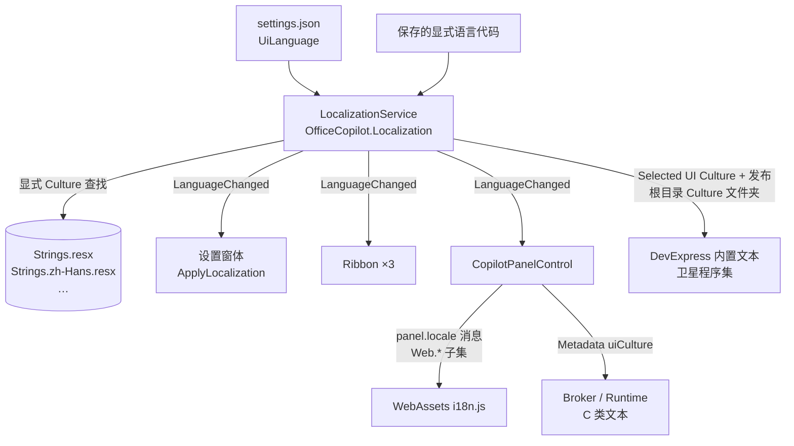
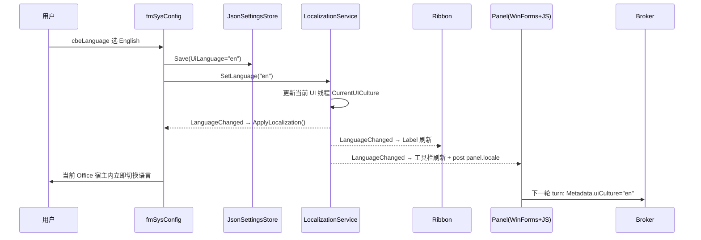

# 多语言（i18n）方案与开发步骤（Blueprint）

> 目标：整个产品（三个 VSTO 加载项 + 设置窗体 + 任务窗格面板 + Broker 用户可见文本）支持 **English / 简体中文 / 日本語 / Deutsch / Español** 切换，并为以后增加其他语言留好扩展点。入口为 [fmSysConfig](../OfficeCopilot.Settings.WinForms/fmSysConfig.cs) 的 `cbeLanguage` 下拉框。
>
> 原则：
> 1. **只有一个语言源**：一份设置 → 一个 `LocalizationService` → 所有 UI 层（WinForms / DevExpress / Ribbon / WebView2 / Broker）。
> 2. **自有文本不依赖线程 Culture**：自有字符串查找总是显式传入 Culture；只有 DevExpress 内置文本依赖 `CurrentUICulture`（见 §3.1）。
> 3. **只改 UI Culture，不改格式 Culture**：数字、日期、Excel 数据格式仍跟随 Office/Windows 的 `CurrentCulture`，避免影响计算与 VBA。
> 4. **面向用户的文本 ≠ 面向模型的文本**：内部工作流提示词以英文作为唯一维护版本，不按 UI 语言制作整套副本；只动态添加一条本地化的默认回答语言指令。输入匹配关键词与工具数据不随提示词策略改写（见 §2）。

## 实施进度（截至 2026-10-25）

**现已接入英语、简体中文、日语、德语（`de`）和西班牙语（`es`）。** 德语、西班牙语资源和回答语言策略已加入；DevExpress 官方 `de` / `es` 语言包仍需另行下载并放入安装包 staging，Office 实机界面布局仍待验收。

- 新增 `OfficeCopilot.Localization`（`netstandard2.0`），含 English 中性资源及 `zh-Hans` / `ja` / `de` / `es` 卫星资源和显式 Culture 查找；五种资源的键集合及复合格式占位符一致。无效或旧的 `auto` 设置归一为 English，区域代码分别规范为受支持的基础 Culture。
- 三个 VSTO 加载项启动时读取保存的 `UiLanguage`，设置当前 UI 线程的 `CurrentUICulture`；运行时切换也会立即设置当前 UI 线程，不修改 `CurrentCulture` 或 `DefaultThreadCurrentUICulture`。设置读取遇到 I/O、权限或安全异常时会记录警告并回退 English。
- 设置模型新增 `UiLanguage`，配置版本为 8；默认值为 English，旧配置和未知值归一为 English。
- `fmSysConfig.cbeLanguage` 提供 English / 简体中文 / 日本語 / Deutsch / Español；保存语言变化后立即刷新当前窗体，不再提示重启。WebView 的 `lang` 属性映射为对应区域 Culture。
- 自有 `OfficeCopilot.Localization.resources.dll` 由构建输出生成；`Stage-Package.ps1` 校验 `zh-Hans`、`ja`、`de` 和 `es` 卫星程序集已进入 staging。
- **按用户澄清，DevExpress 官方语言包需要下载，并在运行 `Stage-Package.ps1` 后手动复制到最终发布根目录对应的 Culture 子目录。** 脚本每次会重建 staging，因此复制操作必须在脚本之后；发布前需确认 `zh-Hans`、`ja`、`de` 和 `es` 的 DevExpress DLL 均存在。
- 已有设置窗体、校验消息、任务窗格 WinForms/WebView UI、附件筛选器、Broker 错误提示、TrustFooter、工具分组名及回答语言策略通过共享资源机制本地化；内置工具显示名和说明固定使用英文，避免与稳定的调用名混淆。新增语言需完成全量翻译和实际 Office 布局验收。
- Excel / Word / PowerPoint 的内置 Ask / Agent 提示词及运行时工作流指令以英文单一版本维护，运行时在最终 system prompt 开头按 UI 语言加入对应语种的默认回答语言指令。
- `HostSystemPromptStore` 会更新带有效 `.seed` 且未修改的旧默认副本；没有匹配 `.seed` 的非空文件或已编辑的提示词按用户自定义内容保留，不会自动覆盖。`fmSysConfig` 中的 Ask / Agent 提示词按钮只会在文件不存在时写入内置默认，然后用记事本打开；当前没有专用提示词编辑器或“恢复默认”按钮。
- 验证：完整解决方案 Debug 构建成功；完整 MSTest **980 通过 / 4 跳过 / 0 失败**；`i18n.js` 语法检查通过；所有语言资源键和复合格式占位符检查通过。三个 VSTO 宿主及 Broker 的 Debug 输出均生成 `de` / `es` 自有卫星程序集。DevExpress 官方 DLL 下载、staging 复制及 Office 实机布局/热切换验收仍待完成。

---

## 0. 现状盘点

### 0.1 语言入口

| 位置 | 现状 |
|---|---|
| [fmSysConfig.Designer.cs](../OfficeCopilot.Settings.WinForms/fmSysConfig.Designer.cs) | `grpLanguage` / `lbLanguage` / `cbeLanguage`（`ComboBoxEdit`，禁用文本输入）已布局 |
| [fmSysConfig.cs](../OfficeCopilot.Settings.WinForms/fmSysConfig.cs) | 已读写 `UiLanguage`；下拉项和标题/语言分组已使用资源 |
| [OfficeCopilotSettings.cs](../OfficeCopilot.Settings.Abstractions/OfficeCopilotSettings.cs) | 已增加 `UiLanguage`；`ConfigurationVersion = 8` |
| 全解决方案 | 共享本地化服务使用显式 Culture 查找；加载项启动和运行时切换均设置当前 UI 线程的 `CurrentUICulture`，但还没有 `Localizable=true` 的窗体 |

### 0.2 DevExpress 本地化资源

- DevExpress 26.1.3 通过安装目录 `$(ProgramW6432)\DevExpress 26.1\Components\Bin\Framework` 引用（[Settings.WinForms](../OfficeCopilot.Settings.WinForms/OfficeCopilot.Settings.WinForms.csproj)、[Panel.WebView](../OfficeCopilot.Panel.WebView/OfficeCopilot.Panel.WebView.csproj)、[Slides.Rendering](../OfficeCopilot.Slides.Rendering/OfficeCopilot.Slides.Rendering.csproj)）。
- 自有应用的资源程序集由 MSBuild 为 `zh-Hans` / `ja` / `de` / `es` 生成。**DevExpress 官方 `de` / `es` 语言包需另行下载**；不要假定本机 DevExpress 安装或历史 staging 中已包含可发布的对应文件。
- [Stage-Package.ps1](../installer/Stage-Package.ps1) 合并四个宿主输出目录并保留相对目录，检查自有 `zh-Hans` / `ja` / `de` / `es` 卫星程序集；官方 DevExpress 语言包由发布流程在 staging 完成后手动复制。
- 不需要自定义 `XtraLocalizer` / `QueryLocalizedString` 翻译层；DevExpress 提供的语言包目录负责内置控件文字。用户已确认控件会在语言切换后热更新。

### 0.3 硬编码中文规模（字符串字面量，排除测试 / Eval / 注释）

| 工程 | 文件 | 字面量 | 主要性质 |
|---|---:|---:|---|
| OfficeCopilot.Host.Excel | 80 | 1724 | 工具结果 / 校验信息（**面向模型为主**） |
| OfficeCopilot.Settings.WinForms | 24 | 773 | **设置窗体 UI**（`fmConfig` 174 + Designer 71 …） |
| OfficeCopilot.Host.PowerPoint | 24 | 587 | 工具结果 / Deck 说明（面向模型为主） |
| OfficeCopilot.Agent.Runtime | 35 | 523 | 混合：`TrustFooterBuilder`（用户可见）、`DefaultContextBuilder`（面向模型） |
| OfficeCopilot.Agent.Planning | 5 | 337 | **意图关键词**（匹配用户输入，禁止翻译） |
| OfficeCopilot.Panel.WebView | 21 | 269 | **面板 UI** + 附件提示 |
| OfficeCopilot.Settings | 4 | 134 | `BuiltInHostPrompts`（面向模型）+ `OfficeCopilotSettingsValidator`（用户可见） |
| OfficeCopilot.Slides.* | 19 | 189 | 预览窗体 / 渲染诊断 |
| Nixer{Excel,Word,Powerpoint}Copilot | 10 | 102 | **Ribbon、About、启动异常提示**（三份同构） |
| OfficeCopilot.Panel.WebAssets | 16 | ~70 | **前端 JS 文案**（按钮 title、状态、确认卡片） |
| 其余工程 | — | ~70 | 零散异常信息 |

结论：真正需要翻译的 **用户可见 UI 文本约 1300–1500 条**，集中在 Settings.WinForms、Panel.WebView、WebAssets、三个 VSTO 外壳和 Runtime 的少数文件；Host.Excel / Host.PowerPoint 的 2300+ 条大部分是喂给模型的，不在首批范围。

### 0.4 已有的“好习惯”（可直接复用）

- `cbeTrustMode`、`cbeTranscriptLogMode`、`cbeRuntimeLogLevel` 均按 **索引** 映射枚举，切换语言不影响已保存的设置值。
- 全仓库只有 [ExcelEvalRunner.cs](../OfficeCopilot.Eval/Excel/ExcelEvalRunner.cs) 用 `case "全量独立复核通过":` 比较显示文本——它依赖 `TrustFooterBuilder` 的中文输出，Phase 5 需同步处理。
- 面板与前端之间已有统一消息通道 [PanelWebViewBridge.cs](../OfficeCopilot.Panel.WebView/Presentation/PanelWebViewBridge.cs)（`PostWebMessageAsJson`），可直接承载语言包下发。
- Panel → Broker 的 [AgentBrokerTurnRequest](../OfficeCopilot.Agent.Client/AgentBrokerTurnRequest.cs) 已有 `Metadata` 字典，可零协议破坏地携带 `uiCulture`。

---

## 1. 目标行为

| 项 | 行为 |
|---|---|
| 可选语言 | `English` / `简体中文` / `日本語` / `Deutsch` / `Español`；列表由 `SupportedLanguages` 注册表生成 |
| 下拉显示 | 每种语言用**其自身语言**显示，与当前 UI 语言无关，避免用户切错后看不懂 |
| 存储 | `OfficeCopilotSettings.UiLanguage`，取值 `"en"` / `"zh-Hans"` / `"ja"` / `"de"` / `"es"`；区域代码规范为对应的受支持 Culture |
| 默认/异常值 | English；仅接受已注册的语言代码，未知值回退 English |
| 回退链 | 缺失翻译的 key 回退到中性资源（English），绝不显示 key 名或空串 |
| 生效时机 | 当前宿主内立即设置 UI Culture；DevExpress 已由用户验证可热切换。其他自有 UI 随后逐步接入 `LanguageChanged` |
| 不变的部分 | `CurrentCulture`（数字/日期格式）、会话历史内容、用户写的提示词与 Skill；模型默认按 UI 语言回答，用户明确指定其他回答语言时从其指定（见 §4.9） |

---

## 2. 文本分类与范围

每一条硬编码文本按下表归类，**只有 A/B/C 类进资源文件**。

| 类 | 定义 | 例子 | 处理 |
|---|---|---|---|
| **A. 静态 UI** | 窗体/控件/Ribbon 的 Caption、Text、Tooltip、列头 | `grpLanguage.Text = "语言"`、`btnTogglePane.Label = "显示面板"` | 资源化，`ApplyLocalization()` 统一赋值 |
| **B. 动态 UI 消息** | MessageBox、状态栏、校验错误、面板提示、前端按钮状态 | `"打开模型管理失败：" + ex.Message`、`'执行中'` | 资源化，带占位符 `{0}` |
| **C. 运行时用户可见文本** | Broker/Runtime 生成并展示给用户的文字 | `TrustFooterBuilder` 校验页脚、工具显示名 `DisplayName`、工具分组名、ask_user 默认按钮 | TrustFooter、分组名和按钮按每轮请求携带的 `uiCulture` 解析；内置工具显示名在所有语言下保持英文 |
| **D. 面向模型的文本** | 系统提示词、工具 description、工具结果、上下文注入 | `BuiltInHostPrompts`、`DefaultContextBuilder`、Host.Excel 工具返回信息 | 内置工具名称、description、Schema 参数说明及工作流指令统一以英文维护，不按 UI 语言复制；最终 system prompt 开头动态加入一条本地化默认回答语言指令（§4.9） |
| **E. 输入匹配关键词** | 用于匹配用户输入的词表/正则 | `StructuredExcelIntentClassifier`、`OfficeSkillCatalog`、“记住/记录下来” | **禁止翻译**；以后另立“多语言输入理解”专题补充英文关键词 |
| **F. 日志 / 诊断 / 注释** | `ILogger`、Trace、异常内部信息、代码注释 | `StartupTimingLog` | 不翻译（日志保持稳定以便检索） |

> 判定口诀：**“用户的眼睛会看到，并且它不会被送进模型或拿去做匹配”** → A/B/C；否则 D/E/F。
> 边界情况：TrustFooter 既展示给用户，又被 `TrustFooterBuilder` 的正则从模型输出中剥离、被 Eval 解析——属于 C，但正则需同时识别所有语言（§4.8）。

---

## 3. 关键技术约束

### 3.1 DevExpress 语言目录与 VSTO UI Culture

- **语言包目录放在最终发布根目录**，例如 `zh-Hans\DevExpress.XtraEditors.v26.1.resources.dll`；不要求 Excel / Word / PowerPoint 各自的中间 `bin` 都带一份。目录缺失时对应控件回退英文；新增语言时，将 DevExpress 下载包的相应 Culture 目录放入发布根目录。
- `cbeLanguage` 选择自有资源使用的 Culture，并在切换时立即设置当前 UI 线程的 `CurrentUICulture`，让 DevExpress 使用相同语言。用户已确认 DevExpress 控件可热切换，无需因 DevExpress 而重启 Office。
- 只修改 `Thread.CurrentThread.CurrentUICulture`，不修改 `CurrentCulture` 或 `DefaultThreadCurrentUICulture`，避免影响数字、日期及 Excel 数据处理。仍需验证不同宿主和其他加载项的影响边界。
- **自有文本**继续通过 `ResourceManager.GetString(key, explicitCulture)` 显式查找，不依赖线程 Culture。
- 不实现 `XtraLocalizer.QueryLocalizedString` 自定义翻译层，也不在每个事件入口临时切换/还原 Culture；优先使用 DevExpress 官方语言卫星程序集目录。
- `System.Windows.Forms.MessageBox` 的按钮文字跟随 Windows 语言，无法本地化。需要按钮也一致的场景改用 `XtraMessageBox`（受 DevExpress 本地化控制）。

### 3.2 Ribbon 早于 Startup 创建

VSTO 先调用 `CreateRibbonExtensibilityObject` 再触发 `ThisAddIn_Startup`；Ribbon Designer 的 `InitializeComponent` 会写入中文 Label。所以：

- Ribbon 可能先于 `ThisAddIn_Startup` 创建；当前启动引导在 `ThisAddIn_Startup` 应用已保存语言。若将来 Ribbon 在创建阶段就需要本地化资源，需把初始化前移并保持幂等。
- 语言设置在 `ThisAddIn_Startup` 读取并应用；支持显式 English / 简体中文 / 日本語 / Deutsch / Español，不依赖 Office UI 语言探测。
- Ribbon 在 `Load` 事件里调用 `ApplyLocalization()` 覆盖 Designer 的 Label；运行时修改 `RibbonButton.Label` 会自动刷新，天然支持即时切换。

### 3.3 多进程

| 进程 | 语言来源 |
|---|---|
| EXCEL / WINWORD / POWERPNT（各自一份 `LocalizationService`） | 共享的 settings JSON（[JsonSettingsStore](../OfficeCopilot.Settings/JsonSettingsStore.cs)） |
| Broker（每个 Office 窗口一个） | 启动参数 `--ui-culture` 作为默认值 + 每轮 `AgentBrokerTurnRequest.Metadata["uiCulture"]` 覆盖 |

- 语言切换立即作用于执行切换的 Office 宿主 UI 线程。已运行的 Word / PowerPoint 是独立进程，不会自动收到 Excel 进程中的内存事件；跨进程同步留待后续增强。
- Broker 是独立进程，可以放心设置自身的 `CurrentUICulture`，但因为同一 Broker 生命周期内语言可能变化，仍然以**每轮请求携带的值**为准。

### 3.4 布局

设置窗体大量使用绝对坐标（例如 `cbeLanguage.Location = (221, 26)`，宽 85），英文普遍比中文长 30%–100%。需要：

- Phase 0 Spike S3：用伪本地化（§7.3）跑一遍所有窗体截图，列出截断点。
- 修复手段优先级：控件 `AutoSize` / `AutoSizeInLayoutControl` → `LayoutControl` → 加宽固定宽度。**不**为每种语言维护独立布局（不启用 `Localizable=true` 的原因之一，见 §4.4）。

### 3.5 DevExpress 卫星程序集的版本

卫星程序集版本必须与主程序集**完全一致**（26.1.3.0）。DevExpress 升级时（对应 ARCHITECTURE §6.1 的 P0-5 版本漂移风险）必须同步更新语言包，否则静默回退为英文。

---

## 4. 总体设计



### 4.1 新工程 `OfficeCopilot.Localization`

- **netstandard2.0、SDK 格式、无任何依赖**，可被 net472 的 VSTO / WinForms / Broker / Runtime 全部引用。
- 内容：

| 类型 | 职责 |
|---|---|
| `SupportedLanguages` | 语言注册表：`en` / `zh-Hans` / `ja` / `de` / `es`，含区域代码规范化 |
| `LocalizationService`（静态门面 `L`） | `CurrentLanguage`、`Culture`、`Get(key)`、`Format(key, args)`、`GetForCulture(key, culture)`（Broker 用）、`event LanguageChanged`、`GetAll(prefix)`（给前端导出子集） |
| `Resources\Strings.resx` | 中性资源 = **English**，`PublicResXFileCodeGenerator` 生成强类型 `Strings.Settings_SysConfig_grpLanguage_Text` 等属性 |
| `Resources\Strings.zh-Hans.resx` | 简体中文 → 输出 `zh-Hans\OfficeCopilot.Localization.resources.dll` |
| `Resources\Strings.ja.resx` | 日本語 → 输出 `ja\OfficeCopilot.Localization.resources.dll` |
| `Resources\Strings.de.resx` | Deutsch → 输出 `de\OfficeCopilot.Localization.resources.dll` |
| `Resources\Strings.es.resx` | Español → 输出 `es\OfficeCopilot.Localization.resources.dll` |
| `[assembly: NeutralResourcesLanguage("en")]` | 中性资源即英文，避免英文环境下多一次卫星探测 |

> 为什么集中到一个工程而不是每个工程各自一份 resx：
> 1. 部署时每种语言**只多一个**自有卫星 dll，和 DevExpress 的 `zh-Hans` 放同一目录；
> 2. 翻译人员只面对一组文件，便于做 key 一致性测试；
> 3. 三个 VSTO 外壳的 Ribbon/About 文案相同，可共享 key（用 `{0}` 代入宿主名）。
>
> 代价是 UI 工程都要引用它——它没有依赖，可以接受。资源按 key 前缀分区，文件过大时可拆为 `Strings.Settings.resx` / `Strings.Panel.resx` / `Strings.Runtime.resx` / `Strings.Web.resx` 多个 ResourceManager，但对外仍是一个门面。

### 4.2 Key 命名规范

```
<区域>.<组件>.<元素>[.<属性>]
Common.Button.OK                      ← 跨窗体共享
Common.Error.OpenFailed               = "Failed to open {0}: {1}"
Ribbon.Group.Caption                  = "{0} Copilot"          （{0}=Excel/Word/PowerPoint）
Ribbon.btnModelConfig.Label           = "Models"
Settings.SysConfig.grpLanguage.Text   = "Language"
Settings.SysConfig.cbeTrustMode.Items = "Ask for confirmation|Always allow"   ← 列表项用 | 分隔，保持与枚举索引同序
Panel.Toolbar.btnNewChat.Caption
Web.ToolCall.State.Running            = "Running"
Runtime.TrustFooter.GradeA            = "Grade A: fully verified ({0})"
```

- 元素名直接用控件 `Name`，便于对照 Designer；带格式的文本必须用 `{n}` 占位，**禁止字符串拼接句子**（语序因语言而异）。
- `Web.*` 前缀的 key 会整体下发给前端。

### 4.3 设置与 `cbeLanguage`

1. [OfficeCopilotSettings](../OfficeCopilot.Settings.Abstractions/OfficeCopilotSettings.cs) 增加 `public string UiLanguage { get; set; }`，默认值见 §9 决策 Q1；`ConfigurationVersion` 7 → 8；`OfficeCopilotSettingsFactory.Normalize` 把空值/未知值归一为默认值。
2. [fmSysConfig](../OfficeCopilot.Settings.WinForms/fmSysConfig.cs)：
   - `WireEvents` 中用 `SupportedLanguages` 填充 `cbeLanguage`（条目为 `{Code, NativeName}` 对象，显示 `NativeName`），并挂 `EditValueChanged += GeneralSetting_Changed`。
   - `BindGeneralSettings` / `ApplyGeneralSettings` 读写 `UiLanguage`。
   - 已接通：保存后调用 `LocalizationService.SetLanguage(code)`，立即更新当前 UI 线程的 `CurrentUICulture` 并刷新本窗体语言文本；不提示重启。
3. 现有中文下拉项（`"禁用", "仅元数据"…`、`"提示确认", "始终放行"`）改为从资源读取，**仍按索引映射**，保存值不受语言影响。

### 4.4 WinForms / DevExpress 窗体：代码驱动的 `ApplyLocalization()`

**不使用** Visual Studio 的 `Localizable = true`，原因：

- 它为每种语言生成一份包含**布局属性**的 `.resx`，13+ 个窗体 × N 种语言，改布局要改 N 份；
- Designer 对 DevExpress 复杂控件（BarManager、LayoutControl、Grid 列）的本地化序列化容易产生大 diff，且与现有 `fmXxx.resx` 冲突；
- 无法运行时切换（需要重建窗体）。

**采用**：每个窗体/用户控件实现

```csharp
internal interface ILocalizable
{
    void ApplyLocalization();
}

public partial class fmSysConfig : HostAwareForm, ILocalizable
{
    public void ApplyLocalization()
    {
        Text = L.Get("Settings.SysConfig.Text");
        grpLanguage.Text = L.Get("Settings.SysConfig.grpLanguage.Text");
        lbLanguage.Text = L.Get("Settings.SysConfig.lbLanguage.Text");
        ceAutoCompactEnabled.Properties.Caption = L.Get("Settings.SysConfig.ceAutoCompactEnabled.Caption");
        // ComboBox 条目：保持 SelectedIndex，替换文本
        LocalizationUi.ReplaceItems(cbeTrustMode, "Settings.SysConfig.cbeTrustMode.Items");
        // ...
    }
}
```

- 在构造函数 `InitializeComponent()` 之后调用一次；订阅 `LocalizationService.LanguageChanged`（窗体关闭时退订）。
- `HostAwareForm` 基类统一做订阅/退订，子类只写 `ApplyLocalization()`。
- Designer 里的中文**保留不动**（设计时可读），运行时被覆盖；等全部窗体迁移完成后，可选择把 Designer 文本批量改为英文。
- 提供一个**开发期辅助工具**（Phase 1 交付）：遍历窗体控件树，导出 `Name → Text/Caption/Hint` 为 resx 草稿，减少手工抄写 773 条。

### 4.5 DevExpress 内置文本与卫星程序集部署

1. DevExpress 语言包由用户从官方 Localization Service 下载；不把第三方卫星程序集逐个复制到各个 VSTO 工程的中间输出。
2. 发布人员在运行 [Stage-Package.ps1](../installer/Stage-Package.ps1) 后，将官方下载的 `<Culture>` 文件夹复制到 `installer\staging\<Culture>\`；脚本会重建 staging，因此复制操作必须在脚本之后。
3. `Stage-Package.ps1` 校验自有 `zh-Hans` / `ja` / `de` / `es` `OfficeCopilot.Localization.resources.dll` 已合并到 staging；发布人员必须在 staging 后复制下载的 DevExpress DLL，并确认对应 Culture 文件夹已存在。不要求每个宿主的独立 `bin` 都重复携带 DevExpress 语言包。
4. 本次启用 `de` / `es`，并保留已有 `ja`；仅将实际发布支持的语言包复制到安装包，避免额外包体积。
5. DevExpress 使用发布根目录中的官方 Culture 卫星程序集；启动和运行时切换均按显式设置更新当前 UI 线程的 UI Culture。

### 4.6 VSTO 外壳（Ribbon / About / 启动提示）

- 三个 `*CopilotRibbon` 的 `Load` 中调用 `ApplyLocalization()`，订阅 `LanguageChanged` 即时刷新；所有 `SetExcelWaitCursor("正在打开…")`、`MessageBox.Show("打开…失败")` 改为 `L.Format("Common.Status.Opening", L.Get("Ribbon.btnModelConfig.Label"))` 之类的共享 key。
- `AboutDialog` 三份同构，共用 `About.*` key。
- ARCHITECTURE R4/R5 已说明 `ThisAddIn` / Ribbon 三份复制有意保留；本方案只把**文本**集中到共享 key，不强行抽基类。可选地抽一个 `RibbonLocalizer.Apply(RibbonBase ribbon, string hostDisplayName)` 静态帮助方法按控件 `Name` 批量赋值，三份 Ribbon 各一行调用。

### 4.7 任务窗格面板（WinForms 部分 + WebView2 前端）

**WinForms 部分**（[CopilotPanelControl](../OfficeCopilot.Panel.WebView/CopilotPanelControl.cs) 及其 partial、`AskUserQuestionDialog`、`PlanApprovalDialog`、`PanelModelMenuPresenter`）：

- 工具栏 `BarButtonItem` / `BarSubItem` Caption、`txtChat` 占位符（`CopilotPanelControl.Placeholder.cs`）、附件/错误提示全部走 `L`。
- 面板实现 `ILocalizable`，`LanguageChanged` 时刷新工具栏并向前端推送新语言包。

**WebView2 前端**（[wwwroot/js](../OfficeCopilot.Panel.WebAssets/wwwroot/js)）：

- 新增 `js/i18n.js`：

```js
const dict = Object.create(null);
let lang = 'en';
export function setLocale(next, strings) { lang = next; Object.assign(dict, strings); document.documentElement.lang = next; applyStatic(); }
export function t(key, ...args) { const s = dict[key] ?? key; return s.replace(/\{(\d+)\}/g, (_, i) => args[i] ?? ''); }
function applyStatic() { document.querySelectorAll('[data-i18n-title]').forEach(el => { el.title = t(el.dataset.i18nTitle); el.setAttribute('aria-label', el.title); }); }
```

- 语言包来源：**由 C# 端下发**，消息类型 `panel.locale`，内容为 `LocalizationService.GetAll("Web.")` 在当前语言下（含回退）的字典。这样前端文案与 WinForms 文案**共用同一套 resx**，翻译人员无需维护第二种格式。
- 首次加载：在现有 ready 握手后立即发送一次；`main.js` 在收到语言包前渲染的内容使用 `t()` 的 key 回退（或短暂延迟首屏渲染）。
- 需要改造的文件：`markdown.js`、`tool-calls.js`、`tool-confirmation-ui.js`、`code-blocks.js`、`code-execution-state.js`、`scroll.js`、`clipboard.js`、`state.js`（`THINKING_ACTIVE_LABEL` 等常量改为函数）、`index.html`（`lang` 动态设置）。
- 已渲染的历史气泡中**由前端生成的标签**（如“已完成”“查看备份”）可通过 `data-i18n-*` 属性在切换时重刷；消息正文不变。

### 4.8 Broker / Runtime 的用户可见文本（C 类）

- Panel 在构造 `AgentBrokerTurnRequest` 时写入 `Metadata["uiCulture"] = L.CurrentLanguage.Code`；`BrokerRuntimeHost` 启动 Broker 时追加 `--ui-culture <code>` 作为默认值（用于非 turn 请求，如会话列表标题生成失败提示）。
- Runtime 侧引入 `IUserTextLocalizer`（实现即 `LocalizationService.GetForCulture`），通过 turn 上下文传递，**不读线程 Culture**。
- 需要改造的点：
  - [TrustFooterBuilder](../OfficeCopilot.Agent.Runtime/Verification/TrustFooterBuilder.cs)：页脚文字资源化；剥离用的正则改为同时匹配所有已支持语言（`校验|Verification`、`口径|Basis` …），否则切换语言后旧会话里的页脚剥不掉。
  - [ExcelEvalRunner](../OfficeCopilot.Eval/Excel/ExcelEvalRunner.cs) 解析等级的 `case "全量独立复核通过"` 改为解析**结构化等级**（A/B/C）而不是显示文本。
  - 工具 `DisplayName`（67 处，Host.Excel / Host.PowerPoint）：只用于确认卡片与工具调用卡片标题时资源化（key = `Tool.<toolName>.DisplayName`）；工具 `Description` 属 D 类不动。
  - 确认对话框 / ask_user 的默认按钮文案、Broker 返回给面板的错误提示（`HostBridgeErrorCodes` 对应的人类可读消息）。
  - [OfficeCopilotSettingsValidator](../OfficeCopilot.Settings/OfficeCopilotSettingsValidator.cs)（30 条，显示在设置窗体）。
- **原则**：Broker 发给面板的事件尽量携带“错误码 + 参数”，由面板在本地按当前语言格式化；只有确实只能在 Broker 生成的整段文字（如 TrustFooter）才在 Broker 端按 `uiCulture` 渲染。

### 4.9 面向模型的文本与“回答语言”策略（D/E 类）

- 系统提示词、工具 description、工具结果、上下文注入等 D 类内容不按 UI 语言制作整套翻译副本，以免行为漂移；宿主默认提示、运行时工作流指令、记忆抽取、子代理、验证/重试及跨轮上下文提示统一以英文维护。
- `DefaultContextBuilder` 在最终 system prompt 的最前面注入一条本地化的默认回答语言指令：English / 简体中文 / 日语 / 德语 / 西班牙语界面分别默认使用对应语言回答。该默认规则优先于宿主或其他系统提示中的冲突语言要求；用户明确要求其他回答语言时，以用户要求为准。
- 已有 `Excel.ask.txt` / `Excel.agent.txt` 等非空提示词文件若没有匹配 `.seed` 或被编辑过，会按用户自定义内容保留；不会因升级而静默覆盖。当前没有恢复默认 UI。对确认仍是旧内置内容的文件，可先备份，再手动清空或删除；空文件会回退到新版内置提示词。不要对含有用户自定义内容的文件执行此操作。
- 后续可选（独立专题，不在本蓝图内）：
  - `HostSystemPromptStore` 支持按语言的默认提示词文件（`excel.agent.en.md`）；
  - E 类意图关键词补充英文同义词（`StructuredExcelIntentClassifier`、`OfficeSkillCatalog`、“记住 / remember”）并配套 harness 用例。

---

## 5. 语言切换流程



| 界面 | MVP（Phase 1–4） | 完整版（Phase 7） |
|---|---|---|
| 当前进程的 DevExpress 控件 | 即时（用户已实测） | 即时 |
| 自有 Ribbon / `fmSysConfig` 文本 | 即时 | 即时 |
| 其他设置窗体 / 面板文本 | 接入 `LanguageChanged` 后即时；尚未迁移的文案保持原样 | 即时 |
| 其他 Office 进程（Word/PPT） | 不跨进程同步；需在该进程重新加载设置或重启 | `FileSystemWatcher` 检测设置变化后即时 |
| Broker 文本 | 下一轮对话 | 下一轮对话 |

---

## 6. 分阶段实施计划

每个阶段可独立合并、独立验收；括号内为约略的字符串数量，便于估算工作量。

### Phase 0 · 技术验证（Spike，不合并到主干）

| ID | 验证内容 | 通过标准 |
|---|---|---|
| S1 | 在三个 Office 宿主验证：启动时按保存语言设置 UI Culture，运行时切换后 DevExpress 从发布根目录对应文件夹即时加载资源；确认线程 Culture 对 Office/其他加载项的影响边界 | 用户已验证 DevExpress 可以热切换；仍需覆盖三个宿主并确认影响边界 |
| S3 | 伪本地化截图：把 Settings 13 个窗体 + 面板的文本替换为加长 40% 的伪文本 | 输出截断清单，作为 Phase 3 的布局修复输入 |
| S4 | 按现有发布流程先运行 `Stage-Package.ps1`，再手动复制下载的 DevExpress Culture 文件夹到 staging / 最终发布根目录，并验证多个 Culture 可并存 | 每种启用语言的 DevExpress satellite DLL 位于最终发布根目录对应子目录，控件能读取相应语言 |

### Phase 1 · 基础设施（MVP 骨架）

1. 新建 `OfficeCopilot.Localization`（netstandard2.0），加入 sln；实现 §4.1 的类型与中性及卫星资源。
2. `OfficeCopilotSettings.UiLanguage` + 版本迁移 + Normalize。
3. 三个 `ThisAddIn_Startup` 调用 `LocalizationBootstrap.Initialize`；读取保存的显式 `UiLanguage`，默认 English。
4. 启动和运行时切换均设置当前 UI 线程 `CurrentUICulture`、保留 `CurrentCulture`；不引入自定义 DevExpress Localizer。跨宿主及第三方加载项影响仍在 S1 验证。
5. `Stage-Package.ps1` 保留合并宿主输出的 Culture 子目录，并校验自有简体中文卫星程序集；官方下载的 DevExpress Culture 文件夹按现有流程在 staging 后手动复制。不要求三个加载项的独立输出目录重复携带 DevExpress 语言包。
6. `fmSysConfig.cbeLanguage` 的语言选择、持久化、当前窗体热刷新及窗体其余可见文本已接通。
7. `HostAwareForm` 增加 `ILocalizable` 订阅/退订基础设施；开发期“控件文本导出 resx 草稿”工具。

**验收**：三个宿主中切换五种已支持语言均即时应用；DevExpress 内置文本及已迁移的自有 UI 使用对应语言；最终发布根目录包含启用语言的 Culture 文件夹；旧配置中的 `auto` 及无效值安全迁移为 English。

### Phase 2 · VSTO 外壳（~100 条，三份共享约 40 个 key）

**代码已完成**：Ribbon ×3、AboutDialog ×3、ThisAddIn 启动及 Excel 保护恢复提示已改用共享中英资源；Ribbon 订阅 `LanguageChanged`，当前宿主内即时刷新。
**验收**：三个 Office 宿主中的 Ribbon 已由用户手测通过；About 和启动提示仍需在 English / 简体中文下实机验证。本轮代码已构建并通过完整测试。

### Phase 3 · 设置窗体（~770 条）

顺序：`fmConfig`、`fmModelConfig` / `fmModelEditor`、`fmMcpConfig` / `fmMcpEditor`、`fmSkillsConfig` / `fmSkillEditor`、`fmMemoryConfig`、`fmBuiltinToolConfig` / `fmToolEditor` 均已迁移；`fmSysConfig`、`OfficeCopilotSettingsValidator` 及共用菜单提示也已完成。窗体保留未保存值并在语言切换时刷新；模型和 Skill PropertyGrid 的类别、属性名、描述支持即时切换。
**验收**：代码和资源构建通过；实际 Office 下逐窗体的无截断 / 无残留截图检查仍待手测。

### Phase 4 · 面板（~270 C# + ~70 JS）

`CopilotPanelControl`（含 AttachmentReferences / CodeExecution / ToolSafety / Placeholder partial）、`AskUserQuestionDialog`、`PlanApprovalDialog`、`PanelModelMenuPresenter`、`BrokerToPanelConverter` 中的可见文本；附件文件筛选器；WebAssets `i18n.js` 与 `panel.locale` 消息；`index.html` 的 `lang`。共 166 个 `Web.*` 文案由共享 resx 下发，五种支持语言均提供资源。
**验收**：代码完成；WebView 接收初始语言并在切换时即时刷新，用户 / 模型消息正文和协议值保持原样。实际 Office WebView 手测仍待执行。

### Phase 5 · Broker / Runtime 用户可见文本

`uiCulture` 透传到 Broker turn；共享 resx 驱动的 `IUserTextLocalizer`；`TrustFooterBuilder`（含双语剥离正则）；内置工具 `DisplayName`（各 UI 语言保持英文）和工具分组名；Broker→Panel 错误码化；`ExcelEvalRunner` 改为解析结构化等级。
**验收**：代码和 TrustFooter / Eval 相关测试通过；五种 UI Culture 下 TrustFooter、工具分组名和错误提示按语言生成，内置工具显示名保持一致的英文，旧语言页脚均可剥离。

### Phase 6 · 模型回答语言策略

`DefaultContextBuilder` 在最终 system prompt 最前面注入本地化的默认回答语言指令：优先遵从用户明确指定的回答语言，否则按 UI 语言对应的英语 / 简体中文 / 日语 / 德语 / 西班牙语回答；未知 UI 语言回退 English。Excel / Word / PowerPoint 六种内置宿主提示词以及运行时工作流指令统一用英语维护。单元测试覆盖语言指令内容、顺序和默认提示词语言；需要真实模型调用的回归仍是发布前验收项。

### Phase 7 · 加固与扩展

- 即时切换补全（其他窗体订阅、`FileSystemWatcher` 跨宿主同步）。
- 伪本地化语言 `qps-ploc` 作为隐藏选项（仅 Debug 构建可见）。
- 翻译流程：resx ↔ XLIFF/Excel 导入导出脚本，交给翻译人员。
- “新增一种语言”检查清单：`SupportedLanguages` 注册代码和区域别名 → 加完整资源文件 → 验证语言选择与模型回答指令 → Stage 校验自有卫星程序集 → 下载并复制对应 DevExpress Culture DLL → 运行资源、构建和 Office 冒烟测试。

---

## 7. 测试与质量门禁（加入 `OfficeCopilot.Agent.Tests`）

### 7.1 资源一致性测试

- 每种语言的 resx key 集合与中性资源**完全一致**（多出 = 废弃 key，缺少 = 漏翻）。
- 同一 key 在各语言中的占位符 `{n}` 集合一致；`|` 分隔的列表项数量一致（防止 ComboBox 索引错位）。
- `SupportedLanguages` 中每种语言都有对应 resx；旧值 `auto` / 无效值回退 English；`zh-CN` / `zh-SG`、`ja-JP`、`de-DE` 和 `es-ES` 规范化到受支持的 Culture。

### 7.2 “禁止新增硬编码 UI 中文”门禁

- 扫描 **A/B/C 类工程**（Settings.WinForms、Panel.WebView、Panel.WebAssets、三个 VSTO 外壳）中非注释、非 `*.Designer.cs` 的 CJK 字符串字面量，与一份 allowlist（迁移期存量）比对；数量只能减少不能增加。迁移完成后 allowlist 清空。
- D/E/F 类工程不纳入扫描。

### 7.3 伪本地化

- `qps-ploc` 资源由构建脚本从中性资源自动生成：加 `[` `]` 包裹、元音加重音、长度 +40%。任何未包裹的文本 = 遗漏；任何被裁掉的 `]` = 截断。

### 7.4 回归

- 设置文件 v7 → v8 迁移测试；`UiLanguage` 空/非法值归一化测试。
- `TrustFooterBuilder` 双语剥离测试；`ExcelEvalRunner` 结构化等级解析测试。
- 现有 118+ 用例与 harness 基线在 `UiLanguage=zh-Hans` 下必须与改造前一致。

---

## 8. 风险与对策

| 风险 | 影响 | 对策 |
|---|---|---|
| 修改 Office 主线程 UI Culture 影响其他加载项 | 其他厂商加载项语言异常，用户投诉难定位 | Phase 0 S1 在三个宿主验证；只改当前 UI 线程的 `CurrentUICulture`，不改 `CurrentCulture` / 默认线程 Culture |
| 最终发布根目录缺少所选 Culture 文件夹 | DevExpress 控件回退英文 | Stage-Package 按最终发布目录校验语言包；下载来源通过 `$(DevExpressLocalizationDir)` 显式配置 |
| DevExpress 升级后语言包版本不匹配 | 静默回退英文 | staging 检查语言包与当前 DevExpress 版本兼容；与 P0-5 一并治理 |
| 英文文本更长导致绝对布局截断 | 界面难看/文字不可读 | S3 伪本地化截图 + 门禁；优先 AutoSize / LayoutControl |
| 翻译 D 类提示词导致 Agent 行为漂移 | harness 回归失败 | 明确 D 类不翻译，只加“回答语言”指令 |
| TrustFooter 文本变化破坏剥离与 Eval | 页脚重复、Eval 误判 | 双语正则 + 结构化等级 |
| `fmConfig` 等大窗体迁移工作量大且易漏 | 中英混杂 | 控件文本导出工具 + §7.2 门禁 + 伪本地化 |
| 语言包授权 / 来源 | DevExpress 本地化资源随应用分发属授权范围，下载目录需明确 | 使用 DevExpress 官方下载，并由 `$(DevExpressLocalizationDir)` 指定外部来源 |

---

## 9. 待决策问题

| # | 问题 | 选项 | 建议 |
|---|---|---|---|
| Q1 | `UiLanguage` 默认值 | `en` / `zh-Hans` | **已确认：`en`**；旧配置的 `auto` 归一为 `en` |
| Q2 | 中性资源语言 | English / 简体中文 | **English**：符合 .NET 与 DevExpress 惯例，未来新增语言缺翻译时回退到英文比回退到中文更通用。代价：Phase 1 起需先把现有中文翻成英文 |
| Q3 | DevExpress 语言包来源 | 外部下载目录 / 由发布人员直接放入 staging | **已确认：**运行 `Stage-Package` 后，由发布人员手动复制到 staging |
| Q4 | 切换后的生效时机 | 重启 Office / 当前界面即时刷新 | **已确认：**当前 Office 宿主内即时切换 |
| Q5 | 即时切换的程度 | MVP 重启生效 / 全量即时 | **已确认：**已翻译界面均按当前语言即时刷新；其他 Office 进程跨进程同步另行实现 |
| Q6 | 是否打包 DevExpress 的 de/es/ja | 仅打包已启用语言 | **已确认：**按发布语言集合下载并复制官方 Culture 文件夹；本次启用 `de` / `es`，日语 `ja` 保持支持 |

---

## 10. 工时预估

> 单位：人日（1 名熟悉本代码库的开发者，含自测，不含评审等待）。字符串迁移按“抽取 + 接线 + 英文初译 + 自测”约 120–180 条/人日估算，英文初译可借助 AI 生成后人工校对。

| 阶段 | 主要工作 | 乐观 | 悲观 | 说明 |
|---|---|---:|---:|---|
| Phase 0 · Spike | S1 UI Culture 影响验证 1–1.5 / S3 伪本地化截图 1 / S4 发布根目录语言包验证 0.5 | 2.5 | 3.5 | 不再实现自定义 `QueryLocalizedString` 方案 |
| Phase 1 · 基础设施 | 新工程 + 服务 1.5 / 设置字段与迁移 0.5 / 启动语言读取与 UI 线程热切换 1 / DevExpress Culture 接线 0.5–1.5 / staging 自有卫星程序集校验 0.5 / `fmSysConfig` 样板 1 / `ILocalizable` + 文本导出工具 1–1.5 | 6 | 8 | DevExpress 官方语言目录由发布人员在 staging 后复制 |
| Phase 2 · VSTO 外壳 | ~100 条，三宿主共享 key；三宿主各验证一遍 | 1.5 | 2 | |
| Phase 3 · 设置窗体 | ~770 条 / 11 个窗体 5–7；英文截断修复 2–3；校验器与显示名 1 | 8 | 11 | `fmConfig` 最重；若需改用 LayoutControl 重排可再 +2–3 |
| Phase 4 · 面板 | C# ~270 条 2–3；`i18n.js` + `panel.locale` + 即时刷新 2–3；JS ~70 条与回归 1 | 5 | 7 | |
| Phase 5 · Broker / Runtime | `uiCulture` 透传 1；TrustFooter 双语 + Eval 结构化 1.5–2；工具 DisplayName 67 处 1–1.5；错误码化 0.5–1.5 | 4 | 6 | |
| Phase 6 · 回答语言 | 指令注入 0.5；中英两套 harness 回归 1–2 | 1.5 | 2.5 | harness 跑批耗时视模型额度 |
| Phase 7 · 加固 | 全量即时切换 + 跨宿主同步 1.5–2；伪本地化构建 1；一致性/门禁测试 1–1.5；翻译导入导出脚本 0.5–1.5 | 4 | 6 | 可按需裁剪 |
| 翻译校对 | ~1400 条英文终稿校对（术语表统一） | 2 | 3 | 外包专业翻译则转为外部周期 |
| 联调与回归 | 三宿主 × 两语言冒烟、安装包验证 | 3 | 4 | |
| **合计** | | **38** | **54** | **约 8–11 周（单人）** |

**里程碑拆分：**

| 里程碑 | 包含 | 人日 | 单人日历 |
|---|---|---:|---|
| M1 · 可切换（MVP） | Phase 0–2 + `fmSysConfig` | 11–14 | 2.5–3.5 周 |
| M2 · 界面全量英文 | + Phase 3–4 + 翻译校对 + 回归 | 29–41 | 6–9 周 |
| M3 · 完整版 | + Phase 5–7 | 38–54 | 8–11 周 |

**并行：** Phase 1 完成后，Phase 3（设置窗体）与 Phase 4/5（面板 + Broker）互不依赖，2 人并行可把 M3 压缩到 **约 5–7 周**。

**主要不确定性：**

- S1 发现 UI Culture 不能安全热切换、需要加强重启流程：+1–2 人日。
- 绝对布局截断严重、需把大窗体改为 `LayoutControl`：+3–5 人日。
- 迁移期间设置窗体/面板仍在频繁改动：合并冲突与重复抽取，建议迁移某窗体期间冻结其功能改动。

---

## 附录 A · 受影响文件清单（按阶段）

| 阶段 | 新增 | 修改 |
|---|---|---|
| 1 | `OfficeCopilot.Localization\*`、`OfficeCopilot.Settings.WinForms\LocalizationBootstrap.cs`、`ILocalizable` | `OfficeCopilotSettings.cs`、`OfficeCopilotSettingsFactory`、`fmSysConfig.cs`、`HostAwareForm.cs`、三个 `ThisAddIn.cs`、`Stage-Package.ps1`、`NixerOfficeCopilot.sln` |
| 2 | — | 三个 `*CopilotRibbon.cs`、三个 `AboutDialog.cs`、三个 `ThisAddIn.cs` |
| 3 | — | `OfficeCopilot.Settings.WinForms\fm*.cs`（11 个窗体）、`GridContextMenuHelper.cs`、`OfficeCopilotSettingsValidator.cs`、`HostApplicationNames` |
| 4 | `wwwroot\js\i18n.js` | `CopilotPanelControl*.cs`、`AskUserQuestionDialog.cs`、`PlanApprovalDialog.cs`、`PanelModelMenuPresenter.cs`、`PanelWebViewBridge.cs`、`BrokerToPanelConverter.cs`、`wwwroot\js\*.js`、`index.html` |
| 5 | `IUserTextLocalizer` | `AgentBrokerTurnRequest` 使用方、`BrokerRuntimeHost.cs`、`BrokerConfig.cs`、`TrustFooterBuilder.cs`、工具 `DisplayName`（英文值）和分组名、`ExcelEvalRunner.cs` |
| 6 | — | `DefaultContextBuilder.cs` |

## 附录 B · 新增一种语言的步骤（目标状态）

1. `SupportedLanguages` 增加语言代码及区域别名，更新 `fmSysConfig` 语言选项与索引映射；不根据 Office UI 语言自动选择。
2. 新增 `Strings.<code>.resx` 并翻译所有资源键；未翻译键会回退 English，但正式支持前应通过 §7.1 一致性测试并人工审校。
3. 确认构建生成 `<code>\OfficeCopilot.Localization.resources.dll` 并由 `Stage-Package.ps1` 校验；从 DevExpress 官方 Localization Service 下载对应语言卫星程序集。
4. 更新回答语言策略、语言切换测试、TrustFooter/工具分组名等依赖语言的行为；工具显示名保持英文，并验证 WebView `GetAll` 的完整资源回退。
5. 伪本地化与三宿主截图检查；按需补充 E 类关键词（独立专题）。
