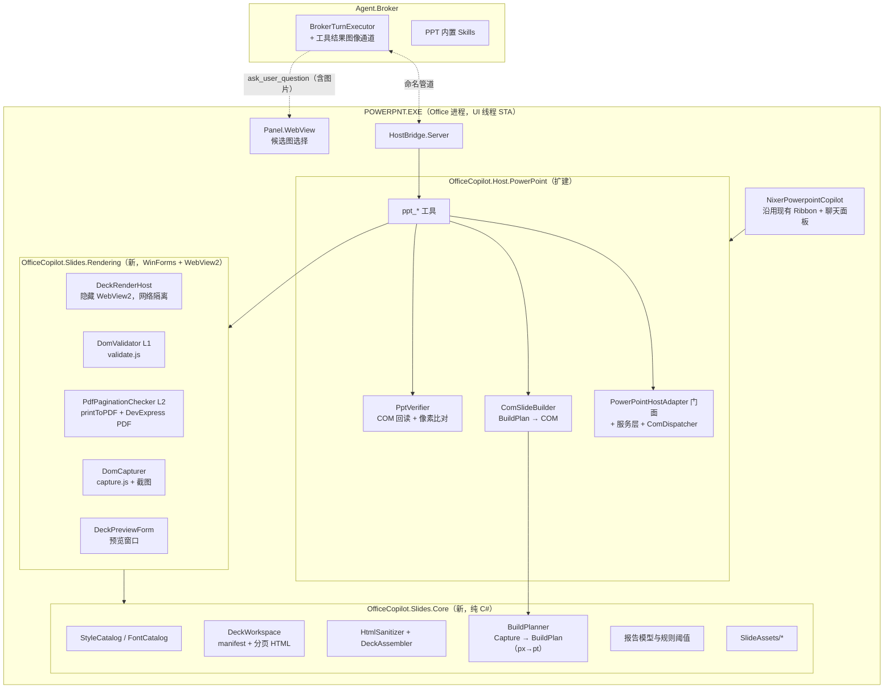
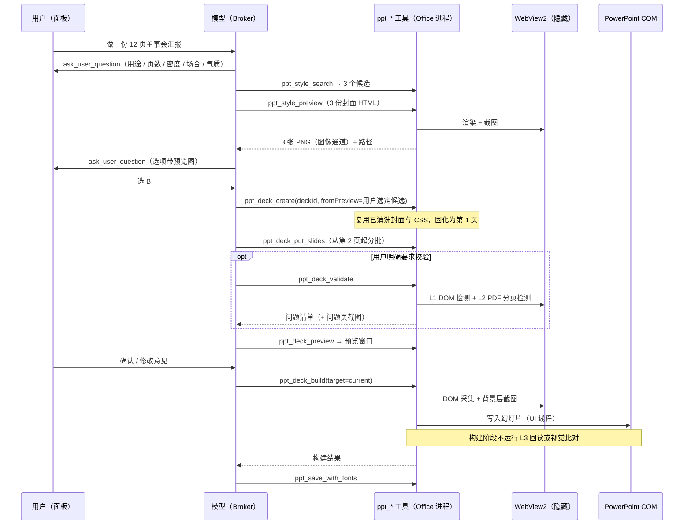

# NixerPowerpointCopilot 开发蓝图（AI + COM：HTML 设计 → 浏览器预览 → 构建 PPT）

> 用途：**实施蓝图**。定义 PowerPoint 插件从"2 个上下文工具的空壳"到"可设计、可预览、可自检、可构建原生 PPT 的 Agent"的完整路径。
> 状态：**决策已确认（2026-09-30，见 §1.4）**，进入实施；遗留问题见 §13。
> 设计蓝本：[PPTskill/beautiful-html-templates](PPTskill/beautiful-html-templates)（MIT）与 [PPTskill/frontend-slides](PPTskill/frontend-slides)（MIT，经用户确认）。两者素材择优合并入项目（§3）。
> 相关文档：[ARCHITECTURE.md](ARCHITECTURE.md) · [CODE_MAP.md](CODE_MAP.md) · [EXCEL_AGENT_HARNESS_PLAN.md](EXCEL_AGENT_HARNESS_PLAN.md)
> 文件编码约定：全仓库 UTF-8 无 BOM。

---

## 目录

1. [目标与范围](#1-目标与范围)
2. [现状盘点（已核实）](#2-现状盘点已核实)
3. [素材择优合并](#3-素材择优合并)
4. [总体架构](#4-总体架构)
5. [核心设计](#5-核心设计)（含 §5.5 溢出检测：DOM / PDF 分页 / PPT 回读）
6. [工具清单](#6-工具清单)
7. [Skill 与提示词](#7-skill-与提示词)
8. [公共层改动（Runtime / Planning / Settings / Panel）](#8-公共层改动runtime--planning--settings--panel)
9. [分阶段实施](#9-分阶段实施)
10. [测试与验收](#10-测试与验收)
11. [风险清单](#11-风险清单)
12. [手动操作清单（由用户执行）](#12-手动操作清单由用户执行)
13. [仍待确认的问题](#13-仍待确认的问题)
14. [附录 A：代码实况索引](#附录-a代码实况索引)

---

## 1. 目标与范围

### 1.1 产品定位

在 PowerPoint 进程内，以 **LLM 负责"内容与设计决策"、确定性 C# 渲染器负责"像素落位"** 的分工，完成三类任务：

| 场景 | 输入 | 输出 | 典型指令 |
|---|---|---|---|
| **生成** | 主题 / 大纲 / 附件（Word、PDF、Excel）/ 选中文本 | 一整套新幻灯片 | "根据这份报告做 12 页董事会汇报" |
| **美化** | 已有演示文稿（内容已定，版式粗糙） | 同内容、套用设计系统后的幻灯片 | "把这份 PPT 改成 Signal 风格" |
| **编辑** | 当前页 / 选中形状 | 局部修改 | "第 5 页改成三栏对比""这页字太多，拆成两页" |

### 1.2 核心路线

```
需求澄清 → 选风格（面板内 3 张候选封面图）→ 大纲确认
  → 模型按所选模板的设计系统逐页编写 HTML（1920×1080 固定舞台）
  → 浏览器预览窗口（用户确认 / 提修改意见）
  → DOM 采集 → 构建计划 → COM 写入当前演示文稿（背景栅格层 + 原生可编辑文字 / 图片 / 表格 / 图表）
  → 嵌入字体保存

`ppt_deck_validate` 的 L1/L2 内容校验可由用户单独要求；`ppt_deck_build` 不自动运行内容校验或构建后的 PowerPoint 回读/视觉验证。
```

1. **HTML 是设计中间态，PPT 是交付物**。模型用 HTML/CSS 发挥两套 skill 的全部设计知识，确定性的 C# 转换器负责落地。
2. **生成与验证不同源**（沿用 [EXCEL_AGENT_HARNESS_PLAN.md §2.1](EXCEL_AGENT_HARNESS_PLAN.md)）：HTML 校验可由用户明确要求后独立运行；构建只负责转换与写入，不自动触发 HTML 校验或 PPT 回读/像素比对。
3. **美观优先**：保真分层（装饰进背景层、文字原生可编辑）；开源字体随包分发并在保存时嵌入。
4. **全私有化**：渲染用本机 WebView2，只允许访问本地虚拟主机，拦截一切外网请求。
5. **可往返**：由 Deck 构建的每页都带标签，可回到 HTML 修改后原位重建。

### 1.3 非目标

- 不做 Vercel 部署，不依赖 Node / Playwright / Python（原 skill 的 `scripts/` 全部由 C# + WebView2 + COM 取代）。
- 不支持企业 .potx 模板作为设计来源（Q9）。
- 不做任意 HTML → PPT 的通用转换，只保证符合《HTML 创作契约》（§5.2）的 HTML。
- CSS 动画首期不转为 PPT 动画（预览中可见，构建时取终态）。

### 1.4 决策记录（2026-09-30 确认）

| # | 问题 | 决定 | 落点 |
|---|---|---|---|
| Q1 | 首版范围 | 生成、美化、编辑都要 | §7 三个技能 |
| Q2 | Office 版本 | 2016 及以上 | 可用 `AddChart2`、`TextFrame2`、`StartNewUndoEntry`；2016 MSI 不支持插入 SVG → SVG 一律进背景层 |
| Q3 | 首批风格 | signal、soft-editorial、blue-professional、monochrome、neo-grid-bold、sakura-chroma 先认证；其余 28 套一并入库，标为实验 | §3 |
| Q4 | 字体 | 必须带开源字体，保存时嵌入，美观第一 | §3.6、§5.7 |
| Q5 | 选风格 | 面板里给出候选图选择 | §5.4、§8.4 |
| Q6 | 工具改名 | 兼容已有用户配置 | §8.5 |
| Q7 | VBA | 作为基础能力提供，不作为设计兜底 | §8.6 |
| Q8 | 素材 | skill 自带素材择优合并入库；用户可自行增加 | §3 |
| Q9 | 路线 | 不考虑模板文件；走 HTML → 浏览器预览 → 构建 PPT | 全文 |
| Q10 | 模型 | 主要用 Qwen 系列（多模态），按模型是否支持图像判断 | §8.1 |
| Q11 | Ribbon | 沿用现有按钮，先靠面板对话 | 无 Ribbon 改动 |
| Q12 | 写入位置 | 默认生成到当前演示文稿 | §5.6 |
| — | frontend-slides 许可 | MIT，素材可复制入库 | §3.7 |
| Q13 | 构建默认模式 | 默认追求与预览一致（`mode=fidelity`），editable 为可选 | §5.6 |
| Q14 | 备份 | 完全沿用 Excel 方案：有文稿写入的应答自动备份一次，在该应答消息头部给出“撤销本次修改 / 查看备份”；还原生成副本、不覆盖原文件 | §5.10、§8.4 |
| Q15 | 模型部署 | vLLM 私有化部署 Qwen3.8 27B，与 ExcelCopilot 相同走 OpenAI 兼容接口 | §8.1 |

---

## 2. 现状盘点（已核实）

### 2.1 已有资产

| 层 | 现状 | 可复用程度 |
|---|---|---|
| VSTO 外壳 [NixerPowerpointCopilot](../NixerPowerpointCopilot) | `ThisAddIn` + 8 按钮 Ribbon + `PowerPointCopilotTaskPaneManager`（按 `DocumentWindow.HWND` 分窗口） | ✅ 直接复用，仅增 Ribbon 入口 |
| 面板 / Broker / HostBridge | 三宿主共享，`CopilotTaskPaneManagerBase` 装配 | ✅ 零改动 |
| 工具目录框架 | `ToolCatalogBuilder` / `ToolCatalogOptions`，已有 `powerpoint.context` / `powerpoint.file` 两组 | ✅ 扩组即可 |
| 宿主适配器 [PowerPointHostAdapter.cs](../OfficeCopilot.Host.PowerPoint/PowerPointHostAdapter.cs) | 392 行，快照 / 演示信息 / 选区 / 插入文本 / 备份 | ⚠️ 需重构为 服务基类 + 服务类（对齐 Excel） |
| COM 工具 | 仅 2 个：`powerpoint_get_active_presentation`、`powerpoint_get_selection` | ❌ 基本从零建设 |
| OpenXml 离线工具 | 9 个 `ppt_file_*` + 3 个 `file_*`（加页、文本框、表、柱图、图片、备注、背景、模板合并） | ⚠️ 仅适用于**未打开**的文件 |
| Skill | `OfficeSkillCatalog` 只有 Excel 技能；`BuiltInSkills/` 仅 `skillify`、`record-to-memory` | ❌ 需新建 |
| 宿主提示词 | `PowerPointAgent` = 通用前缀 + "工具较少，请给手动步骤或 VBA" | ❌ 需重写 |
| 测试 | `OfficeCopilot.Agent.Tests` 有 `TurnHarness` / `ScriptedModelClient` / `FakeHostToolInvoker` | ✅ 可扩展 PPT 场景 |
| WebView2 / PDF | Panel.WebView 已用 WebView2 1.0.3537.50（含虚拟主机映射），并引用 DevExpress PDF 程序集 | ✅ 渲染、PDF 检测直接复用，无需新增第三方 PDF 库 |
| 问题卡片 | `runtime.ask_user_question` 已支持选项 `preview` | ⚠️ 需增加图片预览并修复注入（S10） |

### 2.2 已发现的缺陷与约束

| # | 问题 | 证据 | 影响 |
|---|---|---|---|
| S1 | **工具结果没有图像通道** | [BrokerTurnExecutor.cs](../OfficeCopilot.Agent.Runtime/BrokerTurnExecutor.cs#L709) `BuildToolMessageContent` 只拼文本；`ToolExecutionResult` / `HostBridgeToolDescriptor` 无 ContentParts | 渲染截图若走 `StructuredContentJson` 会把 base64 当文本喂给模型，**视觉自检不可行**。Excel 截图工具同样受此影响 |
| S2 | **COM 调用发生在线程池线程** | [NamedPipeHostBridgeServer.cs](../OfficeCopilot.HostBridge.Server/NamedPipeHostBridgeServer.cs#L128) `ConfigureAwait(false)` 后直接调 handler | 每次属性访问都跨单元封送；批量建页（数千次调用）慢，且 PowerPoint 忙时会抛 `RPC_E_CALL_REJECTED`；全仓无 `IMessageFilter` / 重试 |
| S3 | **Skill 宿主匹配用子串** | [HybridSkillScorer.cs](../OfficeCopilot.Agent.Planning/Runtime/HybridSkillScorer.cs#L186) `actualHost.IndexOf(expectedHostKind)` | 技能元数据写 `host: ppt` 时 `"powerpoint".IndexOf("ppt") == -1`，**被扣 12 分**；必须写 `powerpoint` |
| S4 | **工具命名前缀不一致** | 宿主工具 `powerpoint_*`，离线工具 `ppt_file_*`，系统提示词 [DefaultContextBuilder.cs](../OfficeCopilot.Agent.Runtime/Turn/DefaultContextBuilder.cs#L231) 写 `ppt_*` | 模型按提示词找 `ppt_*` 找不到上下文工具 |
| S5 | `IsReadOnly` 恒为 `false` | [PowerPointHostAdapter.cs](../OfficeCopilot.Host.PowerPoint/PowerPointHostAdapter.cs#L147) | 只读文档上仍会尝试写入 |
| S6 | 备份要求文件已保存且会**先 `Save()` 原文件** | `CreateBackup` | 新建未保存的演示文稿无法备份；备份动作本身改写用户文件 |
| S7 | 基础只读工具注入只针对 Excel | [OfficeSkillCatalog.cs](../OfficeCopilot.Agent.Planning/Runtime/OfficeSkillCatalog.cs#L32) `ApplyExcelBaseToolNames` | PPT 技能启用白名单后可能看不到上下文工具 |
| S8 | `ppt_file_*` 可指向当前打开的文件 | `OpenXmlFileToolBase` 无打开状态检查 | 写盘被 PowerPoint 下次保存覆盖，或文件锁失败 |
| S9 | 适配器无 COM 释放、大量空 `catch {}` | `PowerPointHostAdapter` | 长会话 RCW 泄漏，错误被吞 |
| S10 | **面板问题卡片把模型给的 `preview` 以 `innerHTML` 插入** | [ask-user.js](../OfficeCopilot.Panel.WebAssets/wwwroot/js/ask-user.js#L165) | 模型输出（可能受提示注入影响）可在面板执行脚本，进而触达面板与宿主的消息桥。安全问题，P2 修复 |
| S11 | PowerPoint 没有 VBA 执行适配器 | [DefaultHostBridgeRequestHandler.cs](../OfficeCopilot.HostBridge.Server/DefaultHostBridgeRequestHandler.cs#L100) `CanExecuteCode` 依赖 `_vbaExecutionHostAdapter` | VBA 基础能力缺失（Q7） |

---

## 3. 素材择优合并

> 两套 skill 均为 MIT 许可（frontend-slides 经用户确认），素材可复制入库，但必须保留版权声明（§3.7）。

### 3.1 取舍总表

| 来源 | 内容 | 处置 | 入库位置 |
|---|---|---|---|
| beautiful-html-templates `templates/*/template.html` | 34 套完整 HTML 模板 | **保留**；CDN 改写为本地（§3.3）；按 `<section>` 切出单页版式样例 | `templates/{slug}/template.html`、`layouts/*.html` |
| 同上 `template.json` | 调色板、字体 | **保留** | `templates/{slug}/template.json` |
| 同上 `design.md` 与 bold-template-pack 同名文件 | 设计系统说明 | **二选一**（§3.2） | `templates/{slug}/design.md` |
| bold-template-pack `templates/*/preview.md` | 轻量风格卡 | **保留**，用于生成候选封面 | `templates/{slug}/preview.md` |
| `index.json` + bold-template-pack `selection-index.json` | 选型元数据 | **合并**为单一目录 | `catalog/styles.json` |
| beautiful-html-templates `screenshots/` | 模板效果图 | **保留**，作风格库缩略图 | `templates/{slug}/thumbs/` |
| `deck-stage.js`（多份相同） | 舞台运行时 | **改造**为 `nixer-stage.js`（保留缩放 / 导航 / 打印，去掉向父窗口 postMessage） | `runtime/` |
| frontend-slides `viewport-base.css` | 固定舞台基础 CSS | **保留** | `runtime/viewport-base.css` |
| frontend-slides `SKILL.md` | 工作流、反 AI slop 审美准则、密度模式、预览真实性规则、修改规则 | **拆分改写**为技能正文与指南 | `BuiltInSkills/ppt-*`、`guides/design-principles.md` |
| frontend-slides `STYLE_PRESETS.md` | 12 个描述型风格 + 字体搭配 + 禁用清单 + CSS 坑 | **保留**，每个预设独立成卡，作为"稳妥选项"来源 | `presets/{slug}/preset.md` |
| frontend-slides `html-template.md` | HTML 架构说明 | **改写**并入《HTML 创作契约》 | `guides/authoring-contract.md` |
| frontend-slides `animation-patterns.md` | 动画参考 | 保留（首期不转换动画） | `guides/animation-patterns.md` |
| beautiful-html-templates `AGENTS.md` §3 / §5 | 模板改编规则 | **改写**并入指南 | `guides/adaptation-rules.md` |
| bold-template-pack `README.md` | "1 稳妥 + 1 大胆 + 1 灵活"的候选组合规则 | **并入**指南 | `guides/style-selection.md` |
| `scripts/export-pdf.sh` | Playwright 截图拼 PDF | **弃用**，由 WebView2 打印 + 检测取代（§5.5） | — |
| `scripts/extract-pptx.py` | python-pptx 抽取 | **弃用**，由 `ppt_extract_content` 取代 | — |
| `scripts/deploy.sh`、SKILL.md Phase 6A | Vercel 部署 | **弃用**（无法私有化） | — |

### 3.2 去重规则（34 套模板在两处都有）

1. `template.html`、`template.json`、截图：只存在于 beautiful-html-templates，直接取。
2. `design.md`：bold-template-pack 版本针对**固定 1920×1080 舞台**改写过（含 "Use deck-stage.js or an equivalent inline stage scaler…" 段落，并把 vw/vh 解释为舞台比例），与本方案一致，**优先取 bold 版**；合并时逐套 diff，若 bold 版缺少原版的 CJK / Known Gaps 章节则补回。
3. 元数据：`index.json` 与 `selection-index.json` 按 `slug` 合并，字段取并集；新增 `source`、`tier`（`certified` 首批 6 套 / `experimental` 其余）、`fonts`（本地字体族）、`cdnFree`（改写完成标记）。
4. 12 个 STYLE_PRESETS 没有 HTML，作为 `kind: preset` 进入同一目录，由模型按描述现写封面。

### 3.3 私有化改写

| 外部依赖 | 改写 |
|---|---|
| Google Fonts `<link>` / `@import` | 替换为本地 `fonts/fonts.css`，`@font-face` 指向随包 TTF |
| jsDelivr cn-fontsource、chinese-fonts-cdn | 同上，中文字体本地化 |
| api.fontshare.com | 改用 OFL 替代字体（Fontshare 字体许可需逐个核对，默认不分发） |
| Chart.js CDN（cartesian、coral、retro-windows 等，均为未锁版本的 `cdn.jsdelivr.net/npm/chart.js`） | 本地 `runtime/vendor/chart.umd.min.js`（MIT，锁定 4.x） |
| 其余 `http(s)://` 引用 | 合并工具报错，人工处理 |

改写由一次性合并工具 `OfficeCopilot.Slides.AssetMerge`（控制台，不随产品发布）完成，运行时再由 WebView2 网络拦截兜底（§5.9）。

### 3.4 入库目录结构

```
OfficeCopilot.Slides.Core/SlideAssets/          （CopyToOutput，随插件发布）
  catalog/styles.json                 合并后的风格目录（模板 + 预设）
  templates/{slug}/
    template.html  template.json  design.md  preview.md
    layouts/{nn}-{label}.html         从 template.html 切分的单页版式样例
    thumbs/*.png                      效果图
    assets/*                          模板自带素材
  presets/{slug}/preset.md            12 个描述型风格
  runtime/
    nixer-stage.js  viewport-base.css
    validate.js  capture.js  validate-print.css      （本项目自研，§5.5 / §5.6）
    vendor/chart.umd.min.js
  fonts/{family}/*.ttf  fonts/fonts.css  fonts/fonts.json（族名 → 文件、字重、许可、可否嵌入）
  guides/
    authoring-contract.md  adaptation-rules.md  style-selection.md
    design-principles.md（反 AI slop、密度模式、预览真实性）  animation-patterns.md
  LICENSES/  THIRD_PARTY_NOTICES.md
```

### 3.5 用户扩展（Q8）

`%APPDATA%\NixerOfficeCopilot\slides\` 下使用**相同目录结构**（templates / presets / fonts），加载时与内置合并，同 slug 用户优先。加载时对用户模板跑一次契约检查（无外链、有 `section.slide`、字体可解析），不合格的标记为 `invalid` 并在风格库中显示原因。

### 3.6 首批字体清单（全部 OFL，取**静态 TTF**）

| 用途 | 字体族 |
|---|---|
| signal | Source Serif 4、DM Sans、IBM Plex Mono |
| soft-editorial | Cormorant Garamond、Work Sans |
| blue-professional | Space Grotesk、Inter |
| monochrome | Lora、Jost、JetBrains Mono |
| neo-grid-bold | Space Grotesk、JetBrains Mono |
| sakura-chroma | Big Shoulders Display、Albert Sans、JetBrains Mono |
| 中文 | Noto Sans SC、Noto Serif SC（只取所需字重）；可选 LXGW WenKai、Smiley Sans（得意黑）、ZCOOL XiaoWei（design.md 中的推荐搭配） |

必须用**静态 TTF**：PowerPoint 2016 对可变字体支持差，且 CFF 轮廓的 OTF 嵌入受限（§11-R2）。其余 28 套模板的字体在转为 `certified` 时增补。

### 3.7 许可

- `LICENSES/beautiful-html-templates.MIT.txt`（Copyright (c) 2026 Zara Zhang）。
- `LICENSES/frontend-slides.MIT.txt`：仓库副本中没有 LICENSE 文件，需补入上游原文与版权行（§12-M4）。
- 每个字体族附 OFL 原文；`THIRD_PARTY_NOTICES.md` 汇总，并在"关于程序"对话框中可见。

---

## 4. 总体架构



### 4.1 端到端时序（生成场景）



### 4.2 工程划分

| 工程 | 动作 | 依赖 | 说明 |
|---|---|---|---|
| `OfficeCopilot.Slides.Core` | **新建**，SDK 风格 net472 | Newtonsoft.Json、AngleSharp | 无 UI、无 COM，可在测试工程中纯内存单测；携带 `SlideAssets` |
| `OfficeCopilot.Slides.Rendering` | **新建**，SDK 风格 net472 + WinForms | Slides.Core、WebView2、DevExpress PDF | 渲染、检测、采集、预览窗口；必须在 UI 线程使用 |
| `OfficeCopilot.Slides.AssetMerge` | **新建**，控制台，不发布 | Slides.Core | 一次性素材合并 / CDN 改写 / 版式切分 |
| `OfficeCopilot.Host.PowerPoint` | 扩建 | 上述两者 | 服务层、ComDispatcher、ComSlideBuilder、PptVerifier、工具 |
| `OfficeCopilot.Host.Abstractions` | 扩 `IPowerPointToolHost` 与 DTO（拆独立文件） | — | — |
| `OfficeCopilot.Panel.WebView` / `Panel.WebAssets` | 问题卡片支持图片预览 + 修复 S10 | — | 映射 `nixer-decks.local` 虚拟主机 |
| `Agent.Abstractions` / `HostBridge.Contracts` / `Agent.Runtime` | 工具结果图像通道（§8.1） | — | Excel 截图同样受益 |
| `Agent.Planning` / `Skills` / `Settings` | 技能、宿主匹配、提示词、工具名兼容 | — | §7、§8 |
| `NixerPowerpointCopilot` | 引用新工程；把 UI `SynchronizationContext` 传给适配器 | — | Ribbon 不变（Q11） |

### 4.3 为什么渲染放在 Office 进程

- WebView2 需要 STA 与窗口句柄，Office 进程的 UI 线程已具备，面板也已在用 WebView2 运行时。
- 采集结果与截图要被 COM 构建**同进程**消费，避免大体积跨进程传输。
- Broker 只看到工具接口；HTML 由模型通过工具参数写入，工作区文件在本地磁盘。

---

## 5. 核心设计

### 5.1 Deck 工作区

```
%LOCALAPPDATA%\NixerOfficeCopilot\Decks\{yyyyMMdd-HHmmss}-{id6}\
  manifest.json          style、density、language、页序、每页 hash、最近一次检测 / 构建结果
  slides\s01.html …      每页一个 <section class="slide"> 片段（模型按页读写）
  notes\s01.md …         演讲者备注（也可写在 aside.notes 中）
  assets\                用户图片、模板素材副本
  build\
    deck.html            预览用（片段 + 模板 CSS + nixer-stage.js）
    validate.html        检测用（片段 + 模板 CSS + validate-print.css，无舞台运行时）
    validate.pdf  validate-report.json
    capture\s01.json  png\s01.png  bg\s01.png  ppt\s01.png
    build-report.json
  previews\              风格候选封面
```

- **分页存储**：模型每次只写 / 改若干页，避免整份 HTML 反复进出上下文。
- **回溯编辑**：构建后在演示文稿写 `NIXER.DECK=<id>`，每页写 `NIXER.SLIDE=s03`、`NIXER.HASH=<片段 hash>`；用户说"改第 3 页"时可找回源 HTML 修改后重建该页。工作区不存在时退化为原子工具编辑。
- 工作区默认保留 30 天（§13-O5）。

### 5.2 HTML 创作契约（`guides/authoring-contract.md` 要点）

模型写 HTML 时必须遵守，否则构建无法高保真还原：

| 规则 | 原因 |
|---|---|
| 每页一个 `<section class="slide" data-layout="…">`，舞台固定 1920×1080 px | 1 px = 0.5 pt，映射到 960×540 pt |
| 文字只出现在**叶子文本块**（h1–h6 / p / li / span.nx-text / td），不在装饰元素里混写 | 每个文本块转一个原生文本框 |
| 常规样式（纯色 / 线性渐变 / 边框 / 圆角 / 阴影）可原生映射；`backdrop-filter`、`mix-blend-mode`、噪点、复杂 SVG 等进入背景栅格层 | §5.6 分层策略 |
| 图片只用工作区或模板的相对路径 | 网络隔离 |
| `<table>` ≤ 12 列 × 20 行且无合并单元格转原生表格；超限表格保留背景截图 | 原生表格可编辑 |
| 图表写 `data-nx-chart='{"type":"bar","labels":[…],"series":[{"name":"…","values":[…]}]}'`，支持 bar / line / pie / doughnut；标签 ≤24、系列 ≤8，饼图仅一组数据；系列可选 `color`（柱 / 线图原生生效） | Chart.js 与原生图表共用同一份受限 JSON 数据 |
| `<aside class="notes">` → 演讲者备注 | — |
| 禁止 `<script>`、`on*` 属性、`<iframe>`、外部 URL、`position:fixed` | 安全 + 可预测性（§5.9） |
| 禁止占位文字（Lorem、TODO、XX）与流程标签（"候选 A""Preview"）出现在页面上 | frontend-slides 预览真实性规则 |

密度模式沿用 frontend-slides：`low` 每页 1–3 要点，`high` 4–8 要点；阈值进入 L1 检测。

### 5.3 统一运行时 `nixer-stage.js`

由 `deck-stage.js` 改造，所有模板共用一份：

- **预览模式**（默认）：等比缩放到窗口、键盘 / 滚轮翻页、页码；去掉向父窗口的 `postMessage`。
- **采集模式** `?mode=capture&slide=n`：设 `noscale`（原脚本 L10–13 即为 PPTX 导出器预留）、关闭动画、将 reveal 类元素置为最终态、只显示第 n 页。
- 打印样式保留给用户"另存 PDF"使用，**不用于检测**（§5.5）。

### 5.4 预览

**风格候选（Q5：面板内选图）**

1. `ppt_style_search` 按场合 / 气质 / 密度返回候选，组合规则来自 `style-selection.md`：1 个稳妥、至少 1 个大胆、1 个灵活。
2. 模型为每个候选写一页**真实内容**的封面 HTML → `ppt_style_preview` 清洗并渲染截图到 `previews/`，同时固化 `.slide.html`、`.css` 和带 SHA-256 的 `.json` 来源文件。
3. 模型调 `ask_user_question`，选项新增 `previewImageId` 字段，值为 `{deckId}/{candidateName}/{imageVersion}`（图像内容哈希）；面板校验引用并解析为本地预览图地址。缓存版本缺失、无效或被截短时只移除版本参数，不隐藏图片。旧 `previewImage` URL 仍兼容，但不作为候选选择的首选传输方式。模型同时通过图像通道看到候选图，可自查。
4. 用户选定后，`ppt_deck_create` 必须传同一 `deckId` 与 `fromPreview` 候选名；工具验证来源哈希，将候选的 CSS 写入 `theme.css`、封面写为第 1 页，并在 manifest 记录 `origin.preview/hash`。后续内容从第 2 页开始写，不能让模型重写所选封面。

**整份预览**：`ppt_deck_preview` 在 `DeckPreviewForm`（非模态 WinForms 窗口 + WebView2）中打开 `deck.html`，用户翻页查看后在面板里确认或提修改意见。

### 5.5 三层溢出 / 质量检测

两个 skill 的思路是"打印成 PDF，每页一页，页数不对就是溢出"。但直接沿用有一个坑：`deck-stage.js` 的 `@media print` 在 shadow DOM 中用 `::slotted(*)` 给每页设了 `height:… !important; overflow:hidden`（[deck-stage.js#L223](PPTskill/beautiful-html-templates/templates/soft-editorial/deck-stage.js#L223)），**溢出内容被裁掉而不是挤到下一页**，页数永远正确。frontend-slides 也明确说单靠 `scrollHeight` 不够（[SKILL.md#L279](PPTskill/frontend-slides/SKILL.md#L279)）。因此分三层：

| 层 | 时机 | 手段 | 擅长 |
|---|---|---|---|
| **L1 DOM 检测** | 用户单独要求 `ppt_deck_validate` 时 | 隐藏 WebView2 中注入 `validate.js` | 局部容器溢出、重叠、遮挡、字号、字体回落 |
| **L2 PDF 分页检测** | 同上 | `validate.html` 打印 PDF，比页数并提取溢出文字 | 整页内容高度超出舞台（skill 原始思路） |
| **L3 PPT 回读** | 独立 harness / 显式诊断，不在 `ppt_deck_build` 中 | COM 读文本度量 + `Slide.Export` 像素比对 | HTML → PPT 转换造成的换行 / 字体差异 |

#### 5.5.1 L2：PDF 分页检测

**(1) 单独生成 `validate.html`**：片段 + 模板 CSS + `validate-print.css`，**不加载舞台运行时**（shadow DOM 内的 `!important` 无法从外部覆盖）。

```css
/* runtime/validate-print.css */
@page { size: 1920px 1080px; margin: 0; }
html, body { margin: 0; padding: 0; background: none; }
.slide {
  width: 1920px !important;
  height: auto !important;          /* 允许内容撑高 */
  min-height: 1080px !important;
  overflow: visible !important;      /* 不裁切 */
  break-after: page; break-inside: auto;
  position: relative !important; transform: none !important;
}
.slide:last-child { break-after: auto; }
*, *::before, *::after { animation: none !important; transition: none !important; }
body[data-only] .slide { display: none !important; }
body[data-only] .slide.nx-only { display: block !important; }
```

**(2) 判定算法**

```
整份打印 → pages == slides ?  → 全部通过
                 ↓ 否
逐页隔离打印（body[data-only]，只显示第 i 页）
   pages_i == 1 → 通过
   pages_i  > 1 → 第 i 页溢出；提取第 2..k 页 PDF 文字 = 被挤出去的内容
```

逐页隔离只在整份失败时触发，常规情况只打印一次。返回给模型的是"第 5 页溢出约 1.3 屏，溢出文字从‘…’开始"，模型据此删减或拆页。

**(3) 打印与解析**：用 CDP `Page.printToPDF`（返回 base64，不落盘也可），失败时回退 `CoreWebView2.PrintToPdfAsync`（`PageWidth=20in`、`PageHeight=11.25in`、边距 0）。页数与文字用工程已引用的 DevExpress `PdfDocumentProcessor`。

```csharp
// OfficeCopilot.Slides.Rendering/Validation/PdfPaginationChecker.cs（草图）
internal async Task<byte[]> PrintAsync(CoreWebView2 core)
{
    const string args = "{\"preferCSSPageSize\":true,\"printBackground\":true," +
        "\"paperWidth\":20,\"paperHeight\":11.25," +
        "\"marginTop\":0,\"marginBottom\":0,\"marginLeft\":0,\"marginRight\":0}";
    string json = await core.CallDevToolsProtocolMethodAsync("Page.printToPDF", args);
    return Convert.FromBase64String(JObject.Parse(json).Value<string>("data"));
}

internal static PaginationResult Inspect(byte[] pdf)
{
    using (var processor = new PdfDocumentProcessor())
    using (var stream = new MemoryStream(pdf))
    {
        processor.LoadDocument(stream);
        int pages = processor.Document.Pages.Count;
        var overflowText = new List<string>();
        for (int p = 2; p <= pages; p++)
            overflowText.Add(processor.GetPageText(p));   // 页码从 1 开始；API 待 spike 确认
        return new PaginationResult(pages, overflowText);
    }
}
```

**(4) 盲区**：绝对定位元素超出底边时 Chromium 是否分页需 spike 验证；容器内被 `overflow:hidden` 裁掉的局部溢出不会增加页数。这两类由 L1 覆盖。

#### 5.5.2 L1：DOM 检测（`runtime/validate.js`）

视口用 CDP `Emulation.setDeviceMetricsOverride` 固定为 1920×1080、DPR 1，等 `document.fonts.ready` 后执行。

| 代码 | 规则 | 级别 | 对应 om-validate |
|---|---|---|---|
| `text.clipped` | 文本块或其祖先（不含幻灯片本身）`scrollHeight > clientHeight + 1` / `scrollWidth > clientWidth + 1`；幻灯片边界由 `text.outside` 检查 | error | no_overflowing_text |
| `text.outside` | `Range.getClientRects()` 超出舞台或所属容器 | error | no_overflowing_text |
| `text.overlap` | 两个文本块行矩形相交 | error | no_overlapping_text |
| `text.covered` | 文本行采样点 `elementsFromPoint` 顶层不是该文本 | error | no_overlapping_text |
| `text.too_small` | 正文 < 28px（low）/ 20px（high）；注释 < 16px | warn | slide_sized_text |
| `font.fallback` | CDP `CSS.getPlatformFontsForNode` 实际字体不在声明集合 | error | — |
| `font.weight_unavailable` | 请求字重不在随包字体矩阵中 | warn | — |
| `image.broken` | `img.naturalWidth == 0` | error | — |
| `content.placeholder` | 命中占位 / 流程标签词表 | error | — |
| `density.exceeded` | 要点数、字数超密度模式阈值 | warn | — |

#### 5.5.3 L3：PPT 回读（`PptVerifier`）

实现保留供独立诊断与 harness 使用；`ppt_deck_build` 不调用该检查。

| 代码 | 规则 |
|---|---|
| `ppt.text_overflow` | `TextFrame2.TextRange.BoundHeight > Shape.Height + 2pt` |
| `ppt.line_reflow` | `TextRange.Lines().Count` 与 DOM 行数不同 |
| `ppt.font_substituted` | 文字实际字体不在本机已安装集合 |
| `ppt.visual_diff` | `Slide.Export` PNG 与 HTML 截图缩到 480×270 灰度、切 8×8 格比较，差异格超阈值 |

#### 5.5.4 修复闭环

- 用户明确要求 L1 / L2 校验时，返回结构化问题与问题页截图；字重缺失等 warning 不作为阻断错误。
- L3 不进入默认构建或自动修复闭环；需要时由用户另行要求独立诊断。

### 5.6 构建：HTML → PPT

**(1) 采集**（`capture.js`，采集模式下逐页执行）输出 `SlideCapture` JSON：每个文本块的矩形、逐行文字与行矩形、computed 字体 / 字号 / 字重 / 颜色 / 行高 / 字距 / 对齐；图片矩形与裁切；表格 / 图表数据；可原生化的简单形状。同时截取整页 PNG 与**背景层 PNG**（隐藏所有将被原生化的元素后截图）；默认构建不做整页回读或视觉比对。

**(2) `BuildPlanner`**（纯 C#）把 px 换算为 pt（×0.5），生成分层计划；**(3) `ComSlideBuilder`** 在 UI 线程写入：

| 层 | 内容 | 落地 |
|---|---|---|
| 0 | 背景层 PNG | 铺满全页的图片，名称 `nixer.bg`，锁定在最底层 |
| 1 | 简单形状（矩形 / 圆角 / 线条） | editable 模式：原生形状；若其后（绘制顺序更晚）有与之重叠且留在背景层的内容（如整页底色容器内的圆角色块），则整块留在背景层，避免原生形状盖住背景图；fidelity 模式：留在背景层 |
| 2 | 图片 | 原生图片 + `PictureFormat.Crop` |
| 3 | 表格 / 图表 | `Shapes.AddTable` / `AddChart2` + `ChartData` |
| 4 | 文本 | 原生文本框：内边距 0、`AutoSize=none`、行距按 computed line-height 精确设定、`Font.Name` / `Font.NameFarEast` 分别设置、`Font2.Spacing` 对应 letter-spacing |

**换行锁定**：标题、数字等短文本按 DOM 实际行插入 `\v` 软换行，保证与预览一致；正文保持自动换行并加宽 3%，兼顾用户后续编辑。

**构建模式（Q13）**：默认 `fidelity`——除文字 / 图片 / 表格 / 图表外的装饰全部进背景层，保证与预览一致；用户明确要求“形状可编辑”时才用 `editable`。`image` 为整页图片模式：每页直接用预览截图作为一张图片，与 HTML 完全一致，不再受字体 / 图标 / 形状转换影响，但文字不可编辑（备注保留）。构建前用 ask_user_question 让用户在 editable / fidelity / image 中选择。设置项 `PowerPoint.Slides.BuildMode` 可改默认值。

**输出位置（Q12）**：默认追加到当前演示文稿末尾，使用空白版式；文稿不是 16:9 时先询问用户（改尺寸 / 按比例缩放 / 新建）。

### 5.7 字体（Q4：随包 OFL 字体 + 保存时嵌入）

| 环节 | 设计 |
|---|---|
| 预览 / 检测 | 只用随包字体：预览、WinForms、PPT 一律使用安装包内的 TTF，不因本机已有同名族而改用系统字体；`fonts.css` 不按系统状态剔除 `@font-face`。系统注册文件仅用于判断是否需要安装（SHA-256 相同则跳过） |
| 映射表 | 构建前由 `FontResolutionTable` 为每个随包字面判定供给方式：`Installed`（本机已注册且 SHA-256 与随包文件一致，如 得意黑）、`Pending`（需安装）；`SystemFamily`（系统已有同名族）仅作诊断提示，不改变渲染来源；PPT 写入名以 P0 实测为准（见 `docs/PPT_HARNESS.md` §3.6） |
| 构建 | PowerPoint 只认已安装字体：`Pending` 的族安装到 `%LOCALAPPDATA%\Microsoft\Windows\Fonts` 并写 `HKCU\Software\Microsoft\Windows NT\CurrentVersion\Fonts`（无需管理员，Win10 1809+）；`SystemFamily` / `Installed` 的族跳过安装 |

| 缓存 | PowerPoint 启动时缓存字体列表，首次安装后可能需重启；`ppt_check_fonts` 检测到缺失时明确提示 |
| 保存 | `ppt_save_with_fonts` 调 `Presentation.SaveAs(path, ppSaveAsDefault, EmbedTrueTypeFonts: msoTrue)`；是否只嵌入子集（减小 CJK 体积）需 spike |
| 校验 | L1 `font.fallback` + L3 `ppt.font_substituted` 两处把关 |
| 图标与 emoji | 彩色 emoji：Noto Color Emoji 随包（OFL），HTML 端使用，PPT 端栅格化为图片。单色 UI 图标：Lucide（ISC）随包图标字体，HTML 端 `currentColor` 统一换色，PPT 端以文本 run 输出（可编辑、可换色）。`capture.js` 需采集图标伪元素。详见 `docs/PPT_HARNESS.md` §4 |

### 5.8 COM 线程、性能与健壮性

| 措施 | 设计 |
|---|---|
| **STA 封送** | `PowerPointComDispatcher` 持有面板创建时捕获的 UI `SynchronizationContext`，提供 `Invoke<T>` / `InvokeAsync<T>`；COM 与 WebView2 工作都在 UI 线程执行，异步等待期间消息泵不阻塞 |
| **批量粒度** | `ppt_deck_build` 每批 ≤ 5 页，`ppt_deck_validate` 每批 ≤ 10 页；批间让出 UI 线程并向面板报进度 |
| **超时** | 工具总超时 180s，需与 HostBridge 超时协调（BACKLOG B-1） |
| **忙重试** | 捕获 `RPC_E_CALL_REJECTED (0x80010001)` / `RPC_E_SERVERCALL_RETRYLATER (0x8001010A)`，指数退避 3 次；编辑态（用户正在输入文本）时直接返回 `ppt.host_busy` 让模型稍后重试 |
| **RCW 释放** | 服务基类提供 `using (var s = Com.Scope())` 式集中释放，禁止链式访问 `a.B.C.D` |
| **错误码** | 统一 `ppt.*` 前缀，失败信息面向模型可行动（"第 3 页不存在，当前共 12 页"） |
| **撤销** | 每次写操作前 `Application.StartNewUndoEntry()`，使用户可 Ctrl+Z 按工具粒度撤销 |

### 5.9 安全

| 措施 | 设计 |
|---|---|
| 独立 WebView2 环境 | 渲染用 userDataFolder 与面板分开；不注入 host object；关闭 WebMessage、DevTools、下载、新窗口、密码 / 自动填充 |
| 网络隔离 | `WebResourceRequested` 拦截全部请求，只放行 `https://nixer-deck.local/`（映射到工作区与 SlideAssets），其余返回 403 并记入报告 |
| 输入清洗 | `HtmlSanitizer`（AngleSharp）按 §5.2 白名单删除 script / on* / iframe / 外链；页码 / 文件名只允许 `s\d{2}` 与工作区内相对路径，防路径穿越 |
| 面板 | 修复 S10：`ask-user.js` 的 preview 改为 `textContent` / 受控 ``，不再 `innerHTML` |

### 5.10 确认与备份（Q14：沿用 Excel 方案）

**现有机制（直接复用，不另起炉灶）**

1. `ToolSafetyPolicy.Normalize`：非只读工具一律 `RequiresBackup=true`。
2. `DefaultHostBridgeRequestHandler`（HostBridge.Server）在写工具执行**前**调用 `IDocumentBackupHostAdapter.CreateBackup`；同一条应答消息内的多次写入通过 `RememberSharedBackupPath` **共用一份备份**——即“每个有写入的应答一个备份”。
3. 备份路径写入结果元数据 `ToolMetadataKeys.BackupPath`，并记入 `IBackupArtifactStore` 与备份目录 `index.jsonl`。
4. 面板在该应答消息头部显示“备份中…”→“撤销本次修改（从备份生成还原副本，不覆盖原文件）”与“查看备份”（`scroll.js` / `assistant-message.js`）。
5. 还原：在原文件旁生成 `{名称}_还原_{HHmmss}.pptx` 并打开，**绝不覆盖原文件**。

**PowerPoint 需补的部分**

| 改动 | 说明 |
|---|---|
| 重写 `PowerPointHostAdapter.CreateBackup`（修复 S6） | 现实现先 `presentation.Save()` 再 `File.Copy`，会擅自保存用户文稿；改为 `Presentation.SaveCopyAs(backupPath)`，不触碰原文件与“已修改”状态 |
| 未保存的新文稿 | Excel 对未保存工作簿直接拒绝；PPT 因 Q12 默认写入当前文稿（常为新建的“演示文稿1”），改为允许：`SaveCopyAs` 照样生成备份，`OriginalPath` 为空；还原副本放到备份所在目录并打开 |
| `PowerPointBackupService` | 对标 `ExcelBackupService`：`CreateBackup` / `ListBackups` / `RestoreBackup`，共用 `BuildBackupPath` 与 `index.jsonl` 格式 |
| 工具 `ppt_list_backups` / `ppt_restore_backup` | 对标 `ExcelListBackupsTool` / `ExcelRestoreBackupTool` |
| 面板还原去 Excel 化 | `CopilotPanelControl.ToolSafety.cs` 的 `RestoreBackupArtifact` 目前写死 `IExcelToolHost.RestoreBackup`；抽出宿主无关接口 `IDocumentRestoreHostAdapter`（放 `HostContracts.cs`，与 `IDocumentBackupHostAdapter` 并列），Excel / PPT 各自实现 |
| 工作区工具不触发备份 | `ppt_deck_create/put/remove/reorder` 只写工作区、不动文稿；`ToolDefinition` 增加 `AffectsDocument`（默认 true），为 false 时 `Normalize` 置 `RequiresBackup=false` |

**各操作的确认与备份**

| 操作 | 确认 | 备份 |
|---|---|---|
| 只读工具、风格库、检测、预览 | 否 | 否 |
| 工作区写入（`ppt_deck_create/put/remove/reorder`） | 否 | 否（`AffectsDocument=false`） |
| `ppt_deck_build`（append / new / `replace=true`） | 是（统一确认；替换时展示具体页范围） | **是**（每个应答一份） |
| `ppt_execute_vba` | 沿用 critical 确认门 | **是** |
| `ppt_save_with_fonts`（另存） | 否 | 否（不改当前内容） |

`StartNewUndoEntry` 仍保留，作为 Ctrl+Z 的细粒度补充；备份是跨会话、可审计的兜底。

---

## 6. 工具清单

> 命名统一为 `ppt_*`（COM / 渲染）与 `ppt_file_*`（OpenXml 离线）。`powerpoint_*` 旧名**长期保留别名**，并迁移用户已有的工具设置（Q6，§8.5）。

| 组 | 工具 | 只读 | 确认 | 说明 |
|---|---|:-:|:-:|---|
| `ppt.context` | `ppt_get_active_presentation` | ✓ | | 名称、路径、只读、页数、当前页、尺寸、是否关联 Deck 工作区 |
| | `ppt_get_selection` | ✓ | | 选中的页 / 形状与文本 |
| `ppt.read` | `ppt_list_slides` | ✓ | | 每页：序号、SlideID、标题、形状数、`NIXER.SLIDE` |
| | `ppt_read_slide` | ✓ | | 形状树、几何、文本与字体、标签；`detail=summary\|full` |
| | `ppt_extract_content` | ✓ | | 抽取全文 / 备注 / 图片到工作区（美化场景的输入） |
| | `ppt_export_slide_image` | ✓ | | `Slide.Export` PNG，走图像通道回传 |
| | `ppt_check_fonts` | ✓ | | 比对风格所需字体与本机已安装字体 |
| `ppt.style` | `ppt_style_search` | ✓ | | 按场合 / 气质 / 密度 / 明暗过滤，返回候选摘要 |
| | `ppt_style_get` | ✓ | | 取 design.md 指定章节、版式样例 HTML、preset 卡、guides |
| | `ppt_style_preview` | ✓ | | 清洗并渲染候选封面 HTML 为 PNG，固化可复用的封面/CSS/哈希来源，返回图像 + `previewImageId` 本地引用 |
| `ppt.deck` | `ppt_deck_create` | | | 新建工作区（style、density、language），或从当前文稿标签打开；`fromPreview` 需与 `deckId` 同传并复用候选封面/CSS，不能同时传 `css`；style 省略时沿用复用工作区的风格，再退回 `PowerPoint.Slides` 默认风格，density 省略时用默认密度 |
| | `ppt_deck_put_slides` | | | 写入 / 覆盖若干页 HTML（经清洗） |
| | `ppt_deck_get_slides` | ✓ | | 读回指定页 HTML |
| | `ppt_deck_remove_slides` / `ppt_deck_reorder` | | | 工作区内操作，不影响文稿 |
| | `ppt_deck_validate` | ✓ | | L1 + L2，返回问题清单 + 问题页截图（验收待完成） |
| | `ppt_deck_preview` | ✓ | | 打开预览窗口 |
| | `ppt_deck_build` | | ✓ | `target=append\|new`；`replace=true` 并提供 `fromIndex` / `toIndex` 时替换指定页；自动备份、用户确认；不自动运行 `ppt_deck_validate` 或构建后 L3 回读/视觉验证 |
| `ppt.write` | `ppt_set_text` / `ppt_format_shapes` / `ppt_arrange_shapes` / `ppt_delete_shapes` / `ppt_delete_slides` / `ppt_reorder_slides` | | ✓ | 原子编辑（无工作区或小改时使用） |
| | `ppt_add_slides` / `ppt_insert_picture` / `ppt_set_notes` | | | |
| | `ppt_save_with_fonts` | | | 嵌入字体保存 |
| | `ppt_save_copy` | | | 另存 .pptx 副本，不改原文件、不覆盖已有文件；`embedFonts` 省略时用 `PowerPoint.Slides` 设置 |
| `ppt.backup` | `ppt_list_backups` | ✓ | | 列出当前文稿的备份（对标 Excel） |
| | `ppt_restore_backup` | | ✓ | 从备份生成 `_还原_` 副本并打开，不覆盖原文件 |
| `ppt.vba` | `ppt_execute_vba` | | ✓ | 基础能力（Q7），不作兜底路径 |
| `ppt.file` | 现有 `ppt_file_*` / `file_*` | | | 增加"目标文件不能是当前已打开文稿"检查（修复 S8） |

---

## 7. Skill 与提示词

### 7.1 内置技能（`OfficeCopilot.Skills/BuiltInSkills/`）

| 技能 | 触发 | 流程 |
|---|---|---|
| `ppt-generate-deck` | 做 PPT / 生成演示 / 根据文档做汇报 | ① `ask_user_question` 问用途、页数、密度、场合 / 气质（frontend-slides Phase 1）→ ② 大纲确认 → ③ `ppt_style_search` → ④ 写 3 份真实封面 + `ppt_style_preview` → ⑤ 面板选图 → ⑥ `ppt_style_get` 读 design.md 与版式样例 → ⑦ `ppt_deck_create(deckId, fromPreview)` 固化所选封面为第 1 页 → ⑧ 从第 2 页起分批 `ppt_deck_put_slides` → ⑨ `ppt_deck_preview` 让用户确认 → ⑩ `ppt_deck_build` → ⑪ `ppt_save_with_fonts`（询问后）；`ppt_deck_validate` 仅在用户明确要求时单独调用 |
| `ppt-beautify` | 美化 / 统一风格 / 改成 XX 风格 | `ppt_extract_content` → 选风格（同上 ③–⑤）→ 按原内容重写 HTML（不删内容，frontend-slides Mode C 修改规则）→ preview → 确认 → `ppt_deck_build(replace=true, fromIndex, toIndex)`；校验仅按用户要求单独调用 |
| `ppt-edit-slide` | 改这页 / 拆页 / 换版式 / 改字 | 有工作区：改源 HTML → preview → 重建该页；校验仅按用户要求单独调用；无工作区：原子工具 |
| `ppt-style-advisor` | 推荐风格 / 有哪些模板 | 只读：`ppt_style_search` + `ppt_style_preview` |

- frontmatter 统一 `host: powerpoint`，`allowedTools` 显式列出；`ppt_deck_validate` 保留为显式请求时的独立工具，不作为生成技能的必需 `verificationTools`。
- 技能正文只写流程与硬规则；设计知识（design.md、guides）由模型通过 `ppt_style_get` 按需读取，避免一次性塞入上下文。

### 7.2 宿主提示词重写（`BuiltInHostPrompts.PowerPointAgent`）

1. 生成与美化**必须走 HTML 工作区**（create → put → preview → build），不得用原子工具逐个拼整页；`validate` 仅在用户明确要求时单独调用。
2. 写 HTML 前先 `ppt_style_get` 读该风格的 design.md 与版式样例，严格遵守创作契约。
3. 一页一个观点；超密度就拆页，不缩字号硬塞。
4. validate 有 error 不得 build；不得宣称完成。
5. 禁止 PowerShell 操作 PowerPoint COM（沿用 F12 原生工具优先）。

`PowerPointAsk`：只读工具 + 风格建议 / 内容审阅 / 逐页点评。

---

## 8. 公共层改动（Runtime / Planning / Settings / Panel）

### 8.1 工具结果图像通道（修复 S1，Excel 截图同样受益）

| 层 | 改动 |
|---|---|
| `Agent.Abstractions` `ToolExecutionResult` | 新增 `IList<ToolResultContentPart> ContentParts`（type=`image`、mediaType、base64） |
| `HostBridge.Contracts` | `InvokeTool` 响应透传 ContentParts；单图上限 1.5MB，超限在宿主侧降采样 |
| `Agent.Runtime` `ToolExecutionOutcome` / `BuildToolMessageContent` | 文本部分照旧；图像作为 `ModelClientMessage.ContentParts` 附加 |
| `AnthropicProviderAdapter` | `tool_result.content` 内嵌 `image` 块（原生支持） |
| `OpenAiCompatibleProviderAdapter`（**Qwen 主路径**，Q10 / Q15） | 与 ExcelCopilot 相同的 vLLM OpenAI 兼容接口（Qwen3.8 27B）。tool 消息只放文本，紧随其后注入一条 `user` 消息携带 `image_url`（data URI），并注明对应的 tool_call_id；图片统一缩到 1280×720 |
| `OllamaProviderAdapter` | 该消息 `images: [base64]` |
| 模型能力 | 读取模型设置 `SupportsImageInput`（已存在于 [OfficeCopilotSettings.cs](../OfficeCopilot.Settings.Abstractions/OfficeCopilotSettings.cs#L270)）；为 false 时图像替换为文字说明（预览图仍会展示给用户） |
| 上下文压缩 | `MicroCompactPolicy` 只保留最近 1 轮图像，更早的替换为 `[图像已省略：slide 3 渲染图]` |
| 持久化 | JSONL 不存 base64，只存落盘路径 |

**vLLM 服务端核对项**（P5 前由运维确认，不改代码）：

- 部署的权重须为多模态版本，否则模型设置 `SupportsImageInput` 保持 false，走文字降级。
- `--limit-mm-per-prompt` 的 image 上限 ≥ 4（风格候选一次回传 3 张；vLLM 默认值偏小，超出会直接 400）。
- `--max-model-len` 足够容纳图像 token（1280×720 一张约 1–1.5K token，以实测为准）。
- 工具调用参数（`--enable-auto-tool-choice`、`--tool-call-parser`）沿用 Excel 现网配置。

### 8.2 Planning / Skills

- `HybridSkillScorer.ScoreHostFit`：宿主名归一化（`ppt` / `powerpoint` / `PowerPoint` 视为同一），修复 S3。
- `OfficeSkillCatalog.ApplyExcelBaseToolNames` 泛化为 `ApplyHostBaseToolNames(hostKind)`，PPT 基础工具 = `ppt_get_active_presentation`、`ppt_get_selection`、`ppt_list_slides`、`ppt_read_slide`、`ppt_style_get`（修复 S7）。
- `DefaultContextBuilder` 原生工具优先段的前缀列表与实际命名对齐（修复 S4）。

### 8.3 Settings

- 工具设置增加 PPT 新分组（`ppt.context`、`ppt.read`、`ppt.style`、`ppt.deck`、`ppt.write`、`ppt.vba`）。
- 新增设置项 `PowerPoint.Slides`：默认风格、默认密度、构建模式（fidelity / editable / image）、修复轮次上限、工作区保留天数、保存时是否默认嵌入字体；通用设置页自动保存。
- PowerPoint 设置页提供只读工具自检按钮；`PowerPointToolSelfTestRunner` 只执行活动文稿、选区和幻灯片列表诊断，不触碰写入工具。

### 8.4 Panel

- `ask_user_question` 选项支持 `previewImageId`（本地 `deckId/candidateName/imageVersion` 引用，面板解析后以受控 `` 渲染）和兼容字段 `previewImage`（仅允许 `https://nixer-decks.local/` 前缀），点击可放大。
- `PanelWebViewBridge` 增加 `SetVirtualHostNameToFolderMapping("nixer-decks.local", DecksRoot, Deny)`（仅顶层文档可访问）。
- 修复 S10：[ask-user.js#L165](../OfficeCopilot.Panel.WebAssets/wwwroot/js/ask-user.js#L165) 的 `innerHTML` 改为 `textContent`。
- 备份按钮（Q14）：前端 `scroll.js` / `assistant-message.js` 已宿主无关，无需改；C# 侧 `RestoreBackupArtifact` 改走 `IDocumentRestoreHostAdapter`（§5.10）。

### 8.5 工具名兼容（Q6）

- 工具目录登记 `powerpoint_*` → `ppt_*` 别名表；调用旧名路由到新工具。
- `BuiltinToolSettingsStore` 加载时把用户对旧名的启用 / 确认覆盖迁移到新名，保存后不再写旧名。

### 8.6 VBA（Q7）

- PPT 实现 `IVbaExecutionHostAdapter`：临时标准模块 → `Application.Run` → 删除模块。
- 需要用户开启"信任对 VBA 工程对象模型的访问"；未开启时返回明确提示，不自动改注册表。
- 技能与提示词不把 VBA 作为兜底，只在用户明确要求时使用。

---

## 9. 分阶段实施

| 阶段 | 内容 | 解决 | 依赖 | 验收 |
|---|---|---|---|---|
| **P0** | 宿主地基：服务层 + `PowerPointComDispatcher` + 适配器拆分 + 命名统一与别名迁移 + `ppt.context` / `ppt.read` 组 + 备份还原（§5.10）+ 修 S2/S4–S6/S8/S9 | S2 S4–S6 S8 S9 | 无 | 异线程连续调用 1000 次无异常；旧工具名配置迁移正确；未保存文档 `SaveCopyAs` 备份成功；应答头部“撤销本次修改”生成还原副本 |
| **P1** | 素材：AssetMerge 工具、`SlideAssets` 入库、CDN 改写、字体与许可、`StyleCatalog` / `FontCatalog`、`ppt.style` 前两个工具、用户扩展目录 | — | 无 | 全库 0 个外链；6 套 certified 在离线环境下渲染与截图一致 |
| **P2** | 渲染与预览：Slides.Rendering、Deck 工作区、清洗器、`nixer-stage.js`、`ppt_style_preview`、面板 `previewImage`、预览窗口、修 S10 | S10 | P1 | 候选图在面板可选；网络隔离测试通过 |
| **P3** | 检测：`validate.js` L1、`PdfPaginationChecker` L2、`ppt_deck_validate` + spike（绝对定位分页、`GetPageText`、`getPlatformFontsForNode`） | — | P2 | 构造的 30 个溢出 / 重叠样例检出率 100%，6 套模板原样误报 0 |
| **P4** | 构建：`capture.js`、`BuildPlanner`、`ComSlideBuilder`、L3 `PptVerifier`、字体检测与嵌入保存、原子写工具、VBA | S11 | P3 | 6 套 × 全部版式构建后 `ppt.visual_diff` 达标；嵌入字体文件在无字体机器显示正确 |
| **P5** | 图像通道（§8.1），vLLM Qwen3.8 27B 实测 | S1 | — | Qwen 能收到并描述工具回传的预览图 |
| **P6** | 技能、提示词、Planning 修复、Settings、Eval | S3 S7 | P4 P5 | Eval 达标（§10.3） |

**关键路径**：P0 → P2 → P3 → P4 → P6。P1 与 P0 并行；P5 与 P3 / P4 并行。

### 9.1 实施进度

| 阶段 | 状态 | 说明 |
|---|---|---|
| P0 | ✅ 代码完成，单元测试通过 | `PowerPointComDispatcher`（`SynchronizationContext.Send` + RPC_E_CALL_REJECTED 重试）、`ComLate` 晚绑定（互操作包无 office.dll）、`PowerPointBackupStore/Service`、`IDocumentRestoreHostAdapter`（Excel / PowerPoint 共用，面板还原泛化）、`ToolDefinition.AffectsDocument`、`ppt.context/read/backup` 工具与旧名迁移。异线程 1000 次压测与“撤销本次修改”需在 PowerPoint 中手测 |
| P1 | ✅ 代码与素材入库完成 | AssetMerge（34 模板 / 12 预设 / 351 版式 / 17 字体族，外链 0）；`Noto Sans JP` 以 CSS 别名指向 Noto Sans SC；指南待按创作契约改写（P2 后续）；P2 已把 `nixer-stage.js` 改为统一运行时，并移除 `postMessage`。离线渲染截图比对仍需手工验收 |
| P2 | 🟡 实现完成，VS 解决方案构建通过 | 新增 `Slides.Rendering` 隐藏截图器 / 非模态预览窗、Deck 工作区工具与 `ppt_style_preview`；面板映射 `nixer-decks.local`，选项支持 `previewImage`，S10 改用 `textContent`；新增清洗器、工作区、URL 隔离和组装测试。自动化测试未运行；真实 WebView2 网络隔离与候选图交互待本机验收 |
| P3 | 🟡 完整编译通过，行为验收待完成 | 新增 `validate.js` DOM 检查、无舞台运行时的 `validate.html`、CDP `Page.printToPDF`（含 WebView2 打印回退）、DevExpress PDF 页数/溢出文字检查、CDP `CSS.getPlatformFontsForNode` 字体比对，并注册只读 `ppt_deck_validate`；新增组装、报告和工具元数据测试。自动化测试通过；PowerPoint 内冒烟（2 页 deck）L1 + L2 + 字体比对跑通、0 误报（已修 `getPlatformFontsForNode` 参数应为 `nodeId`、验证样式 `.slide` 改 `flow-root` 防外边距折叠多出空白页）；绝对定位内容的 Chromium 分页、`GetPageText` 运行效果、30 个样例检出率 / 6 套模板误报率仍待验证 |
| P4 | 🟡 追加构建与 L3 首版已接入，视觉差异待实测 | 新增 `capture.js`（逐行几何、图片与简单形状）、隐藏 WebView2 同页双截图接口、`BuildPlanner`（px→pt / 模式分层 / 软换行）及纯内存测试；COM builder 目前追加背景图、文本、图片与简单形状，失败回滚新增页；注册会自动备份的 `ppt_deck_build`，支持 `target=append|new` 与 `replace=true, fromIndex, toIndex`（替换指定页，需确认，失败回滚新增页）；追加后回读文本框存在性、BoundHeight 溢出及字体元数据，并以 480×270 灰度图划分 8×8 格比较 HTML 与 PowerPoint 导出图。PowerPoint 追加构建和 L3 文本回读手测通过；视觉差异首版已接入、阈值待本机 smoke 校准。已补：新建 960×540 文稿；`ppt.write` 原子工具（设置文字 / 格式化 / 对齐分布层级 / 删除形状 / 文本框 / 图片 / 备注 / 新增 / 删除（需确认）/ 移动页，每次调用开启撤销单元）；只读 `ppt_extract_content` / `ppt_export_slide_image`（附图）/ `ppt_check_fonts`；`ppt_save_with_fonts` 另存嵌入字体副本（不覆盖）；`ppt.vba` 组 `ppt_execute_vba`（临时模块 + 受保护包装 + NixerLog，需确认、要求信任 VBOM，无超时中断）。均待 PowerPoint 内手测。二次补齐：构建写 `NIXER.DECK/SLIDE/HASH` 标签，`ppt_get_active_presentation` / `ppt_list_slides` 回报 deckId / deckSlideId；`aside.notes` → 演讲者备注；正文加宽 3%；L3 增加 `ppt.line_reflow`、本机未安装字体检测（含中文本地化名）与自动修复（加宽 3% → 收紧字距 → 降 1 级字号，结果回报 `L3Fixes`）；视觉差异改 LockBits；COM 忙重试耗尽返回 `ppt.host_busy`；按路径写 OpenXml 文件前检测文件被占用（S8）；关于对话框加第三方声明链接。**仍缺**：原生表格 / 图表（`nx-chart` 管线）、§8.3 `PowerPoint.Slides` 设置节与界面、`PowerPointToolSelfTestRunner`、字体安装脚本 |
| P5 | 🟡 代码完成，待模型实测 | 工具结果 `ContentParts` 图像通道贯通 HostBridge → Dispatcher → Broker（每轮工具后以 user 消息附图，下一轮剥离旧图）；`AgentModelOptions.SupportsImageInput`（默认 false）控制是否下发；OpenAI 兼容 / Ollama / Anthropic 适配器支持图片；`ppt_style_preview`、`ppt_deck_validate`（≤4 张）、`ppt_export_slide_image` 附图（≤1280×720 JPEG）。Qwen-VL（vLLM）图片输入与上下文长度待实测 |
| P6 | 🟡 代码完成，Eval 未开始 | `SkillHostMatcher`（powerpoint/ppt 等别名）统一 Keyword / Hybrid 规划器宿主匹配；Hybrid 工具画像修正下划线前缀匹配并加入 `ppt_*`；技能基础工具按宿主并入；新增 `ppt-generate-deck` / `ppt-edit-slide` / `ppt-beautify` / `ppt-style-advisor` 技能；PowerPoint Agent / Ask 宿主提示词按选路 / 验证 / 安全重写；新增目录、技能与宿主匹配单元测试。Eval 语料与打分未开始 |

**P4 收尾更新**：上表 P4 行末原列的四项缺口现已完成：原生表格 / 图表管线、`PowerPoint.Slides` 设置与界面、只读 `PowerPointToolSelfTestRunner`、当前用户字体安装脚本。相关 VS MSBuild 构建、全量 235 项 MSTest、运行时 JavaScript 语法检查与字体脚本 `-WhatIf` 均通过；真实 `AddTable` / `AddChart2` / ChartData 及字体嵌入仍需在 PowerPoint 内冒烟验收。L3 实现保留用于独立 harness/诊断，但不由 `ppt_deck_build` 自动执行。

当前工具接口统一为 `ppt_deck_build`（替换参数为 `replace=true`、`fromIndex`、`toIndex`）、`ppt_save_with_fonts` 和 `ppt_save_copy`；构建操作统一要求用户确认并自动备份。

重新生成素材：构建 `OfficeCopilot.Slides.AssetMerge` 后在仓库根运行其 exe（退出码 2 表示仍有未改写外链）。会重建 `templates/ presets/ catalog/ guides/`，不动 `fonts/*/*.ttf`、`LICENSES/`、`runtime/vendor/`。

---

## 10. 测试与验收

### 10.1 单元测试（纯内存，无 COM）

| 目标 | 用例 |
|---|---|
| `StyleCatalog` | 内置 + 用户目录合并、同 slug 覆盖、契约不合格标 invalid |
| `HtmlSanitizer` | script / on* / iframe / 外链 / 路径穿越均被剔除；合法模板 HTML 原样保留 |
| `DeckWorkspace` | 分页读写、重排、hash、manifest 持久化 |
| `DeckAssembler` | deck.html / validate.html 组装（validate 版不含舞台脚本） |
| `BuildPlanner` | 以手工 `SlideCapture` JSON 验证 px→pt、分层、软换行、字体拆分 |
| `PaginationResult` 解析 | 用预先生成的 PDF 样例验证页数与文字提取 |

### 10.2 回合场景（扩展现有 `TurnHarness`）

| 场景 | 断言 |
|---|---|
| `Generate_ValidateErrorTriggersRepair` | validate 返回 overflow → 模型改 HTML → 第二次通过 |
| `Generate_RepairCapReportsRemainingIssues` | 连续 3 次 error → 不 build，如实报告 |
| `Build_ReplaceRequiresConfirmationAndBackup` | replace=true 触发确认与备份；追加只备份不确认；工作区工具两者都不触发 |
| `MultipleWritesInOneReply_ShareOneBackup` | 同一应答内 3 次写入只产生 1 份备份 |
| `LegacyToolName_RoutesToNewTool` | `powerpoint_*` 调用落到 `ppt_*` |
| `Ask_ExposesReadOnlyPptToolsOnly` | Ask 模式无写工具 |
| `SkillHostMatch_PowerPoint` | `host: powerpoint` 与 `host: ppt` 均得正分 |

### 10.3 手工冒烟与 Eval

- **冒烟清单**：断网环境全流程；DPI 150%；Office 2016 / 2019 / 365；未安装字体的机器打开嵌入字体文件；4:3 文稿；只读 / 受保护视图；用户正在编辑文本框时调用；50 页大 deck。
- **Eval 集**：12 个题目 × 6 套风格。指标：validate error 率、修复轮次、`ppt.visual_diff` 通过率、耗时、token、人工 1–5 分美观评分。
- **首版达标线**：构建前 error = 0，平均修复 ≤ 1 轮，人工评分均值 ≥ 4（美观为首要目标）。

---

## 11. 风险清单

| # | 风险 | 缓解 |
|---|---|---|
| R1 | HTML 与 PowerPoint 文字排版引擎不同，换行 / 行高差异 | 短文本锁定换行、正文加宽 3%、L3 回读自动修 |
| R2 | CFF 轮廓 OTF / 可变字体无法嵌入或显示异常 | 只分发静态 TTF；`fonts.json` 标注可嵌入性；P4 实测 |
| R3 | CJK 字体体积大（安装包与嵌入文件） | 只取所需字重；spike `saveSubsetFonts` |
| R4 | fidelity 模式装饰进背景图，用户无法编辑 | 文字 / 图片 / 表格 / 图表始终原生；提供 editable 模式 |
| R5 | UI 线程被渲染 + COM 占用导致卡顿 | 异步 + 分批 + 进度反馈 |
| R6 | 模型写出违反契约的 HTML | 清洗器硬拦 + L1 报错 + 技能内附版式样例 |
| R7 | 绝对定位溢出不分页，L2 漏检 | L1 `text.outside` 覆盖；P3 spike 确认 |
| R8 | 模板引用 Fontshare 等许可不明字体 | 合并时替换为 OFL 字体（§13-O7） |
| R9 | 图像 token 成本 | 1280×720、压缩只保留最近一轮图像、只回传问题页 |
| R10 | WebView2 运行时缺失（Office 2016 老机器） | 安装包检测并安装 Evergreen Runtime（面板已有同样依赖） |

---

## 12. 手动操作清单（由用户执行）

> 涉及工程属性、NuGet、下载与打包的步骤均由你手工完成；代码实现到对应阶段时我会给出确切命令与核对项。

| # | 阶段 | 操作 |
|---|---|---|
| M1 | P1 | 新建 `OfficeCopilot.Slides.Core`（SDK 风格、net472）；`Directory.Packages.props` 增加 AngleSharp 版本并引用；`SlideAssets\**` 设为 `CopyToOutputDirectory=PreserveNewest` |
| M2 | P1 | 新建 `OfficeCopilot.Slides.AssetMerge` 控制台工程（不加入安装包） |
| M3 | P1 | 下载 §3.6 字体的静态 TTF 与 OFL 原文；下载 Chart.js UMD 发行版与 LICENSE |
| M4 | P1 | 从 frontend-slides 上游取 LICENSE 原文与版权行 |
| M5 | P2 | 新建 `OfficeCopilot.Slides.Rendering`（SDK 风格、net472、`UseWindowsForms`）；引用 `Microsoft.Web.WebView2` 1.0.3537.50（与面板一致）与 DevExpress PDF 程序集（Panel.WebView 从 GAC 解析；SDK 工程默认不搜 GAC，需 HintPath） |
| M6 | P2 | 项目引用：Host.PowerPoint → Slides.Core / Slides.Rendering；Agent.Tests（旧式 csproj）→ Slides.Core。NixerPowerpointCopilot 经 Host.PowerPoint 传递获得 DLL 与 SlideAssets，代码直接用到时再加直接引用 |
| M7 | P4 | 仓库内没有安装包工程：在现用打包工具中加按用户安装字体（§5.7）与 WebView2 Runtime 检测；暂无工具时用脚本 `Install-NixerFonts.ps1` |
| M8 | 每阶段 | 关闭 Office 与 Broker 后执行 `.\build.ps1 -Rebuild -Test` |

---

## 13. 仍待确认的问题

> 未回复则按默认执行。原 O1、O3 已确认，转入 §1.4 的 Q13、Q15。

| # | 问题 | 默认 |
|---|---|---|
| O2 | 美化已有页时：确认后原位替换，还是追加到末尾让用户自己删旧页？ | 确认 + 备份后原位替换 |
| O4 | 12 个 STYLE_PRESETS 是否作为候选中的"稳妥选项"参与选择？ | 是 |
| O5 | Deck 工作区保留天数 | 30 天 |
| O6 | 动画 / 转场是否转换为 PPT 动画？ | 首版不做 |
| O7 | Fontshare 字体是否分发？ | 不分发，替换为 OFL 字体 |

---

## 附录 A：代码实况索引

| 主题 | 位置 |
|---|---|
| PPT 面板装配（8 个重写） | [NixerPowerpointCopilot/Composition/PowerPointCopilotTaskPaneManager.cs](../NixerPowerpointCopilot/Composition/PowerPointCopilotTaskPaneManager.cs) |
| PPT 宿主适配器 | [OfficeCopilot.Host.PowerPoint/PowerPointHostAdapter.cs](../OfficeCopilot.Host.PowerPoint/PowerPointHostAdapter.cs) |
| PPT 工具目录 | [OfficeCopilot.Host.PowerPoint/Tools/Registration/PowerPointBuiltInToolCatalog.cs](../OfficeCopilot.Host.PowerPoint/Tools/Registration/PowerPointBuiltInToolCatalog.cs) |
| OpenXml PPT 引擎 | [OfficeCopilot.OpenXml.PowerPoint](../OfficeCopilot.OpenXml.PowerPoint) |
| Excel 服务层范式（对标） | [OfficeCopilot.Host.Excel/ExcelServiceBase.cs](../OfficeCopilot.Host.Excel/ExcelServiceBase.cs)、`ExcelHostAdapter.Facade.cs` |
| Excel 截图工具（图像回传现状） | [OfficeCopilot.Host.Excel/Tools/Data/ExcelCaptureWorksheetScreenshotTool.cs](../OfficeCopilot.Host.Excel/Tools/Data/ExcelCaptureWorksheetScreenshotTool.cs) |
| 工具结果 → 模型消息 | [OfficeCopilot.Agent.Runtime/BrokerTurnExecutor.cs](../OfficeCopilot.Agent.Runtime/BrokerTurnExecutor.cs#L709) |
| 用户消息图像（已支持） | [OpenAiCompatibleProviderAdapter.cs](../OfficeCopilot.Agent.Runtime/ModelProviders/OpenAiCompatibleProviderAdapter.cs#L318)、[AnthropicProviderAdapter.cs](../OfficeCopilot.Agent.Runtime/ModelProviders/AnthropicProviderAdapter.cs#L413) |
| 技能宿主评分 | [OfficeCopilot.Agent.Planning/Runtime/HybridSkillScorer.cs](../OfficeCopilot.Agent.Planning/Runtime/HybridSkillScorer.cs#L161) |
| 技能基础工具注入 | [OfficeCopilot.Agent.Planning/Runtime/OfficeSkillCatalog.cs](../OfficeCopilot.Agent.Planning/Runtime/OfficeSkillCatalog.cs#L32) |
| 宿主提示词 | [OfficeCopilot.Settings/BuiltInHostPrompts.cs](../OfficeCopilot.Settings/BuiltInHostPrompts.cs#L105) |
| 原生工具优先提示段 | [OfficeCopilot.Agent.Runtime/Turn/DefaultContextBuilder.cs](../OfficeCopilot.Agent.Runtime/Turn/DefaultContextBuilder.cs#L231) |
| HostBridge 请求处理线程 | [OfficeCopilot.HostBridge.Server/NamedPipeHostBridgeServer.cs](../OfficeCopilot.HostBridge.Server/NamedPipeHostBridgeServer.cs#L128) |
| 面板 WebView2 虚拟主机映射 | [OfficeCopilot.Panel.WebView/Presentation/PanelWebViewBridge.cs](../OfficeCopilot.Panel.WebView/Presentation/PanelWebViewBridge.cs#L159) |
| 面板问题卡片 preview（S10） | [OfficeCopilot.Panel.WebAssets/wwwroot/js/ask-user.js](../OfficeCopilot.Panel.WebAssets/wwwroot/js/ask-user.js#L165) |
| DevExpress PDF 引用 | [OfficeCopilot.Panel.WebView/OfficeCopilot.Panel.WebView.csproj](../OfficeCopilot.Panel.WebView/OfficeCopilot.Panel.WebView.csproj) |
| 舞台脚本 noscale 预留 | [deck-stage.js#L10](PPTskill/beautiful-html-templates/templates/soft-editorial/deck-stage.js#L10) |
| 舞台脚本打印裁切 | [deck-stage.js#L223](PPTskill/beautiful-html-templates/templates/soft-editorial/deck-stage.js#L223) |
| "scrollHeight 不够"原文 | [frontend-slides/SKILL.md#L279](PPTskill/frontend-slides/SKILL.md#L279) |
| 内置技能打包 | [OfficeCopilot.Skills/OfficeCopilot.Skills.csproj](../OfficeCopilot.Skills/OfficeCopilot.Skills.csproj)（当前无文件型内置技能，内置技能以 `OfficeSkillCatalog` 硬编码形式分发） |
| 回放 Harness | `OfficeCopilot.Agent.Tests/Harness/`（`TurnHarness` / `ScriptedModelClient` / `FakeHostToolInvoker`） |
