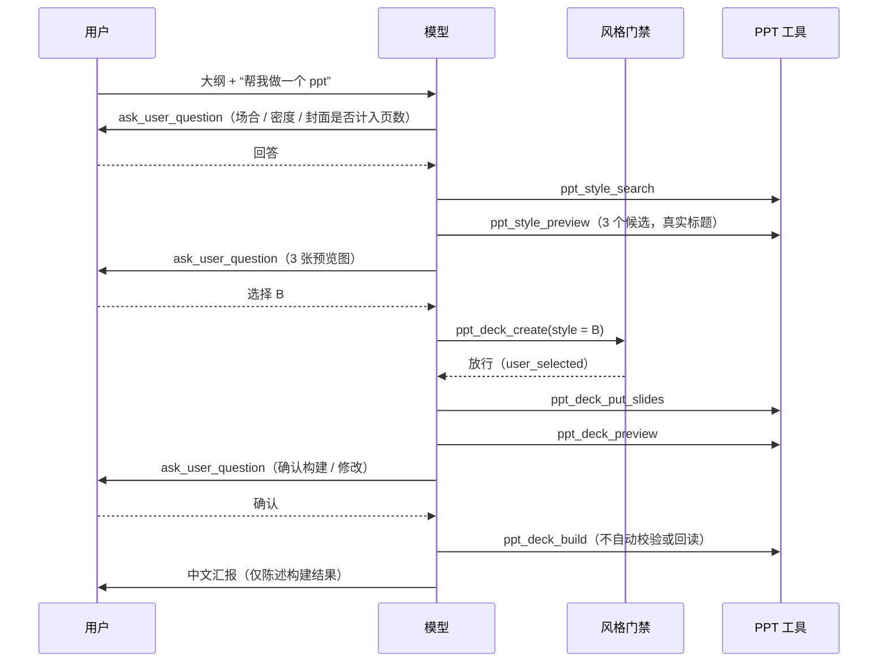

# PPT 生成流程改进方案

> 来源：会话 `5ebc06e8-a737-44e0-b935-0fbba3cebe16`（2026-10-02，PowerPoint，「财务共享帮助中心PPT」）复盘；第二轮测试 `af8b12ad-…` 复盘见 §8（含三宿主通用的会话持久化问题）。
> 关联：[POWERPOINT_COPILOT_BLUEPRINT.md](POWERPOINT_COPILOT_BLUEPRINT.md) §ppt-generate-deck 流程（①–⑪）。

---

## 1. 问题概述

用户给出一份完整的 5 页大纲，要求“帮我做一个 ppt”。按蓝图，流程应该是：询问需求 → 3 份封面预览 → 用户看图选风格 → 写页 → 验证 → 预览确认 → 构建。实际过程中**没有任何交互**，模型自行选定风格后直接产出成品，并且成品存在严重的质量问题，最终汇报中还有不实结论。

### 1.1 实际执行时间线

| # | 调用 | 结果 | 与蓝图的偏差 |
|---|---|---|---|
| 1 | `ppt_get_active_presentation` | 空白演示文稿，1 页 | — |
| 2 | `ppt_style_search`（finance enterprise formal light clean） | 命中 8 个风格 | — |
| 3 | `ppt_style_get`（blue-professional, design） | 读取设计文档 | 只读了第 1 名，没有形成 3 个候选 |
| 4 | `ppt_style_preview`（**1 个候选**） | 返回 previewImageId，并提示“下一步：调用 ask_user_question” | 蓝图要求 3 个候选 |
| 5 | —— | 模型自评“The cover looks clean and professional”，直接继续 | **跳过用户选择（蓝图步骤 ⑤）** |
| 6 | `ppt_deck_create` | 复用工作区 | 用户没有确认风格 |
| 7 | `ppt_deck_put_slides`（带 `id: s01`） | 失败：工作区没有 s01 | 浪费 1 轮 |
| 8 | `ppt_deck_put_slides`（6 页） | 成功 | 大纲写明 5 页，实际 6 页，没有询问 |
| 9 | `ppt_deck_validate` | 0 错误 0 警告，**字体抽样 0 个文本节点** | 校验实际上什么都没检查 |
| 10 | `ppt_deck_build`（editable, new） | **L3 文本回读 0 个文本框** | 文字没有转成原生文本框 |
| 11 | `ppt_list_slides` | **每页只有 1 个形状** | 整页是一张背景图 |
| 12 | 最终回复 | 声称“文字可编辑”“无字体回退”“无溢出重叠” | **结论与证据不符** |

另外，过程中的说明全部是英文（用户使用中文）；构建前也没有调用 `ppt_deck_preview` 请用户确认（蓝图步骤 ⑨）。

### 1.2 问题清单

| ID | 问题 | 严重度 | 类别 |
|---|---|---|---|
| P1 | 没有让用户选择风格，流程中零交互 | **P0** | 流程 / 门禁 |
| P2 | editable 模式实际产出整页图片，文字不可编辑 | **P0** | 构建管线 |
| P3 | 校验在 0 个采样的情况下仍报“通过” | **P0** | 校验 |
| P4 | 技能描述把预览写成“可选”，完全没提到询问用户 | P1 | 提示词 |
| P5 | `guides/` 下的风格选择指南和 HTML 编写约定从未加载给模型 | P1 | 提示词 / 资产 |
| P6 | 工具里写的提问工具名与实际注册名不一致 | P1 | 提示词 |
| P7 | `ppt_style_preview` 只给 1 个候选也能通过 | P1 | 工具约束 |
| P8 | 风格只配了西文字体（Space Grotesk / Inter），中文必然回退 | P1 | 风格资产 |
| P9 | 最终汇报包含没有证据的结论 | P1 | 提示词 / 工具输出 |
| P10 | 没有在构建前预览确认 | P2 | 流程 |
| P11 | 页数与大纲不一致，且没有询问 | P2 | 流程 |
| P12 | 中间说明语言没有跟随用户 | P2 | 提示词 |
| P13 | `ppt_deck_put_slides` 遇到不存在的 id 直接失败 | P2 | 工具易用性 |

---

## 2. 根因分析

### P1 没有让用户选择风格

这不是模型偶然不听话。现在的设计里，没有任何一处强制它停下来询问：

1. **技能说明明确写了“可选”**：[OfficeSkillCatalog.cs](../OfficeCopilot.Agent.Planning/Runtime/OfficeSkillCatalog.cs#L109) 写的是 `pick a style (ppt_style_search/ppt_style_get, optional ppt_style_preview)`，没有提到 `runtime.ask_user_question`。模型照字面执行，跳过预览和提问都是“合规”的。
2. **完整流程只存在于文档里**：蓝图写了 ①–⑪，[style-selection.md](../OfficeCopilot.Slides.Core/SlideAssets/guides/style-selection.md) 写了“默认 3 个候选，用 ask_user_question 让用户选”，但运行时都看不到（见 P5）。
3. **唯一的约束是一句提示**：[PowerPointStylePreviewTool.cs](../OfficeCopilot.Host.PowerPoint/Tools/Style/PowerPointStylePreviewTool.cs#L162) 在结果末尾写“下一步：调用 ask_user_question”。这是软约束，模型可以忽略，而且工具名还写错了（见 P6）。
4. **代码层没有任何门禁**：`ppt_deck_create` 和 `ppt_deck_put_slides` 不检查用户是否已选择风格。
5. **技能没有声明执行步骤**：`SkillDefinition` 支持 `ExecutionPlanSteps`，[SkillExecutionPromptBuilder.cs](../OfficeCopilot.Agent.Planning/Runtime/SkillExecutionPromptBuilder.cs) 也会把步骤渲染为“Execute in this order”，但 `ppt-generate-deck` 没有配置步骤。

### P2 editable 模式产出整页图片

- 构建时的文本采集只识别语义元素。[capture.js](../OfficeCopilot.Slides.Core/SlideAssets/runtime/capture.js#L3) 中定义 `TEXT_SELECTOR = 'h1,h2,h3,h4,h5,h6,p,li,td,.nx-text'`。
- 本次模型生成的 6 页 HTML 中，标签统计为：`div=109, br=15, span=6, section=6, b=3`，**没有一个 h1–h6 / p / li**。所有文字都放在带内联样式的 `<div>` 里。
- 结果是：`capture.TextBlocks` 为空 → [BuildPlanner.cs](../OfficeCopilot.Slides.Core/Deck/BuildPlanner.cs#L254) 没有生成任何文本框 → 文字全部留在背景截图里 → 每页只有 1 个图片形状。
- [PptVerifier.cs](../OfficeCopilot.Host.PowerPoint/PptVerifier.cs#L103) 只遍历计划中的文本块，计划为空时就检查 0 个，也不报任何问题。
- 模型不知道这条规则，因为 [authoring-contract.md](../OfficeCopilot.Slides.Core/SlideAssets/guides/authoring-contract.md) 从未加载（见 P5）。

### P3 校验在 0 个采样时仍报“通过”

- `validate.js` 的 `BLOCK_SELECTOR` 与 capture 使用同一套选择器。全 div 的页面上，溢出、重叠、字体回退的检查对象都是 0 个。
- [PowerPointDeckTools.cs](../OfficeCopilot.Host.PowerPoint/Tools/Deck/PowerPointDeckTools.cs) 中，`ppt_deck_validate` 只按 issue 数量汇总，“0 错误 0 警告”和“什么都没查”在输出上无法区分；`ppt_deck_build` 在 `TextBlocksChecked == 0` 时同样不报警。
- 模型据此汇报“无溢出、无文字越界/重叠、无字体回退”。

### P4 / P5 / P6 提示词与资产

- **P4**：见 P1 第 1 点。
- **P5**：全仓库搜索后确认，`SlideAssets/guides/` 只由 [AssetMerger.cs](../OfficeCopilot.Slides.AssetMerge/AssetMerger.cs) 在生成阶段写出，运行时没有任何代码读取。`SkillExecutionPromptBuilder` 中有大量 Excel 专用的提示块，但没有 PPT 的。
- **P6**：预览工具的描述和返回结果都写 `ask_user_question`，而实际注册名是 `runtime.ask_user_question`（见 [DefaultToolDispatcher.cs](../OfficeCopilot.Agent.Runtime/Turn/DefaultToolDispatcher.cs) `RuntimeAskUserQuestionName`）。

### P7 预览候选数

`ppt_style_preview` 的 schema 是 `minItems: 1`，代码中 `MaxCandidates = 4`、最少 1 个。只做 1 个候选，就无从选择。

### P8 中文字体

- blue-professional 的字体是 Space Grotesk 和 Inter，二者都没有中文字形。
- `BuildPlanner` 中 `FontNameFarEast = FirstFont(fontFamilyFarEast) ?? FirstFont(fontFamily)`。没有声明东亚字体时，东亚字体会被设为 `Space Grotesk`，PowerPoint 只能自行替换。
- 浏览器预览与 PowerPoint 的回退字体可能不同，导致字宽差异和换行偏移。

### P9 不实汇报

- 工具输出没有明确说明“0 采样意味着结论不成立”。
- 提示词没有要求“汇报中的每条质量结论都必须有工具证据”。

### P10–P13

- **P10**：技能没有要求构建前调用 `ppt_deck_preview`，`PreferredToolNames` 中也没有它。
- **P11**：没有“遵守用户指定页数；增加封面、目录、结束页需要询问或在页数中说明”的规则。
- **P12**：没有“中间说明使用用户语言”的规则。
- **P13**：[DeckWorkspace.cs](../OfficeCopilot.Slides.Core/Deck/DeckWorkspace.cs) `PutSlides` 对不存在的 id 直接抛错。工具描述里其实已经写了“省略 id 表示新增”，但模型仍然会犯这个错。

---

## 3. 解决方案

原则：**关键的用户决策点用代码门禁兜底，提示词负责引导，工具输出负责说真话。**

### 3.1 S1 风格选择门禁（解决 P1，P0）

在运行时增加一个按会话生效的前置条件检查，而不是只依赖模型自觉。

**位置**：`OfficeCopilot.Agent.Runtime/Turn/` 新增 `DeckStyleSelectionGate`，由 `DefaultToolDispatcher.DispatchToolCallAsync` 在派发宿主工具前调用。

**判定逻辑**（只对 `ppt_deck_create` 生效；`ppt_deck_put_slides` 和 `ppt_deck_build` 依赖 create，不必重复拦截）：

1. 扫描当前会话的消息（`BrokerConversationState.Messages`）：
   - 收集 `ppt_style_preview` 的成功结果，从 `structuredContentJson` 取 `deckId` 和 `candidates[].previewImageId`。
   - 收集 `runtime.ask_user_question` 的成功调用：从调用参数取选项的 `previewImageId`，从结果取用户选中的 label，反查出被选中的候选 ID。
2. 放行条件，满足任意一条即可：
   - **A. 用户已看图选择**：存在已回答的 ask_user_question，且被选中的选项 `previewImageId` 属于本次 `deckId`（未传 deckId 时，属于任一预览工作区），并且 create 的 `style` 等于该候选的 style。
   - **B. 用户明确指定了风格**：create 参数 `styleSource = { kind: "user_specified", quote: "..." }`，并且 `quote` 能在本会话的**用户消息原文**中找到（规范化空白后做子串匹配）。
   - **C. 用户明确要求不询问**：`styleSource = { kind: "user_waived", quote: "..." }`，校验方式同 B（例如“直接做”“不用问我”“你看着办”）。
   - **D. 修改已有工作区**：deckId 对应的 manifest 已存在 `styleConfirmed`（后续轮次继续编辑同一 deck）。
3. 不满足时返回失败，错误码 `ppt.style_selection_required`，消息中给出下一步：

   > 需要先让用户选择风格：用 ppt_style_preview 渲染 2–4 个候选，再用 runtime.ask_user_question 把每个 previewImageId 放进选项。如果用户已在消息中指定风格或明确表示不用询问，请在 styleSource 中引用用户原话。

**manifest 记录**：create 放行后，在 `DeckManifest` 中写入 `StyleConfirmed = { Source: "user_selected|user_specified|user_waived", Quote, ConfirmedUtc }`，供后续轮次走 D，也便于事后审计。

**ask_user_question 结果增强**（[DefaultToolDispatcher.cs](../OfficeCopilot.Agent.Runtime/Turn/DefaultToolDispatcher.cs) `HandleUserInteractionToolAsync`）：用户选中的选项如果带有 `previewImageId`，就在结果文本中追加所选候选 ID，并写入 `StructuredContentJson.selectedPreviews`。这样模型和门禁都能直接读到，无需反查 URL。

**用户取消或超时**：ask_user_question 失败时，模型不得使用默认风格继续。门禁天然保证这一点：没有选择记录就无法 create。

**为什么用 quote 校验而不是信任参数**：如果只是一个 `styleSource` 枚举，模型可以随手填 `user_specified` 绕过门禁。要求引用用户原话，并在服务端核对，才能把“声称”变成“可验证”。

**涉及文件**

- `OfficeCopilot.Agent.Runtime/Turn/DeckStyleSelectionGate.cs`（新增）
- `OfficeCopilot.Agent.Runtime/Turn/DefaultToolDispatcher.cs`（调用门禁；增强提问结果）
- `OfficeCopilot.Host.PowerPoint/Tools/Deck/PowerPointDeckTools.cs`（create 的 schema 增加 `styleSource`；写入 manifest）
- `OfficeCopilot.Slides.Core/Deck/DeckManifest`（增加 `StyleConfirmed`）

**验收**

- 脚本化模型：preview 后直接 create → 被拒，错误码为 `ppt.style_selection_required`。
- preview（3 个候选）→ ask（用户选第 2 个）→ create(style = 第 2 个) → 通过；create(style = 第 1 个) → 被拒。
- 用户消息含“用 blue-professional 风格”→ create(styleSource.quote = "blue-professional") → 通过；quote 为用户没说过的话 → 被拒。
- ask 被取消 → 后续 create 被拒。

### 3.2 S2 修复 editable 文本采集（解决 P2，P0）

两层修复：采集端兼容非语义标签，编写端引导使用语义标签。

**① 放宽 capture.js / validate.js 的文本识别**

在 `TEXT_SELECTOR` 之外，增加“叶子文本容器”规则：只要元素满足以下条件，就视为一个文本块：

- 有非空白的**直接**文本子节点；
- 后代中没有已匹配的文本块元素，也没有块级元素（`display` 不是 `inline` / `inline-block` / `contents` 的元素）；
- 不在 `svg`、`[aria-hidden="true"]`、`[data-nx-hidden]` 之内。

`<br>`、`<b>`、`<span>` 这类行内后代仍然属于同一个文本块，交给 `captureTextLines` 处理换行。

两个脚本必须共用同一个判定函数，避免“校验看到的”和“构建采集的”不一致。建议抽成 `runtime/text-blocks.js`，由两者共同引用。

**② 采集覆盖率自检**

capture.js 在每页结束时计算：

```
coverage = 已采集文本块的字符数 / slide.innerText 的非空白字符数
```

`coverage < 0.9` 时，在采集结果中返回 `uncapturedText` 样本（最多 5 段）。

**③ 编写约定**

在注入给模型的 authoring 要点（见 S4）中明确写出：

> 可见文字必须放在 h1–h6 / p / li / td，或带 `class="nx-text"` 的元素中；不要用纯 `<div>` 承载文字。

**涉及文件**

- `OfficeCopilot.Slides.Core/SlideAssets/runtime/capture.js`
- `OfficeCopilot.Slides.Core/SlideAssets/runtime/validate.js`
- `OfficeCopilot.Slides.Core/SlideAssets/runtime/text-blocks.js`（新增）
- `OfficeCopilot.Slides.Core/Deck/DeckAssembler`（引入新脚本）

**验收**

- 用本次会话的 6 页 HTML 作为独立 harness 回归样本，单独采集 PowerPoint 文本回读；`ppt_deck_build` 本身不执行或报告 L3 检查。
- 原有语义标签样本的构建结果不变（快照对比）。

### 3.3 S3 校验与构建“说真话”（解决 P3、P9 的工具侧，P0）

**ppt_deck_validate**

- 新增 issue `nx.text_not_captured`（error）：某页可见文字非空，但文本块数为 0，或覆盖率低于 0.9。消息附带未覆盖文本样本，并说明“这些文字构建后将成为图片，不可编辑，也不会参与溢出和字体检查”。
- 输出中显式列出**每页**文本块数，而不仅是总的 issue 数。
- 字体抽样数为 0 且演示中存在可见文字时，不得输出“字体回退检查抽样 0 个文本节点。”这类看似正常的文本，而要改为：

  > 字体回退检查未执行：没有识别到文本元素。

**ppt_deck_build**

- `mode = editable` 且 `TextBlocksChecked == 0`，而 capture 的 `slide.innerText` 非空时，结果中追加 issue `ppt.no_native_text`，并提示：

  > 本次构建没有生成任何原生文本框，文字全部位于背景图中，不可编辑。请先修复 nx.text_not_captured 再重建。

- 按页汇总“原生文本框 / 表格 / 图表 / 形状”数量，让模型能做出有依据的汇报。

**涉及文件**

- `OfficeCopilot.Host.PowerPoint/Tools/Deck/PowerPointDeckTools.cs`
- `OfficeCopilot.Host.PowerPoint/PptVerifier.cs`
- `OfficeCopilot.Host.PowerPoint/PowerPointDeckBuildService.cs`

**验收**：用本次会话的 HTML（在 S2 修复之前，或关闭叶子规则时），validate 必须报 error，build 必须报 `ppt.no_native_text`。

### 3.4 S4 重写技能定义并注入指南（解决 P4、P5、P10、P11，P1）

**① 技能描述**

去掉 `optional`，改为必经流程：

```
Create a new deck from a topic or outline. Required flow:
1) If audience/occasion/density/page count are unclear, ask once with runtime.ask_user_question (batch up to 4 questions).
2) ppt_style_search → pick 3 clearly different candidates → ppt_style_preview with the user's real title.
3) runtime.ask_user_question with one option per candidate, each previewImageId copied verbatim. Wait for the answer; never choose for the user.
4) ppt_style_get(design + layouts) for the chosen style → ppt_deck_create(deckId from preview).
5) ppt_deck_put_slides in batches → ppt_deck_preview and ask the user to confirm.
6) ppt_deck_build; do not run automatic pre-build validation or post-build readback/visual verification.
Respect the user's page count; a cover/agenda/closing slide counts toward it unless the user agrees otherwise.
```

`ppt_deck_validate` remains available as a standalone check when the user explicitly requests it; `font.weight_unavailable` is a warning and does not block the flow.

**② 配置 ExecutionPlanSteps**

把上面的流程拆为结构化步骤，每步给出 `PreferredToolNames`。`DefaultToolDispatcher.GetOrderedModelToolNames` 会按当前步骤排序工具，`RegisterSuccessfulToolCall` 会推进步骤。

| 步骤 | 说明 | Preferred tools |
|---|---|---|
| clarify | 需求不明确时提问 | `runtime.ask_user_question` |
| shortlist | 检索并预览候选 | `ppt_style_search`, `ppt_style_preview` |
| select | 让用户选择风格 | `runtime.ask_user_question` |
| author | 建工作区并写页 | `ppt_style_get`, `ppt_deck_create`, `ppt_deck_put_slides` |
| confirm | 预览并请用户确认 | `ppt_deck_preview`, `runtime.ask_user_question` |
| build | 构建（不自动校验） | `ppt_deck_build` |

`PreferredToolNames` 中补充 `ppt_style_preview` 和 `ppt_deck_preview`。

**③ 注入指南**

在 `SkillExecutionPromptBuilder` 中增加 PPT 提示块，触发条件是 `AllowedToolNames` 包含 `ppt_deck_put_slides`（与现有 Excel 提示块的写法一致）。内容是 style-selection.md 与 authoring-contract.md 的**精简要点**，控制在 25 行以内，至少包括：

- 默认 3 个差异明显的候选，封面使用用户的真实标题；
- 文字必须放在语义标签或 `.nx-text` 中；
- 优先使用所选风格的版式样例和 CSS 类，少写内联样式；
- 图表使用 `data-nx-chart`，表格不超过 20×12 且不合并单元格；
- 没有工具证据的质量结论不得写进汇报。

完整的 authoring-contract.md 由 `ppt_deck_create` 的结果首次返回一次，在单轮中只占用一次上下文。

**涉及文件**

- `OfficeCopilot.Agent.Planning/Runtime/OfficeSkillCatalog.cs`
- `OfficeCopilot.Agent.Planning/Runtime/SkillExecutionPromptBuilder.cs`
- `OfficeCopilot.Host.PowerPoint/Tools/Deck/PowerPointDeckTools.cs`（create 结果附带约定）
- `OfficeCopilot.Slides.Core/Assets/SlideAssetPaths.cs`（提供 guides 路径）

### 3.5 S5 预览工具约束与命名（解决 P6、P7，P1）

- 描述和结果中的 `ask_user_question` 全部改为 `runtime.ask_user_question`。如果模型侧的工具名会被规范化（例如把 `.` 换成 `_`），提示中应使用规范化之后的名字。需要先确认 `ModelClientTool` 的命名映射。
- schema 改为 `minItems: 2`。用户指定了风格时不需要预览，所以不存在只需 1 个候选的合理场景；如果确实需要单图确认，可以走 `ppt_deck_preview`。
- 结果文本改为强指令，并给出可直接照抄的示例：

  > 必须立即调用 runtime.ask_user_question，并等待用户回答；不要自行选择。示例：{ questions:[{ header:"风格", question:"选择演示风格", options:[{ label:"…", previewImageId:"deckId/candidateName/0123456789ab" }, …] }] }

**涉及文件**：`OfficeCopilot.Host.PowerPoint/Tools/Style/PowerPointStylePreviewTool.cs`

### 3.6 S6 中文字体配对（解决 P8，P1）

- 风格元数据（`preset.md` 或 catalog 条目）增加 `fonts.cjk`，例如 `["Noto Sans SC", "Microsoft YaHei"]`。没有声明时，按风格气质给默认值：无衬线用 Noto Sans SC / 微软雅黑，衬线用 Noto Serif SC / 宋体。
- `DeckAssembler` 在 `zh-*` 语言下把 CJK 字体追加到每个 `font-family` 字体栈的末尾，并设置 `font-family-east-asian`（capture.js 已经会读取这个属性）。
- `BuildPlanner` 中 `FontNameFarEast` 的回退顺序改为：显式东亚字体 → 风格的 CJK 字体 → 系统默认，**不再回退到西文首字体**。
- `ppt_deck_create` 在语言为 zh 且风格没有可用 CJK 字体时，在结果中给出警告。
- 字体安装：确认 [Install-NixerFonts.ps1](../Install-NixerFonts.ps1) 覆盖所选 CJK 字体。

**涉及文件**：`OfficeCopilot.Slides.Core/Catalog/StyleCatalog.cs`、`DeckAssembler`、`BuildPlanner.cs`、风格资产

### 3.7 S7 汇报纪律与语言（解决 P9、P12，P2）

在 PPT 提示块中增加：

- 中间说明与最终汇报使用用户的语言。
- 汇报中的每条质量结论（可编辑、无溢出、字体）都必须对应本轮的工具输出。工具显示 0 采样或未执行时，必须如实说明，不得写成“通过”。
- 汇报页数时，说明是否包含封面或结束页。

### 3.8 S8 put_slides 容错（解决 P13，P2）

`DeckWorkspace.PutSlides` 遇到格式合法（`sNN`）但不存在的 id 时，按该 id **新增**，而不是报错。结果中标记为“新增”，并提示“id 不存在，已按新增处理”。仍然拒绝格式非法的 id。

这样不会误覆盖已有页，又避免了一轮无意义的重试。

**涉及文件**：`OfficeCopilot.Slides.Core/Deck/DeckWorkspace.cs`（`AllocateSlideId` 需要跳过已被显式占用的编号）

---

## 4. 改进后的目标交互



需求已经完整的场景（例如大纲 + 页数 + 场合齐全），第一次提问可以省略，但风格选择与构建前确认不能省略，除非用户明确豁免（门禁 C）。
用户明确要求 HTML 校验时，可单独调用 `ppt_deck_validate`；这不属于默认生成/构建流程。

---

## 5. 实施顺序

| 阶段 | 内容 | 解决问题 | 说明 |
|---|---|---|---|
| 1 | S2 文本采集 + S3 校验说真话 | P2, P3 | 影响所有已生成 deck 的可编辑性，优先级最高；先写回归样本 |
| 2 | S1 风格门禁 + 提问结果增强 | P1 | 核心交互缺陷；依赖 manifest 字段 |
| 3 | S4 技能重写 + 指南注入 + S5 预览约束 | P4–P7, P10, P11 | 提示词层面，与门禁配合降低被拒率 |
| 4 | S6 中文字体 | P8 | 涉及风格资产批量补全 |
| 5 | S7 汇报纪律 + S8 put_slides 容错 | P9, P12, P13 | 小改动 |

---

## 6. 测试计划

位于 `OfficeCopilot.Agent.Tests`，复用 `TurnHarness` / `ScriptedModelClient` / `FakeHostToolInvoker`。

| 测试 | 覆盖 |
|---|---|
| `DeckStyleSelectionGateTests` | 门禁 A/B/C/D 四种放行路径；直接 create、选错风格、伪造 quote、取消提问后 create 都被拒 |
| `AskUserQuestionPreviewSelectionTests` | 选中带 previewImageId 的选项后，结果包含 `selectedPreviews` |
| `CaptureTextBlocksTests`（WebView2 集成，可选） | 全 div 页面能采集到文本块；`<br>` 换行保留；svg 内文字不采集 |
| `SlideDeckTests` 回归 | 本次会话的 6 页 HTML → validate 无 `nx.text_not_captured`，build 后每页文本框数 > 0 |
| `DeckValidateHonestyTests` | 文本覆盖率 < 0.9 时报 error；0 采样时文本不含“抽样 0 个” |
| `OfficeSkillCatalogTests` | `ppt-generate-deck` 描述不含 `optional`；含 7 个执行步骤；Preferred 含 `ppt_style_preview` / `ppt_deck_preview` |
| `SkillExecutionPromptBuilderTests` | PPT 技能命中时输出 PPT 提示块，且长度不超过上限 |
| `StylePreviewToolTests` | 1 个候选被拒；结果文本使用 `runtime.ask_user_question` |
| `DeckWorkspacePutSlidesTests` | 不存在的合法 id 按新增处理；非法 id 仍报错 |
| 端到端回放 | 用本次会话的用户输入跑 ScriptedModelClient，断言工具序列中 `runtime.ask_user_question` 出现在 `ppt_deck_create` 之前 |

---

## 7. 风险与权衡

| 风险 | 缓解 |
|---|---|
| 门禁过严，用户觉得问得太多 | 提供 B/C 两条可验证的豁免路径；第一次需求提问可以省略；把多个问题合并到一张卡片（最多 4 题） |
| quote 校验误判（用户的说法与模型引用不完全一致） | 规范化空白和全半角后做子串匹配；失败消息提示“请原样引用用户原话” |
| 放宽文本识别后误采装饰性文字 | 排除 svg / aria-hidden / data-nx-hidden；保留 `.nx-text` 显式标记作为首选写法 |
| 提示词变长，占用上下文 | PPT 提示块不超过 25 行，完整约定只在 create 结果中返回一次 |
| 已有工作区没有 `StyleConfirmed` 字段 | 门禁只在 create 时检查；已有 slides 的旧工作区视为已确认（兼容规则写入门禁） |
| 用户长时间不回答提问（超时 300 秒） | 超时返回失败，模型应汇报“等待选择”并结束本轮，而不是自行继续；门禁保证无法绕过 |

---

## 8. 第二轮测试复盘（会话 `af8b12ad-281a-45b7-b9b4-1b0770ba7bce`）

> 时间：2026-10-02 11:42（本地），deckId `20261002-114231-dte104`，PowerPoint 空白演示文稿。
> 证据来源：会话 JSONL **只有 head 一行**，以下时间线全部来自回合轨迹
> `%LOCALAPPDATA%\NixerOfficeCopilot\Traces\20261002\af8b12ad-…_48f7be67….jsonl`（seq 1–56）。

### 8.1 现象

| ID | 现象 | 严重度 |
|---|---|---|
| Q1 | 用户主动中止（或回合异常/超时）后，会话 JSONL 没有任何交互内容，只有 head；Excel / Word 同样存在 | **P0** |
| Q2 | 构建阶段出现“死循环”：同一份 deck 被重复构建多批，演示文稿从 6 页涨到 11 页，随后模型自行恢复备份、再次构建失败 | **P0** |
| Q3 | 风格预览只给了 2 张，不是 3 张 | P1 |

### 8.2 时间线（摘自轨迹）

| seq | round | 调用 | 结果 / 说明 |
|---|---|---|---|
| 5–9 | 1–3 | `ppt_style_search` → `ppt_style_get` ×2（blue-professional、neo-grid-bold，各约 25K 字符） | 每读一个候选的完整 design 就要约 6K token，模型只读了 2 个就去预览 |
| 11 | 4 | `ppt_style_preview`（**2 个候选**） | 成功 |
| 13 | 5 | `runtime.ask_user_question`（2 张预览图） | 用户 78 秒后选择 neo-grid-bold ✅（本轮交互正常） |
| 15–27 | 6–12 | create → put_slides → validate ×3 → put_slides ×2 | 正常 |
| 29 | 13 | **build #1** `editable`（无 target，空白文稿复用） | 生成 6 页 |
| 33 | 14 | `ppt_export_slide_image` [1,2,4,6] | 模型发现第 6 页需要修改 |
| 35–37 | 15–16 | put_slides(s06) → validate | 正常 |
| 39 | 17 | **build #2** `replace:true, fromIndex:6, toIndex:6` | **把整套 6 页插到第 6 页位置，再删原第 6 页 → 共 11 页** |
| 41 | 18 | `ppt_list_slides` | 11 页 |
| 43 | 19 | **build #3** `replace:true, fromIndex:6, toIndex:11` | 再次插入 6 页、删 6 页 → 仍 11 页（第 2 批重复内容被重建一次） |
| 47 | 21 | `ppt_delete_slides` [6–11] | **被技能白名单拒绝**（`skill.tool_not_allowed`） |
| 48–50 | 22–23 | `ppt_list_backups` → **`ppt_restore_backup`**（`114448.pptx`，`openAfterRestore:true`） | 模型绕路：用恢复备份来“删页”，未询问用户 |
| 52–54 | 24–25 | list_slides / get_active_presentation | 文稿回到 1 页 |
| 56 | 26 | **build #4** `editable`（无 target） | 失败：“当前演示文稿已有内容，不能按空白文稿直接构建。” |
| — | — | 用户中止 | 轨迹到此结束，**没有 turn_end 记录**；会话 JSONL 无任何消息 |

4 次构建 + 1 次恢复备份，全部没有经过用户确认（`ppt_deck_build` 声明了 `RequiresConfirmation`，但 Agent 模式下确认被跳过，见 §8.4 R2-4）。

### 8.3 Q1 根因：会话只在回合“正常结束”时落盘

整条持久化链路只有**一个**写盘点，而取消和超时都绕过了它。

1. **新会话只写 head**：[JsonlConversationStore.GetOrCreateAsync](../OfficeCopilot.Agent.Persistence/Jsonl/JsonlConversationStore.cs#L89) 对新 id 只调用 `WriteHeadAsync`。之后用户消息、助手中间文本、`tool_call` / `tool_result` 都只追加到**内存**里的 `conversation.Messages`（[AgentRuntimeService.cs](../OfficeCopilot.Agent.Runtime/AgentRuntimeService.cs#L112)、[BrokerTurnExecutor.AddConversationMessage](../OfficeCopilot.Agent.Runtime/BrokerTurnExecutor.cs#L700)）。
2. **唯一写盘点在回合末尾**：[AgentRuntimeService.ExecuteTurnAsync](../OfficeCopilot.Agent.Runtime/AgentRuntimeService.cs#L217) 的 `SaveAsync` 位于 try/catch 之后。
3. **取消直接跳过写盘**：同一方法中 `catch (OperationCanceledException) { throw; }`（[L161](../OfficeCopilot.Agent.Runtime/AgentRuntimeService.cs#L161)）把异常原样抛出，`SaveAsync` 永远执行不到。内存中已有的几十条消息随对象一起丢弃。
4. **即使走到写盘也会失败**：`SaveAsync(conversation, cancellationToken)` 首行就是 `ThrowIfCancellationRequested()`，用的又是已取消的令牌。
5. **“异常”大多也是取消**：以下情况在运行时内部都表现为 `OperationCanceledException`，因此同样不落盘：
   - 用户点“停止”：Panel 发送 `CancelTurn` 并取消本地 CTS（[CopilotPanelControl.CancelCurrentTurnAsync](../OfficeCopilot.Panel.WebView/CopilotPanelControl.cs#L2083)）；
   - **回合超时**：[BrokerEnvelopeDispatcher](../OfficeCopilot.Agent.Broker/BrokerEnvelopeDispatcher.cs#L228) 默认 600 秒的 `turnTimeoutCts`。PPT 流程包含最长 300 秒的用户提问等待，加上渲染和构建，**很容易超过 10 分钟**；Dispatcher 把它报告为 `broker.turn.failed`，用户看到的是“异常”；
   - Broker 关闭（Office 退出、面板关闭）时的 shutdown 令牌；
   - 模型流式读取期间外层令牌被取消（[OpenAiCompatibleProviderAdapter](../OfficeCopilot.Agent.Runtime/ModelProviders/OpenAiCompatibleProviderAdapter.cs#L175) 只在“非外层取消”时才转成 `TimeoutException`）。

   只有真正的非取消异常（例如模型返回 error 事件）会进入 `catch (Exception)` 分支并被保存。
6. **超时后的后台回合会“迟到写盘”**：Dispatcher 用 `Task.WhenAny` 实现超时，超时后回合任务仍在后台跑。如果它之后正常结束，会用整份内存状态**覆盖**文件；如果用户此时已开始下一回合，两次 `SaveAsync` 都是整文件重写，后写者覆盖先写者，消息会丢失。
7. **写盘本身不是原子的**：`SaveAsync` 先 `File.Delete(path)` 再 `File.Move(temp, path)`。两步之间进程崩溃（例如 Office 被强杀）会导致整份会话文件消失。
8. **后续回合的连锁问题**：下一回合 `GetOrCreateAsync` 从磁盘加载，被中止回合的用户消息、已执行的写操作（例如已经构建了 6 页）全部不可见。模型会把任务当成从未执行过，**再做一遍**——这也是“重复生成好几批”的一个放大因素。
9. **轨迹也不完整**：`TurnTraceWriter` 只在工具调用时写记录，没有 `turn_start` / `turn_end`，无法从轨迹判断回合是正常完成、被取消还是超时。

Excel、Word 与 PowerPoint 共用 `AgentRuntimeService` / `BrokerTurnExecutor` / `JsonlConversationStore`，因此三个宿主问题完全相同。

### 8.4 Q2 根因：构建工具的“替换”语义与模型理解不一致

**R2-1 replace 是“用整套 deck 替换一段页码”，不是“重建指定页”**

[PowerPointHostAdapter.Slides.cs](../OfficeCopilot.Host.PowerPoint/PowerPointHostAdapter.Slides.cs#L140) 中，`replace` 模式会在 `fromIndex` 处插入**工作区全部页面**，再删除原 `fromIndex–toIndex`。工具描述只写了“replace=true 时替换 fromIndex–toIndex 页”（[PowerPointDeckTools.cs](../OfficeCopilot.Host.PowerPoint/Tools/Deck/PowerPointDeckTools.cs#L716)），模型自然理解为“只重建第 6 页”。结果：

- build #2 用 6 页替换 1 页 → 11 页；
- build #3 用 6 页替换 6 页 → 仍 11 页，重复内容又生成一遍。

工具结果也没有给出“构建前 N 页 → 构建后 M 页”的对比，模型直到调用 `ppt_list_slides` 才发现。

**R2-2 没有“只重建某几页”的能力**

`ppt_deck_build` 没有 `slideIds` 参数，无法只把修改过的 s06 重新构建到原位置。模型在“改了一页”的常见场景下没有正确的工具可用，只能猜参数。

**R2-3 缺少删除页的正规途径，模型绕路恢复备份**

- 技能白名单里没有 `ppt_delete_slides`；`ppt_deck_remove_slides` 只删工作区，不删演示文稿。
- 模型于是选择 `ppt_restore_backup` 回退到构建前——这是一个覆盖整个文档的高风险操作，却在没有询问用户的情况下执行了。

**R2-4 Agent 模式下高风险写操作没有任何确认**

[DefaultToolDispatcher.cs](../OfficeCopilot.Agent.Runtime/Turn/DefaultToolDispatcher.cs#L410) 中，`AcceptEdits` / `BypassPermissions` 模式跳过 `RequiresConfirmation`。对单元格编辑这样设计是合理的，但对“整套构建”“替换页码区间”“恢复备份”这类**结构性、整文档级**的操作，一回合内连续执行 4 次没有任何人工确认。

**R2-5 循环保护识别不到这种循环**

[LoopGuardPolicy](../OfficeCopilot.Agent.Runtime/Turn/LoopGuardPolicy.cs#L62) 只拦截“同一工具 + 相同参数 ≥ 3 次”和 Excel 探测类工具。4 次构建的参数各不相同（无 target / replace 6–6 / replace 6–11 / 无 target），轨迹 `argsHash` 分别为 `c48b21c6`、`0f82fbe7`、`278b6d36`、`c48b21c6`，全部放行。

**R2-6 执行计划早已“完成”，构建后没有任何约束**

轨迹显示 `ppt-generate-deck` 使用的是通用两步计划（“Apply write operation / Verify result”），从 round 8 起就是 “Execution plan completed”。构建之后的修复、重建、恢复全部处于无计划状态（与 §3.4 S4 ② 相同的根因）。

**R2-7 恢复备份后，工具层与宿主层对“空白文稿”的判断不一致（待核实）**

build #4 在工具层通过了 `IsBlank` 检查（否则会返回“构建位置需要用户决定”），但在宿主层 `BuildSlides` 中被判为“已有内容”。两处都读取 `Application.ActivePresentation`。推测：`openAfterRestore` 新开窗口后，capture 渲染的约 3 秒内活动文稿发生了切换，两次读取的不是同一份文稿。需要复现确认。

### 8.5 Q3 根因：只给 2 张预览

- `ppt_style_preview` 的 schema 是 `minItems: 1`，没有“默认 3 个”的硬约束；技能描述也没有提到数量（§2 P4、P7）。
- 预览需要模型为每个候选手写封面 HTML/CSS，而为了写出符合风格的封面，模型会先 `ppt_style_get` 读取完整 design 文档（每个约 25K 字符）。**候选越多，成本线性增加**，模型倾向于少选。

### 8.6 改进步骤

#### 8.6.1 C1 会话持久化：任何结束方式都要落盘（解决 Q1，P0，三宿主通用）

按顺序实施，前 3 步即可止血。

**步骤 1：回合收尾一律写盘（止血）**

[AgentRuntimeService.ExecuteTurnAsync](../OfficeCopilot.Agent.Runtime/AgentRuntimeService.cs#L161)：

- 把 `SaveAsync` 移到 `finally`，取消、超时、异常都执行；
- 收尾写盘使用**独立令牌**：`CancellationToken.None` 加 10 秒超时的 CTS，而不是已取消的回合令牌；
- 捕获 `OperationCanceledException` 时，追加一条助手消息再重新抛出：
  - `MessageType = "assistant"`、`Success = false`；
  - 内容区分原因：用户中止 → “（本回合已被用户中止）”；回合超时 → “（本回合超时，已中止）”；Broker 关闭 → “（Broker 关闭，回合中止）”；
  - 原因判断需要 Dispatcher 把 `requestCancellationSource` / `turnTimeoutCts` / shutdown 三个令牌的状态传下来（建议在 `AgentBrokerTurnRequest.Metadata` 或 `BrokerTurnContext` 上增加 `CancellationReason` 提供者）；
- 写盘失败只记日志，不能掩盖原始异常。

**步骤 2：保留被中断时的半截内容**

[BrokerTurnExecutor.ExecuteModelTurnAsync](../OfficeCopilot.Agent.Runtime/BrokerTurnExecutor.cs) 中，流式累积的 `lastContent` 在工具调用前才会写入会话。取消时这段已展示给用户的文字会丢失。

- 在 `ExecuteModelTurnAsync` 外层加 `catch (OperationCanceledException)`：若 `lastContent` 非空，先 `AddConversationMessage(..., success:false)` 再重新抛出；
- 如果取消发生在工具执行期间（已有 `tool_call` 但没有 `tool_result`），补一条 `tool_result`：`Success = false`，`ErrorCode = "runtime.cancelled"`，保证历史中工具调用成对出现，Panel 回放时不会出现“永远在执行”的工具卡片。

**步骤 3：回合开始即落盘用户消息**

在 `AgentRuntimeService` 追加用户消息后立即写盘一次。即使进程随后被强杀，至少能看到用户问了什么。

**步骤 4：增量检查点（防进程崩溃）**

每完成一轮工具调用（`BrokerTurnExecutor` 主循环中 `round++` 处）写一次检查点。

- 推荐在 `IConversationStore` 增加 `AppendMessagesAsync(conversationId, IReadOnlyList<BrokerConversationMessage>)`：只追加本轮新增行，不重写整个文件。现有的 `AppendMessageAsync` 会重新 `GetOrCreateAsync` 并加载整份文件，不适合在循环中调用；
- `BrokerTurnExecutor` 记录“已持久化到第几条消息”的游标，检查点只写游标之后的消息；
- 回合结束仍执行一次完整 `SaveAsync`（负责 head 元数据和 compact 链），作为整理；
- compact 链（`.compact.jsonl`）同样按检查点追加。

**步骤 5：原子写与并发**

- `SaveAsync` 改用 `File.Replace(tempPath, path, backupPath)`（目标存在时）或 `File.Move`（目标不存在时），去掉“先删再移”的窗口；
- `JsonlConversationStore` 增加按 conversationId 的 `SemaphoreSlim`，`SaveAsync` / `AppendMessagesAsync` 串行化；
- 回合超时后后台任务仍在运行的问题：`AgentRuntimeService` 为每个会话记录当前回合的 `MessageId`；收尾写盘前检查自己是否仍是最新回合，**不是**则只追加自己的消息（`AppendMessagesAsync`），不做整文件重写。

**步骤 6：让下一回合知道上一回合被中断**

[DefaultContextBuilder](../OfficeCopilot.Agent.Runtime/Turn/DefaultContextBuilder.cs) 不向模型回放 `tool_call` / `tool_result`。被中止回合即使落盘，模型也只能看到“（本回合已被用户中止）”，不知道哪些写操作已经生效。

- 中止时生成一条 `MessageType = "turn_interrupted"` 的 system 摘要：列出本回合已**成功执行的写工具**及关键结果（例如 “ppt_deck_build：已在当前文稿生成 6 页（第 1–6 页）”），复用 `ConversationHistoryFollowUpPolicy.BuildPriorTurnToolTrail` 的格式；
- `DefaultContextBuilder` 把 `turn_interrupted` 当作 system 消息回放（与 `compact_summary` 同样处理）。

**步骤 7：轨迹补齐回合边界**

`TurnTraceWriter` 增加 `turn_start`（技能、模式、模型）和 `turn_end`（`status = completed | cancelled | timeout | failed`、轮次、耗时、写工具次数）。`turn_end` 在 `finally` 中写。

**涉及文件**

- `OfficeCopilot.Agent.Runtime/AgentRuntimeService.cs`
- `OfficeCopilot.Agent.Runtime/BrokerTurnExecutor.cs`
- `OfficeCopilot.Agent.Runtime/Turn/DefaultContextBuilder.cs`
- `OfficeCopilot.Agent.Runtime/Diagnostics/TurnTraceWriter.cs`
- `OfficeCopilot.Agent.Persistence/IConversationStore.cs`、`Jsonl/JsonlConversationStore.cs`、`InMemoryConversationStore`
- `OfficeCopilot.Agent.Broker/BrokerEnvelopeDispatcher.cs`（传递取消原因）

**验收**

| 场景 | 期望 |
|---|---|
| 工具执行中用户点停止 | JSONL 含用户消息、已完成的 tool_call/tool_result、被中断工具的 `runtime.cancelled` 结果、“已被用户中止”助手消息 |
| 模型流式输出中用户点停止 | 已输出的半截文字作为 `Success=false` 的助手消息保存 |
| 回合超时（把 `runtime.turnTimeoutSeconds` 设为 30 复现） | 同上，原因为“超时” |
| 回合中途强杀 Broker 进程 | 至少保存到上一个检查点；文件完整可解析 |
| 中止后发送“继续” | 模型上下文中可见 `turn_interrupted` 摘要，不重复执行已完成的构建 |
| Excel / Word 各跑一次中止 | 结果与 PowerPoint 一致 |

#### 8.6.2 C2 构建工具：明确语义 + 支持按页重建（解决 Q2 R2-1、R2-2，P0）

**① 增加 `slideIds` 参数**

`ppt_deck_build` 新增 `slideIds: ["s06"]`，只构建指定页。与 `replace` 组合：

```
{ deckId, mode, slideIds:["s06"], replace:true, fromIndex:6, toIndex:6 }
```

**② replace 数量必须匹配**

`replace` 时，构建页数（`slideIds` 的数量，未指定时为整套页数）必须等于 `toIndex - fromIndex + 1`；不相等时直接拒绝，错误码 `ppt.deck_replace_count_mismatch`，提示：

> 要构建 6 页，但替换区间只有 1 页。只更新个别页请传 slideIds；整套重建请设置 fromIndex=1、toIndex=当前页数。

如果确实需要“插入多页替换一页”的场景，再加显式开关 `allowCountChange: true`，默认关闭。

**③ 用 deck tag 自动定位**

构建时已经通过 `ComSlideBuilder.SetTag` 给文稿打了 deck tag。建议同时给**每一页**写入 `nx-slide-id = sNN`。这样：

- 重建 s06 时可以直接找到对应页并原位替换，无需模型计算页码（新增 `target: "update"`，按 slide tag 替换）；
- 文稿中已存在该 deck 的页时，未指定 target 的整套构建应拒绝并提示使用 `update`，从根本上杜绝“同一 deck 构建出两批”。

**④ 结果中报告页数变化**

构建结果第一行固定为：

> 构建前 6 页 → 构建后 11 页；新增第 6–11 页，删除原第 6 页。

页数增加且不是 `target=append/new` 时，追加警告 `ppt.deck_slide_count_changed`。

**⑤ 工具描述重写**

```
replace=true: delete slides fromIndex–toIndex and insert the built slides there. The number of built slides
(slideIds, or the whole deck) must equal toIndex-fromIndex+1. To re-render one edited slide use
target="update" with slideIds=["s06"]; it replaces the slide previously built from s06 in place.
```

**涉及文件**：`PowerPointDeckTools.cs`（schema、参数校验、结果文本）、`PowerPointDeckBuildService.cs`（`PowerPointDeckBuildTarget` 增加 `UpdateKind` 和 slideIds）、`PowerPointHostAdapter.Slides.cs`（按 tag 定位、页数校验）、`ComSlideBuilder`（写页级 tag）

#### 8.6.3 C3 高风险写操作的回合预算与确认（解决 R2-3、R2-4、R2-5，P0）

**① 结构性操作在任何模式下都要确认**

在 `ToolDefinition` 增加 `ConfirmationLevel`（或复用 `RiskLevel = "high"`）：`ppt_deck_build`（replace / update 除外的首次构建可豁免）、`ppt_restore_backup`、`excel_restore_backup`、Word 恢复类工具，在 `AcceptEdits` 模式下**仍然**弹确认；只有 `BypassPermissions` 跳过。

**② 每回合写操作预算**

新增 `MutationBudgetPolicy`（与 `LoopGuardPolicy` 并列），按工具统计**成功**次数：

| 工具 | 每回合上限 | 超限后 |
|---|---|---|
| `ppt_deck_build` | 2 | 拒绝，返回 `runtime.mutation_budget_exceeded`，要求向用户汇报现状并询问 |
| `*_restore_backup` | 1 | 同上 |

超限不是硬停回合，而是拒绝该次调用，让模型转去汇报。

**③ 恢复备份必须由用户发起**

`ppt_restore_backup` 的描述写明“仅在用户明确要求时使用”，并在 `ppt-generate-deck` 白名单中移除。模型需要删除误建页时，应使用 C2 的 `update` / replace 或询问用户。

**④ 删除误建页的正规途径**

二选一：

- 把 `ppt_delete_slides` 加入 `ppt-generate-deck` 白名单，并限定只能删除带本 deck tag 的页（宿主侧校验 tag，不是本 deck 生成的页一律拒绝）；
- 或在 `ppt_deck_build` 增加 `cleanup: true`：删除文稿中所有带本 deck tag、但不在本次构建结果中的页。

推荐前者，语义更直观。

**⑤ 循环保护增加“同工具不同参数”的写操作规则**

`LoopGuardPolicy` 新增：同一个**写工具**在一回合内成功 ≥ 3 次、且两次调用之间没有 `runtime.ask_user_question`，触发 `ShouldStop`，走 `ExecuteLoopGuardCompletionAsync` 汇报。只针对写工具，避免误伤读取类工具。

**涉及文件**：`DefaultToolDispatcher.cs`、`LoopGuardPolicy.cs`、新增 `MutationBudgetPolicy.cs`、`OfficeSkillCatalog.cs`（白名单）、`PowerPointWriteTools.cs`（delete 限定 deck tag）、各宿主 restore 工具定义

#### 8.6.4 C4 构建后流程纳入执行计划（不实施）

在 §3.4 S4 ② 的执行步骤之后增加：

| 步骤 | 说明 | Preferred tools |
|---|---|---|
| review | 构建后导出缩略图自检，发现问题时**先向用户汇报并询问是否修改**，不自动重建 | `ppt_export_slide_image`, `runtime.ask_user_question` |
| revise（可选） | 用户同意后：put_slides → validate → `build(target=update, slideIds)` | `ppt_deck_put_slides`, `ppt_deck_validate`, `ppt_deck_build` |

该建议不实施：`ppt_deck_build` 不自动执行构建后 PowerPoint 回读或视觉验证。构建完成后只汇报实际构建结果；需要额外检查时由用户另行提出。

#### 8.6.5 C5 活动文稿身份锁定（解决 R2-7，P1，先复现）

- 复现：构建 → `ppt_restore_backup(openAfterRestore:true)` → 立即 `ppt_deck_build`，记录两次 `ActivePresentation.FullName`；
- 修复方向：`ppt_deck_build` 在入口读取一次文稿身份（`FullName` + 窗口 HWND），通过 `PowerPointDeckBuildTarget` 传给宿主；宿主 `BuildSlides` 按身份查找文稿，找不到或不一致时报错 `ppt.presentation_changed`，而不是按“当前活动文稿”重新判断。

#### 8.6.6 C6 预览默认 3 个、降低预览成本（解决 Q3，P1）

- `ppt_style_preview` schema 改为 `minItems: 3, maxItems: 4`。仅当 `ppt_style_search` 命中不足 3 个时允许更少，由工具对照本会话的检索结果放行。这替代 §3.5 S5 中 `minItems: 2` 的方案；
- 新增简化输入：`{ styles: ["a","b","c"], title, subtitle }`。工具用每个风格自带的封面版式样例（`layouts` 中的 cover）渲染，替换标题文字即可，**不再需要模型先读完整 design、再手写封面 HTML**。保留现有 `candidates[].html` 作为高级用法；
- 技能描述（§3.4 S4 ①）中写明“3 clearly different candidates”，与 schema 一致。

### 8.7 实施顺序（并入 §5）

| 阶段 | 内容 | 说明 |
|---|---|---|
| 0 | **C1 步骤 1–3**（收尾写盘、半截内容、开局写用户消息） | 三宿主通用，改动小，立即止血 |
| 1 | C2 构建语义 + C3 ①②⑤ 确认与预算 | 直接消除本次的重复构建 |
| 1 | 原 S2 / S3 | 保持不变 |
| 2 | C1 步骤 4–7（检查点、原子写、中断摘要、轨迹边界） | 依赖 store 接口扩展 |
| 2 | 原 S1、C3 ③④ | 流程门禁 |
| 3 | C5、C6、原 S4–S8 | |

### 8.8 新增测试

| 测试 | 覆盖 |
|---|---|
| `AgentRuntimeServicePersistenceTests.CancelDuringToolCall_PersistsMessages` | 脚本化模型调用 2 个工具，第 2 个工具执行中取消 → 文件含用户消息、2 个 tool_call、1 个成功 tool_result、1 个 `runtime.cancelled`、中止提示 |
| `…CancelDuringStreaming_PersistsPartialAssistant` | 流式输出一半取消 → 半截文字被保存 |
| `…TurnTimeout_PersistsWithTimeoutReason` | 短超时 → 原因标记为超时 |
| `…StaleTurnDoesNotOverwriteNewerTurn` | 回合 A 超时后台继续，回合 B 开始并结束，A 再结束 → B 的消息仍在 |
| `JsonlConversationStoreTests.AppendMessages_AppendsOnlyNewLines` / `Save_IsAtomic` | 增量追加；写盘中途异常不丢原文件 |
| `DefaultContextBuilderTests.TurnInterruptedSummary_IsReplayedAsSystem` | 中断摘要回放给模型 |
| `PowerPointDeckBuildTargetTests.ReplaceCountMismatch_Rejected` | 6 页替换 1 页被拒 |
| `…UpdateBySlideTag_ReplacesInPlace` | `target=update, slideIds=[s06]` 后页数不变 |
| `MutationBudgetPolicyTests` | 第 3 次 build、第 2 次 restore 被拒 |
| `LoopGuardPolicyTests.RepeatedWriteToolWithDifferentArgs_Stops` | 写工具不同参数 3 次触发 |
| `StylePreviewToolTests.FewerThanThreeCandidates_RejectedUnlessSearchHadFewer` | 预览数量约束 |
| 端到端回放 | 用本次会话轨迹构造 ScriptedModelClient：断言 build #2 被 C2 拒绝、restore 不在白名单、全程会话文件非空 |
