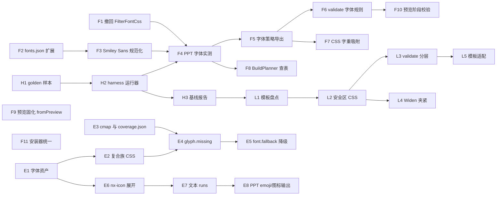

# PPT Harness：字体、图标/emoji 与安全区

> 本文是 [POWERPOINT_COPILOT_BLUEPRINT.md](./POWERPOINT_COPILOT_BLUEPRINT.md) 的配套文档。BLUEPRINT 中引用的
> “PPT_HARNESS §3.6（PPT 写入名以 P0 实测为准）”与“§4（图标与 emoji）”即本文对应章节。
>
> 目标：让 **panel 风格预览 PNG**、**WinForm 预览**、**最终 PPTX** 三端尽可能一致，并把一致性从“靠模型自觉”
> 变成“由 harness 约束 + 校验 + 回归保证”。

---

## 1. 全链路与三端

```
ppt_style_preview ──► 候选 html+css ──► Sanitize ──► DeckAssembler(ThemeCss=候选css)
        │                                               │
        │                                   previews/{name}.html?mode=capture#1
        │                                               │ 隐藏 WebView2，CaptureScale=2/3
        ▼                                               ▼
  ask_user_question(previewImageId)  ◄────────── previews/{name}.png（端①：panel 封面；面板解析本地候选引用）
        │ 用户选中
        ▼
ppt_deck_create（只复用 deckId / 工作区，不复用候选 html/css）
        ▼
ppt_deck_put_slides（模型重新写 theme.css + 所有页，含封面）
        ▼
（用户明确要求时）ppt_deck_validate（validate.js：margin/overlap/covered/font.fallback…）
        ▼
ppt_deck_preview ──► DeckPreviewForm（同一 RenderEnvironment，ZoomFactor 适配）（端②：WinForm）
        ▼
ppt_deck_build ──► capture.js 采集 ──► BuildPlanner（字体/几何/3% 加宽）
        ──► ComSlideBuilder（原生文本框/表格/图表 + 背景 PNG）（端③：PPTX）
```

`ppt_deck_validate` 是独立可选检查；`ppt_deck_build` 不自动运行它，也不在构建后调用 `PptVerifier`。Harness 的回读和图像比对属于单独的测试流程。

三端共享的东西：同一套 `SlideAssets`（fonts.css、nx-runtime、nixer-stage.js）、同一个 WebView2 环境
（[RenderEnvironment.cs](../OfficeCopilot.Slides.Rendering/RenderEnvironment.cs)）。
三端**不共享**的东西是问题的来源：

| 差异点 | 端① 风格预览 | 端② WinForm | 端③ PPTX |
|---|---|---|---|
| HTML/CSS 来源 | 候选 html + 候选 css | 模型重写的 slides + theme.css | 同端② |
| 字体解析 | Chromium/DirectWrite + fonts.css | 同左 | BuildPlanner → FontCatalog → GDI 族名，由 PowerPoint 解析 |
| emoji/符号 | Chromium 使用随包 COLRv1 emoji 字体复合回退 | 同左 | emoji 单独栅格化为透明 PNG；普通文字保持原生文本框 |
| 校验 | 无 | validate.js | L3 回读（宽度/字距/字号） |
| 几何 | 1920×1080，capture 模式 | 1920×1080，ZoomFactor 缩放、动画运行 | 960×540pt（1px=0.5pt），正文框加宽 3% |

**核心结论：三端不一致的首要原因不是渲染器，而是“同一页被生成了两次”和“允许使用随包范围以外的字体能力”。**
渲染器差异是次要的、可通过白名单彻底消除的。

---

## 2. 问题诊断（附证据）

证据工作区：`%LOCALAPPDATA%\NixerOfficeCopilot\Decks\20261016-100747-u2397g`（daisy-days，“天目山亲子野采攻略”）。

### 2.1 “panel 是斜体、WinForm 是正体” —— 根因：封面被重写

| | 端① `previews/daisy-cover.html` | 端② `slides/s01.html` + `theme.css` |
|---|---|---|
| 标题字体 | `font-family:'Smiley Sans','Noto Sans SC'` | `.dsp{font-family:'Noto Sans SC';font-weight:900}` |
| 观感 | 得意黑（字形本身倾斜） | 思源黑粗体（正体） |

daisy-days 的 `design.md` 规定 display 用 `'Smiley Sans','Noto Sans SC'`。风格预览遵守了，
但 `ppt_deck_create` 之后模型重新写了 theme.css，换成了 Noto Sans SC 900。
[PowerPointStylePreviewTool.cs](../OfficeCopilot.Host.PowerPoint/Tools/Style/PowerPointStylePreviewTool.cs) 不保留选中候选的 html/css，
[PowerPointDeckTools.cs](../OfficeCopilot.Host.PowerPoint/Tools/Deck/PowerPointDeckTools.cs) 的 DeckCreate 也不读取它，所以漂移是**结构性**的，不是偶发。

我们用无头 Edge 对比了“随包 fonts.css”与“FilterFontCss 过滤后”的渲染，本机两者像素一致——过滤器不是这次斜体差异的原因。

### 2.2 使用了不存在的字重（900）

随包 Noto Sans SC 只有 400/500/700。`font-weight:900` 时：

- 旧版过滤逻辑在本机恰好装了系统级 “Noto Sans SC Black” 时，会剥离随包 @font-face → Chromium 用系统 Black；F1 已撤销这条路径；
- 用户机器只有随包字体 → Chromium 用 700（或合成加粗）；
- PPT：`FontCatalog.SelectFace` 按 CSS 规则选 700 面 → “Noto Sans SC” + Bold。

**同一个 CSS，三种结果**。只要允许“随包矩阵外”的字重/样式，就不可能三端一致。

### 2.3 FontCssFilter 与 BLUEPRINT 决策矛盾（已按 F1 处理）

- BLUEPRINT §5.7 写的是“只用随包字体，fonts.css 不按系统状态剔除 @font-face，SystemFamily 仅诊断”；
- F1 前，[RenderEnvironment.cs](../OfficeCopilot.Slides.Rendering/RenderEnvironment.cs) 中的 `FilterFontCss` + `FontCssFilter` 会在系统存在同名 GDI 族时剥离 @font-face；现已由只读的 [FontShadowDiagnostics.cs](../OfficeCopilot.Slides.Core/Fonts/FontShadowDiagnostics.cs) 取代。

问题：
1. **名称空间错配**：判断用 GDI+ `InstalledFontCollection`（GDI 族名），Chromium 用 DirectWrite（typographic 族名）。例如 GDI 枚举会返回 “DM Sans 14pt” 和 “Source Serif 4 14pt”，而用户在 PowerPoint 字体列表中确认的是 “DM Sans” 和 “Source Serif 4”。这里的 `14pt` 是 GDI 暴露的名称别名，不是 HTML/CSS 解析出的字体名，也不能直接当作 PowerPoint 可用名称。本机 GDI+ 还可能看不到用户字体目录中的字体。
2. **按族而非按字面**：系统里只有同名族的某几个字面（如只有 Regular，或有 Black），剥离后缺失的字面由系统合成或换成非随包文件。
3. **时机不稳定**：每次请求实时判断，字体安装器在构建中途装字体后，同一会话前后结果不同。

### 2.4 字体文件自身的命名坑

| 字体 | 现象 | 影响 |
|---|---|---|
| Smiley Sans | 只有 `SmileySans-Oblique.ttf`；fonts.css 中声明了两次：`'Smiley Sans'`(italic) 与 `'Smiley Sans Oblique'`(normal)；win32 族名 “Smiley Sans Oblique”，typo 族名 “Smiley Sans” | 写 `font-family:'Smiley Sans'` 但不写 `font-style:italic` 时，Chromium 只能用 italic 面去“近似” normal，再叠加 CJK 回退时容易出现**双重倾斜/合成倾斜**；PPT 端名称与 Italic 标志需实测 |
| DM Sans / Source Serif 4 | GDI `InstalledFontCollection` 分别暴露 “DM Sans 14pt” / “Source Serif 4 14pt” 别名；随包 TTF 的 name ID 1 与当前 `FontCatalog.SelectFace` 对 400/700 输出的是 “DM Sans” / “Source Serif 4” | GDI 别名不等于 PPT 字体列表名称。目测探针里的 “DM Sans 14pt” 是手工设置的错误候选，不是当前构建器对 DM Sans 400 的输出；它在 PowerPoint 中回退不能证明当前构建路径也写了该名称 |
| Space Grotesk SemiBold | `SpaceGrotesk-SemiBold.ttf` 报 win32Family='Space Grotesk' face='Regular' | 与 Regular 冲突，GDI/PPT 可能选错面 |
| Inter/Jost 等 Medium/SemiBold | 非 RIBBI 字重是独立 GDI 族（“Inter SemiBold”） | PPT 写入名必须带后缀，Bold 标志不能叠加 |
| CJK 族 | 没有真斜体 | Chromium 会合成倾斜；PowerPoint 的 Italic 标志行为需实测（§3.6） |

### 2.5 两套安装路径

[PowerPointFontInstaller.cs](../OfficeCopilot.Host.PowerPoint/PowerPointFontInstaller.cs) 用 `AddFontResourceEx` + HKCU 注册，文件前缀 `OfficeCopilot-`；
安装脚本 `Install-NixerFonts.ps1` 用前缀 `NixerOfficeCopilot_`。同一字体可能被装两份，注册状态不一致，正是 §2.3 中“文件在、注册表不在”的来源之一。

### 2.6 其他观察

- 10:07 生成的预览 PNG 右/下有滚动条，而 `Emulation.setScrollbarsHidden` 已在 3a911d3（10-13）加入 `PreparePageAsync`。最可能是加载的 add-in 不是最新构建；如重现，需确认 setScrollbarsHidden 在 navigate 之后是否被重置（建议同时在 capture 模式 CSS 中加 `html,body{overflow:hidden}` 兜底）。
- 风格预览不跑 validate，所以端①可以“违规好看”，到了端②被 validate 逼着改，进一步加剧漂移。
- 2026-10-18 测试机的 10 页 deck 报 276 个 `glyph.missing`、19 个 `font.no_cjk_fallback` 和 10 个 `font.fallback`；抽样实际字族为系统 `NSimSun`，声明栈是 `JetBrains Mono, Noto Color Emoji`。这不是“所有随包字体都未安装”的证据：Terminal Green preset 只声明 JetBrains Mono，而它的矩阵标记 `cjk:false`，没有把已随包的 Noto Sans SC 加入 CJK 回退；另有 JetBrains Mono 700 超出随包 400/500 字重。preset、样式目录及 authoring-contract 已改为 JetBrains Mono 仅用于 400/500 的拉丁/代码文字，Noto Sans SC 负责中文。
- 2026-10-18 `演示文稿1.pptx` 第 6 页的 1–4 号圆点来自 HTML flex 项；DOM 将 `justify-content/align-items:center` 用于同时居中，但捕获只保留了 `text-align`，PPT 原生文字框遂落在左上。`capture.js` 现将 flex 主轴/交叉轴居中映射到段落水平对齐和文字框垂直锚点；回归覆盖该对齐和 56×56 px 圆点几何。

---

## 3. 字体方案

### 3.1 原则

1. **封闭字体宇宙**：HTML 中可用的 `(family, weight, style)` 优先使用随包矩阵中的组合（§3.2）。超出时 sanitize 可吸附，`font.weight_unavailable` 作为警告报告，不阻断构建。
2. **fonts.css 永远完整**：撤回 `FilterFontCss` 的剥离行为，改为只诊断（与 BLUEPRINT §5.7 一致）。随包 @font-face 以 `url()` 指向包内文件，Chromium 用的就是 PPT 会用的那一个文件。
3. **一次生成、三端复用**：选中的风格候选直接成为 deck 的 theme.css + s01（§3.4）。
4. **主题 token 化**：模型不在每页随手写 `font-family`，只用 `--nx-font-display / --nx-font-body / --nx-font-mono` 与 `--nx-weight-*`，主题决定取值。

### 3.2 随包字体矩阵（白名单）

由 `fonts.json` 生成，供 sanitizer、validate、BuildPlanner、模型提示词共用（单一来源）：

| CSS 族名 | 字重 | 斜体 | CJK | 备注 |
|---|---|---|---|---|
| Noto Sans SC（别名 Noto Sans JP） | 400/500/700 | ✗（禁止 italic） | ✓ | **900 不可用** |
| Noto Serif SC | 400/600/700 | ✗ | ✓ | |
| LXGW WenKai | 400/500 | ✗ | ✓ | |
| ZCOOL XiaoWei | 400 | ✗ | ✓ | |
| Smiley Sans | 400（字形自带倾斜） | 仅“自带倾斜”，**禁止再写 italic/oblique** | ✓ | 规范为单一声明，见 §3.5 |
| Big Shoulders Display | 700/800/900 | ✗ | | |
| Cormorant Garamond / Lora / Source Serif 4 | 按文件 | ✓ 真斜体 | | |
| Inter / DM Sans / Albert Sans / Jost / Work Sans / Space Grotesk | 按文件 | 按文件 | | |
| IBM Plex Mono / JetBrains Mono | 按文件 | 按文件 | | |

规则（validate 严重级别沿用现有的 `error` / `warn`）：
- 字重不在矩阵中：**吸附到最近可用字重**（CSS 匹配规则同 `FontCatalog.SelectFace`），并在 validate 报 `font.weight_unavailable`（warn）；风格预览阶段直接改写 CSS，使三端看到的就是吸附后的结果。
- `font-style:italic` 作用于无斜体面的族（尤其 CJK）：报 `font.style_synthesized`（error），提示用颜色/字重/Smiley Sans 代替。
- 族不在白名单：`font.not_bundled`（error）。通用族 `sans-serif/serif/monospace` 仅允许出现在栈尾。
- 例外：现有模板允许少量 Windows 系统字体（`SlideDeckTests.WindowsSystemFamilies`：Segoe UI、Microsoft YaHei、SimSun、SimHei、Consolas、Arial、Calibri 等）。它们在所有目标系统上都存在，可保留为“二级白名单”。本机已安装的系统字体可直接作为主字体使用（推荐随包字体，但不强制，不再报 `font.system_primary`）。该列表从测试代码移入 Slides.Core，由运行时与测试共用。
- 每个字体栈必须以一个随包 CJK 族收尾（`… ,'Noto Sans SC', sans-serif`），避免中文落到 Microsoft YaHei（BuildPlanner 的 `DefaultCjkFamily` 回退仅作兜底）。

校验实现：validate.js 中对**所有可见文本元素**（不只采样 3 族）读取 computed `font-family/weight/style`，与注入的矩阵 JSON 比对。这一步是纯 CSS 层面的，比 CDP `getPlatformFontsForNode` 便宜得多，可以全量做。

### 3.3 撤回 FilterFontCss，改为诊断（F1 已完成）

- `RenderIsolation.ReadFontCss` 按包内原始字节提供 fonts.css；同名系统族只通过 `Trace` 记录，不参与输出内容；
- `InstalledFontState` / `FontResolutionTable` 保留，用于 `ppt_diagnostics` 报告“系统已有同名族、版本可能不同”的提示；
- 若担心“系统有同名但不同版本字体覆盖随包字体”：随包 @font-face 使用 `url()` 时 Chromium 不会去用系统同名族，冲突只会出现在 PPT 侧（GDI 按名字找）。这是 §3.6 实测要覆盖的点，而不是在 HTML 侧剥离的理由。

### 3.4 风格预览固化（解决 §2.1）

1. `ppt_style_preview` 将每个候选的 sanitize 后 html/css 落盘：`previews/{name}.html`、`previews/{name}.css`（已有 html，补 css 与元数据）。
2. `ppt_deck_create` 增加参数 `fromPreview: "{name}"`：
   - 候选 css → `theme.css`；候选封面 → `slides/s01.html`；
   - 记录 `deck.json.origin = { preview, hash }`。
3. 工具描述与 authoring-contract 明确：**封面与主题已定，后续页只能复用 theme.css 中的类和 token；修改 theme.css 中字体/配色 token 需要显式理由**。
4. validate 增加 `theme.drift`（warn）：比较 s01 与 preview 的关键计算样式（标题族/字重/字号/颜色），偏离时提示。
5. 风格预览也运行 validate（至少字体矩阵、安全区两类 error），保证端①不会“违规好看”。

### 3.5 fonts.css 规范化

- Smiley Sans：只保留一个声明 `font-family:'Smiley Sans'; font-style:normal;` 指向 Oblique 文件（把“倾斜”视为字形设计而非样式）。`'Smiley Sans Oblique'` 作为别名保留。这样：作者写 `normal` 即得到原生字形，不会触发合成；BuildPlanner 不置 Italic 标志。
- 为 FontCatalog 增加显式的 **PPT 写入名覆盖表**（`fonts.json` 中的 `pptName` 字段），而不是在运行时从 name 表推断，至少覆盖：DM Sans、Source Serif 4、Smiley Sans、Space Grotesk SemiBold、全部非 RIBBI 字重。值以 §3.6 实测为准。
- Space Grotesk SemiBold 的 name 表问题：要么从白名单中去掉 600，要么在打包时修正 name 表（OFL 允许修改，需改名保留条款注意）。推荐先去掉 600（吸附到 500/700）。

### 3.6 PPT 写入字体名：P0 实测矩阵

正式构建的字体名可用性以 **Windows 系统字体字典** 为准：从 HKLM/HKCU Fonts 注册项取得已注册字体文件，再从 OpenType name 表生成规范族名和字面别名。不得通过读取 PowerPoint 控件或字体下拉列表来构造这份字典。字体最终是否正确渲染仍须通过 PowerPoint 导出图与 HTML capture 的视觉对照验收；`Font.Name` 回读只能验证写入值。

测试 harness（建议放在 `OfficeCopilot.Host.PowerPoint` 的诊断命令或独立测试工程中）：

1. 生成一页 HTML：矩阵中每个 `(family, weight, style)` 一行；字体名/字重/样式标签与固定样张 `Hamburgefonstiv 0123 汉字永和` 分开绘制，标签使用统一字体且不进入样张测量区域。
2. 走完整 build 流程生成 PPTX。
3. 对每个文本框：
   - 回读 `Font.Name / NameFarEast / Bold / Italic`，只用于确认写入值，不把它当作实际渲染字体的证明；
   - 对照 Windows 注册字体字典核对名称；该字典来自系统注册项指向的字体文件及其 OpenType name 表，不读取 PowerPoint 控件内容；
   - 对每个有效字面记录浏览器 DOM Range 宽度和 PowerPoint `TextRange2.BoundWidth`，相对差值采用 **±3%** 作为快速回归门槛；这是跨引擎的实用容差，不宣称是精确墨迹宽度；
   - 整页 Web/PPT SSIM 保留 ≥ 0.93 的回归线；逐行 raw SSIM 和 CV 墨迹分割暂不作为 F4 阻塞项。用户已目测认可的最大差异样本作为视觉抽查依据；
   - 记录系统注册字体字典命中、随包文件 hash 与字体安装状态。`PptVerifier.GetInstalledFonts` 使用该系统字典，不使用 GDI 枚举或 PowerPoint 字体列表；名称回读和 `Presentation.Fonts` 不作为系统字体可用性证据。
4. 输出表：

| CSS (family, weight, style) | 文件 | PPT Name | NameFarEast | Bold | Italic | 回读一致 | 视觉一致 | 备注 |
|---|---|---|---|---|---|---|---|---|
| Inter 600 normal | Inter-SemiBold | Inter SemiBold | Noto Sans SC | ✗ | ✗ | | | |
| DM Sans 400 normal | DMSans-Regular.ttf | `FontCatalog.SelectFace` → `DM Sans`；GDI 别名 `DM Sans 14pt` | | | | | | 已确认 `DM Sans 14pt` 是错误候选；当前构建路径须用完整 harness 再验 |
| Smiley Sans 400 normal | SmileySans-Oblique | Smiley Sans Oblique ? | 同 | ✗ | ✗ | | | 待测 |
| Noto Sans SC 700 normal | NotoSansSC-Bold | Noto Sans SC | Noto Sans SC Regular | ✓ | ✗ | | | |
| … | | | | | | | | |

5. 不能一致的组合从白名单删除（或吸附）。实测结果分别回写 `fonts.json.pptName` 与 `pptFarEastName`，BuildPlanner 按拉丁/东亚字段查表。Office 2019 的 `NameFarEast` 不能假定与拉丁 `Name` 共用同一个字体族名：Noto Sans SC 的旧式族名会导致汉字映射到错误字形，实测使用完整字体名 `Noto Sans SC Regular` 可正确显示。

名称归一化必须采用**受约束的精确匹配**：候选名与 Windows 注册字体字典做大小写不敏感的精确匹配；只有完整光学尺寸 token（如 `14pt`）被移除后能精确命中唯一注册名称时，才允许规范化到该名称。不得逐字符删后缀或无条件删除最后一个词，否则可能把 `Arial Narrow` 错配成 `Arial`。未命中时必须显式阻断构建，不能静默回退。

### 3.6.1 字体名交叉校验与回退阻断方案

**目标**：对每个 `(CSS family, weight, style, script)`，在写入 PPT 前确定一个经目标 PowerPoint 验证的名称；若不能证明名称有效，标记为未验证并阻断该字面进入正式字体白名单，避免 Office 静默替代。

**当前实现**：`InstalledFontState` 从 HKLM/HKCU Fonts 注册项解析字体文件，并以 OpenType ID 16/17 优先、ID 1/2 回退构建 Windows 名称字典；支持 TTC 中的多个字体面。字体安装后，构建服务只对完整 optical-size token 做规范化，再按字典精确匹配文本框和表格（含 FarEast）名称；未匹配时以 `ppt.font_name_unresolved` 阻断。随后按实际使用的打包字体族确认全部随包字面的 SHA-256 均存在于 Windows 注册字体文件集合中；缺少随包字面或文件无法读取时以 `ppt.font_identity_mismatch` / `ppt.font_identity_unverified` 阻断。系统中额外的同族字体文件不阻断构建，但会通过 `ppt.font_system_shadow` 提示，并由 F4 实际渲染验证是否影响字体选择。该流程不读取 PowerPoint 控件来获取系统字体列表。

#### 阶段 A：建立名称来源账本

对每个随包字面记录并在诊断输出中区分以下名称，禁止统称为“字体名”：

| 来源 | 示例 | 用途 |
|---|---|---|
| CSS 规范族名 | `DM Sans` | HTML `@font-face` 与 `BuildPlanner` 的族查找键 |
| TTF legacy name（name ID 1/2） | `DM Sans Medium` | 字体元数据候选，不自动等于 PowerPoint 字体列表项 |
| TTF typographic name（name ID 16/17） | `DM Sans` / `Medium` | 现代族名与字面样式候选 |
| Windows 注册字体字典名 | `DM Sans Medium` | 从注册表字体文件的 name ID 1/2、16/17 构造；用于构建前精确核验 |
| 规范化后的写入候选 | `DM Sans` | 只有与 Windows 注册字体字典精确命中后才允许写入 |

每个结果同时记录选中的 TTF 文件、名称来源（显式 `pptName` / ID 1 / ID 16 / 规范族名）、字体安装 hash、注册字典匹配结果、Office 版本及渲染验收状态。这样可定位名字在哪一层改变，而不是只看最终的 `Font.Name`。

#### 阶段 B：构建 Windows 系统字体字典

1. 从 `HKLM\SOFTWARE\Microsoft\Windows NT\CurrentVersion\Fonts` 与 `HKCU\SOFTWARE\Microsoft\Windows NT\CurrentVersion\Fonts` 读取字体注册项，并解析项值对应的字体文件路径；不读取 PowerPoint 控件、字体下拉列表或文档字体集合。
2. 对每个可读字体文件解析 OpenType name ID 16/17（typographic family/subfamily），缺失时回退到 ID 1/2（legacy family/subfamily）。生成规范族名和已注册字面名的大小写不敏感字典；完整光学尺寸 token 仅作为受约束别名归一化。
3. 注册项缺失、文件不可读、名称缺失或候选无法唯一精确命中时显式报告并阻断对应字体写入。对本次构建使用的每个打包族，注册文件 hash 集合必须包含全部随包字面 hash；缺少随包字面或无法读取时阻断。额外同族 hash 通过 `ppt.font_system_shadow` 报告但不单独阻断，是否影响实际字体选择由 F4 渲染验收确认。刚安装的字体须先注册，再重新读取名称与 hash 字典后进入构建。

#### 阶段 C：实现受约束名称解析

1. 优先使用 `fonts.json` 中显式的 `pptName/pptFarEastName/pptBold/pptItalic`；未标记 `verified` 的值只作为候选。
2. 候选与 Windows 注册字体字典做不区分大小写的**精确匹配**；只有移除完整 optical-size token 后精确命中，才将计划中的写入名称规范化为字典中的名称。
3. 禁止逐字符截断、任意删词或用族名前缀命中。`Arial Narrow` 不得因 `Arial` 已安装而通过。
4. 候选无匹配、注册字典为空或字体文件名称无法解析，均产生显式 `ppt.font_name_unresolved` 错误并阻断构建；不能静默回退或自动选第一个候选。RIBBI 与 Medium/SemiBold 等非 RIBBI 字面分别核验。
5. 构建前先安装缺失的随包字体，再读取注册字典并解析计划；任何随包字面未能在注册 hash 集合中确认，或无法核实字体身份时，报告具体问题并阻断构建。额外同族字体仅给出诊断提示。

#### 阶段 D：贯通 BuildPlanner 与验证器

- `BuildPlanner` 先生成候选计划；字体安装完成后由系统字典解析器规范化并验证所有文本框、FarEast 与表格字体名，再比对本次使用字面的注册文件与随包文件 hash；名称或身份无法验证时不得新增/替换幻灯片。
- `PptVerifier` 对 `Font.Name/NameFarEast/Bold/Italic` 的回读只检查请求值是否写入；字体可用性来自 Windows 注册字体字典，实际字形来自 PowerPoint 导出图与 HTML 对照。
- `PptVerifier.IsInstalledFontName` 只做字典精确匹配；光学尺寸归一化发生在构建前，不能让 `DM Sans 14pt` 作为最终写入名通过，也不能让 `Arial Narrow` 通过 `Arial` 命中。

#### 阶段 E：回归矩阵与验收门槛

1. 单元测试覆盖：CSS 族解析与 PPT 名解析分离；ID 1/2、16/17 名称构造；显式映射优先；`DM Sans 14pt` 只可在字典精确命中后规范化、不可成为最终写入名；`Arial Narrow` 不可匹配 `Arial`；无匹配必须失败。
2. Office 2019 集成测试使用 `BuildPlanner → ComSlideBuilder` 生成矩阵，再由 harness 独立回读与测量；不通过 `ppt_deck_build` 自动运行 `PptVerifier`。手工错误名（如未规范化的 `DM Sans 14pt`）作为**负向控制**单独统计，不得混入正式构建输出；字典构造本身不得依赖 Office 控件读取。
3. 每个有效字面导出 PowerPoint PNG，与同一字体文件、同一文字的浏览器参考逐行比较；Latin、CJK/FarEast、粗体、斜体分开测。只有名单精确命中且视觉 SSIM ≥ 0.95（或经批准的等价阈值）才设置 `verified`。
4. 首批必测 DM Sans 400/500/600/700、Source Serif 4 400/600/700/italic、已知 GDI 名称冲突族与 Noto Sans SC FarEast；通过后扩展到全部白名单字面。

**已核实的 DM Sans 事实**：随包 `DMSans-Regular.ttf` 的 name ID 1 与当前 `SelectFace(400/700)` 输出为 `DM Sans`；500/600 的选择名是 `DM Sans Medium` / `DM Sans SemiBold`。本机 GDI 列表则暴露 `DM Sans 14pt`、`DM Sans 14pt Medium`、`DM Sans 14pt SemiBold`。此前目测 PPT 中的 `DM Sans 14pt` 是手工设置的负向控制，不是完整 BuildPlanner 流程的输出；当前仍需对 Medium/SemiBold 与正式生成路径做 Office 2019 验收。

Bold/Italic 当前规则 `Italic = (ribbi && faceItalic) || (italic && !faceItalic)` 中，后半句会给 CJK 等无斜体面打 Italic 标志，导致 PPT 合成倾斜——在 §3.2 禁止 CJK italic 后此分支应只用于“确认可合成且实测一致”的族。

### 3.7 安装器统一

- 只保留一个安装实现与一个前缀（建议 `NixerOfficeCopilot_`），安装时清理旧前缀副本；
- 安装后同时 `AddFontResourceEx` + HKCU `Fonts` 注册 + 广播 `WM_FONTCHANGE`；
- 安装结果写入一份清单（文件 hash + 版本），`ppt_diagnostics` 比对清单而不是 GDI+ 枚举；
- 若系统已有同名但不同版本的字体（如用户装了 Noto Sans SC Black 或旧版 Inter），在诊断中给出 warning：PPT 侧可能选中系统版本。这是 PPTX 端唯一无法由 HTML 侧消除的风险，靠 §3.6 的回读兜底。

---

## 4. 图标与 emoji

### 4.1 现状与漏洞

原有字体校验是 [DeckRenderHost.cs](../OfficeCopilot.Slides.Rendering/DeckRenderHost.cs) 的 `ValidateFontsAsync`（`font.fallback`），通过 CDP `CSS.getPlatformFontsForNode` 对有限文本样本检查实际平台字体。现在额外增加了随包 cmap 覆盖检查（`glyph.missing`）；两者职责不同，前者检查 Chromium 实际使用的字体，后者检查随包字体栈是否声明覆盖字符。

| 缺口 | 后果 |
|---|---|
| CDP 平台字体检查仍最多采样 3 个族/页、120 个目标 | `font.fallback` 仍是有限样本；不能代替 cmap 检查 |
| cmap 检查覆盖范围 | 遍历可见 DOM 文本（含行内文本）和静态 quoted `::before`/`::after` 内容；`svg`、`aria-hidden`、`data-nx-hidden` 内容跳过，动态 `attr()`/`counter()` 及 `url()` 伪元素内容不解析 |
| cmap 检查与实际渲染的差别 | 依据随包字体 cmap，不证明浏览器/Office 实际选中了该面，也不能发现 cmap 声明有字形但字形本身为空白等异常 |
| PPT 端 emoji | capture.js 将 emoji 字素簇作为透明 PNG overlay；Office 2019 的近期 emoji 方框问题已修复并复验，伪元素/SVG 等边界仍不在 capture 支持范围内 |

方框的典型来源：较新的 emoji（Emoji 13+）、ZWJ 序列、肤色修饰、`FE0F` 变体选择符、私用区字符、生僻符号（★✓➜ 部分字体缺）、模型写的 Font Awesome 类名但没有图标字体。

### 4.2 方案：随包 emoji / Lucide SVG + 码点级覆盖检查

**(a) 随包字体**
- **Noto Color Emoji（OFL）**采用官方 COLRv1 TTF，作为 WebView2 的本地回退字体；不把它选作 PowerPoint 正文字体，也不依赖系统全局安装。
- `FontCatalog.BuildCss` 为每个随包正文族生成一条同族 `@font-face`，引用 emoji 字体并用 `unicode-range` 限定常用 emoji 区段；正文族自己的 face 仍负责普通文字。模板和模型不需要自行追加 emoji 字体栈。
- 仅靠同族 `@font-face` 回退不足以保证所有正文栈实际选中 emoji 字体；`nixer-stage.js` 现在为有文本/伪元素内容的节点把 `"Noto Color Emoji"` 加入 computed `font-family` 栈，确保 WebView 预览可回退到随包字体。
- Noto Color Emoji 当前文件约 24.2 MiB（25,336,844 bytes），会完整增加素材及安装包体积；它通过 `fonts.json` 和 `Stage-Package.ps1` 纳入包内素材清单，实际安装包由用户构建。
- Lucide 使用官方 SVG 图标资产，不引入图标字体；当前随包提供 287 个常用图标，通过 `nx-icon` 调用；`data-icon` 只写图标名，清洗器会去掉误加的 `lucide-` 前缀并映射常见旧名（如 home→house）。随包没有的图标不再拒绝整批写入，而是替换为最相近的随包图标（无相近项时用 `sparkle`），并在写入结果的清洗备注里说明。
- `.nx-chrome` 是全页覆盖层（运行时默认 top/bottom 均有值）；作者只写 `bottom` 或只写 `top` 时，CSS 清洗器自动补 `top:auto` / `bottom:auto`，`validate` 另以 `layout.chrome_stretched` 拦截页脚被拉伸到页面中部的情况。

**(b) 码点白名单**
- [TrueTypeInfo.cs](../OfficeCopilot.Slides.Core/Fonts/TrueTypeInfo.cs) 读取随包 TrueType 字体 cmap format 4/12，排除映射到 `.notdef` 的码点并压缩为区间；运行时 [FontPolicy.cs](../OfficeCopilot.Slides.Core/Fonts/FontPolicy.cs) 将各字体族及 Noto Color Emoji 回退的覆盖区间直接传给 validate.js。**不生成独立 `coverage.json`**，避免与实际字体文件清单漂移。
- 对随包 Noto Color Emoji 2.057 的 cmap 做了逐项核验：共映射 1,508 个 Unicode 码点，其中 1,437 个落在当前 emoji 候选区间内（这不是“emoji 图案数”）。与 Unicode 18.0（2026-04-30）的 [emoji-test.txt](https://unicode.org/Public/emoji/latest/emoji-test.txt) 对照，3,963 个 fully-qualified RGI 序列的所有可见组成码点均在字体 cmap 中；FE0F、ZWJ、tag 和 keycap combining mark 等非独立绘制控制码点不计入可见覆盖。
- 上述是序列组成码点的 cmap 覆盖对照，不等于 3,963 个序列都逐像素实测或都映射为单一连字。当前没有已知需替换的标准 RGI emoji；已复现的方框属于字体选择问题，不是超出 cmap。未来遇到真实不覆盖项时，`glyph.missing` 阻断并要求模型改写为语义相近、受支持的标准 emoji；无明确映射时不静默替换。
- sanitizer 层（只做无歧义的清理，不改写可见内容）： 
  - 去掉孤立的 `FE0E/FE0F`、孤立的 `U+200D`，并在返回的 Removed 列表中说明；
  - `<i class="nx-icon" data-icon="leaf"></i>` 展开为随包 Lucide 官方 SVG；未知图标名报错并列出当前支持列表；
  - 私用区字符、Font Awesome / 外部 Lucide 字体类名 → 报错并提示使用 `nx-icon`。
- 符号替换建议（`✓✔ → check`、`★ → star`、`➜ → arrow-right`）只出现在 `glyph.missing` 的修复提示中，不自动替换，避免改动用户文案。

**(c) 全量覆盖检查（替换 font.fallback 的判定逻辑）**
- validate.js 遍历可见 TreeWalker 文本节点（含行内文本）及可见元素静态 quoted `::before`/`::after` 字符串；当前明确跳过 `svg`、`aria-hidden`、`data-nx-hidden`，不求值动态 `attr()`/`counter()` 等内容。
- 每个字素簇（`Intl.Segmenter`）按 computed `font-family` 栈逐族查随包 cmap 区间及 emoji fallback 区间；全栈都不覆盖 → `glyph.missing`（error，包含字符、码点和元素选择器）。
- emoji 字体通过复合族接入覆盖后，常见 emoji、肤色/ZWJ、旗帜与 keycap 序列不会因缺少基础码点而误报；这项检查仍是 cmap 声明覆盖判断，不等价于像素级字形检查。
- CDP `getPlatformFontsForNode` 保留为独立的有限样本检查；目前没有增加 `font.platform_fallback` 新错误码，实际平台字体与 cmap 的差异仍需结合诊断和实机验收。
- opt-in WebView2 往返测试会把一张代表性页面重复成 20 页，累计测量 cmap 字素覆盖判定耗时，门槛为 `< 300 ms`。此数值不包括 PDF 分页、CDP 字体采样和浏览器导航耗时。

**(d) PPT 端**

前提：当前 `PlannedTextBlock` 整个文本框只有一套字体属性（FontName/FontNameFarEast/Bold/Italic），没有 run 的概念；图标 run 和 emoji 占位都需要先把文本块扩展为 runs。

- 彩色 emoji：capture.js 按字素簇把 emoji 渲染为 2× 透明 PNG，显式加载并使用随包 `"Noto Color Emoji"`，不再依赖正文族的间接回退；普通文字仍为原生可编辑文本，emoji 图像作为独立图片对象在文字之后叠加。文本中以全角空格保留近似字宽，多行含 emoji 的文本锁定浏览器采集的换行，降低 PowerPoint 重排造成的位置漂移。
- E8 验收已完成：WebView2 往返测试覆盖 🫠、🩷、🫶，并检查其 overlay 含多种可见颜色，防止“有像素但实际是单色缺字方框”的假通过；2026-10-18 Office 2019 COM harness（16.0.19127.20860，6 种样式）复验 `glyphs.html`，近期 emoji、家庭 ZWJ、肤色与旗帜序列在 WebView 及 PPT 导出图中均显示为彩色字形，文字仍可编辑。叠加位置按 DOM Range 字符矩形定位并经截图目视确认；当前没有独立的 CV/逐像素 ≤ 2 pt 数值门禁。
- Lucide 图标：sanitizer 展开已支持的官方 SVG；capture.js 将其单独栅格化为透明 PNG，作为 PowerPoint 图片对象叠加，周围普通文字保持可编辑。
- 已知边界：伪元素中的 emoji/图标仍画进背景 PNG（安全但不可编辑）；SVG `<text>`、动态伪元素内容仍不作为独立 overlay 采集。`glyphs.html` 中的私用区 U+E000 故意无覆盖，出现缺字方框属于负向测试样本，应由 `glyph.missing` 报出，不代表已支持字体出现回归。

### 4.3 给模型的规则（写入 authoring-contract）

- 图标使用随包白名单支持的 `<i class="nx-icon" data-icon="leaf"></i>`（Lucide）；emoji 只用于“语气装饰”，单页 ≤ 3 个；
- ZWJ 组合、肤色修饰、国旗和变体选择符由随包 Noto Color Emoji 回退及字素簇采集处理；`glyphs.html` 已通过 Office 2019 验收，但不据此承诺任意码点/序列都受支持；
- 不要给 emoji 单独设置 font-family；
- `glyph.missing` 必须修复，`font.platform_fallback` 可忽略并说明。

---

## 5. 布局与安全区

### 5.1 现状问题

- 原实现以 validate.js 的 `SAFE_MARGIN = 80`（设计像素）一刀切，作用于文字行矩形与图片；该规则已由分层安全区校验替代；
- 技能描述与 authoring-contract 已同步安全区变量、层标记与 80/80 例外规则；
- 模型原先没有任何安全区 token，只能凭感觉写 `padding:80px` 或绝对坐标；
- 初始盘点发现 34 个模板各自定义内边距；修复前 studio（`5vw`≈96px）与 stencil-tablet（内容区 `left/right:64px`）都小于 128。现已完成 34×351 原始 gallery 实测，按模板逐一闭环修复；
- 80px 是**最小值被当成了目标值**：模型把内容贴着 80 线放，结果视觉上仍“贴边”（在 1920 宽上 80px≈4.2%，低于常见的标题安全区 5%–10%）；
- 构建时正文框加宽 3%（[BuildPlanner.cs](../OfficeCopilot.Slides.Core/Deck/BuildPlanner.cs) `BodyWidenRatio`），右对齐/居中框会向外扩，PPT 中比 HTML 更贴边；
- 装饰元素（色块、圆、插画）没有分层概念，validate 要么一起管、要么不管。

daisy-days 实际成片（s04/s06）内容左边界约 150px、右边界约 1770px、上边界约 100px，视觉是舒适的——说明舒适值大约在 **左右 ~150 / 上下 ~100**，而不是 80。

### 5.2 “中芯画幅”评估

| 方案 | 做法 | 优点 | 缺点 |
|---|---|---|---|
| A. 缩放整页 | 在 1600×900 写，整体 `transform: scale(1.2)` 放入 1920×1080 | 简单 | 字号/坐标与 pt 映射全错，PPT 文本框尺寸与 HTML 不一致，背景无法出血，**不推荐** |
| B. 小画布居中 | 在 1680×945 写，四周留空居中 | 自动留白 | 背景/装饰被困在中芯，边缘一圈空白，无法满版 |
| **C. 分层安全框（推荐）** | 画布仍是 1920×1080；`.slide` 承载背景与装饰（可出血）；内容放在 `.nx-safe` 容器里，容器由 CSS 变量定位 | 本质就是“中芯画幅”，但不缩放、背景可满版、坐标仍 1px=0.5pt | 需要 runtime/模板/validate 配合 |

方案 C 让模型“在中芯里创作”：对模型来说 `.nx-safe` 就是它的画布（宽 1920−2×左右边距），绝对定位也相对它计算。

### 5.3 安全区模型

两层边界（设计像素，1920×1080）：

| 变量 | 建议值 | 含义 | 校验 |
|---|---|---|---|
| `--nx-safe-x` | 128px（≈6.7%） | 内容左右目标边距（title safe） | 超过 112px 下限 → `layout.unsafe` warn；介于目标与下限 → `layout.tight` warn |
| `--nx-safe-y` | 96px（≈8.9%） | 内容上下目标边距 | 超过 80px 下限 → `layout.unsafe` warn；介于目标与下限 → `layout.tight` warn |
| `--nx-action-x / -y` | 64px / 48px | 页眉页脚、页码、logo 等“角标”可达的边界 | 角标越界 → `layout.chrome_unsafe` warn |
| 出血 | 0 | 装饰层可超出画布 | 不校验 |

内容位于目标线与最小线之间时给 `layout.tight`（warn），提示不要把下限当目标。低于最小线的配置会报 `layout.safe_override`，校验按下限执行。仅对绝对定位页面显式标记 `data-nx-safe-exception="absolute-80"` 且目标正好为 80/80，才允许该例外。

非 16:9（如 4:3：1440×1080）按百分比计算：`--nx-safe-x: calc(var(--nx-w) * 0.067)`。

### 5.4 Runtime/模板实现

运行时 CSS 在模板模式由 [DeckAssembler.cs](../OfficeCopilot.Slides.Core/Deck/DeckAssembler.cs) 的 `RuntimeCss` 注入，在外壳模式由 `SlideAssets/runtime/viewport-base.css` 提供。当前两种模式均保留 1920×1080 画布并由 runtime 提供安全区变量及 `.nx-bg/.nx-safe/.nx-chrome` 基础规则：

```css
:root{
  --nx-safe-x:128px; --nx-safe-y:96px;
  --nx-action-x:64px; --nx-action-y:48px;
}
.slide{position:relative;width:1920px;height:1080px;overflow:hidden}
.nx-bg{position:absolute;inset:0;z-index:0}           /* 背景与装饰：可出血 */
.nx-safe{position:absolute;z-index:1;
  left:var(--nx-safe-x);right:var(--nx-safe-x);
  top:var(--nx-safe-y);bottom:var(--nx-safe-y);
  display:flex;flex-direction:column}
.nx-chrome{position:absolute;z-index:2;               /* 页码/页眉页脚 */
  left:var(--nx-action-x);right:var(--nx-action-x);
  top:var(--nx-action-y);bottom:var(--nx-action-y);pointer-events:none}
```

- 模板模式不自动重排既有 DOM；34 个内置模板已通过 L1/L5 逐页适配安全区并显式标层，避免统一包装破坏既有定位。新生成内容仍应放入 `.nx-safe` 或使用等价的 `data-nx-layer` 标记。
- 主题可以在约束内调整变量（如极简风格 `--nx-safe-x:180px`），但不能低于 harness 下限（validate 以下限判断）。
- authoring-contract 已写明：正文使用 `.nx-safe` / `.nx-content` 或 `data-nx-layer="content"`；装饰使用 `.nx-bg`；页码使用 `.nx-chrome`。

### 5.5 校验调整

本节描述的 `PptVerifier` 回读能力保留给独立 harness/诊断使用；默认 `ppt_deck_build` 不调用它。`ppt_deck_validate` 也是用户明确要求时才单独运行。

validate.js（核心已实现；34 个内置模板已完成 L1/L5 迁移与全量验收）：
- 按层判断：元素祖先为 `.nx-bg` / `[data-nx-layer=bg]` → 跳过安全区；`.nx-chrome` / `chrome` → action 边界；其他 → safe 边界。不在任何层中的内容元素 → `layout.unlayered`（warn）。
- WebView2 预检按实际排版的文本行矩形判断，避免把全宽块级文本容器的空白误算成可见内容；PowerPoint 导出阶段的 BuildPlanner 3% Widen 按采集到的安全线夹紧，并由 `PptVerifier` 回读复核。输出 `layout.unsafe`、`layout.chrome_unsafe`、`layout.tight`、`layout.unlayered`、`layout.safe_override`，均先为 warn。
- 原 `text.margin/image.margin` 代码已移除；风格预览与正式校验共用同一 validator。

BuildPlanner 与 PptVerifier：`Widen` 以采集到的水平安全线而非 `[0, slideWidth]` 作为夹紧范围，加宽不越线；越线的原始框保持不变，由 validator 报告。

---

## 6. 三端一致性回归 harness

### 6.1 golden 用例

`OfficeCopilot.Agent.Tests\PowerPoint\Fixtures\Harness\`（新建）：
- 每个 catalog 风格一个封面 + 一页正文（含中英文混排、表格、emoji、Lucide 图标、斜体真/假用例）；
- §3.6 字体矩阵页；
- 安全区边界页（内容紧贴 safe 线、装饰出血、页码在 action 区）。

### 6.2 三端截图对比

| 对比 | 方法 | 阈值 |
|---|---|---|
| 端① vs 端②（预览 PNG vs deck capture s01） | 同尺寸 SSIM | ≥ 0.98（应近乎一致，因为 §3.4 复用同一 html/css） |
| 端② vs 端③（capture vs PPT `Slide.Export`） | 整页 SSIM + 文本框几何/行数检查 | SSIM ≥ 0.93；行数一致 |
| 字体矩阵 | DOM Range 与 `TextRange2.BoundWidth` 差值 | 每行 ≤ 3%（快速回归容差；不解释为精确墨迹差异）；raw 行 SSIM 仅记录、不阻塞 |
| 安全区 | 回读 PPT 文本框矩形 | 不越过 safe 线（考虑 3% 加宽后） |

### 6.3 环境矩阵

- 干净 VM：只装 Office + 安装包（验证“只有随包字体”的真实用户场景）；
- 开发机：系统已装同名/不同版本字体（验证 §3.7 的风险提示）；
- DPI 100%/150%（WebView2 capture 与 PPT Export 尺寸稳定性）。

---

## 7. 分阶段落地

### 7.0 约定

- **任务编号**：`H` 基线与工具，`F` 字体，`L` 布局，`E` emoji/图标，`X` 收尾。每个任务一个 PR，PR 标题带编号。
- **通用完成标准（每个任务都要满足）**：
  1. 解决方案能构建，`OfficeCopilot.Agent.Tests` 默认测试全部通过；
  2. 新增/修改的行为有单元测试（放在 `OfficeCopilot.Agent.Tests\PowerPoint\`）；
  3. 需要 WebView2 或 PowerPoint 的测试标记 `[TestCategory("Harness")]`，默认流水线不跑，发布前手动跑；
  4. 改到模型可见的行为时，同步更新 authoring-contract、工具描述（`Define(...)` 中的文字）和 [OfficeSkillCatalog.cs](../OfficeCopilot.Agent.Planning/Runtime/OfficeSkillCatalog.cs) 中的技能描述；
  5. 改到架构决策时，同步更新 BLUEPRINT 对应章节。
- **新校验规则的上线方式**：先以 `warn` 发布并在基线样本上统计命中数，误报率可接受后再升为 `error`。每条规则的升级时间点写在任务里。
- **工作量**：以人日估计，含测试，不含评审等待。

### 7.1 依赖关系



关键路径：`H1 → H2 → F4 → F5 → F6`。F1、F2、F9、F11、E1、E3 没有前置依赖，可以并行开工。

### 7.2 阶段与门禁

| 阶段 | 包含任务 | 进入下一阶段的条件（门禁） |
|---|---|---|
| **M0 基线** | H1–H3 | harness 运行器能对所有 golden 样本输出三端截图与指标；基线报告入库 |
| **P0 字体一致** | F1–F11 | ① 字体矩阵中保留的每个组合，PPT 回读名一致、逐行 SSIM ≥ 0.95；② daisy-days 复现场景中，预览 PNG 与 s01 的 SSIM ≥ 0.98；③ 34 个模板 + 12 个预设在 validate 中 `font.not_bundled`/`font.style_synthesized` 为 0（或列入已知例外清单）；④ 干净 VM 上三端标题字体目视一致 |
| **P1a 安全区** | L1–L5 | ① `layout.unsafe` 在全部模板样本上为 0；② PPT 回读的文本框不越过安全线；③ `layout.unsafe` 已升为 error |
| **P1b emoji/图标** | E1–E6 | ① glyph 样本中预期缺字全部报出，受支持 emoji 零误报；② 干净 VM 上 HTML 端无方框 |
| **P2 PPT 端与回归** | E7–E8、F12、X1–X3 | ① PPT 中受支持 emoji 显示为彩色图片或图标 run，无方框；② 三端回归纳入发布检查清单 |

### 7.3 M0：基线与工具

**H1 golden 样本**（1.5 人日）
- 新建 `OfficeCopilot.Agent.Tests\PowerPoint\Fixtures\Harness\`：
  - `font-matrix.html`：**由测试代码根据 fonts.json 生成**，不手写。每个 `(family, weight, style)` 一行，样张为 `Hamburgefonstiv 0123 汉字永和`；有效字面统一显式带随包 CJK fallback（Noto Sans SC），避免 Web 与 PPT 对 CJK 系统回退不同；另有缺失 CJK fallback 探针及非法组合行（Noto Sans SC 900、CJK italic、Smiley Sans + italic）用于验证规则；
  - `glyphs.html`：基础 emoji、Emoji 13+、ZWJ 序列、肤色修饰、国旗、孤立 FE0F、★✓➜•、私用区字符、行内 span 中的 emoji、`::before` 中的 emoji、SVG `<text>`、`aria-hidden` 中的可见文字；
  - `safe-area.html`：内容紧贴 safe 线、越线 1px、装饰出血、页码在 action 区、右对齐长正文（验证 3% 加宽）；
  - 封面与正文 fixture 组合：用 6 个代表风格（daisy-days 必选，另选衬线类、等宽类、深色、模板类、预设类各一）组装；P1a 再扩到全部。
- 当前首批 golden 页面作为 fixture 文件固定；字体矩阵由测试从 `fonts.json` 动态生成。封面/正文 fixture 已用 daisy-days、vellum、terminal-green、dark-botanical、studio、bold-signal 六种代表风格逐一通过 `DeckAssembler.Assemble`。
- 验收：样本能被 `DeckAssembler.Assemble` 组装；完整 WebView2 加载验证由 H2 的显式集成测试执行。

**H2 harness 运行器**（3 人日）
- 位置：`OfficeCopilot.Agent.Tests\PowerPoint\Harness\`，`[TestCategory("Harness")]`。
- 对每个样本执行：组装 → `CaptureAsync`（端①等价）→ `ValidateAsync`（收集 issues）→ build 到临时演示文稿（注入生产用随包字体安装器）→ `Slide.Export` 导出 PNG（端③）→ 回读每个文本框的 `Font.Name/NameFarEast/Bold/Italic/矩形`。
- 图像比较：在测试工程内实现灰度 SSIM（8×8 窗口），不引入新依赖；支持整页和按矩形裁剪比较。按 `Format32bppArgb` 读取像素，兼容 PowerPoint 导出的 8bpp indexed PNG。
- 输出：`%TEMP%\nixer-harness\{时间戳}\report.md`、`text-readback.csv`、每风格 panel preview、每页 Web/PPT 截图与差异热图。CSV 回读 `Font.Name/NameFarEast/Bold/Italic/矩形`；报告包含每页 issues 统计及 Web capture/PPT SSIM。
- 目前集成入口为 `[TestCategory("Harness")]` 的 `RunFullHarness_WhenExplicitlyEnabled`，默认不会启动 Office 或 WebView2。先用 Visual Studio/.NET Framework MSBuild 构建测试工程，然后在已安装 PowerPoint 与 WebView2 Runtime 的机器上运行：

  ```powershell
  $env:NIXER_PPT_HARNESS = "1"
  dotnet vstest OfficeCopilot.Agent.Tests\bin\Debug\OfficeCopilot.Agent.Tests.dll --TestCaseFilter:FullyQualifiedName~RunFullHarness_WhenExplicitlyEnabled
  ```

  集成入口对 6 个代表风格（daisy-days、vellum、terminal-green、dark-botanical、studio、bold-signal）逐一运行 8 页样本（封面、正文、glyph、safe-area、按 16 个字面拆分的四页动态字体矩阵），每个风格单独组装、validate、build、导出与回读。
- 已在本机真实运行：6 个风格共 48 页，PDF 页数 48，PowerPoint 检查并回读 486 个文本块；生成 6 张 panel preview、48 张差异热图及 `text-readback.csv`。各风格的最低 SSIM：daisy-days `0.9381`、vellum `0.9541`、terminal-green `0.9444`、dark-botanical `0.9444`、studio `0.9579`、bold-signal `0.9444`。封面/正文/glyph/safe-area 的跨端 SSIM 均高于 0.96；低值集中在动态字体矩阵，后续需按字面区分真实字体差异与预期替代。
- 回读 `text-readback.csv` 的封面文本显示：6 种风格的 `Font.Name` 均为 `Smiley Sans Oblique`，而 `Italic=false`。这表明 PPT 的倾斜外观来自被选中的字体字面，而非 PowerPoint 的 Italic 标志；需按 F3 统一 Smiley Sans 字面与别名，并用面板/WinForms/PPT 三端截图复核。
- 最新 48 页样本总计 `text.margin` 55、`text.outside` 0、`text.overlap` 1、`font.fallback` 50、`ppt.font_substituted` 54、`ppt.text_overflow` 9。样本含边界与非法字面探针，须按风格/页/文本框分类这些命中，不能把总数直接当成模板缺陷率。
- 指标曾错误读取 PowerPoint 导出的 8bpp indexed PNG：按 32bpp 连续缓冲区读取会造成封面 SSIM 假低（`0.3996`）。现改为请求 `Format32bppArgb` 并逐行读取，同时新增 indexed PNG 回归测试；修正前后数据不可直接比较。
- H2 已补齐六风格实跑、逐文本框回读、SSIM 和差异热图；尚缺按 `fonts.json` 字面归类的矩阵验收表与稳定性门槛。该轮报告暂不作为入库基线；H3 仍需盘点 34 个模板、12 个预设的实际内容边距并保存审核后的报告/截图。
- 验收：在开发机上对 H1 样本跑通，报告内容完整。

**H3 基线报告**（1 人日）
- 在当前代码上跑 H2，把报告放到 `docs/harness-baseline/`（只放 report.md 和少量关键截图）。
- 对 34 个模板使用相同的封面、正文、glyph、安全区样本，记录源码中的共享内边距声明及 `text.margin` 命中；计数按页面分类，作为 L1 输入。preset.md 是描述型素材，没有固定 HTML/数值内边距，报告中标记 N/A，不能将无样本误报成 0 命中。
- 运行模板盘点的显式命令：

  ```powershell
  $env:NIXER_PPT_HARNESS = "1"
  dotnet vstest OfficeCopilot.Agent.Tests\bin\Debug\OfficeCopilot.Agent.Tests.dll --TestCaseFilter:FullyQualifiedName~RunTemplateMarginInventory_WhenExplicitlyEnabled
  ```

- 当前盘点结果已保存到 [docs/harness-baseline/](harness-baseline/)：34 个模板均完成四页样本验证，共有 323 个 `text.margin` 命中（封面 51、正文 101、glyph 171、安全区 0），`text.outside` 为 0；28 个模板有至少一项命中，6 个无命中。18 个模板能提取共享 inset 声明，另 16 个为 per-slide/custom 或未检测到统一规则。
- 验收：H2 运行摘要、模板逐项表、预设不可测说明和少量关键截图入库；后续每阶段门禁与此基线比较。正式把 margin 命中升级为门禁前，L1 仍需结合真实生成页面核验误报。

### 7.4 P0：字体一致

**F1 撤回 FilterFontCss 的剥离行为**（1 人日，已完成）
- [RenderEnvironment.cs](../OfficeCopilot.Slides.Rendering/RenderEnvironment.cs)：`RenderIsolation.ReadFontCss` 按包内原始字节提供 fonts.css；同名系统族只通过 `Trace` 记录，不参与输出内容。
- [FontShadowDiagnostics.cs](../OfficeCopilot.Slides.Core/Fonts/FontShadowDiagnostics.cs)：只读诊断，返回系统中存在同名族的列表。
- `FontCssFilterTests.cs` 已改测诊断结果，并通过测试确认字体 CSS 与包内文件逐字节相同。
- 验收：本机已有同名系统族时，不再剥离随包 @font-face；900→700 的完整矩阵渲染对比留待 F4/F7。

**F2 扩展 fonts.json**（1 人日，元数据读取已完成）
- 字面级新增字段：`pptName`、`pptBold`、`pptItalic`（PPT 写入值）、`verified`（实测日期与 Office 版本）。
- 族级新增字段：`italic`（`"true"`=有真斜体、`"builtin"`=字形自带倾斜、`"none"`=不允许斜体）、`cssAliases`。
- [FontCatalog.cs](../OfficeCopilot.Slides.Core/Fonts/FontCatalog.cs) 已读取新字段：显式 PPT 值优先；无值时沿用原推断；CSS 别名从 `cssAliases` 读取。`AssetMerger` 从族元数据生成别名 CSS，并在同名族/字面仍存在时保留已有 PPT 实测值。
- 已新增 PPT 元数据优先级、alias CSS 和缺省回退测试；F4 实测日期与 Office 版本写入各有效字面的 `verified` 字段，跨端验收阈值及本轮结果记录在下方 F4 结论中。
- 验收：未填 PPT 实测字段时既有族的选择结果保持不变；通过。

**F3 Smiley Sans 规范化**（0.5 人日，已完成）
- fonts.css：`'Smiley Sans'` 改为 `font-style:normal`，`'Smiley Sans Oblique'` 保留为别名；fonts.json 中该族 `italic:"builtin"`，字面 style 记为 normal。
- `FontCatalog.ScanFolder` 与 AssetMerger 同步输出该元数据；daisy-days design 已明确禁止 italic，模板中未发现额外 `font-style:italic` 声明，无需改写模板。
- 单元测试覆盖 Smiley Sans normal/italic 请求均不再设置 PPT Italic 标记、别名解析及 CSS 输出；六风格 H2 已重跑，结果如下。
- F1/F3 后于 2026-10-16 重跑六风格 H2：48 页、486 个文本框全部完成。六种封面的 Web/PPT SSIM 均 ≥ 0.9640；daisy-days 封面回读 `Font.Name=Smiley Sans Oblique`、`Italic=false`，确认是字体自带倾斜字形而非 PPT 斜体开关。具体 SSIM：

  | 风格 | 封面 SSIM | 全套最低 SSIM |
  |---|---:|---:|
  | daisy-days | 0.9640 | 0.9354 |
  | vellum | 0.9918 | 0.9520 |
  | terminal-green | 0.9896 | 0.9444 |
  | dark-botanical | 0.9896 | 0.9444 |
  | studio | 0.9931 | 0.9592 |
  | bold-signal | 0.9896 | 0.9369 |

- 字体矩阵页的最低值仍低于 0.95（集中在矩阵中的替代/非法字面），所以不能据此宣告 P0 门禁通过；需等 F4/F7 按字面归类。以上 H2 SSIM 是 deck Web capture 对 PPT 导出，不等同于 F9 的 fromPreview 单页验收。

**F4 PPT 字体实测（§3.6）**（已完成，2026-10-18）
- F4-0 字体身份门禁要求：构建前逐个实际使用的打包字体族，确认每个随包字面的 SHA-256 都出现在 Windows 注册文件集合中；缺少随包字面或无法读取文件时阻断。额外同族 hash 只报告 `ppt.font_system_shadow`，不单独阻断，也不因此要求隔离环境；F4 仍须通过逐行视觉验收确认字体选择没有造成偏差。此前 24/312 的宽度结果仅作诊断线索，需在新门禁下重跑。
- 本机身份预检中，Noto Sans SC 的 3 个随包字面 hash 均在注册集合中，另有 `C:\Windows\Fonts\NotoSansSC-VF.ttf`；Space Grotesk 的 3 个随包字面 hash 也均在注册集合中，另有 `%LOCALAPPDATA%\Microsoft\Windows\Fonts\SpaceGrotesk-SemiBold.ttf`。两者会产生同族额外字体诊断，但不再因额外 hash 被身份门禁阻断，可在当前机器继续 F4 实测。
- 用 H2 跑 `font-matrix.html`，当前门槛为本机 Office 2019 ProPlus（PowerPoint `16.0.19127.20860`，build `19127`）；Microsoft 365 和其他 Office 版本列为后续增量验证，不阻塞本阶段。
- `pptName/pptFarEastName/pptBold/pptItalic` 保存实际写入映射；本轮 52 个有效字体面已写入 `verified.date=2026-10-18` 与 Office 2019 ProPlus 版本。跨端验收阈值及本轮结果记录在本节末尾。
- 对六种代表风格核对有效字体字面的 PPT `Font.Name/Bold/Italic`；已知的非法字面探针只验证诊断，不参与保留字面验收。宽度 API 差值每行采用 ±3% 快速回归门槛；超过门槛才调查，不因 ≤3% 的差值补偿字距或移除字体。
- 已移除 Space Grotesk 600（name 表与 GDI family 冲突，见 7.8 D4）。Source Serif 4 有显式 `pptName`；DM Sans 的字体面候选按 TTF name ID 1 推断。最新 H2 的 PowerPoint 回读包含 `DM Sans Medium`、`Source Serif 4` 及 `Italic=true` 的 Source Serif 4 斜体，作为当前 Office 2019 名称/字形标志的实测证据。
- 收尾验收结果：Office 2019 的有效字体映射回读无缺失/未解析/替代告警，312 个有效字体面行的 API 宽度差均在 ±3%，六种代表风格的整页 SSIM 均 ≥ 0.93，最大差异样本已由用户目测认可；52 个有效字体面的验证日期/版本写入 `fonts.json`。CV 墨迹分割与逐行 SSIM 阈值校准延期，不作为 F4 阻塞项；跨 Office 版本回归作为后续增量。
- 当前决定：先以 Office 2019 完成 F4，其他 Office 版本以后增量测试。用户用手工创建的 `FontsTest.pptx` 确认：在 PowerPoint 字体列表中选 `Source Serif 4`，字形与 HTML 一致；`Source Serif 4 14pt` 候选不在该列表中并会回退为“等线（正文）”。该探针证明候选名无效；除非从正式 BuildPlanner 输出复现，不把手工负向控制误记为正式构建的输出根因。
- `fonts.json` 已为 Source Serif 4 各面显式设置 PowerPoint 名称：常规/粗体/斜体使用 `Source Serif 4`，600 使用 `Source Serif 4 SemiBold`；粗体与斜体分别通过 PowerPoint 标志设置。DM Sans 的名称映射尚未由同样的手工字体列表验证，不能据 Source Serif 4 的结论自动外推。
- 旧诊断 PNG 的 CJK 样本同时设置了 `Noto Sans SC Regular`，而本机字体族枚举返回的是 `Noto Sans SC`；它与 Latin 主字体名称问题混在一起，导致 PowerPoint 重渲染的 CJK 行不可读。该 PNG 不作为通过/失败证据；新的对照应以纯 Latin 样本隔离 Source Serif 4 字体名，并另行核实 CJK FarEast 名称。
- HTML 的 `fonts.css` 对 Source Serif 4 以 URL 指向随包静态文件（400/600/700/italic 分别映射到对应 TTF），没有 `local()`。此前 CDP 的 `font.fallback` 只比较实际族名是否属于声明族名；PPT 端也主要回读请求的 `Font.Name`。这两种检查都没有确认最终栅格化时是否回退到主题字体，因此即使名称回读匹配，仍可能漏报“等线（正文）”替代。
- 受控 COM 已证明把 `NameFarEast` 设到整段会改变西文字宽；`ComSlideBuilder` 现仅对 CJK 字符范围设置 FarEast 字体，文本框和表格均一致。`PptVerifier` 与 Harness 改为读取 CJK 范围的 FarEast 字体名，避免混合格式下整段属性为空；H2 实际回读为 `Noto Sans SC Regular`。
- 2026-10-18 最新 Office 2019 H2 输出位于 `%TEMP%\nixer-harness\20261018-003806-877`：48 页、每风格 95 个文本块（共 570 个）；排除不应用于常规 PowerPoint 文本的 emoji-only 字体后，52 个字体面在六风格各测 52 行（共 312 行）。GDI 驱动的验证器未报 `ppt.font_substituted`、`ppt.font_missing` 或 `ppt.font_install_failed`；由于它不是 PowerPoint 字体名单或字形身份证据，该结果不能代替 §3.6.1 的验证。
- 新 H2 的 API 宽度诊断中，288/312 行的相对差值在 ±2% 内；IBM Plex Mono 400/500 为 +2.167%，JetBrains Mono 400/500 为 +2.135%。浏览器数值来自逐字素 DOM Range 矩形并集，PPT 数值来自 `TextRange2.BoundWidth`；二者语义不同，不能据此判断实际字形墨迹宽度是否相同。隔离探针中 Latin/CJK 样本增量偏差分别约 +0.38%/+0.05% 和 +0.38%/+0.06%，只说明两种 API 对新增样本文本给出的增量接近，不证明整行差值来自标签或外围边距。该组宽度数值仅保留作诊断，不作为通过/失败依据；不应据此调整字距。
- H2 另记录字号、字距和自动缩字号：字体矩阵均为 Browser 22px / PowerPoint 11pt，CSS 字距换算到 PowerPoint `Font.Spacing` 的误差为 0，`TextFrame.AutoSize=0`（关闭）。这批测量排除了字号自动缩小与字距换算作为 Source Serif 4 / DM Sans 大偏差的原因。详见输出中的 `font-visual-metrics.csv` 与 `text-readback.csv`。
- F4 仍未通过：不是因为 24/312 行的 API 宽度诊断超出 ±2%。Harness 现会输出逐行裁剪 SSIM，但新 H2 的 IBM Plex Mono 400（daisy-days）行结果为 0.762；用户目测认为墨迹高度重合。这说明当前 raw SSIM 受跨引擎栅格化影响，不能把旧阈值 ≥ 0.95 直接当作字形失败判据。下一步用该认可样本作正向控制，另加字体替换/错字重作负向控制，再校准抗锯齿容差（例如比较带 1 px 容差的前景墨迹重合度）；校准前不因 API 宽度或 raw SSIM 调整字体、字距或白名单。

**F4 收尾结论（2026-10-18）**：F4 按快速验收门槛完成。最新 Office 2019 ProPlus H2（PowerPoint `16.0.19127.20860`，build `19127`）共回读 570 个文本块；`Font.Name/Bold/Italic` 字段均有值，390 个包含 CJK 的回读行均有 `NameFarEast`。52 个非 emoji 字体面在六种风格各测一次（共 312 行），宽度 API 差值 312/312 在 ±3% 内，最大绝对差为 2.167%；六风格整页 SSIM 最低 0.9374。PowerPoint 未报告 `ppt.font_substituted`、`ppt.font_missing`、`ppt.font_install_failed` 或 `ppt.font_name_unresolved`。IBM Plex Mono 400 的 raw 行 SSIM 为 0.762，但最大差异样本已由用户目测认可，因此 raw 行 SSIM 与 CV 墨迹校准不阻塞 F4。Noto Sans SC 与 Space Grotesk 仍有 `ppt.font_system_shadow` 同族版本提示，按已确认策略保留为非阻塞诊断；跨 Office 版本回归作为后续增量。字体面日期/Office 版本记录于 `fonts.json` 的 `verified` 字段；完整数据位于 `%TEMP%\nixer-harness\20261018-074630-011`。

**F5 字体策略导出**（1 人日，已完成）
- 新增 [FontPolicy.cs](../OfficeCopilot.Slides.Core/Fonts/FontPolicy.cs)：从 FontCatalog 生成 `families/system/generic` JSON；权重排序去重，缺少明确斜体元数据时按真斜体面推导为 `"true"`，否则为 `"none"`。
- `WindowsSystemFamilies` 和 Generic 列表集中到 FontPolicy；测试、BuildPlanner、PptVerifier、WebView2 字体验证采样共用 generic 定义，system/generic 两份白名单一并导出供 F6 使用。
- `PowerPointDeckRenderService` 按实际 `SlideAssetPaths` 生成策略；[DeckRenderHost.cs](../OfficeCopilot.Slides.Rendering/DeckRenderHost.cs) 的 `ValidateAsync` 将策略放进传给 `window.nixerValidate(options)` 的 `fontPolicy` 字段，F6 再让 validate.js 消费它。
- 测试确认 Noto Sans SC 真实字重、Noto Sans JP 别名、Smiley Sans builtin italic、system/generic 列表及 JSON 形状；Harness 仍跑通 6 风格 48 页。
- 验证：字体策略定向测试 9/9 通过；全套 864 通过、2 个显式 Harness 测试跳过（另行实跑的六风格 Harness 1/1 通过）。

**F6 validate.js 字体规则**（2 人日，已完成）
- 用 TreeWalker 遍历每页可渲染文本节点（包括 SVG `<text>` 和 `aria-hidden` 但实际可见的文本；忽略 script/style/noscript 与 `[data-nx-hidden]`），取父元素的 computed `font-family/font-weight/font-style`，按 `(栈, 字重, 样式)` 去重后检查：

| 代码 | 级别 | 条件 | 修复提示 |
|---|---|---|---|
| `font.not_bundled` | warn → error | 栈中第一个非通用族既不在随包白名单，也不在系统二级白名单 | 列出可用族 |
| `font.weight_unavailable` | warn | 字重不在该族矩阵中 | 给出将实际使用的字重 |
| `font.style_synthesized` | warn → error | `italic/oblique` 用在 `italic:"none"` 的族上；或用在 `italic:"builtin"` 的族上 | 用颜色/字重/Smiley Sans 代替 |
| `font.no_cjk_fallback` | warn | 文本含 CJK，但栈中没有任何中文字体（随包或系统） | 在栈中加入中文字体，如 `'Noto Sans SC'` |

- 升级时间：H3 基线上命中数为 0（模板已修完）后，`not_bundled` 与 `style_synthesized` 升为 error。
- 包含修复模板：在 34 个模板 + 12 个预设上跑新规则，修复命中项（预计主要是非随包字重和 CJK 斜体）；无法修复的列入已知例外清单并写明原因。预计 1.5 人日，单独计入 7.10。
- 实现：`validate.js` 在现有布局检查之前遍历所有可渲染文本节点，排除不可见或无可见字形矩形的文本，并按字体栈、计算字重和样式去重。五项新增字体策略规则保持 warn；既有 `font.fallback` 仍由独立的 WebView2 字体采样器报告，合法字体组合不因此被阻断。
- 测试：字体矩阵覆盖随包每个 face，并追加六个探针（不支持字重、CJK 斜体、builtin italic 误用、系统主字体、未打包族、缺失 CJK fallback）；显式 H2 断言五项新增规则均能命中。测试封面明确使用 Smiley Sans 支持的 400 字重，避免浏览器 UA `h1` 默认粗体制造无关告警。
- 验证：Agent.Tests 全量 867 通过、3 个显式 Harness 测试按默认设置跳过；Office 2019 六风格 H2 实跑通过，48 页、534 个文本块。六个探针均命中；每页最多 15 个 issue，低于 30 条上限，因此字体告警未截断布局结果。五项新规则仍维持 warn；F4 已按 §3.6 的快速验收门槛完成，跨 Office 版本验证为后续增量。
- 34 个模板的 cover/body/glyph/safe-area 库存已实跑，并保存于 [harness-baseline/font-policy-inventory.md](./harness-baseline/font-policy-inventory.md)。复核并修复后，`font.not_bundled`、`font.weight_unavailable`、`font.style_synthesized`、`font.no_cjk_fallback` 均为 0；剩余 4 条 `font.system_primary` 全来自 retro-windows 的 Tahoma（Windows 95 风格的明确系统字体例外）。raw-grid 原本意外以 Segoe UI 为主字体，现改用随包 Inter；共享 nixer-stage HUD 与模板 stage 默认字体栈改用 Inter + Noto Sans SC。其余 42 条是既有 `font.fallback` WebView2 采样诊断，不与这五项策略规则混算，仍需在后续字体验收中分析。
- 模板修复同时为 8-bit-orbit、blue-professional、cartesian、emerald-editorial、scatterbrain 的探针文本补齐 Noto Sans SC 回退；blue-professional 的 Space Grotesk 600 改为实际随包字重。12 个 preset 的显式字体/字重已由 `PresetFontWeightGuidance_UsesOnlyBundledWeights` 回归测试约束。库存结果只代表四种 Harness 探针在模板 CSS 下的行为，不等同于逐页扫描所有原始模板内容。

**F7 CSS 字重吸附**（1.5 人日，已完成）
- [CssSanitizer.cs](../OfficeCopilot.Slides.Core/Html/CssSanitizer.cs)：对**同一规则内同时声明了 font-family 和 font-weight** 的情况，把不可用字重改写为最近可用字重（规则同 `FontCatalog.SelectFace`），并写入 Removed 列表（如“font-weight 900 → 700（Noto Sans SC 无 900）”）。继承得到的字重无法在 CSS 文本层判断，交给 F6。
- 作用范围：风格预览候选 css、`ppt_deck_create`/`ppt_deck_put_slides` 的主题 css、页面内 `<style>`。
- 测试：吸附、多族栈（以第一个随包族为准）、未知族不改写。
- 实现：主题与页面 CSS 清洗接收当前 `FontCatalog`；只处理同一 CSS 规则内明确同时具备族和字重的声明，尊重随包族实际可用字面/斜体匹配顺序，CSS 多族栈取第一个随包族。`normal`/`bold` 和数字字重可解析，`!important` 保留；未知族、继承字重、无字重声明均不改写。每条规则的吸附结果写入 Removed 摘要，规则汇总仍受既有摘要上限约束。
- 验证：CSS 和 HTML sanitizer 定向测试 3/3 通过；Agent.Tests 全量 866 通过、2 个显式 Harness 测试按默认设置跳过。覆盖 900→700、550→600、`!important` 保留、多族栈中选择首个随包族、未知族不改写，以及页面内联和嵌入式 CSS。

**F8 BuildPlanner 查表**（已完成，2026-10-18）
- [BuildPlanner.cs](../OfficeCopilot.Slides.Core/Deck/BuildPlanner.cs) `PlanFont`：拉丁 `Name`、东亚 `NameFarEast` 与 Bold/Italic 取自 `FontCatalog.SelectFace` 的 F4 实测映射。
- 斜体合成许可复用 `FontPolicy.ResolveItalicPolicy`：只有显式/推导策略为 `true` 时才允许在缺少斜体面的字重上合成；`builtin`、`none` 与无真实斜体面的字体族不设置 PPT `Italic` 标志。此规则修复了 Noto Sans SC 在 CSS 请求 italic 时误合成 PPT 斜体的问题。
- `PptVerifier` 按计划中的 PowerPoint 名称核对 `Font.Name/NameFarEast`；显式 `pptName/pptFarEastName/pptBold/pptItalic` 优先于推导值。
- `BuildPlanner_CarriesItalicAndSemiBoldIntoPowerPointFonts` 覆盖 Source Serif 4 斜体映射、DM Sans 与 Inter SemiBold、Noto Sans SC CJK 斜体抑制及 Smiley Sans builtin italic；另覆盖 Lora 真斜体和 Albert Sans SemiBold。字体目录、策略与 BuildPlanner 定向测试 4/4 通过。

**F9 风格预览固化（fromPreview）**（2.5 人日，已完成）
- [PowerPointStylePreviewTool.cs](../OfficeCopilot.Host.PowerPoint/Tools/Style/PowerPointStylePreviewTool.cs)：除现有组装后的 `previews/{name}.html` 外，保存清洗后的原始页面与 CSS：`previews/{name}.slide.html`、`previews/{name}.css`、`previews/{name}.json`（style slug、SHA-256、生成时间）。[DeckWorkspace](../OfficeCopilot.Slides.Core/Deck/DeckWorkspace.cs) 的 `WritePreviewSource/ReadPreviewSource` 负责读写；复用前重新计算 style+HTML+CSS 哈希，不匹配则显式拒绝。
- [PowerPointDeckTools.cs](../OfficeCopilot.Host.PowerPoint/Tools/Deck/PowerPointDeckTools.cs) `PowerPointDeckCreateTool`：schema 新增 `fromPreview`（候选名，必须同时传 `deckId`）。行为：
  - 风格取候选的 style（与 `style` 参数冲突时报 `ppt.deck_invalid_argument`）；
  - 候选 css 写为 theme.css，`fromPreview` 与 `css` 同时传入时报错；
  - 候选页面写为第 1 页；
  - manifest 记录 `origin: { preview, hash }`；
  - 返回文字提示第 1 页由所选封面生成，后续从第 2 页开始写入并复用 theme.css 中的类名。
- 技能描述（OfficeSkillCatalog `ppt-generate-deck`）和工具说明/schema 均要求用户选定后使用 `fromPreview`；不再重新生成封面，后续从第 2 页起写。
- 预览封面是可编辑的起稿，不是工具层硬锁；`ppt_deck_put_slides` 显式传已有页 ID 会整页替换。修复校验问题应针对受影响页面，且不能把预览/平台字体的等价名称误判成错误。
- 测试（SlideDeckTests）：`DeckCreate_FromPreviewCopiesTheSelectedCoverAndTheme` 覆盖成功复用、候选不存在、hash 不匹配、style/CSS 冲突及缺少 deckId。
- 实现还修正了采集模式的滚动条：模板可能在内部 slide 容器使用强制滚动，`nixer-stage.js` 在 `mode=capture` 中隐藏 WebKit 滚动条。面板图与 Deck 第 1 页只比较幻灯片画面，不把浏览器控件计入差异。
- 验证：预览来源/创建/错误路径定向测试 3/3 通过；真实 WebView2 daisy-days preview→`fromPreview`→deck capture SSIM **1.0000**，达到 ≥0.98；六风格 48 页 H2 Harness 1/1 通过；Agent.Tests 全量 867 通过、3 个显式 Harness 测试按默认设置跳过。

**F10 风格预览阶段运行校验**（1.5 人日，已完成）
- 每个候选截图后生成独立 `.validate.html`，调用 `IDeckRenderService.ValidateAsync`。返回内容与结构化结果都按候选携带诊断，不改变用户选择流程；校验执行失败则显式返回工具失败，不静默跳过。
- 当前筛选保留所有 `font.*` 诊断（包括 warn，以便 `font-weight:900` 等可修复问题能提示模型），以及 L3 落地后的 `layout.*` error；不纳入其他旧版布局问题和 layout warning。
- 按 D1 采用不阻断展示：工具明确要求模型让用户选择；用户选定后，先修复该候选封面，再写其他页面。
- 测试：伪渲染器断言三个候选均先截图后校验，字体 warning 与布局 error 返回到文本和结构化结果，layout warning/旧 `text.margin` 不混入且候选仍成功；相关预览测试 3/3 通过，真实 WebView2 preview→`fromPreview`→deck capture 往返测试通过。全量测试 868 通过、3 个显式 Harness 测试默认跳过。

**F11 安装器统一**（字体清单、staging、AIP 构建及真实安装/卸载已验证；旧版本迁移未记录）
- 角色划分：正式安装程序在安装/升级时通过 Windows Installer 原生 `FontsFolder`/`MsiFonts` 注册表安装全部随包字体，并由 MSI 在卸载时清理；`ppt_deck_build` 中的 C# 安装器保留为按需自动修复，只在本次构建使用的字体缺失时补装，不加按钮、不要求确认。修复结果及必要时的 PowerPoint 重启建议通过构建结果返回。
- 用户提供的 Advanced Installer 工程原有 53 条 `MsiFonts` 记录且全部挂在 `MainFeature`；其中 Space Grotesk SemiBold 已不在当前 `fonts.json`/`fonts.css` 白名单中，现已从工程清单移除，核对后余下 52 条与清单完全一致且源文件均存在。项目设置为 `ALLUSERS=1`，这是机器范围安装；此路径无需再调用 PowerShell 安装/卸载脚本，避免重复注册字体。
- Advanced Installer 工程当前位于仓库外，本次 AIP 修订仅更新了该本机工程，不会随仓库提交或克隆；后续应将工程纳入版本控制或建立受控同步，避免代码与安装包定义再次漂移。
- [Stage-Package.ps1](../installer/Stage-Package.ps1) 除保留运行时 `SlideAssets\fonts` 目录外，还从 `fonts.json` 生成 Advanced Installer 所需的扁平 `fonts\` 字面文件目录和根级 `licenses\` 目录；检查字体/许可证缺失、同名不同内容冲突及过期 TTF/OFL 文件。本次 Release 重建后 staging 共 1,136 个文件（517.9 MB）：扁平和运行时字体目录各 52 面、OFL 许可证 17 个，字体与许可证逐文件 SHA-256 均与源码一致，过期 SemiBold 不在 staging。
- 后续修改 `fonts.json` 时，还必须同步更新 AIP 的文件清单和 `MsiFonts` 表；当前 staging 脚本只生成文件 payload，不会改写外置 AIP。
- C# 安装器和 [Install-NixerFonts.ps1](../Install-NixerFonts.ps1) 使用共享定义所对应的文件前缀 `NixerOfficeCopilot_`；旧前缀 `OfficeCopilot-` 只保留作迁移识别。注册表值名称和值也已统一，脚本保留常量同步注释。
- 构建所用字体若存在旧前缀副本，仅在旧文件哈希与当前随包字体一致时迁移：注册新版文件、解除旧注册（含 `RemoveFontResourceEx`），再删除旧文件。被占用时写入 `pendingDeletionPaths` 并在后续构建重试；哈希冲突则保留文件和注册并返回 `ppt.font_legacy_conflict`。
- C# 与 PowerShell 安装均维护 `%LOCALAPPDATA%\NixerOfficeCopilot\fonts\installed.json`，包括族名、文件名、完整路径、SHA-256、字体 name ID 5 版本和注册状态。C# 只将清单中仍存在且哈希匹配的注册字体视为随包已安装；清单用唯一临时文件原子替换。PowerShell `-WhatIf` 只校验，不修改文件、注册表或清单。
- 保留“机器字体已提供时不重复安装”的行为。新增 `ppt.font_system_shadow`：比较系统注册字体的 name ID 1/16 族名及文件哈希，若同名系统字形与随包版本不同则给出提示；读取失败会显式返回 `ppt.font_shadow_check_failed`。
- 验证：Slides.Core、Host.PowerPoint 构建成功；字体安装器、清单哈希和系统同名冲突定向测试 **12/12 通过**；Agent.Tests 全量 **873 通过、3 个显式 Harness 测试默认跳过**；安装脚本语法校验及安装/卸载 `-WhatIf` 检查通过（均校验 52 个 OFL 字体面）。本次 Release 构建与 staging 成功，AIP 的 1,136 个源文件均存在；原 53 条 MSI 字体记录修正为与 `fonts.json` 一致的 52 条。Advanced Installer `DefaultBuild` 在隔离临时目录生成安装包并通过 MSI 验证；临时输出已清理，未覆盖旧版 `Setup Files`。
- 自动化测试覆盖了同哈希迁移、异哈希保留、锁定文件待清理及哈希失效不计为已安装。用户于 2026-10-18 对重新打包的安装程序完成实际安装/卸载验证：全部随包字体安装成功，卸载后全部清理；旧前缀迁移仍未手测。

**F12 主题 token 化**（P2 再做，2 人日）
- 在运行时 CSS 中提供 `--nx-font-display/body/mono`、`--nx-weight-regular/strong/display`；预设与风格预览改为通过 token 设置字体。P0 不依赖它，放在 P2，避免一次改动过多模板。

### 7.5 P1a：安全区

**L1 模板盘点**（1.5 人日）
- 基于 H3 统计，为 34 个模板 + 12 个预设逐个记录：内容容器选择器、背景/装饰选择器、页眉页脚选择器、当前左右/上下内边距。
- 分类：A 已满足 128/96；B 有内容容器但内边距不足（改变量即可）；C 绝对定位布局（需要逐个布局调整）。
- 34 个内置模板的 `template.json` 与 `styles.json` 均已记录 `safeArea`：`{ content, background, chrome, safeX, safeY }`；目录模型可解析并由 AssetMerge 保留该元数据。选择器是声明性映射，不会自动改写 CSS 或代替 `data-nx-layer` 分层。
- 2026-10-17 已完成首轮 34 模板 × 4 个固定探针的 WebView2 扫描，结果见 [template-safe-area-probe-2026-10-17.md](./harness-baseline/template-safe-area-probe-2026-10-17.md)。18 个模板检测到共享 `.slide` padding/变量，16 个是逐页/自定义或未检测到共享规则；共享外边距本身都至少有一个轴低于 128/96 目标。探针复用相同测试页，不等于完整模板原始 gallery 验收。
- 随后对 34 个模板的 **351 张原始 gallery 页面**进行了 WebView2 全量渲染，原始报告见 [template-gallery-safe-area-2026-10-17.md](./harness-baseline/template-gallery-safe-area-2026-10-17.md)：27 个模板至少有一项文字越过 112/80 下限，7 个模板的采样页没有几何告警；验证问题没有触发截断。报告中的 `chrome_unsafe=0` 不代表页眉页脚已经安全，因为大量页面仍有 `layout.unlayered`，尚未映射 chrome selector。
- 2026-10-17 对 `neo-grid-bold` 完成首个逐页闭环，并把本次全量结果存于 [template-gallery-safe-area-2026-10-17-after-neo-grid-bold.md](./harness-baseline/template-gallery-safe-area-2026-10-17-after-neo-grid-bold.md)：原模板 12 页的 45 个 `layout.unsafe` 降为 0；`layout.tight`、`layout.chrome_unsafe`、`layout.unlayered` 也均为 0。根因是 40px 网格 inset 小于安全区；统一改为 `inset: 100px 136px` 并给 `.frame` 标记 `--nx-layer: content`。两处残留标题问题经实测修正（分隔页标题 132→120px；封面卡片标题适配缩窄后的安全框）。同步更新 12 个独立 layout HTML、设计说明与 3 张 panel 缩略图。Harness 现在解析 `.frame` inset，并在布局警告中给出实测 L/R/T/B 边距，便于定位是哪一侧越界。
- 2026-10-17 对 `broadside` 完成 16 页闭环，当时 34 模板 × 351 页结果见 [template-gallery-safe-area-2026-10-17-after-neo-grid-broadside.md](./harness-baseline/template-gallery-safe-area-2026-10-17-after-neo-grid-broadside.md)：Broadside 的 `layout.unsafe`、`layout.tight`、`layout.chrome_unsafe`、`layout.unlayered` 均为 0。外层安全 inset 独立为 7.1vw/9.3vh，不再借用影响卡片内部间距的 `pad-x/y`；quote 使用同一 inset 的 1.2/1.1 倍；显式标记 content/chrome 层。原 13vw 封面显示字号降至 11.5vw，防止大标题侵入顶部安全区。同步 16 份独立 layout、设计/预览说明及 01/04/13 缩略图。完成后刷新 Release staging（1,165 个文件，566.4 MB）；未构建安装包。
- Broadside 盘点期间确认，旧版 `validate.js` 将全宽文本块的 content box 再向外扩 3%，会把实际安全的短文本误报为贴边。布局校验现以 WebView2 实际渲染的文本行矩形为准；`text.clipped`/`text.outside` 仍独立检测容器裁切及画布越界。该测量调整已纳入上述 34×351 报告。
- 2026-10-17 完成 `pin-and-paper` 11 页闭环，当时 34 模板 × 351 页结果见 [template-gallery-safe-area-2026-10-17-after-pin-and-paper.md](./harness-baseline/template-gallery-safe-area-2026-10-17-after-pin-and-paper.md)：原有 23 项 `layout.unsafe`、5 项 `layout.tight` 和 10 项 `layout.unlayered` 均降为 0，`layout.chrome_unsafe`、`text.clipped`、`text.outside` 也为 0。内容安全边界定为 136×100 设计像素，页眉/页脚使用 64×48 action 边界；别针 SVG 明确归为 background。同步 11 份独立 layout、设计/预览说明及 01/03/11 缩略图。
- 2026-10-17 完成 `stencil-tablet` 11 页闭环，最新 34 模板 × 351 页结果见 [template-gallery-safe-area-2026-10-17-after-stencil-tablet.md](./harness-baseline/template-gallery-safe-area-2026-10-17-after-stencil-tablet.md)：原有 20 项 `layout.unsafe`、5 项 `layout.tight` 和 9 项 `layout.unlayered` 均降为 0，`layout.chrome_unsafe`、`text.clipped`、`text.outside` 也为 0。内容安全边界定为 136×100 设计像素，页眉/页脚使用 64×48 action 边界；封面/议程/分隔页图形明确归为 background。同步 11 份独立 layout 及 01/03/08 缩略图；保留既有 `deck-stage.js` 工作区修改。
- 2026-10-17 完成 `studio` 12 页闭环，Studio 完成阶段的全库结果见 [template-gallery-safe-area-2026-10-17-after-studio.md](./harness-baseline/template-gallery-safe-area-2026-10-17-after-studio.md)：原有 19 项 `layout.unsafe`、1 项 `layout.tight`、12 项 `layout.unlayered` 全部清零，`layout.chrome_unsafe`、`text.clipped`、`text.outside` 也为 0。外层安全边界改为 136×100 设计像素、页眉/页脚 action 边界为 64×48；`pad-x/y` 保留为内部节奏，不再用作页边距。封面和收尾大字按 WebView2 实测扩大顶部 inset；收尾标题由 display 缩至 h1，保证双列联系信息与签名 footer 不裁切。同步 12 份独立 layout、设计/预览说明及 01/04/08/12 缩略图。
- 2026-10-17 完成 `editorial-tri-tone` 8 页闭环，Editorial Tri-Tone 完成阶段的全库结果见 [template-gallery-safe-area-2026-10-17-after-editorial-tri-tone.md](./harness-baseline/template-gallery-safe-area-2026-10-17-after-editorial-tri-tone.md)：原有 18 项 `layout.unsafe`、2 项 `layout.tight`、7 项 `layout.unlayered` 及 grid 页文字裁切全部清零。内容边界为 136×128，action 边界为 64×48；为 grid/timeline 标题补偿实际行框偏移，缩小 4×2 value-card 高度以避免整页纵向溢出，并修正封面 wordmark 越界。同步 8 份独立 layout、设计/预览说明及 01/03/04/08 缩略图；保留已有 `deck-stage.js` 工作区修改。
- 2026-10-17 完成 `soft-editorial` 12 页闭环，Soft Editorial 完成阶段的全库结果见 [template-gallery-safe-area-2026-10-17-after-soft-editorial.md](./harness-baseline/template-gallery-safe-area-2026-10-17-after-soft-editorial.md)：原有 13 项 `layout.unsafe`、7 项 `layout.tight`、10 项 `layout.unlayered` 和 slide 8 的文字越界全部清零。内容边界为 136×100，action 边界为 64×48；将独立布局的外侧内容锚点接入安全区变量，并约束 slide 8 的双栏行高、三张行动卡及标题字号，避免正文越过卡片和画布。同步 12 份独立 layout、设计/预览说明及 01/03/06/08/12 缩略图；保留已有 `deck-stage.js` 工作区修改。
- 2026-10-17 完成 `mat` 9 页闭环，Mat 完成阶段的 34 模板 × 351 页结果见 [template-gallery-safe-area-2026-10-17-after-mat.md](./harness-baseline/template-gallery-safe-area-2026-10-17-after-mat.md)：原有 12 项 `layout.unsafe`、3 项 `layout.tight`、8 项 `layout.unlayered` 全部清零，`text.clipped`、`text.outside` 也为 0。内容与 chrome 统一保持在 7.1vw/9.3vh 安全区（1920×1080 时约 136×100）；`pad-x/y` 保留为组件内部节奏。封面标题向下微调以容纳字体行框，9 份独立 layout 与设计/预览说明同步，并更新 01/03/06/09 缩略图。
- 2026-10-17 完成 `pink-script` 9 页闭环，Pink Script 完成阶段的 34 模板 × 351 页结果见 [template-gallery-safe-area-2026-10-17-after-pink-script.md](./harness-baseline/template-gallery-safe-area-2026-10-17-after-pink-script.md)：原有 12 项 `layout.unsafe`、1 项 `layout.tight`、7 项 `layout.unlayered` 全部清零。内容区为 136×100，runner/footer 使用 64×48 action 边界；将全部 slide body 锚点接入安全区变量，收窄 chart plot/callout 的间距冲突，保留 36px 装饰性内框。同步 9 份独立 layout、设计/预览说明及 01/03/05/07/09 缩略图；保留已有 `deck-stage.js` 工作区修改。
- 2026-10-17 完成 `peoples-platform` 10 页闭环，完成阶段的 34 模板 × 351 页结果见 [template-gallery-safe-area-2026-10-17-after-peoples-platform.md](./harness-baseline/template-gallery-safe-area-2026-10-17-after-peoples-platform.md)：原有 11 项 `layout.unsafe`、7 项 `layout.tight`、8 项 `layout.unlayered` 全部清零，`layout.chrome_unsafe`、`text.clipped`、`text.outside` 也为 0。内容区为 136×100，action 区为 64×48；保留 48/50px 装饰内框，按实测行框调整目录、支柱、计划、路线图和对照页标题，并压缩密集列表行距及对照列顶部空白。同步 10 份独立 layout、设计/预览说明及 01/02/03/04/06/08/09/10 缩略图；未改动已有 `deck-stage.js`。Release staging 已刷新（1,183 个文件，576.5 MB）；模板源与 staging 的 23 个文件 SHA-256 零差异；未构建 MSI。
- 2026-10-17 完成 `block-frame` 10 页闭环，完成阶段的 34 模板 × 351 页结果见 [template-gallery-safe-area-2026-10-17-after-block-frame.md](./harness-baseline/template-gallery-safe-area-2026-10-17-after-block-frame.md)：原有 10 项 `layout.unsafe`、1 项 `layout.tight`、10 项 `layout.unlayered` 全部清零，`layout.chrome_unsafe`、`text.clipped`、`text.outside` 也为 0。普通页面使用 136×100 内容安全区；全出血分栏页保留左右背景，右侧文字区及固定导航/页码分别使用内容与 64×48 action 边界。同步 10 份独立 layout、设计/预览说明及 10 张缩略图。Release staging 刷新至 1,190 个文件（576.9 MB）；Block Frame 24 个文件及 Peoples Platform 23 个文件与 staging 的 SHA-256 均零差异；未构建 MSI。
- 2026-10-17 完成 `bold-poster` 10 页闭环，完成阶段的 34 模板 × 351 页结果见 [template-gallery-safe-area-2026-10-17-after-bold-poster.md](./harness-baseline/template-gallery-safe-area-2026-10-17-after-bold-poster.md)：原有 6 项 `layout.unsafe`、3 项 `layout.unlayered` 全部清零，`layout.tight`、`layout.chrome_unsafe`、`text.clipped`、`text.outside` 也为 0。普通内容使用 136×100 安全区，页码和提示控件使用 64×48 action 边界；覆盖 hero/roadmap/full-bleed pillars 的定位与边距。同步 10 份独立 layout、设计/预览说明及 01/04/08 缩略图；10 页缩略图均经 harness 采集并目视检查。Release staging 刷新至 1,190 个文件（576.8 MB）；Bold Poster 17 个素材文件与 staging 的 SHA-256 零差异；未构建 MSI。
- 2026-10-17 完成 `cobalt-grid` 8 页闭环，完成阶段的 34 模板 × 351 页结果见 [template-gallery-safe-area-2026-10-17-after-cobalt-grid.md](./harness-baseline/template-gallery-safe-area-2026-10-17-after-cobalt-grid.md)：原有 5 项 `layout.unsafe`、6 项 `layout.unlayered` 全部清零，`layout.tight`、`layout.chrome_unsafe`、`text.clipped`、`text.outside` 也为 0。主内容锚点统一使用 136×100 安全区，页码/导航提示使用 64×48 action 边界；图表、清单、引用页与收尾页的装饰网格和发丝线保持原设计。同步 8 份独立 layout、设计/预览说明及 01/03/05 缩略图；8 页缩略图均经 harness 采集并目视检查。Release staging 刷新至 1,190 个文件（576.8 MB）；Cobalt Grid 15 个素材文件、Bold Poster 17 个素材文件与 staging 的 SHA-256 零差异；未构建 MSI。
- **L1 已完成（34/34）**：2026-10-17 对 34 个模板共 351 张原始 gallery 页面完成 WebView2 全量验收，所有模板的 `layout.unsafe`、`layout.tight`、`layout.chrome_unsafe`、`layout.unlayered`、`text.clipped`、`text.outside` 均为 0；最终报告见 [template-gallery-safe-area-2026-10-17-all-templates.md](./harness-baseline/template-gallery-safe-area-2026-10-17-all-templates.md)。最后完成的 21 个模板为 `biennale-yellow`、`capsule`、`coral`、`daisy-days`、`playful`、`creative-mode`、`editorial-forest`、`grove`、`monochrome`、`retro-zine`、`long-table`、`retro-windows`、`sakura-chroma`、`signal`、`vellum`、`8-bit-orbit`、`blue-professional`、`cartesian`、`emerald-editorial`、`raw-grid`、`scatterbrain`；各模板的 selector 与安全 inset 已进入 `template.json` 和 catalog，本轮同步 63 张已有缩略图。12 个 Markdown preset 没有固定 HTML/数值 inset，保持 N/A。Release staging 已刷新为 1,190 个文件（572.8 MB），377 个模板/目录素材 SHA-256 与源文件一致；未构建 MSI。

**L2 安全区 CSS**（基础运行时与 catalog 元数据已完成）
- `DeckAssembler.RuntimeCss` 与 `viewport-base.css` 提供 128/96 目标值、64/48 action 值以及 `.nx-bg/.nx-safe/.nx-content/.nx-chrome` 基础规则。
- `safeArea.content/background/chrome` selector 与 `safeX/safeY` 已写入 34 个模板的 `template.json`、`styles.json`，并由 `StyleCatalog` 解析、由 AssetMerge 合并；该目录元数据用于描述模板映射，不会自动替换模板中的类名或 `data-nx-layer`。
- `.nx-safe`、`.nx-bg`、`.nx-chrome` 运行时规则不改变未使用这些类的既有模板布局。
- 测试：组装结果包含变量与层属性；外壳模式与模板模式各一例。

**L3 validate 分层校验**（核心已实现；34 个内置模板已完成迁移并通过全量验收）
- validate.js 读取 `.slide` 上的 `--nx-safe-x/y`、`--nx-action-x/y`；112/80 下限由 C# 通过 options 传入。低于下限时按下限计算并报 `layout.safe_override`（warn）。
- 明确 `data-nx-safe-exception="absolute-80"` 且目标为 80/80 的绝对定位页面可使用例外。
- 判定：`.nx-bg`/`[data-nx-layer=bg]` 内跳过；`.nx-chrome`/`chrome` 按 action 边界；其余按 safe 边界。不声明分层的内容报 `layout.unlayered`（warn）。
- 布局判断使用 WebView2 实际排版的文本行矩形，避免把全宽块级文本容器的剩余空白错误算成可见内容；`text.clipped` 与 `text.outside` 仍覆盖容器溢出和舞台越界。
- 原 `text.margin`、`image.margin` 已移除；当前输出 `layout.unsafe`、`layout.chrome_unsafe`、`layout.tight`、`layout.unlayered`、`layout.safe_override`，仍为 warn；34×351 内置 gallery 中上述几何告警均为 0，动态生成页面仍保留 warn，避免将用户内容直接阻断。
- 技能描述与 authoring-contract 已替换旧 80px 通用要求并写明分层用法。

**L4 Widen 夹紧到安全线**（核心已实现）
- capture.js 为页面和每个文字块采集安全区；页眉/角标文字按 action 边界记录。
- `BuildPlanner.Widen` 与 `PptVerifier` 的回读加宽均按采集到的水平安全边界夹紧；原始文本框已越线时不再向外加宽，避免扩大越线。
- planner 单测覆盖居中、左右对齐、临近安全线和原框已越线场景；新增文本块级 action 边界（64/48）测试，验证页眉/角标按自身安全区而非页面内容安全区加宽。

**L5 模板适配（34/34 内置模板完成；12 个 Markdown preset 不适用）**
- B 类模板已将外侧内容边距收敛到安全区变量；C 类逐布局调整锚点/绝对坐标并补齐 content/background/chrome 分层。
- 每个模板的独立 layout、设计/预览说明与已有缩略图均已同步；最终 34×351 WebView2 Gallery Harness 全部无几何告警或文字裁切/越界。
- 兼容：已有工作区（保留期默认 30 天）不迁移；旧页面没有层标记时全部按内容层判断，可能出现新的 `layout.unsafe`，属于预期。

### 7.6 P1b：emoji 与图标（HTML 端）

**E1 字体资产**（已实现）
- 加入官方 Noto Color Emoji COLRv1 TTF 与 OFL 1.1；`fonts.json` 标记 `emojiOnly:true`、`embeddable:false`，PowerPoint 字体规划跳过该族。
- 已确认字体包含 COLR v1、CPAL、GSUB 与 cmap 表；仍需在最低支持的 WebView2 Runtime 和 Office 2019 实机上验收。
- 文件大小 25,336,844 bytes；安装包体积增加约 24.2 MiB。

**E2 复合族 CSS 生成**（已实现）
- `FontCatalog.BuildCss` 根据 `emojiOnly` 元数据为正文族追加受 `unicode-range` 限制的 Noto Color Emoji face。
- 测试：`FontCatalog_BuildCssAddsEmojiFallbackForRegularFamiliesOnly`；`FontCatalog_BuildCssMatchesShippedStylesheet` 保证提交的 `fonts.css` 与生成器完全一致。

**E3 cmap 读取**（已实现）
- [TrueTypeInfo.cs](../OfficeCopilot.Slides.Core/Fonts/TrueTypeInfo.cs) 读取 cmap format 4/12，过滤无字形映射并压缩为码点区间；不生成独立 `coverage.json`，而是在渲染时随字体策略传递，避免资产清单与字体文件漂移。
- `Noto Sans SC` 与 `Noto Color Emoji` 的已知码点覆盖、emoji fallback 区间及 JSON 输出有回归断言。

**E4 glyph.missing 可见文本检查**（核心已实现）
- validate.js 遍历可见 DOM 文本节点（含行内文本）及静态 quoted `::before`/`::after` 内容，按 `Intl.Segmenter` 字素簇检查字体栈的 cmap 覆盖；当前跳过 SVG、`aria-hidden`、`data-nx-hidden`，不求值动态 `attr()`/`counter()` 等伪元素内容；ZWJ、变体选择符和 emoji tag 控制码不作为独立字形要求。
- 正文字族包含随包 Noto Color Emoji 的 CSS fallback 覆盖；找不到码点时报告 `glyph.missing`（error），附字符、码点、元素选择器和修复建议；重复问题去重并受 `maxIssuesPerSlide` 限制。
- opt-in WebView2 往返测试验证文本和 `::before` 中的 U+10FFFF 会被检出、常见 emoji/肤色 ZWJ/旗帜/keycap 不误报；20 页 cmap 覆盖判定耗时门槛 `< 300 ms` 已加入并通过。

**E5 font.fallback 降级**（部分实现）
- `DeckRenderHost.ValidateFontsAsync` 把随包 `emojiOnly` 字体视为合法 fallback，并按 CSS 别名及 TTF name ID 1/16 归一化同一随包族的平台字体名；例如 `Smiley Sans` → `Smiley Sans Oblique` 不再误报。实际使用其他族或未登记字体仍报 `font.fallback`。
- 2026-10-18 Daisy Days 会话中，7 个标题错误均为同一组 `Smiley Sans` / `Smiley Sans Oblique` 名称差异，不是缺字体；收到这些错误后模型读取并覆盖了全部 7 页。该问题由同族名称归一化修复，不通过禁止编辑封面规避。
- `glyph.missing` 已按随包 cmap 检查；平台字体替代目前仍由代表性文本块的 CDP 字体采样检查，尚未细化到每个字素簇的实际渲染字体。

**E6 nx-icon 展开与清理**（核心已实现）
- [SlideHtmlSanitizer.cs](../OfficeCopilot.Slides.Core/Html/SlideHtmlSanitizer.cs)：将 `<i class="nx-icon" data-icon="...">` 展开为 Lucide 官方 SVG 素材；未知图标报错并列出受支持名称；Font Awesome / 外部 Lucide 类名报错。
- 重复清洗已展开的 `data-nx-icon` 会重新生成受白名单约束的 SVG，保证预览固化后创建 deck 的二次清洗可用；回归测试覆盖此路径。
- 当前白名单 SVG 位于 `SlideAssets/icons/lucide/`，许可与来源见 `LICENSE.txt`；未引入第三方图标字体。
- 孤立 VS/ZWJ 清理及近似名称建议仍待补充；sanitizer 测试已覆盖展开和无效输入。

### 7.7 P2：PPT 端与回归

**E7 文本块扩展为 runs**（3 人日）
- capture.js 按样式变化切分文本为 runs（字体、字重、样式、颜色）；`CapturedTextBlock`/`PlannedTextBlock` 增加 `Runs`；[ComSlideBuilder.cs](../OfficeCopilot.Host.PowerPoint/ComSlideBuilder.cs) 按 `Characters(start, length)` 逐段设置字体；PptVerifier 按 run 回读。
- 这也会改善行内加粗/变色在 PPT 中的还原，属于独立收益。
- 风险：COM 调用次数增加导致构建变慢，需在 H2 中记录耗时。

**E8 PPT emoji 与图标输出**（已完成；已知边界见 §4.2(d)）
- capture.js 将 emoji 字素簇栅格化为独立透明 PNG；原生文字框保留其他可编辑文字，emoji PNG 在文字框之后添加。
- capture.js 将 flex 文本块的居中布局映射为 PowerPoint 水平段落居中和垂直锚定居中，保留 DOM 盒尺寸；避免 HTML flex 圆点中的编号在 PPT 中贴到左上角。
- 含 emoji 或 `nx-icon` 的多行文本采用采集换行锁定；伪元素中的 emoji/图标仍留在背景截图。
- 修复：nixer-stage.js 显式把随包 emoji 字体加入页面文本回退栈；capture.js 加载该字体并直接用它生成 overlay，避免不同正文族/系统 fallback 对新 emoji 产生方框。
- opt-in WebView2 `RunPreviewRoundTrip_WhenExplicitlyEnabled` 覆盖独立 emoji、肤色/ZWJ、旗帜、keycap、近期 🫠🩷🫶、Lucide 图标及文本/伪元素中的无覆盖码点；验证近期 emoji 不是单色方框、overlay PNG 有透明区域、普通文字仍可编辑，panel 预览与组装 deck 封面 SSIM ≥ 0.98；20 页输入仍验证 cmap 覆盖判定耗时低于 300 ms。
- 2026-10-18 Office 2019 COM harness（16.0.19127.20860）通过，6 种样式的 `glyphs.html` 输出已目视确认近期 emoji 和复杂序列无缺字方框。位置使用 DOM Range 字符矩形映射并经截图目视检查；未新增 CV 或逐像素 ≤ 2 pt 自动门禁。
- 已知限制：U+E000 是故意缺字负向样本；SVG `<text>`、动态伪元素和伪元素 emoji/图标不会独立采集，仍留在背景图。

**X1 主题漂移检查**（1 人日）
- `theme.drift`（warn）：比较第 1 页与 `previews/{name}.json` 记录的关键样式（标题族、字重、字号、主色）。

**X2 三端回归纳入发布流程**（1 人日）
- 发布检查清单：
  1. 在干净 Windows VM 上安装本次候选包及随包字体，记录 Windows、Office、WebView2 Runtime 和包版本；当前已实测 Office 2019，其他受支持版本按发布矩阵补测。
  2. 从 Release 构建的 Agent.Tests 目录顺序运行各 Harness 测试，每个测试使用独立 VSTest 进程，避免 WebView2/Office COM 对象跨用例生命周期相互干扰：
     ```powershell
     $env:NIXER_PPT_HARNESS = '1'
     $testDll = 'OfficeCopilot.Agent.Tests\bin\Release\OfficeCopilot.Agent.Tests.dll'
     $harnessTests = @(
       'RunFullHarness_WhenExplicitlyEnabled',
       'RunPreviewRoundTrip_WhenExplicitlyEnabled',
       'RunTemplateMarginInventory_WhenExplicitlyEnabled',
       'RunTemplateGallerySafeAreaInventory_WhenExplicitlyEnabled'
     )
     foreach ($testName in $harnessTests) {
       dotnet vstest $testDll "--TestCaseFilter:FullyQualifiedName~$testName"
       if ($LASTEXITCODE -ne 0) { throw "Harness test failed: $testName" }
     }
     ```
     未设置 `NIXER_PPT_HARNESS=1` 时这些测试会标记为 Inconclusive，不能视为通过。
  3. 要求测试全部通过且无 Inconclusive；检查生成的 PPT、预览图和 harness 报告，确认字体、emoji、文字可编辑性及安全区门禁符合当前基线。归档测试日志、环境版本和 `%TEMP%\nixer-harness*` 输出；同一环境后续发布与最近一次通过基线比较，不同 Office/WebView2 环境不直接做像素级横向比较。
- 清单已定义；开发机上四个 Harness 分开运行全部通过。一次将它们放在同一 VSTest 进程的运行出现 3 个 WebView2/COM 生命周期失败，故发布命令固定为独立进程顺序运行。干净 VM 的本轮执行及证据归档仍是发布前置门禁，不能由开发机测试替代。

**X3 文档收尾**（0.5 人日）
- 本文、BLUEPRINT、ARCHITECTURE 中相关描述与最终实现对齐；基线报告更新为最终结果。

### 7.8 开工前需要拍板的决策点

| 编号 | 问题 | 建议 |
|---|---|---|
| D1 | 风格预览发现 error 时，是阻断该候选还是只提示 | 只提示，固化后在第 1 页修正（避免多一轮生成） |
| D2 | 安全线数值与 harness 下限 | 目标 128/96，下限 112/80；仅绝对定位页可显式启用 80/80 例外；模板全量验收通过后再考虑把 `layout.unsafe` 升为 error |
| D3 | 正文 emoji 在 PPT 里如何处理 | 普通文字仍为可编辑文本；emoji 作为单独透明图片对象叠放，不把整块正文压平到背景 |
| D4 | Space Grotesk 600 | 已从 `fonts.json` 与字体 CSS 白名单移除，权重吸附至 500/700；不修改字体文件 |
| D5 | 实测覆盖的 Office 版本 | 当前阶段以本机 Office 2019 ProPlus 单版本验收；Microsoft 365/其他版本作为后续增量测试，不阻塞 F4 |
| D6 | 是否允许模板继续以 Windows 系统字体为主字体 | 允许，且不再告警（2026-10-20 移除 `font.system_primary`） |
| D7 | FilterFontCss 的去留 | 已按 F1 撤销过滤并改为只读诊断 |

### 7.9 风险与回退

| 风险 | 影响 | 应对 / 回退 |
|---|---|---|
| 字体规则升为 error 后模型反复修不好 | 生成轮次增加 | 现有“同一问题两轮未解决则停止并报告”的规则兜底；规则可退回 warn |
| 安全线提高导致模板大量报错 | 生成失败率上升 | 下限通过 C# options 传入，可不发版调整；先 warn 后 error |
| COLRv1 在用户的 WebView2 版本上不支持 | emoji 仍回退 | 诊断检查运行时版本；不支持时 E4 规则仍能报出缺字 |
| runs 改造使构建变慢 | 用户等待时间增加 | 只在一个文本块含多种样式时才拆 run，单一样式保持整框设置 |
| 系统中有同名不同版本字体 | PPT 端选中系统版本 | `font.system_shadow` 提示；F4 实测在“有冲突字体”的机器上也跑一次 |

### 7.10 工作量汇总

| 阶段 | 任务 | 估计（人日） |
|---|---|---|
| M0 | H1–H3 | 5.5 |
| P0 | F1–F11（含模板修复） | 16 + 1.5 |
| P1a | L1–L4 + L5 | 5.5 + 模板适配（L1 后确定，预计 8–15） |
| P1b | E1–E6 | 8.5 |
| P2 | E7–E8、F12、X1–X3 | 10 |
| 合计 | | 约 55–62 |

建议顺序：M0 → P0（F1/F2/F9/F11 可与 M0 并行）→ P1a 与 P1b 并行 → P2。P0 完成后用户最在意的“预览与成品字体不一致”即可解决。

---

## 8. 一句话总结

- **字体**：问题不在渲染器，而在“风格预览与正式页面是两次生成”与“允许随包矩阵外的字重/斜体”。固化预览 + 字体白名单 + 不剥离 @font-face + PPT 名实测查表，三端即可一致。
- **emoji**：WebView2 页面及 capture overlay 均明确使用随包 Noto Color Emoji；`glyph.missing` 检查和 E8 Office 2019 实机回归已通过，普通文字保持可编辑。SVG/动态伪元素及伪元素独立 overlay 仍不支持；U+E000 是预期的负向缺字样本。
- **布局**：不要缩放到“小画布”，而是保持 1920×1080、把内容放进由变量定义的 `.nx-safe` 中芯层，装饰层可出血；安全线 128/96 起步，按层校验。HTML 预检测量实际文本行，PowerPoint 的 3% Widen 则由 BuildPlanner 夹紧到安全线并通过回读校验。

## 9. 工作区构建目标连续性保护

`ppt_deck_build` 不再只依赖模型从对话历史复制 `deckId`。构建确认参数必须显示工作区标题、完整 ID 和页数，HostBridge 会将三者与会话当前绑定值核对。HostBridge 按会话记录最近成功选定的工作区，并分别记录其验证和预览版本；两者必须对应同一版本。最后一次验证或预览后若工作区内容变更，或模型提交了其他 `deckId`，执行端会在自动备份和 PowerPoint 写入之前拒绝构建，并返回当前工作区的 ID、标题和页数供恢复调用。

通过会话绑定后，构建工具还会在备份前重新打开工作区，检查其存在、非空且版本与最近预览一致。HostBridge 状态丢失、工作区过期、ID 不匹配或版本变化均按失败关闭，不会自动替换目标。完成最终修改后必须重新预览，再构建。
