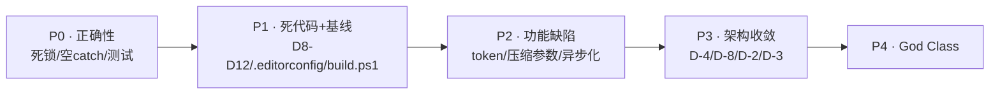

# 遗留项整改计划（2026-08-25）

> 本文档是对 [ARCHITECTURE.md](ARCHITECTURE.md) 的**实测复核结论**与**可执行整改清单**。
> 每一条都基于仓库当前磁盘状态验证过（而非仅依据文档记载），并给出证据、动作、验收标准。
> 文件编码约定：**全仓库 UTF-8 无 BOM**。
>
> **本轮明确排除**：P0-4（`.pfx` 私钥）、P0-5 / E6（DevExpress 依赖治理）、A5、E8（发布形态）。
> 这些项保留风险记录，不纳入本轮验收。

---

## 0. 复核结论摘要

### 0.1 已确认落地（文档与磁盘一致）

| 项 | 验证方式 | 结论 |
|---|---|---|
| A1 Git 基线 + `.gitignore` | `Test-Path .gitignore` | ✅ |
| A2 `<HintPath>` → `<ProjectReference>` | 三个 VSTO csproj | ✅ |
| B1 编码修复 | 全仓库 `U+FFFD` 计数 = **0** | ✅ |
| C3 / P1-1 删除 `ChatApiClient` | `ChatApiClient.cs` 不存在 | ✅ |
| D1–D7 Turn 骨架占位删除 | 文件均不存在 | ✅ |
| D-1 日志统一门面 | `OfficeCopilotLog` 存在并被各层调用 | ✅ |
| F1–F11 工具确认门 / 白名单 | `SkillPlanSupport.cs` = 345 行实装 | ✅ |
| 阶段 1.1 测试工程 | `OfficeCopilot.Agent.Tests` 存在，16 测试通过 | ⚠️ 覆盖不足 |

### 0.2 仍未处理项（实测证据）

| # | 项 | 实测证据 |
|---|---|---|
| 1 | UI 线程同步阻塞 | `CopilotPanelControl.ToolSafety.cs:146` `tcs.Task.GetAwaiter().GetResult()` |
| 2 | 空 `catch` | 全仓库 **31 处** `catch {}` / `catch (Exception) {}` |
| 3 | 测试覆盖 | 仅 16 个纯逻辑测试 |
| 4 | D8 `ChatSessionManager` | 仍在，40 行空实现 |
| 5 | D10 `RegisterExcelTools(dynamic)` | 仍在 `Host.Excel/Tools/Registration/InMemoryToolRegistryExtensions.cs` |
| 6 | D11 `WordBuiltInTools` | 仍在，67 行纯转发壳 |
| 7 | D12 重复赋值 | `ExcelCopilotTaskPaneManager.cs` L238–240 与 L264–266 |
| 8 | `.editorconfig` | **不存在** |
| 9 | UTF-8 BOM | **60 个** `.cs` / `.csproj` / `.md` 带 BOM |
| 10 | R2/B3 `Phase7CLog` | **2 份实现，85 处引用** |
| 11 | `docs/BACKLOG.md` | 不存在；`待解决问题.txt` 仍在根目录 |
| 12 | 仓库杂物 | 3 个 `.bak` + 6 个 `.csproj.user` 在磁盘 |
| 13 | E1/E2 构建基线 | `Directory.Build.props` / `Directory.Packages.props` **均不存在** |
| 14 | G1 token 估算 | `RoughTokenEstimator` = `text.Length / 4` |
| 15 | D-7 双套压缩参数 | Panel 侧 4 个 `Session*` 常量仍在 |
| 16 | D-8 DI | `AgentRuntimeService` 4 个构造重载 + 内部大量 `new` |
| 17 | G4 其余同步阻塞 | `AgentTool.cs:109`、`PowerShellTool.cs:153`、`AgentRuntimeService.cs:166/191` |
| 18 | God Class | `CopilotPanelControl.cs` **4236**、`HttpModelClient.cs` 2639、`ExcelHostAdapter*` 7472、`OfficeCopilotSettingsFactory.cs` 1414 |
| 19 | D-2/D-3/D-4 | 4 套工具模型、2 套 IPC 风格、3 份 TaskPaneManager |

---

## 1. P0 · 正确性风险（先修）

### P0-1 · 消除 UI 线程同步阻塞（死锁风险）

**证据**

`OfficeCopilot.Panel.WebView/CopilotPanelControl.ToolSafety.cs:146`：

```csharp
response = tcs.Task.GetAwaiter().GetResult();
```

`tcs` 由 WebView2 弹窗回调完成，而该回调必须回到 UI 线程投递。若此调用发生在 UI 线程上，
线程被自己等待的任务阻塞 → **经典 WinForms 死锁**（面板假死，与历史上 `CreateClient()`
的 `Thread.Sleep(100)` 轮询是同一类问题）。

**动作**

1. 判定 `ConfirmToolExecution` 的实际调用线程（HostBridge 工作线程 or UI 线程）。
2. 若可能在 UI 线程：改为**非阻塞消息泵**（`Application.DoEvents` 不可取）或把整条确认链路异步化。
3. 保守方案：在 `WaitOne` 前加 `InvokeRequired` 断言，UI 线程上走同步对话框而非等待 TCS。

**验收**：确认门在 UI 线程调用时不会挂起；工具确认弹窗端到端可用。

---

### P0-2 · 消除关键路径空 `catch`

**证据**：全仓库 31 处。重点：

| 位置 | 后果 |
|---|---|
| `AgentRuntimeService.CreateSkillRegistry()` | Skill 加载失败静默降级 → **对应待办"安装包中 skill 找不到"** |
| `AgentRuntimeService.CreateMemoryStore()` | 记忆不可用无提示 |
| `BrokerTurnExecutor.GetCapabilitiesAsync()` | 工具目录为空却继续跑 |
| `*TaskPaneManager.TryGetToolRuntime()` | 工具运行时缺失无提示 |

**动作**：关键路径至少 `OfficeCopilotLog` 记 `Warning/Error` + 异常对象；
best-effort 清理路径（`Dispose`/删临时文件）保留空 catch 但加一行理由注释。

**验收**：Skill / Memory / Capabilities 加载失败可从日志定位。

---

### P0-3 · 补齐测试安全网

**证据**：`OfficeCopilot.Agent.Tests` 仅 16 个纯逻辑测试。

**动作**：优先补齐四块——
1. `JsonlConversationStore` 读写 / 损坏行容错；
2. Broker 协议信封序列化往返（`AgentBrokerMessageTypes` 全量）；
3. `SkillPlanSupport` 白名单五条规则 + `AllowHighRiskTools` 硬门；
4. `Context/*` 压缩策略触发边界。

**验收**：测试数 ≥ 60，全绿；批次 P3/P4 开工前置条件满足。

#### 已交付

测试总数 **18 → 102，全绿**（`.\build.ps1 -Test`）。新增 4 个测试文件，均已登记进 `OfficeCopilot.Agent.Tests.csproj` 的 `<Compile Include>`（legacy csproj 不自动通配）：

| 文件 | 覆盖 | 用例数 |
|---|---|---:|
| `Persistence/JsonlConversationStoreTests.cs` | `GetOrCreate`/`AppendMessage`/`SaveAsync` 原子重写/`ListAsync`/`DeleteAsync`；**损坏行、空行、缺 head、空文件容错**；`JsonlPaths.EncodeConversationFileName` 非法字符与空 id 兜底；跨日期目录复用同一会话文件 | 20 |
| `Client/BrokerEnvelopeTests.cs` | 三种信封的 `System.Text.Json` 默认往返（含 `Metadata`、非 ASCII、Emoji）；**序列化结果不得含裸换行**（管道按行读）；22 个 `AgentBrokerMessageTypes` 常量的非空 / 唯一 / 全小写点分命名 / 请求-响应前缀配对 | 13 |
| `Turn/SkillPlanSupportTests.cs` | `IsToolPermittedBySkillPlan` 五条规则；`AllowHighRiskTools` 硬闸（critical 工具即便命中 `runtime.`/`host.` 豁免或显式白名单也必须拦截）；`CollectSkillPlanToolNames` 合并与 Trim；`GetSkillPlanViolationMessage` 三种分支 | 20 |
| `Context/CompactionBudgetTests.cs` | `ContextWindowThresholds` 对数缩放与各 clamp；`CompactionBudget.Compute` 极小/极大窗口与成本护栏；`RecentBudget` 绝对下限；`AutoCompactPolicy` 触发/警告/无动作边界、三连失败熔断与复位、`ApplyPrune` | 26 |

配套修复（否则测试工程无法编译/运行）：

- 补 `System.Text.Json` / `System.Memory` 程序集引用——packages.config 工程不会继承 SDK 工程 `ProjectReference` 的传递性 NuGet 引用。
- 新增 `OfficeCopilot.Agent.Tests/app.config` 并开启 `AutoGenerateBindingRedirects` + `GenerateBindingRedirectsOutputType`。此前测试宿主一碰 `OfficeCopilotLog` 就抛 `FileLoadException: Microsoft.Bcl.AsyncInterfaces`，属于**真实存在但一直被掩盖的版本漂移**（见 §7.2 E3）。

---

## 2. P1 · 低风险高杠杆

### P1-1 · 删除剩余死代码（D8 / D10 / D11 / D12）

| 编号 | 目标 | 行数 | 处理 |
|---|---|---:|---|
| D8 | `Panel.WebView/Services/ChatSessionManager.cs` | 40 | 删文件 + 清理调用点 |
| D10 | `RegisterExcelTools(this InMemoryToolRegistry, dynamic addIn)` | ~30 | 删方法（加载项走私有同名方法） |
| D11 | `Host.Word/Tools/Registration/WordBuiltInTools.cs` | 67 | 删类，保留 `WordToolRegistrationOptions` / `WordToolCatalogOptions` |
| D12 | `ExcelCopilotTaskPaneManager.cs` L264–266 | 3 | 删除重复赋值 |

**验收**：全局引用搜索无生产调用者；受影响工程编译通过。

---

### P1-2 · `.editorconfig` + 清除 60 个 BOM

**动作**
1. 新建根 `.editorconfig`：`charset = utf-8`（无 BOM）、`end_of_line = crlf`、
   缩进 4 空格、C# 基础风格规则。
2. 脚本化去除 60 个文件的 BOM（`UTF8Encoding($false)` 重写，内容字节不变）。

**验收**：BOM 文件计数 = 0；全解决方案编译通过。

---

### P1-3 · `Phase7CLog` 收编（R2 / B3 / C5）

**证据**：2 份同名实现（`Agent.Runtime/Turn/` 与 `Panel.WebView/`），85 处引用。

**动作**：两份实现体改为对 `OfficeCopilotLog` 的薄委托；类型重命名为 `RuntimeTrace` /
`PanelTrace`（或统一删除，调用点直接用 `OfficeCopilotLog`）。分两步走，先改实现体（零风险），
再改名（机械替换）。

**验收**：日志统一进 `ILoggerFactory`；无 `Phase7CLog` 标识符。

---

### P1-4 · 待办转 `docs/BACKLOG.md` + 清杂物

1. `待解决问题.txt`（GBK）→ `docs/BACKLOG.md`（UTF-8 无 BOM），按优先级/状态结构化。
2. 删除磁盘上 3 个 `.bak` + 6 个 `.csproj.user`（已被 gitignore，仅清理工作区）。

---

### P1-5 · 构建基线（E1/E2/E4/E5/E7）

| 编号 | 动作 |
|---|---|
| E1 | `Directory.Build.props`：集中 `LangVersion` / `Nullable` / `ImplicitUsings` / `Company` / `Version` |
| E2 | `Directory.Packages.props`：Central Package Management 统一 NuGet 版本 |
| E4 | TFM 写法统一为 `net472` / `netstandard2.0` |
| E5 | 删除自造的 `All` 解决方案配置 |
| E7 | `build.ps1`：VS MSBuild 构建 VSTO + `dotnet build` Broker + **强制刷新 Broker bin** |

> ⚠️ E7 直接消灭已记录的 **"Broker rebuild trap"**（改了 Runtime 但 Excel 跑旧代码），
> 是本批次收益最高的一条。

**验收**：`build.ps1` 一条命令完成全量构建；Broker `bin` 中 Runtime.dll 时间戳必然新于源码。

---

## 3. P2 · 功能缺陷

### P2-1 · CJK 感知的 token 估算（G1）

**证据**：`Context/ITokenEstimator.cs` → `RoughTokenEstimator.EstimateTokens` = `text.Length / 4`。

中文 1 字符 ≈ 0.6~1 token，`/4` **系统性低估 2~3 倍** → 该压缩时不压缩 → 撞上下文上限。

**动作**：按字符分类累加——CJK/全角 ×1.0，其余 ÷4（ASCII 近似）。保持 `internal`，
扩展既有 `TokenEstimatorTests`。

**验收**：纯中文、纯英文、中英混合三组用例断言通过；压缩触发时机符合预期。

**已交付**：`RoughTokenEstimator.EstimateTokens` 改为逐字符分类，宽字符（CJK 统一/扩展 A、
补充平面代理对、假名、谚文、注音、彩文、CJK 兼容形式、全角符号）计 1 token，其余 ÷4；
新增 `EstimateTokens_CountsOneTokenPerCjkCharacter` / `EstimateTokens_MixesCjkAndLatinWeights` 两个用例，
测试 16 → **18 全绿**。

---

### P2-2 · 统一压缩参数（D-7）

**证据**：`CopilotPanelControl` 的 `SessionKeepRecentMessageCount = 12`、
`SessionCompressTriggerCount = 18`、`SessionCompressTriggerTokens = 6000`、
`AgentMaxToolRoundCount = 50` 与 Broker `Context/*` 策略是两套独立参数。

**动作**：删除 Panel 侧四个常量，压缩只由 Broker 决定；`AgentMaxToolRoundCount` 进 Settings。

**已交付**：

| 删除/修改 | 说明 |
|---|---|
| 4 个常量 | 全部移除 |
| `CompressSessionIfNeededAsync`（约 75 行） | **实际是无效代码**：它写完 `session.Messages = keep` 后，紧接着的 `RefreshCurrentSessionMessagesFromBrokerAsync` 会立即用 Broker 数据覆盖——等于每轮白花一次模型调用 |
| `EstimateConversationTokens` / `EstimateTokenCount`（Panel 本地版） | 与 Broker `RoughTokenEstimator` 重复且系数不同（÷1.5 vs ×1.0），删除 |
| `ChatSessionState.Summary` | 仅被上述死代码读写，一并移除（含 3 处 `Summary = string.Empty` 初始化） |
| `runtime.maxToolRoundCount` | 改读 `_settings.Runtime.MaxToolRoundCount`（默认 300），**仅当 > 0 时才下发**。原硬编码 50 会静默覆盖 `settings.json` 里的配置 |

---

### P2-3 · 其余同步阻塞（G4）与魔数配置化（G5）

| 位置 | 处理 |
|---|---|
| `Turn/AgentTool.cs:109` | 子 Agent 调用异步化 |
| `Turn/PowerShellTool.cs:153` | 同上 |
| `AgentRuntimeService.cs:166/191` | Skill 加载改异步初始化 |
| `TokenBudget` 三个阈值、`BrokerReadyTimeout`、`maxConsecutiveFailures` | 进 `OfficeCopilotSettings` |

**已交付**：

**G4 异步化**

| 位置 | 处理 |
|---|---|
| `AgentTool.Execute` | → `ExecuteAsync`，`_runner.RunAsync(...).GetAwaiter().GetResult()` → `await ... ConfigureAwait(false)` |
| `PowerShellTool.Execute` | → `ExecuteAsync`，同上 |
| `DefaultToolDispatcher` 两处调用点 | 改 `await`（外层 `DispatchToolCallAsync` / `HandlePowerShellWithPermissionGateAsync` 本就是 `async`） |
| `AgentRuntimeService.CreateSkillRegistry` 两处 | **诊断修正**：`BuiltInSkillLoader` / `FileSystemSkillLoader` 的 `LoadAsync` 实际是 `Task.FromResult(LoadSync())`——根本没有真异步。将 `LoadSync` 提升为 public `Load()`，直接同步调用，消除「伪异步 + 阻塞」反模式 |

**G5 魔数配置化**

| 魔数 | 新配置项（`Runtime` 节） | 默认 |
|---|---|---|
| `stopThreshold: 0.85` | `TokenBudgetStopThreshold` | 0.85 |
| `smallDeltaTokenThreshold: 500` | `TokenBudgetSmallDeltaTokenThreshold` | 500 |
| `maxConsecutiveSmallDeltas: 100` | `TokenBudgetMaxConsecutiveSmallDeltas` | 100 |
| `const int maxConsecutiveFailures = 3` | `MaxConsecutiveTurnFailures` | 3 |
| `BrokerReadyTimeout = 5s` | `BrokerReadyTimeoutSeconds` | 5 |

链路已打通：`OfficeCopilotSettings.RuntimeSettings` → `NormalizeRuntime`（范围校验 + 回退）
→ `BrokerConfig.MergeFromSettingsJson` / `ApplyRuntimeSection` → `AgentRuntimeOptions` → `BrokerTurnExecutor`；
`BrokerReadyTimeoutSeconds` 由三个 `*TaskPaneManager` 传给 `BrokerRuntimeHost` 新增的三参数构造函数。

> 未动：`NamedPipeBrokerHost` 内的 `maxConsecutiveFailures = 5` 是管道重建重试次数，
> 属于进程内部实现细节，不对外暴露，保留为具名常量。

---

## 4. P3 · 架构收敛（须 P0-3 就位后动）

| 编号 | 动作 | 收益 |
|---|---|---|
| D-4 | 抽 `CopilotTaskPaneManagerBase<TWindow>` + `WindowPaneContext` + 管道名工厂 | **-784 行**，消除 R3/R4/R5/R7 |
| D-8 | 引入 `IServiceCollection`，收敛 4 个构造重载与内部 `new` | 可测试、消除静默降级 |
| D-2 | 工具模型 4 套 → 2 套 | 消除 R9 |
| D-3 | 统一 IPC 协议风格（推荐 HostBridge 改强类型 DTO） | 消除 P1-4 |

### 4.1 D-4 已交付

| 文件 | 行数 | 说明 |
|---|---:|---|
| `OfficeCopilot.Panel.WebView/Composition/CopilotTaskPaneManagerBase.cs` | 457 | 泛型基类：预热定时器、按窗口缓存、面板装配、HostBridge 服务端与 Broker 宿主生命周期、资源释放 |
| `OfficeCopilot.Panel.WebView/Composition/WindowPaneContext.cs` | 24 | 单窗口的 6 项资源聚合 |
| `OfficeCopilot.Panel.WebView/Composition/HostBridgePipeNameFactory.cs` | 21 | 统一 `officecopilot-host-bridge-<pid>-<windowKey>` 命名 |
| `NixerExcelCopilot/Composition/ExcelCopilotTaskPaneManager.cs` | 523 → **112** | 只留 8 个宿主差异重写 |
| `NixerWordCopilot/Composition/WordCopilotTaskPaneManager.cs` | 557 → **119** | 同上，保留 `ActiveWindow` 的 `COMException` 守卫 |
| `NixerPowerpointCopilot/Composition/PowerPointCopilotTaskPaneManager.cs` | 547 → **110** | 同上，`HWND` 而非 `Hwnd` |

合计 1627 → 843 行（含新增共享代码），净减 **784 行**。

配套修复：

- Word / PowerPoint 的 `DisposeWindowContext` **原先从不移除任务窗格**（泄漏），基类统一走 `RemoveTaskPane`。
- 释放路径上约 15 个空 `catch` 收敛为 `SafeRelease(step, action)`，逐步记 `OfficeCopilotLog.Error`。
- 三个宿主的对外方法签名（`IsPaneCreated` / `BeginWarmup` / `TogglePane` / `ShowPane` / `RefreshContext` / `TryGetToolRuntime` / `Dispose`）保持不变，`ThisAddIn` 与 Ribbon 调用点零改动。

### 4.2 D-8 已交付

新增 `OfficeCopilot.Agent.Runtime/Composition/AgentRuntimeServiceCollectionExtensions.cs`，提供唯一装配入口 `AddOfficeCopilotAgentRuntime(IServiceCollection, AgentRuntimeOptions)`。

| 变更 | 说明 |
|---|---|
| `AgentRuntimeService` | **4 个构造重载 → 1 个**，6 个依赖全部显式注入并 `ArgumentNullException` 守卫 |
| 内部 `new` | `HttpModelClient` / `HostBridgeContextReader` / `HostBridgeToolInvoker` / `BrokerEventDispatcher` / `CompositeContextWindowPolicy` / 会话存储 / Skill 注册表 / 记忆库全部上提到装配根 |
| 静默降级 | `?? new NullHostBridgeClient()` / `?? new NullUserInteractionHandler()` 等兼容分支改为容器默认登记（`TryAdd`），调用方可覆盖 |
| 死代码 | 构造函数里构建后从不使用的 `DefaultToolDispatcher` 实例已删除 |
| `BrokerTurnExecutor` | 删除 2 个无调用方的公开便捷构造（内嵌 `NullModelClient` / `NullHostBridgeClient` 降级），仅保留 internal 完整构造 |
| `BrokerApplication` | `CreateTurnService` 改为搭容器：先 `AddSingleton` 真实的 `IHostBridgeClient` / `IUserInteractionHandler` / `IMcpRegistry`，再 `AddOfficeCopilotAgentRuntime` |
| 测试 | 新增 `Composition/AgentRuntimeCompositionTests.cs`（5 用例），把“DI 图配错只在 Broker 启动时暴露”提前到测试期；总用例 102 → **107** |
| 包 | `Microsoft.Extensions.DependencyInjection` **10.0.5**（与 `OfficeCopilot.Diagnostics` 的 packages.config 同版，避免 Broker 进程绑定漂移），已入 CPM |
| `build.ps1` | 补上缺失的 `Restore` 目标——新增 `PackageReference` 后直接构建会报“找不到扩展方法” |

### 4.3 D-2 已交付

删除 `OfficeCopilot.Agent.Runtime/Turn/RuntimeToolDefinition.cs`，Runtime 工具目录改为直接持有线上模型 `HostBridgeToolDescriptor`。工具表示由 **4 套 → 3 套**（宿主 `ToolDefinition` → 线上/Runtime `HostBridgeToolDescriptor` → LLM `ModelClientTool`），跨 Broker 边界的那一次 descriptor → definition 映射整体消失。

| 变更 | 说明 |
|---|---|
| `HostBridgeToolDescriptor` | 补上原本只存在于 Runtime 侧的 `RequiresUserInteraction` 字段，使其成为完整的工具契约 |
| `RuntimeToolDescriptors`（新增） | 接手原构造函数的归一化逻辑（null 合并、`RiskLevel` 缺省推导、schema JSON 规范化），DTO 本身保持无逻辑的可序列化形态 |
| 签名收敛 | `DefaultToolDispatcher` / `SkillPlanSupport` / `BrokerTurnExecutor` / `BackupPathManager` / `AgentTool` / `SubagentRunner` 共 20+ 处 `IReadOnlyDictionary<string, RuntimeToolDefinition>` 换为 descriptor |
| 测试 | `SkillPlanSupportTests` 的工具工厂改为直接构造 descriptor；107 用例全部通过 |

### 4.4 D-3 已交付

审计后修正了原先的判断：两套 IPC **并非“强类型 DTO vs PayloadJson”之差**——两者均为「信封 + 点分小写消息名 + `PayloadJson` 内嵌强类型 DTO」。真正的不一致在下面四处，已逐项拉齐。

| 变更 | 说明 |
|---|---|
| **同一协议两种序列化器**（高危） | `Agent.Broker/BrokerNamedPipeHostBridgeClient` 用 `System.Text.Json` 发送 `HostBridgeRequest`，服务端 `NamedPipeHostBridgeServer` 用 `Newtonsoft.Json` 反序列化。当前仅因属性名碰巧一致而能跑通，任一侧加序列化特性即断。**删除这份重复实现**，Broker 改用 `HostBridge.Client.NamedPipeHostBridgeClient`，协议两端回到同一序列化器 |
| 错误码常量化 | 新增 `HostBridgeErrorCodes`（`HostBridge.Contracts`），收编原先散落在 4 个文件的 20 处字面量，与 Broker 侧 `AgentBrokerMessageTypes` 保持同一风格 |
| 响应回显 | `HostBridgeResponse` 新增 `Operation` 字段（对应 Broker 响应的 `MessageType` 回显），`HandleAsync` 统一回填，失败响应也能定位到具体操作 |
| 文件正名 | `NullHostBridgeServer.cs` / `NullHostBridgeClient.cs` 里实际藏着真正的 `NamedPipeHostBridgeServer` / `NamedPipeHostBridgeClient`，已拆为同名独立文件 |
| 测试 | 新增 `HostBridge/HostBridgeEnvelopeTests.cs`（11 用例），按 `BrokerEnvelopeTests` 同一套标准锁定信封往返、行分帧安全（无裸换行）、操作名/错误码常量命名与唯一性；总用例 107 → **118** |

---

## 5. P4 · God Class 拆解（最后做）

| 编号 | 目标 | 初审行数 | 方向 | 状态 |
|---|---|---:|---|---|
| F1 | `CopilotPanelControl` | **4236（仍在增长）** | 拆 `PanelWebViewBridge` / `PanelSessionController` / `PanelInteractionCoordinator` / `PanelModelMenuPresenter`；**即刻起冻结新增代码** | ✅ 已完成（4093 → 3611） |
| F2 | `HttpModelClient` | 2639 | 抽 `IModelProviderAdapter` + `SseReader` | ✅ 已完成（→ 62 行门面 + `ModelProviders/` 8 个文件） |
| F3 | `ExcelHostAdapter*` | 7472 / 10 文件 | 按 partial 边界拆协作类，Adapter 只做门面 | ✅ 已完成（门面 692+231；`ExcelServiceBase` + 7 个服务类） |
| F5 | `OfficeCopilotSettingsFactory` | 1414 | `JsonSettingsStore` 拆出独立文件 | ✅ 已完成（拆为 8 个文件，Factory 剩 519 行） |
| F4 | `chat.js` | 120 KB | esbuild/rollup + ESLint | ✅ 已完成（改用**原生 ES Module、不引入工具链**：19 个模块，入口 `main.js`） |

### 5.1 F1 已交付

`CopilotPanelControl.cs` 主体 **4093 → 3611 行**（连同 5 个分部共 6096 行），抽出 4 个单一职责协作类共 806 行。拆法遵循「先搬走能独立成型的，再让控件只剩 UI 编排」，不改动任何对前端 JS 的协议串。

| 新类 | 位置 | 收编内容 |
|---|---|---|
| `PanelModelMenuPresenter` | `Presentation/` | 可用模型列表 + 当前选中模型 + `menuModels` 菜单项渲染 / 勾选同步；`ResolveModelProviderId`（会话 → 全局默认 → 首个可用）与 `ResolveEffectiveModel` 也一并内聚。会话侧读写以 3 个构造回调回到面板，presenter 不反向依赖会话状态 |
| `PanelWebViewBridge` | `Presentation/` | WebView2 控件初始化 → 虚拟主机映射 → 页面导航 → `PostWebMessageAsJson`；原先散在面板里的 4 个就绪标志位收敛为 `IsInitialized` / `IsClientReady` / `CanPost` 三个语义属性。面板不再直接触碰 `CoreWebView2` |
| `PanelInteractionCoordinator` | `Presentation/` | 待决用户交互登记簿。原先 `requestId→TCS` 与 `requestId→toolName` 两张表连同各自的 `lock` 散落在面板主体、`ToolSafety` 分部与嵌套的 `BrokerEventSink` **三处共 9 段重复锁代码**，现收敛为单锁四方法（`Register` / `TryComplete` / `TryGetToolName` / `Unregister`）。顺带修掉 `RequestToolConfirmationFromWeb` 缺失的「同 requestId 旧请求未取消」缺口 |
| `BrokerSessionRepository` | `Services/` | 会话持久化 4 条 Broker IPC（拉列表+补最近一条 / 补消息 / 删会话 / 回灌标题）及其各自的 try-catch。命名未沿用计划里的 `PanelSessionController`——会话的 UI 编排（历史下拉、当前会话切换、推送前端）必须留在控件内，能干净外移的只有 I/O 这一层 |

未做（有意保留）：`_sessions` / `_currentSession` 仍在控件内。这两个字段有 60+ 处引用且与 `EnsureCurrentSession()` 的隐式建仓语义强耦合，机械外移收益低于风险，留待后续单独一轮。

验证：全解决方案编译通过，单元测试 118/118 全绿（本项未新增用例——4 个新类均为 `internal`，测试工程当前不引用 `Panel.WebView`）。

---

## 6. 执行顺序与验收门禁



**每批次门禁**

1. SDK 工程 `dotnet build` 通过；VSTO 工程用 VS MSBuild 验证。
2. `OfficeCopilot.Agent.Tests` 全绿。
3. Excel 手测：启动 → 开面板 → 对话 → 宿主工具调用 → 确认决策 → 会话切换 → Broker 重启。
4. Word / PowerPoint 至少编译通过 + 工具目录初始化回归。

---

## 7. 进度跟踪

| 编号 | 项 | 状态 | 备注 |
|---|---|---|---|
| P0-1 | UI 线程同步阻塞 | ✅ 已完成 | 复核后确认 `ToolSafety` 已有 `InvokeRequired` 守卫，阻塞路径只在非 UI 线程执行；原判定为误报，已加断言与注释固化 |
| P0-2 | 关键路径空 catch | ✅ 已完成 | Skill / Memory / Capabilities / TryGetToolRuntime 均已记日志 |
| P0-3 | 测试安全网 | ✅ 已完成 | 18 → **102** 用例全绿；新增 JSONL 存储 / Broker 信封 / 技能白名单 / 压缩预算四组；顺带补齐测试工程的绑定重定向
| P1-1 | 死代码 D8/D10/D11/D12 | ✅ 已完成 | 全解决方案编译通过 |
| P1-2 | `.editorconfig` + BOM | ✅ 已完成 | 新增根 `.editorconfig`；**清除 76 个 BOM**，残留 = 0 |
| P1-3 | `Phase7CLog` 收编 | ✅ 已完成 | → `RuntimeTrace` / `PanelTrace`；JS↔C# 协议串 `phase7cLog` → `traceLog`；残留标识符 = 0 |
| P1-4 | BACKLOG + 清杂物 | ✅ 已完成 | `待解决问题.txt` → [BACKLOG.md](BACKLOG.md)；删除 3 个 `.bak` + 6 个 `.csproj.user`（`.vs/` 被 VS 占用，保留） |
| P1-5 | 构建基线 + `build.ps1` | ✅ 已完成 | E1 / E2 / E5 / E7 见下表；E3 / E4 受阻 |
| P2-1 | CJK token 估算 | ✅ 已完成 | 宽字符 ×1.0 / 其余 ÷4；测试 18/18 |
| P2-2 | 统一压缩参数 | ✅ 已完成 | 删 Panel 侧 4 常量 + 无效压缩方法 + 重复估算器；`MaxToolRoundCount` 改读 Settings |
| P2-3 | 异步化 + 魔数配置化 | ✅ 已完成 | 2 个工具改 `ExecuteAsync`；Skill 加载器改真同步；5 个魔数进 `Runtime` 配置节 |
| P3 · D-4 | TaskPaneManager 基类 | ✅ 已完成 | 三宿主 1627 → 843 行（净 **-784**）；顺带修掉 Word/PPT 的窗格泄漏与 ~15 个空 `catch` |
| P3 · D-8 | IServiceCollection DI | ✅ 已完成 | `AgentRuntimeService` 4 构造 → 1；8 处内部 `new` 与全部静默降级上提到装配根；新增 5 个装配冒烟用例（102 → **107**） |
| P3 · D-2 | 工具模型 4 套 → 3 套 | ✅ 已完成 | 删除 `RuntimeToolDefinition`；Runtime 直接消费 `HostBridgeToolDescriptor`，取消跨 Broker 边界的工具模型转换 |
| P3 · D-3 | 架构收敛（IPC 协议风格） | ✅ 已完成 | 删除重复的 Broker 侧 HostBridge 客户端（消除同一协议两种序列化器）；新增 `HostBridgeErrorCodes`；响应回显 `Operation`；新增 11 个信封用例（107 → **118**） |
| P4 · F1 | `CopilotPanelControl` 拆解 | ✅ 已完成 | 主体 4093 → **3611** 行；抽出 `PanelModelMenuPresenter` / `PanelWebViewBridge` / `PanelInteractionCoordinator` / `BrokerSessionRepository` 四类；交互登记簿的 9 段重复锁代码收敛为单锁 |
| P4 · F2–F5 | 其余 God Class | ✅ 已完成 | `HttpModelClient` 2639→62；`ExcelHostAdapter` 7472→门面 923 + 8 个服务类；`OfficeCopilotSettingsFactory` 1439→8 个文件；`chat.js` 3458→19 个原生 ES Module。构建 0 错误，测试 118/118 |

### 7.1 P1-5 构建基线明细

| 编号 | 交付 | 状态 | 说明 |
|---|---|---|---|
| E1 | `Directory.Build.props` | ✅ | 集中 `LangVersion=10` / `Nullable` / `ImplicitUsings` / `Company` / `Version`。**不能设 `Deterministic=true`**——VSTO 的 `AssemblyInfo` 用 `1.0.*` 通配版本号，会触发 `CS8357` |
| E2 | `Directory.Packages.props` | ⚠️ 部分 | SDK 工程（15 个）已纳入 CPM，9 个包版本集中声明。`Panel.WebView` 混用 packages.config + 内联版本，显式 `ManagePackageVersionsCentrally=false` opt-out |
| E3 | legacy → SDK 迁移 | ⬜ 未开始 | 本轮未做 |
| E4 | TFM 写法统一 | 🚫 受阻 | `TargetFrameworkVersion=v4.7.2` 是 legacy csproj 的**唯一合法写法**，必须先做 E3 |
| E5 | 删除自造 `All` 配置 | ✅ | 从 `.sln` 移除 **207 行**；保留 `Debug`/`Release` × `Any CPU`/`x64`/`x86` |
| E7 | `build.ps1` | ✅ | 一条命令完成：清 Broker 输出 → VS MSBuild 构建解决方案 → 校验 `Agent.Runtime.dll` 新鲜度 → 可选跑测试。已实测 `-Rebuild -Test` 通过（16/16） |

### 7.2 本轮新发现的遗留风险

| 项 | 证据 | 处理 |
|---|---|---|
| packages.config 版本漂移 | `Microsoft.Extensions.*` / `System.Diagnostics.DiagnosticSource` 同时存在 **10.0.5 与 10.0.7**；`System.ValueTuple` 4.6.1 vs 4.6.2 | CPM 管不到 packages.config，**受阻于 E3**；期间可能出现绑定重定向不一致 |
| `.ps1` 编码冲突 | Windows PowerShell 5.1 把无 BOM 的 `.ps1` 按 ANSI 解码，中文会乱码 | `build.ps1` 固定为**纯 ASCII**，以同时满足「UTF-8 无 BOM」约定 |
| `.vs/` 目录 | 6 处，被 VS 进程占用 | 已 gitignore；关闭 VS 后可手动删除 |

