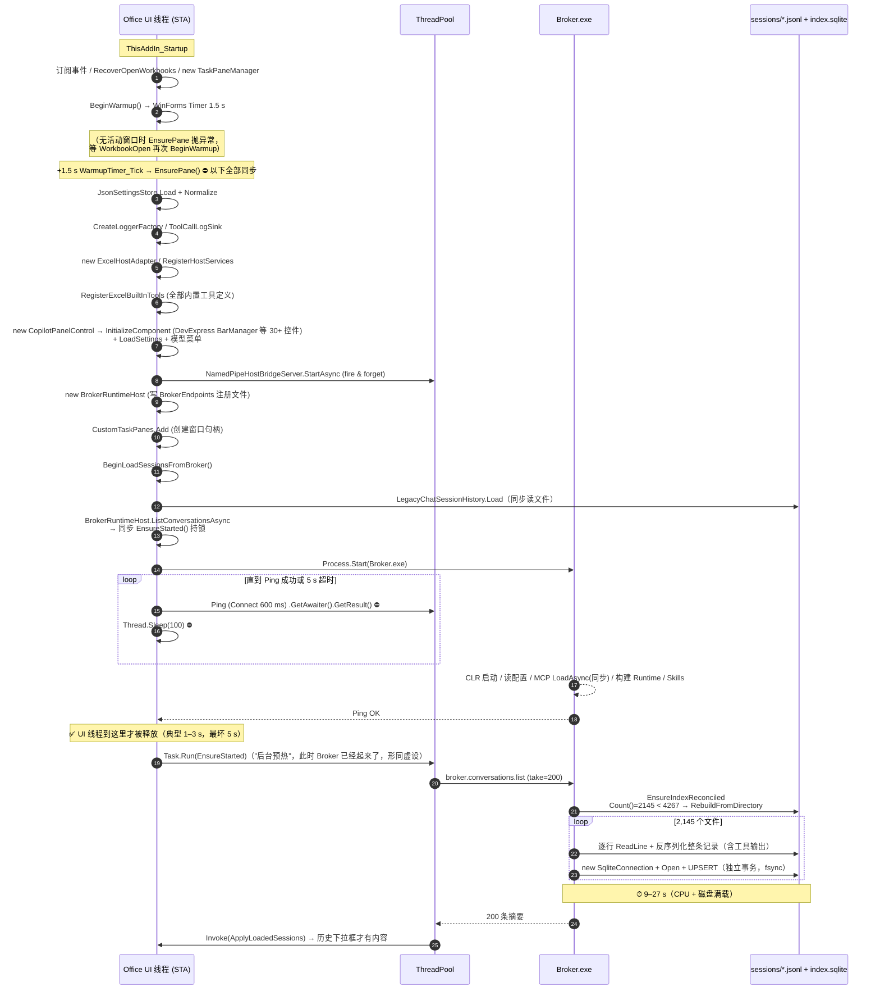

# 加载项启动卡顿 & 历史会话延迟 —— 全链路分析与改进方案

> 日期：2026-10-10
> 范围：Excel / Word / PowerPoint 三个 VSTO 加载项共用的启动与面板加载链路（`CopilotTaskPaneManagerBase` → `CopilotPanelControl` → `BrokerRuntimeHost` → `OfficeCopilot.Agent.Broker.exe` → `JsonlConversationStore`）。
> 状态：**仅分析，未改代码**。

---

## 0. 结论速览

| # | 现象 | 根因（已证实 / 推断） | 影响 | 建议优先级 |
|---|---|---|---|---|
| R1 | 打开工作簿约 1.5 s 后 Office 假死，Ribbon 与单元格均无响应 | **UI 线程同步启动 Broker 进程并轮询 Ping**：`BeginLoadSessionsFromBroker()` 在 UI 线程上执行，`BrokerRuntimeHost.ListConversationsAsync` 在第一个 `await` 之前同步调用 `EnsureStarted()`（`Process.Start` + `Thread.Sleep` + `GetAwaiter().GetResult()` 轮询，最长 5 s）。代码中“后台预热”的 `Task.Run(EnsureStarted)` 实际上排在它之后，从未起到作用。**（代码证实）** | 每次冷启动卡 1–5 s；Broker 启动慢时直接顶满 5 s 超时 | **P0** |
| R2 | 同上，假死总时长在不同机器上可达十几秒 | `EnsurePane()` 整体在 UI 线程同步执行：DevExpress 面板构造、工具注册、宿主适配器、`CustomTaskPanes.Add` 等 + R1；同时 Broker 端 R3 的重 CPU/磁盘负载与 Office 抢资源。**（代码证实 + 推断，需打点量化）** | 叠加 R1 | P1 |
| R3 | 面板打开后马上点“历史会话”下拉框是空的，要等十几秒 | **会话索引对账（reconcile）每次 Broker 冷启动都做全量重建**：`EnsureIndexReconciled` 用“索引行数 ≥ 磁盘 `*.jsonl` 文件数”判断，但磁盘计数包含了索引永远不会收录的 `*.compact.jsonl`，条件**恒不成立**。重建会逐行反序列化全部 ~2,145 个会话文件（75 MB）并做 ~2,145 次独立 SQLite 事务。**（日志证实：9–27 s）** | 历史列表冷启动必然延迟 9–27 s，数据越多越慢 | **P0** |
| R4 | 历史列表加载期间没有任何反馈；加载失败后不会自动恢复 | 面板只在 `EnsurePane` 时拉一次历史；没有“加载中”状态、没有本地快速路径、失败不重试。 | 体验差、偶发“永远看不到历史” | P1 |

**一句话**：假死的主因是“UI 线程在等 Broker 进程起来”，历史延迟的主因是“Broker 每次冷启动都把全部历史会话重新解析一遍”。两者都是确定性的 bug，修复成本不高，收益立竿见影。

---

## 1. 现场证据

### 1.1 本机会话数据规模

```
%APPDATA%\NixerOfficeCopilot\sessions
  *.jsonl 总数         4,267   (148.7 MB)
    ├─ 普通会话          2,145   ( 75.1 MB)
    └─ *.compact.jsonl   2,122   ( 73.7 MB)   ← 压缩快照，索引不收录
  index.sqlite         1.4 MB，约 2,145 行
```

`EnsureIndexReconciled` 比较的是 `index.Count()=2145` vs `EnumerateFiles("*.jsonl")=4267`，于是 **每个 Broker 进程第一次 List 都会触发 `RebuildFromDirectory`**。

### 1.2 Broker 日志实测（`%LOCALAPPDATA%\NixerOfficeCopilot\Logs\application.log`）

“Broker 开始监听” → “首个 ListAsync 返回” 的间隔，即用户看到历史列表前的纯等待：

| Broker 开始监听 | ListAsync(take=200) 返回 | 间隔 |
|---|---|---|
| 22:45:23.338 | 22:45:40.969 | **17.6 s** |
| 22:46:01.896 | 22:46:16.399 | **14.5 s** |
| 22:46:47.038 | 22:47:14.624 | **27.6 s** |
| 22:47:35.146 | 22:47:50.247 | **15.1 s** |
| 22:48:22.614 | 22:48:34.559 | **11.9 s** |
| 22:50:08.911 | 22:50:20.856 | **11.9 s** |
| 22:52:40.294 | 22:52:55.138 | **14.8 s** |
| 23:18:31.020 | 23:18:41.854 | **10.8 s** |
| 23:41:03.388 | 23:41:12.860 | **9.5 s** |
| 00:02:22.424 | 00:02:34.750 | **12.3 s** |

同一进程内后续的 List 都是毫秒级（`Interlocked` 只对账一次），说明延迟**全部**来自首次对账重建。

Broker 进程自身启动（“process starting” → “Waiting for connections”）约 0.3–2 s，其中读取配置、加载 Skill、构建 DI 容器；这段时间在当前实现里**全部压在 Office UI 线程上**（见 §3）。

> 面板侧（`NixerExcelCopilot.TaskPane`）的 `EnsurePane begin/end`、`Starting Broker`、`Broker is ready` 都是 Information 级别，而当前配置 `Logging.Runtime.MinimumLevel = Warning`，所以日志里没有面板侧耗时。UI 线程阻塞时长目前只能通过代码推导，§7 给出了补打点方案。

---

## 2. 完整加载时序（现状）



### 2.1 用户感知时间线（典型值）

| 时刻 | 发生了什么 | 用户看到 |
|---|---|---|
| T0 | 打开 Excel / 工作簿 | 界面出现，可操作 |
| T0+1.5 s | `WarmupTimer_Tick` → `EnsurePane` 开始 | **开始假死** |
| T0+1.5 s ~ +2.0 s | 面板对象构造、工具注册、TaskPane 创建 | 假死 |
| T0+2.0 s ~ +4~7 s | UI 线程等待 Broker 进程启动并 Ping 通 | 假死（Ribbon、单元格无响应） |
| T0+4~7 s | UI 线程释放 | 恢复；但 Broker 正在全速重建索引，机器可能仍发涩 |
| T0+15~35 s | 索引重建完成，历史列表回填 | 下拉框才出现历史 |

这与“几秒到十几秒假死 + 十几秒后才能看到历史”的反馈完全吻合。

---

## 3. 根因详解

### R1 —— UI 线程同步启动 Broker（假死主因）

调用链（全部在 UI 线程，没有任何 `await` 让出点）：

1. [CopilotTaskPaneManagerBase.cs](../OfficeCopilot.Panel.WebView/Composition/CopilotTaskPaneManagerBase.cs) `WarmupTimer_Tick`（WinForms Timer，回调在 UI 线程）→ `EnsurePane()`
2. `EnsurePane()` 末尾 `panelControl.BeginLoadSessionsFromBroker();`
3. [CopilotPanelControl.cs](../OfficeCopilot.Panel.WebView/CopilotPanelControl.cs) `LoadSessionsFromBrokerAsync` → `await _sessionRepository.LoadRecentAsync(...)`
   —— `async` 方法在遇到第一个**未完成**的 await 之前都是同步执行的。
4. [BrokerSessionRepository.cs](../OfficeCopilot.Panel.WebView/Services/BrokerSessionRepository.cs) `LoadRecentAsync`：先同步 `LegacyChatSessionHistory.Load(...)`（读文件），再调用 `client.ListConversationsAsync(...)`
5. [BrokerRuntimeHost.cs](../OfficeCopilot.Panel.WebView/Services/BrokerRuntimeHost.cs) `ListConversationsAsync`：**第一行就是同步的 `if (!EnsureStarted())`**
6. `EnsureStarted()` → `lock (_syncRoot)` → `StartBrokerProcessNoLock` → `Process.Start` → `WaitForBrokerReadyNoLock`：
   ```csharp
   while (DateTime.UtcNow - startedAt < timeout)        // 默认 5 s
   {
       if (IsBrokerResponsiveNoLock(600ms)) return true; // 内部 .GetAwaiter().GetResult()
       Thread.Sleep(100);
   }
   ```

几个加重因素：

- **“后台预热”是失效的**：`EnsurePane` 里的 `Task.Run(() => capturedHost.EnsureStarted())` 写在 `BeginLoadSessionsFromBroker()` **之后**，而后者已经在 UI 线程上把 Broker 拉起来了。源码注释“不在 UI 线程上同步等待 Broker 进程启动……先出界面，再后台预热”所描述的优化，被后来加入的历史加载逻辑绕过了。
- **STA 线程阻塞不泵消息**：`GetAwaiter().GetResult()` 与 `Thread.Sleep` 都会让 Office 主线程停止处理窗口消息，Ribbon、重绘、COM 外部调用全部挂起。
- **持锁等待**：`EnsureStarted` 在 `lock (_syncRoot)` 内等待最长 5 s。其它所有 Broker 调用（`SendTurnAsync`、`LoadConversationAsync`、`DeleteConversationAsync`……）也都在第一个 await 之前同步调用 `EnsureStarted()`；如果它们恰好从 UI 线程发起（例如用户点发送、切换历史会话），同样会把 UI 线程卡在锁上或卡在启动过程里。
- **Broker 就绪前的 Ping 忙等**：`IsBrokerResponsiveNoLock` 每次通过 [NamedPipeAgentBrokerTransport.cs](../OfficeCopilot.Agent.Client/NamedPipeAgentBrokerTransport.cs) 发起连接。.NET Framework 的 `NamedPipeClientStream.Connect(timeout)` 在管道尚不存在时会在 `WaitNamedPipe` 返回 `ERROR_FILE_NOT_FOUND` 后**原地自旋**直到超时，等待期间持续吃满一个核心，与正在启动的 Broker 和 Office 抢 CPU。传输层自带的“指数退避重试”在这里也没有意义（外层 600 ms 的 CTS 会直接取消）。
- **Broker 在监听管道之前做了太多事**：[BrokerApplication.cs](../OfficeCopilot.Agent.Broker/BrokerApplication.cs) 的 `CreateTurnService` 在 `NamedPipeBrokerHost.StartAsync` 之前同步完成：读 `settings.json`、**`McpRegistry.LoadAsync(...).GetAwaiter().GetResult()`（若配置了 stdio MCP 服务器，会同步拉起子进程）**、构建整个 Agent Runtime DI 容器、加载三层 Skill。这些耗时 1:1 计入 UI 线程的等待时间；一旦超过 `BrokerReadyTimeoutSeconds`（5 s），面板会 **杀掉 Broker** 并返回失败，随后后台 `Task.Run` 再冷启动一次。
- **触发时机不佳**：Excel 无工作簿启动时首次 `EnsurePane` 会因没有活动窗口而失败，`WorkbookOpen` 再次 `BeginWarmup()`，于是卡顿恰好落在“用户刚打开文件、准备操作”的 1.5 s 后——体感最差的时刻。

### R2 —— EnsurePane 其余部分也在 UI 线程同步执行

即使修好 R1，`EnsurePane` 仍有一批 UI 线程同步工作（需打点量化，但量级可预估）：

| 步骤 | 性质 | 预估 | 是否必须在 UI 线程 |
|---|---|---|---|
| `JsonSettingsStore.Load` + `Normalize`（面板构造时又读一次、`Load` 事件再读一次、`TogglePane` 再读一次） | 文件 I/O + JSON | 数十 ms ×4 | 否 |
| `CreateLoggerFactory` / `CreateAndWireToolCallLogSink` | 程序集加载 + 文件 | 数十 ms | 否 |
| `RegisterExcelBuiltInTools` | 大量 `ToolDefinition`/Schema 构建，首次 JIT | 100 ms 级 | 否（纯数据） |
| `new CopilotPanelControl` → `InitializeComponent` | DevExpress 程序集加载 + JIT + 30+ 控件 | 数百 ms – 1 s+（冷启动） | 是 |
| `CustomTaskPanes.Add` | COM + 句柄创建 | 数十–数百 ms | 是 |
| `new BrokerRuntimeHost` → `AgentBrokerEndpointRegistry.Register` | 文件 I/O | 数 ms | 否 |

此外，Broker 在 R3 重建索引时满载一个核心并产生约 2,000 次 fsync 级别的磁盘写入，叠加 Defender 对 4,000+ 个文件的实时扫描，会让 Office 在 UI 线程已释放后仍“发涩”一段时间。

### R3 —— 每次冷启动都全量重建会话索引（历史延迟主因）

[JsonlConversationStore.cs](../OfficeCopilot.Agent.Persistence/Jsonl/JsonlConversationStore.cs)：

```csharp
var indexCount = _index.Count();
var diskCount  = Directory.EnumerateFiles(SessionsDirectory, "*.jsonl", AllDirectories).Count();
if (indexCount >= diskCount) return;                     // 永远不成立
_index.RebuildFromDirectory(SessionsDirectory, TryBuildSummaryFromFile, ct);
```

而 [SqliteConversationIndex.cs](../OfficeCopilot.Agent.Persistence/Jsonl/SqliteConversationIndex.cs) 的 `RebuildFromDirectory` 会**跳过** `*.compact.jsonl`，空/损坏文件也不会入索引。因此只要磁盘上存在任何一个 compact 文件（本机 2,122 个），这个判断恒为“落后”，**每个 Broker 进程都会重建一次**。

重建本身也很重：

1. **整文件解析**：`TryBuildSummaryFromFile` 逐行 `ReadLine` 并 `TryDeserializeRecord` 每一条记录（包括大段工具输出、思考内容），只是为了得到 `title / messageCount / hostApplicationName`。本机需解析 75 MB JSON。
2. **逐条独立事务**：`Upsert` 每次 `new SqliteConnection(...).Open()` 后执行一条自动提交的 `INSERT ... ON CONFLICT`，2,145 条就是 2,145 次事务提交（每次都要日志刷盘）。批量写入应在单连接单事务内完成，通常可快 1–2 个数量级。
3. **在请求路径上同步执行**：对账发生在第一次 `ListAsync` 内部，调用方（面板）必须等它跑完才拿到结果。
4. **结果本来就没问题**：索引里 2,145 行与磁盘的 2,145 个普通会话本来是一致的——这次重建是纯浪费。

附带问题：`AgentRuntimeService.LoadConversationAsync` 为了判断会话是否存在，调用 `ListAsync(0)` 把**全部** 2,145 条摘要从 SQLite 读出来再 `FirstOrDefault`（日志中的 `index returned 2145 summaries (take=0)`）。每次切换历史会话都会付出这笔 O(N) 开销，应改为按主键查询或直接 `TryResolveExistingPath`。

### R4 —— 历史下拉框的加载策略缺陷

- **唯一入口**：历史只在 `EnsurePane` 时由 `BeginLoadSessionsFromBroker()` 拉取一次。若 Broker 启动超时（返回 `broker.start_failed`），面板只拿到旧版本地会话，之后后台 `Task.Run` 把 Broker 启动成功了，**也没人再拉一次**——历史列表在本次 Office 会话中一直是空的。
- **无加载态**：加载期间下拉框里只有一个“新会话”占位，用户无法分辨“没有历史”还是“正在加载”。
- **无本地快速路径**：会话摘要已经持久化在 `index.sqlite` 中，但面板必须经由“启动 Broker → Broker 对账 → IPC”才能看到，冷启动链路过长。
- `RefreshHistoryMenuSelection` 对 200 项 `Items.Clear()/Add()` 没有 `BeginUpdate/EndUpdate`（小问题）。

---

## 4. 改进方案

按“收益 / 风险比”排序。P0 均为局部改动，可独立合入。

### P0-1 让 UI 线程永远不等 Broker（解决 R1）

目标：UI 线程上与 Broker 相关的同步工作 ≤ 几毫秒。

1. **`BrokerRuntimeHost` 改为真正异步的启动门闩**
   - 用 `SemaphoreSlim`（或缓存一个 `Task<bool> _startTask`）替换 `lock` + 同步等待；对外提供 `Task<bool> EnsureStartedAsync(CancellationToken)`。
   - 并发调用者共享同一个启动任务，不重复拉进程。
   - 所有 `SendTurnAsync / ListConversationsAsync / LoadConversationAsync / ...` 改为 `if (!await EnsureStartedAsync(ct).ConfigureAwait(false))`。
   - `WaitForBrokerReady` 中 `Thread.Sleep` → `await Task.Delay`；Ping 走 `await`，不再 `GetAwaiter().GetResult()`。
   - 保留同步 `EnsureStarted()` 仅供已在后台线程的调用方使用，并加 `Debug.Assert(!IsUiThread)`。
2. **启动顺序修正**：在 `EnsurePane` 中先发起后台启动 `_ = brokerRuntimeHost.EnsureStartedAsync()`，再 `BeginLoadSessionsFromBroker()`；后者内部也只是 await 同一个启动任务。
3. **兜底最小改动**（如果想先止血）：`BeginLoadSessionsFromBroker` 内用 `Task.Run(() => LoadSessionsFromBrokerAsync(...))` 把整条链路丢到线程池，`ApplyLoadedSessions` 仍经 `BeginInvoke` 回到 UI 线程。改动 1 行即可消除冷启动假死的主要部分，但其它 UI 线程发起的 Broker 调用仍有同类风险，建议随后做完整的第 1 步。
4. **Broker 就绪改为事件通知，取消 Ping 轮询**：面板启动 Broker 前创建命名事件（如 `Local\officecopilot-broker-ready-{pipe}`），通过参数传给 Broker；Broker 在管道开始监听后 `Set()`。面板 `await` 该事件（`ThreadPool.RegisterWaitForSingleObject` 包装成 Task）+ 进程退出监听 + 超时。既消除 Connect 自旋，也让就绪判断精确到毫秒。也可退一步：轮询前先 `File.Exists(@"\\.\pipe\" + name)`（不存在时不发起 Connect）。
5. **超时策略**：冷启动失败时不应“杀掉再重启”导致总等待翻倍；后台模式下可放宽到 15–30 s，并把 `BrokerReadyTimeoutSeconds` 的语义改为“首个请求的等待上限”。

### P0-2 修复索引对账逻辑（解决 R3 的 9–27 s）

1. **计数口径一致**：`diskCount` 只统计普通会话文件（排除 `*.compact.jsonl`、`index.sqlite*`），与 `RebuildFromDirectory` 的过滤规则共用一个谓词。仅此一项即可让本机后续冷启动的首个 List 从 9–27 s 降到毫秒级。
2. **对账移出请求路径**：`ListAsync` 先直接返回索引结果；对账放到 Broker 启动后的后台任务中执行（低优先级线程、可取消），完成后如有变化再通知面板刷新（或面板下次打开下拉框时重新拉取）。
3. **增量而非全量**：用 `file_path + 文件 LastWriteTimeUtc/Length` 判断哪些文件需要重新摘要，只处理新增/变更/删除的文件；索引表加 `file_mtime`、`file_size` 列即可。
4. **批量写入**：`RebuildFromDirectory` 使用单连接 + 单事务（`BEGIN ... COMMIT`），并可开启 `PRAGMA journal_mode=WAL; synchronous=NORMAL`。
5. **摘要不必全量反序列化**：
   - 首选：在会话写入时就把 `title / messageCount / hostApplicationName` 维护在索引里（`AppendMessageAsync` / `SaveAsync` 已经调用 `RefreshIndexForFile`，但它同样会全文件解析，可改为增量更新计数）。
   - 次选：`TryBuildSummaryFromFile` 用 `JsonTextReader` 只读取 `Kind`、`Role` 等少数字段并跳过大字段，或者只解析 head 行 + 统计行数。
6. **`LoadConversationAsync` 的存在性判断**改为 `_paths.TryResolveExistingPath(id)` 或 SQLite 主键查询，不再 `ListAsync(0)`。

### P1-1 历史列表“秒开”与可感知的加载状态（解决 R4）

1. **面板直读本地摘要**：会话摘要是本机文件，不必等 Broker。两种实现任选：
   - 面板以只读方式打开 `sessions\index.sqlite`（`Mode=ReadOnly`，WAL 下与 Broker 写入并发安全）查询前 200 条；需要在面板侧引用 SQLite 库。
   - 或 Broker 每次索引变化后原子写出一个轻量 `sessions\summaries.cache.json`（只含 id/title/host/updatedAt），面板后台线程读它，<50 ms 出列表；Broker 就绪后再用 IPC 结果校正。
2. **加载态**：拉取中在下拉框中显示一条禁用项“正在加载历史会话…”；失败显示“加载失败，点击重试”。
3. **按需重拉 + 自动重试**：
   - Broker 首次就绪（`EnsureStartedAsync` 成功）后，如果历史尚未成功加载，自动再拉一次。
   - 用户打开下拉框（`ShowingEditor`/`QueryPopUp` 事件）时，若距上次成功加载已过期或从未成功，触发后台刷新。
4. `RefreshHistoryMenuSelection` 包 `riicbHistoryChat.Items.BeginUpdate()/EndUpdate()`。

### P1-2 预热分层：UI 线程只做必须做的事（解决 R2）

把 `EnsurePane` 拆为三段：

| 阶段 | 内容 | 线程 | 时机 |
|---|---|---|---|
| A. 无 UI 预热 | 读设置、建 LoggerFactory、构建工具注册表、创建 HostBridge Server、**启动 Broker 进程**、读本地会话摘要 | 线程池 | `ThisAddIn_Startup` 后立即（不依赖活动窗口） |
| B. UI 构建 | `new CopilotPanelControl` + `CustomTaskPanes.Add` | UI | 用户首次点击“Copilot”按钮时；或在 Office 空闲时（`Application.Idle` 且最近 N 秒无输入）再做，避免落在“刚打开文件”的时刻 |
| C. WebView2 | `CoreWebView2Environment.CreateAsync` 可在阶段 A/B 之后提前触发（异步，不阻塞）；`EnsureCoreWebView2Async` 在面板可见时执行 | UI（异步） | 面板首次显示前 |

要点：

- 工具注册、设置、宿主适配器构造均不依赖 UI 线程，可在后台构建好后交给面板（注意：`ExcelHostAdapter` 构造若触碰 COM 对象需留在 UI 线程，需逐项确认）。
- 阶段 B 若在用户点按钮时才做，首次打开面板会多出数百 ms，但用户此时正期待面板出现，可显示等待光标（Ribbon 已有 `SetExcelWaitCursor`）；相比“打开文件就假死”，体验明显更好。也可保留空闲预热，但必须在 UI 空闲时进行。
- 设置文件在一次 `EnsurePane` 中被读取 3–4 次（`EnsurePane`、面板构造、`Load` 事件、`TogglePane`），合并为一次并缓存。

### P1-3 Broker 先监听、后组装（缩短“就绪”时间）

- `BrokerApplication` 先启动 `NamedPipeBrokerHost` 并响应 Ping，再在后台构建 `IAgentRuntime`（`Lazy<Task<IAgentRuntime>>`）；`list/load/delete` 这类只需 `IConversationStore` 的请求不必等待完整 Runtime。
- `McpRegistry.LoadAsync` 改为后台异步加载，首个需要 MCP 工具的回合再 await；MCP 服务器启动失败也不应拖慢 Broker 就绪。
- 会话存储层（`JsonlConversationStore` + SQLite 初始化）在监听后立即后台初始化，使第一次 List 命中热路径。

### P2 其它可选优化

| 项 | 说明 |
|---|---|
| NGEN | 安装时对 `OfficeCopilot.Agent.Broker.exe` 及加载项依赖执行 `ngen install`，可显著减少两侧冷启动 JIT（net472 没有 ReadyToRun）。 |
| 会话目录治理 | 2,122 个 `.compact.jsonl` 与普通会话混放；可移至 `sessions\compact\` 子目录或在压缩后删除旧快照，减少目录枚举和杀毒扫描开销。另外可提供“归档 N 天前会话”的选项。 |
| WebView2 用户数据目录 | `PanelWebViewBridge.GetUserDataFolder` 对三个宿主都返回 `...\NixerExcelCopilot\WebView2`，跨宿主共享浏览器进程本身可行，但命名有误导性；如果未来各宿主使用不同的环境选项会导致初始化失败，建议改为按宿主或统一命名。 |
| 日志级别 | 启动关键节点（`EnsurePane` 各阶段耗时、Broker ready 耗时、首次 List 耗时）应以 Warning 以上或独立的 `Startup` 类别记录，否则默认配置下无法事后诊断。 |
| Broker 连接接受 | `NamedPipeBrokerHost` 每次只挂起一个 `NamedPipeServerStream` 实例，连接到来后才创建下一个；短时间内多个请求（Ping + List + 预热 Ping）会互相排队。可预先挂起 2–4 个监听实例。 |

---

## 5. 推荐实施顺序

| 步骤 | 内容 | 预期效果 | 改动面 |
|---|---|---|---|
| 1 | ✅ 已实施 —— P0-2 第 1 条：对账计数排除 `.compact.jsonl` | 历史延迟 9–27 s → <1 s（本机） | 1 个方法，几行 |
| 2 | ✅ 已实施 —— P0-1 第 3 条：历史加载整体丢到线程池 | 冷启动假死 1–5 s → 基本消失 | 1 个方法，几行 |
| 3 | P0-1 第 1/2/4 条：`EnsureStartedAsync` + 就绪事件 | 消除所有 UI 线程等 Broker 的路径；消除 Ping 自旋 | `BrokerRuntimeHost` + Broker 启动参数 |
| 4 | P0-2 第 2–6 条：对账后台化、增量化、批量事务、`LoadConversation` 改主键查询 | 数据量增长后仍保持毫秒级；切换历史更快 | Persistence 层 |
| 5 | P1-1：面板直读摘要 + 加载态 + 自动重试 | 面板打开即见历史；失败可恢复 | 面板 + Broker 少量 |
| 6 | P1-2 / P1-3：预热分层、Broker 先监听后组装 | 剩余几百 ms UI 卡顿消除；Broker 就绪 <500 ms | 中等 |
| 7 | P2 | 进一步压缩冷启动 | 视情况 |

步骤 1、2 可作为一次“止血”提交，风险极低；步骤 3、4 是正式修复。

---

## 6. 验收指标

| 指标 | 现状 | 目标 |
|---|---|---|
| 加载项启动后 UI 线程单次最长阻塞 | 1–5 s（推导） | < 100 ms |
| `EnsurePane` 在 UI 线程上的总耗时 | 未知（未打点） | < 300 ms（不含用户主动打开面板时的 DevExpress 构造） |
| Broker 进程启动 → 可响应 Ping | 0.3–2 s（日志） | < 500 ms |
| 面板打开 → 历史下拉框有内容（冷启动） | 10–30 s（日志） | < 1 s |
| Broker 冷启动后首个 `ListAsync` | 9.5–27.6 s（日志） | < 100 ms |
| 切换历史会话 → 消息渲染 | 含 `ListAsync(0)` 全表读取 | 只读单个会话文件 |

---

## 7. 验证与打点方案

1. **补启动打点**（建议在修复前先合入，用于对比）：
   - `CopilotTaskPaneManagerBase.EnsurePane` 每个步骤用 `Stopwatch` 计时，结束时以 Warning（或独立 `Startup` 类别）输出一行汇总：`settings=..ms adapter=..ms tools=..ms panel=..ms taskpane=..ms broker=..ms total=..ms thread=UI`。
   - `BrokerRuntimeHost.StartBrokerProcessNoLock` 输出“Process.Start → ready”耗时与调用线程是否为 UI 线程。
   - `JsonlConversationStore.EnsureIndexReconciled` 输出 `indexCount / diskCount / 是否重建 / 耗时`。
2. **UI 冻结的客观测量**：外部脚本每 100 ms 对 Office 主窗口调用 `SendMessageTimeout(WM_NULL, SMTO_ABORTIFHUNG, 200ms)`，记录无响应区间（这是 Windows “未响应”判定的同一机制），对比修复前后。
3. **场景矩阵**：Excel / Word / PowerPoint × {空启动后打开文件、双击文件启动、多窗口}× {会话目录为空、~2,000 个会话}× {冷缓存（重启后首次）、热缓存}。
4. **回归关注点**：
   - 面板在 Broker 尚未就绪时立即发送消息：应排队等待启动任务，而非报 `broker.start_failed`。
   - Broker 启动失败 / 被杀：历史与发送均能在 Broker 恢复后自动恢复。
   - 多窗口：每窗口一个 Broker 的语义不变；启动门闩按 `BrokerRuntimeHost` 实例隔离。
   - 索引对账后台化后，新建/删除会话与对账并发时索引一致性（Upsert 幂等，Delete 需在对账写入后仍生效——对账应以文件存在性为准）。

### 7.1 已加入的时间点（`[startup-timing]`，类别 `Startup`）

| 标记 | 位置 | 含义 |
|---|---|---|
| `{excel,word,ppt}-startup-enter` / `-exit` | 各 `ThisAddIn_Startup` 入口/出口 | 加载项 Startup 执行的时刻 |
| `{excel,word,ppt}-first-window-activate` | 第一次 `Application.WindowActivate` | Office 主窗口可见的时刻（之后用户可交互） |
| `warmup-tick` | `WarmupTimer_Tick` | 预热定时器触发（Startup 后约 1.5 s） |

每行包含 `sinceProcessStartMs`（距宿主进程启动的毫秒数）。Startup 入口的该值即近似等于 splash 已显示的时长，用来判断 Startup 是否确实在 splash 期间执行。

判读方法：在 `%LOCALAPPDATA%\NixerOfficeCopilot\Logs\application.log` 中筛选 `[startup-timing]`：
- 若 `startup-enter` 的 `sinceProcessStartMs` 明显大于 0（例如 2000–5000 ms），且 `first-window-activate` 晚于 `startup-exit`，则 Startup 在 splash 期间执行，支持“把非 UI 工作前移到 Startup”的方案。
- 若 `startup-enter` 与 `first-window-activate` 几乎同时出现，则 Startup 发生在窗口已可见之后，该方案需要重新评估。

### 7.2 Excel Startup 中已有的同步工作

`NixerExcelCopilot/ThisAddIn.cs` 的 `ThisAddIn_Startup` 在 `BeginWarmup()` 之前同步调用 `ExcelStagedWorksheetProtection.RecoverOpenWorkbooks(Application)`。它会遍历已打开工作簿，恢复暂存的工作表保护状态。该调用的耗时尚未测量，应与上面的时间点一起分析：若其耗时较长，它也是 splash 期间的工作，并会推迟 `BeginWarmup()`。

---

### 7.3 实测时间线（冷启动 Excel，2026-10-10，T0 = 进程启动 10:24:46.487）

| 相对 T0 | 时刻 | 事件 | 说明 |
|---|---|---|---|
| 4.63 s | 10:24:51.114 | `excel-startup-enter` | Startup 开始，splash 仍显示 |
| 5.04 s | 10:24:51.525 | `excel-startup-exit` | Startup 仅耗时 412 ms（含 `RecoverOpenWorkbooks` 与 `BeginWarmup`） |
| 6.54 s | 10:24:53.023 | `warmup-tick` | 1.5 s 预热定时器触发 |
| 6.9 s | 10:24:53.391 | 预热失败 | `No Excel window is currently available`，预热未创建面板 |
| 7.71 s | 10:24:54.192 | `excel-first-window-activate` | 主窗口可见，比 Startup 晚约 3.1 s |
| 7.7–16.5 s | — | 无加加项日志 | 约 8.8 s，面板未创建的空白期（EnsurePane 未打点，原因待确认） |
| 16.55 s | 10:25:03.038 | Broker 进程启动 | 首次打开面板触发，不在 splash 期间 |
| +0.31 s | 10:25:03.345 | 读取 settings | |
| +0.9 s | 约 10:25:04.27 | 技能加载 | 03.383 至 04.267 之间约 0.9 s 无打点，推测为 MCP / Runtime 构建 |
| +1.58 s | 10:25:04.613 | 管道开始监听 | Broker 就绪 |
| +2.10 s | 10:25:05.135 | 索引返回 200 条 | 无 `rebuild` 日志，索引对账未触发全量重建 |
| +2.10 s | 10:25:05.138 | 宿主过滤后返回 200 条 | UI 端应用结果的时刻未打点 |

**结论**

1. **Startup 确实在 splash 期间执行**：入口在窗口出现前 3.1 s。但 Startup 本身只有 412 ms，因此当前的重活不在 Startup 里。
2. **预热定时器在冷启动时必然失败**：1.5 s 固定延迟早于窗口出现，`WarmupTimer_Tick` 报错后不再重试。面板因此要等用户点击才创建，整套组装（WebView2、设置、适配器）都发生在窗口出现之后，这正是用户感知的卡顿区域。
3. **Broker 是打开面板时才拉起的**，不是 splash 期间。从拉起到会话列表就绪约 2.1 s，其中 Broker 启动约 1.6 s。
4. **历史列表的后端部分约 2.1 s**，与用户反馈的“十几秒”有差距。差距来自未打点的部分：UI 线程应用结果、WebView 首次加载历史下拉框。需要在 `BeginLoadSessionsFromBroker`、`ApplyLoadedSessions` 和前端渲染完成处补点才能定位。
5. **日志中没有复现“窗口出现后加载项导致的假死”**：加载项在窗口出现后唯一可见的活动是面板创建。8.8 s 的空白期是否包含卡顿，需要在 `EnsurePane` 各步骤打点，并配合 §7 第 2 条的 `SendMessageTimeout` 外部监测来确认。
6. 另有一个无关的错误：关闭时 `Pane teardown step 'RemoveTaskPane' failed`，应单独排查。

**对方案的影响**

- splash 期间有约 3.1 s 窗口（Startup 入口到窗口出现），Broker 启动加索引加会话预取约 2.1 s，理论上可以放进去。
- 预热定时器应改为在 `first-window-activate` 后触发，或者直接依赖 Startup 中的预取结果，而不是固定 1.5 s。
- Broker 启动中约 0.9 s 的未知耗时（MCP 与 Runtime 构建）是 P1-3 的优化目标。

---

### 7.4 哪些工作能放进 splash（窗口出现前）

`No Excel window is currently available` 来自 `TryGetActiveWindow`：`Application.ActiveWindow` 为 null。`EnsurePane` 第一步就检查它并抛出异常。也就是说，面板的挂载依赖一个已存在的窗口。

**依赖窗口，只能在窗口出现后执行**

| 步骤 | 原因 |
|---|---|
| `CreateTaskPane`（`CustomTaskPanes.Add(..., activeWindow)`） | 任务窗格必须挂在具体的 `Excel.Window` 上 |
| WebView2 面板宿主初始化 | 挂在任务窗格中，依赖上一步 |
| 窗口句柄 `Hwnd` 派生的管道名 | `windowKey = Hwnd` → `officecopilot-host-bridge-{pid}-{hwnd}` → `officecopilot-agent-broker-{pid}-{hwnd}`。Broker 的管道名因此也依赖窗口 |

**不依赖窗口，可以放进 splash**

| 步骤 | 当前状态 | 如何放进 splash |
|---|---|---|
| 读取 settings、创建 logger、工具注册（`RegisterTools` 只用 settings） | 在 `EnsurePane` 中同步执行 | 直接移到 Startup |
| 会话索引读取 | 经 Broker 转发，因此受管道名约束 | 若改为在加载项进程内直接读索引，则不依赖窗口 |
| Broker 进程启动、MCP / Runtime 构建、技能加载（约 1.6 s） | 管道名依赖 `Hwnd` | 管道名改为进程级后即可提前启动 |

**对方案的影响**

- splash 中可用的窗口时间约 3.1 s（本次实测）。Startup 同步做约 2.1 s 的工作，窗口会相应推迟约 2 s，这在你接受的范围内。
- 把管道名改为进程级会改变“每窗口一个 Broker”的隔离语义，需要确认。多窗口场景下，窗口之间如何共享同一个 Broker，需要单独设计。
- 不能放进 splash 的部分只有挂载任务窗格和 WebView2 初始化。这两步仍会在窗口出现后执行，因此要通过减少同步步骤、异步化 WebView2 来降低冻结风险。
- 不能用“等窗口出现再做”来替代 Startup 预取：窗口出现后做的工作会直接落在用户可交互的时间段内。
- 预热定时器应改为由 `first-window-activate` 触发，而不是固定 1.5 s，否则冷启动时必然失败。

### 7.5 “先起 Broker，窗口出现后再登记窗口”方案（已放弃）

**决定：不实施。** 方案技术上可行（窗口句柄可从管道名中拿出，预热槽位由第一个认领的窗口登记），但 Broker 与窗口的绑定关系是现有窗口逻辑的核心，把它拿到 splash 阶段执行会改动窗口生命周期，且不适合放在 splash 中。Broker 保持“每窗口一个、在 `EnsurePane()` 中创建”的现状。

下文保留原分析，供后续参考。

**原方案要点：** 把“窗口句柄”从管道名中拿出来，改为：Broker 在 splash 期间以进程级“预热槽位”启动，第一个创建面板的窗口认领该槽位，窗口句柄只在认领时记入 `_windowContexts`。

**依据（已核对代码）**

| 项 | 现状 | 对方案的影响 |
|---|---|---|
| Broker 启动参数 `--hostBridgePipe` | 在 `CreateTurnService` 中读取一次，构造 `NamedPipeHostBridgeClient` | 管道名必须在 Broker 启动前确定，所以槽位管道名不能依赖 hwnd |
| `NamedPipeHostBridgeClient.SendAsync` | 每次请求新建 `NamedPipeClientStream` 连接 | 名字只在请求时使用，HostBridge 服务端只要求在首次请求前已监听 |
| Broker 管道名 `BuildBrokerPipeName` | 由 HostBridge 管道名后缀派生，因此也含 hwnd | 槽位可直接用 `officecopilot-agent-broker-{pid}-slot`，不影响客户端连接逻辑 |
| `AgentBrokerEndpointRegistry` | 以进程 ID 索引，允许同一进程多条记录 | Eval 等按 PID 发现的逻辑不依赖窗口句柄，无需改动 |
| `HostBridge` 服务端的 `ExcelHostAdapter` | 工具执行时取 `Application.ActiveWindow`，不绑定创建时的窗口 | 服务端可在 Startup 创建，无需窗口 |

**与之前决定的关系**

- 每个 Broker 仍只属于一个窗口：只有第一个认领的窗口获得预热槽位，之后出现的窗口仍按原方式各自启动 Broker。这与你之前“不接受共享 Broker”的决定一致。
- 窗口在认领时才“登记”，这正是你提出的顺序。

**建议的流程**

1. `ThisAddIn_Startup`（splash 期间）：在后台线程启动预热槽位，包括 HostBridge 服务端（进程级名字）和 Broker 进程。不阻塞 Startup，也不阻塞窗口出现。
2. 窗口出现后，`EnsurePane` 认领槽位：创建面板、注入已启动的 `BrokerClient`（`EnsureStarted` 已完成，无需再轮询）、把窗口句柄登记到 `_windowContexts`。
3. 若槽位尚未就绪，认领方等待其启动任务，设超时；超时则回退到现有的按窗口启动路径。
4. 若 Excel 以自动化方式运行、没有可见窗口，预热槽位会白白占用一个 Broker 进程。需要用 `Application.Visible` 或窗口是否存在作为门控，或者在无窗口时回收槽位。

**预期收益**（以本次日志为基础）

- 窗口出现后可省去约 1.6 s Broker 启动和约 0.9 s MCP/技能加载，原本落在用户可交互时段内的这部分会移到 splash 期间。
- 剩余问题：8.8 s 空白期（EnsurePane 未打点）、历史列表 UI 端耗时，仍需用打点确认，它们不在本方案覆盖范围内。

**待确认的风险**

- 自动化场景（无窗口的 Excel 实例）会多启动一个 Broker，需要门控。
- 槽位的生命周期需要和窗口一致：窗口关闭时释放，且槽位不能被两个窗口同时认领。

---

### 7.6 本轮改动：预热重试与面板打点

**改动一：预热定时器不再在冷启动时必然失败**（[CopilotTaskPaneManagerBase.cs](../OfficeCopilot.Panel.WebView/Composition/CopilotTaskPaneManagerBase.cs) `WarmupTimer_Tick`）

- 首次触发（约 1.5 s）时若没有活动窗口，不再抛异常，而是每 500 ms 重试一次，最多 120 次（约 60 s）。
- 有活动窗口后立即执行 `EnsurePane()`；超过上限则放弃，等用户打开面板时再创建。
- `TryGetActiveWindow` 若在启动早期抛出 COM 异常，按“窗口未就绪”处理。

**取舍（需要实测确认）**：改动后，冷启动会在窗口出现后约 0.5 s 内执行一次完整的 `EnsurePane`（WebView2、Broker 启动等，同步部分仍在 UI 线程）。此前这一步在冷启动时失败，推迟到用户点击面板时才执行。也就是说，本改动**把组装工作从“用户点面板时”提前到了“窗口刚出现时”**，并不减少总工作量。如果 §7.3 中的 8.8 s 空白期确实是用户手动打开面板的时间，那么这个改动会让窗口刚出现时的卡顿变得可感知，需要用下面的打点验证。根本解决仍依赖 P0-1 / P1-2（UI 线程不再同步等待 Broker，WebView2 异步化）。

**改动二：面板组装与历史加载打点**（同样使用 `[startup-timing]`）

| 标记 | 位置 | 含义 |
|---|---|---|
| `warmup-tick` | `WarmupTimer_Tick` 入口 | 每次触发（含重试）都会记录，可看出重试次数 |
| `ensurepane-begin` | `EnsurePane` 窗口检查通过后 | 面板组装开始 |
| `ensurepane-panel-created` | `new CopilotPanelControl` 之后 | 面板控件对象构造耗时 = 上一标记到此处 |
| `ensurepane-taskpane-created` | `CreateTaskPane` 之后 | 任务窗格创建（含 WebView2 宿主挂载前的同步部分） |
| `ensurepane-history-requested` | `BeginLoadSessionsFromBroker` 之后 | 历史加载已派发到后台 |
| `ensurepane-end` | `EnsurePane` 返回前 | 面板组装结束 |
| `pane-visible` | `ShowPane` / `TogglePane` 设置可见后 | 用户看到面板的时刻 |
| `history-loaded` | 后台 `LoadRecentAsync` 返回后 | Broker 历史列表到达 |
| `history-apply-begin` / `-end` | `ApplyLoadedSessions` 首尾 | UI 线程应用历史列表与推送 WebView 的耗时 |

**验证方法**：冷启动 Excel，打开面板后，读取日志中 `[startup-timing]` 行：
- `warmup-tick` 出现次数与 `ensurepane-begin` 时间，判断预热是否在窗口出现后成功。
- 对比 `first-window-activate` 与 `ensurepane-begin`、`ensurepane-end` 的间隔，确认窗口出现后的同步卡顿有多长。
- `pane-visible` 与 `history-apply-end` 的差值即用户等待历史列表的时间；`history-loaded` 与 `history-apply-begin` 的差值是 UI 派发延迟。

## 7.7 日志级别被覆盖，导致 EnsurePane 之后的标记丢失

**现象**：§7.6 的 `ensurepane-*`、`pane-visible`、`history-*` 标记在最新日志中完全缺失，但 `warmup-tick` 与 `excel-*` 标记正常。

**原因**（既有行为，非本轮改动引入）：
- `EnsurePane` 调用 `OfficeCopilotDiagnostics.CreateLoggerFactory(settings.Logging)`，该方法内部执行 `OfficeCopilotLog.Configure(factory)`，把全局日志工厂替换为按用户配置构建的工厂。
- 用户的 `settings.json` 中 `Logging.Runtime.MinimumLevel` 为 `Warning`，替换后所有 `Information` 日志（包括 `StartupTimingLog.Mark` 的标记）被丢弃。
- 验证：`10:48:59` 之后的 `Information` 行只剩 4 条，即替换之前写入的 `excel-startup-enter`、`excel-startup-exit`、`excel-first-window-activate`、`warmup-tick`。`Warning` 和 `Error` 行（如 `RemoveTaskPane` 失败）仍能写入。

**影响**：
- 用户配置为 `Warning` 时，面板创建之后 Excel 进程内所有 `OfficeCopilotLog.Info` 日志都会丢失，排障信息不完整。
- 本轮的计时标记在面板创建后全部不可见，因此 `ensurepane-*` 与 `history-*` 的耗时无法从日志测量。

**修复选项**：
1. 计时标记绕过全局工厂，单独写入 `Information` 级别日志。只影响测量代码，不改变其他日志的生效范围。
2. 修正全局替换逻辑（例如 `EnsurePane` 不再替换全局工厂，或 `Configure` 保留全局最低级别）。能根治，但会改变用户现有日志级别的生效范围，影响面较大。

**已实施（方案 2）**：`OfficeCopilotDiagnostics.CreateLoggerFactory` 不再调用 `OfficeCopilotLog.Configure`。全局 `OfficeCopilotLog` 保持 `InitializeDefault` 的 `Information` 级别与默认日志目录；`EnsurePane` 按设置创建的工厂只服务于 TaskPane 与 Panel 的 `ILogger`，`settings.json` 中的 `MinimumLevel` 和 `RootFolder` 不再作用于全局 `OfficeCopilotLog` 日志。Persistence 测试 27/27 通过，解决方案构建通过。待冷启动验证：面板创建后的 `ensurepane-*`、`pane-visible`、`history-*` 标记应出现在日志中。

## 7.8 实测时间线（日志标记恢复后，冷启动 Excel）

数据来源：`application.log` 中 `[startup-timing]` 行，时间为相对 Excel 进程启动的毫秒数（`sinceProcessStartMs`）。

| 阶段 | 时刻（ms） | 与上一阶段间隔（ms） | 说明 |
|---|---|---|---|
| `excel-startup-enter` | 4176 | — | ThisAddIn_Startup 开始 |
| `excel-startup-exit` | 4564 | 388 | 启动同步段（含 RecoverOpenWorkbooks） |
| `warmup-tick`（第 1 次） | 6077 | — | 窗口未出现，`No Excel window`，进入重试 |
| `excel-first-window-activate` | 6614 | — | 窗口出现 |
| `warmup-tick`（第 2 次） | 6786 | 172 | 重试成功 |
| `ensurepane-begin` | 7457 | 671 | 设置读取、日志工厂、窗口检查等（未细分） |
| `ensurepane-panel-created` | 9364 | 1907 | 注册服务、工具、`CopilotPanelControl` 构造（未细分） |
| `ensurepane-taskpane-created` | 9728 | 364 | `CreateTaskPane` |
| `ensurepane-end` | 9730 | 2 | 预热完成，UI 线程释放 |
| `pane-visible` | 11299 | 1569 | 用户打开面板 |
| Broker 进程启动 | 11565 | 266 | `Task.Run(EnsureStarted)` 或历史加载触发 |
| Broker 管道就绪 | 13464 | 1899 | Broker 自身启动（程序集加载、Skills） |
| `history-loaded` | 14109 | — | Broker 返回 200 条摘要，面板收到结果 |
| `history-apply-begin` / `-end` | 未出现 | — | 见下文 |

**关键数字**：
- 窗口出现（6614）到预热结束（9730）之间，UI 线程同步执行约 **3.1 s**。这是用户感受到的“窗口出现后假死”，由 `WarmupTimer_Tick` → `EnsurePane` 同步完成。
- 其中 `ensurepane-begin` → `ensurepane-panel-created` 的 1.9 s 占大头，尚未细分到具体调用。
- `ensurepane-history-requested`（9730）到 Broker 进程启动（11565）之间还有约 **1.8 s** 空档，原因未确认。

**历史会话**：
- Broker 从启动到返回 200 条摘要，耗时约 **2.8 s**（11565 → 14109）。
- `history-apply-begin` 与 `history-apply-end` 缺失。`LoadSessionsFromBrokerAsync` 已写入 `history-loaded`，之后 `RunOnUiWhenReady` 调用 `SafeUiBeginInvoke`。该方法在 `!IsHandleCreated` 或 `IsDisposed` 时**静默返回**，不记录任何日志。日志中 Excel 在 `history-loaded` 后约 0.19 s 即关闭（`RemoveTaskPane` 报错，23240 ms），因此无法区分两种可能：回调未执行即关闭，或回调被静默丢弃。
- 结论：本次运行中，历史列表是否真正渲染到下拉框，**未被日志证实**。

**未解决问题**：
1. `ensurepane-begin` 之前的 671 ms、以及 `panel-created` 之前的 1.9 s 需要进一步细分打点。
2. Broker 启动前的 1.8 s 空档需要确认是否与 UI 线程忙碌或线程池排队有关。
3. `RunOnUiWhenReady` 的回调需要在入口、`HandleCreated`、丢弃分支加日志，确认历史列表的实际应用时刻。
4. `RemoveTaskPane` 关闭时的 `ObjectDisposedException` 仍存在，属于独立问题。

---

## 7.9 假死时间构成与优化方向

**范围**：窗口出现（6614 ms）到预热结束（9730 ms）之间的 UI 线程同步段，约 **3.1 s**。这是用户感受到的假死。下表按 `EnsurePane` 的代码顺序拆分，耗时来自 §7.8 实测，构成来自代码阅读。

| 段 | 实测耗时 | 包含的工作 | 性质 |
|---|---|---|---|
| `warmup-tick` → `ensurepane-begin` | 671 ms | `settingsStore.Load()` + `Normalize`；`ToolCallDiagnosticsLogger.Configure`；`CreateLoggerFactory`；`TryGetActiveWindow`（COM 访问 `ActiveWindow`） | 大部分与窗口无关，可后移 |
| `ensurepane-begin` → `ensurepane-panel-created` | **1907 ms** | `CreateHostAdapter`（`ExcelHostAdapter` 构造，创建 9 个服务，含 `VerificationEngine`、`ManagedCalcBackend`）；`RegisterHostServices`；`RegisterSettingsServices`；`RegisterTools`（`CreateAllTools` 实例化全部工具）；`CopilotPanelControl` 构造（`InitializeComponent` 创建 DevExpress 控件；`LoadSettings` 第二次读取设置；`LoadSessions`；`RefreshRuntimeSettings`） | **最大头**，尚未细分 |
| `panel-created` → `taskpane-created` | 364 ms | HostBridge 管道服务器；`BrokerRuntimeHost` 构造；`CreateClientNoStart`；`CustomTaskPanes.Add`（COM，绑定窗口） | 窗口绑定，只能在窗口出现后做 |
| `taskpane-created` → `ensurepane-end` | 2 ms | 启动后台 `EnsureStarted`、历史加载（均已在线程池） | 已不占 UI 线程 |

**1907 ms 的主要怀疑对象**（未经实测，按可能性排序）：
1. **首次触碰的成本**（JIT 编译、程序集加载）。这是 Excel 进程中第一次执行这些类型的代码，DevExpress 控件和工具目录尤其明显。如果是这一项，后续窗口的耗时会明显下降。
2. **DevExpress `InitializeComponent`**（BarManager、菜单、样式初始化）。如果是稳定开销，每个窗口都会付出。
3. **`RegisterTools` 与 `ExcelHostAdapter` 构造**。工具实例数量大，若构造函数较重，则是稳定开销。

**区分实验（建议）**：在同一个 Excel 进程中新开第二个工作簿窗口，然后点击面板按钮。第二个窗口的 `ensurepane-begin` → `ensurepane-end` 耗时即可区分：
- 若明显低于 1.9 s：第一次的大部分是首次触碰成本，可用预热思路解决。
- 若仍接近 1.9 s：是稳定开销，需要减少工作量或延迟执行。
- 此实验同时暴露多窗口问题：每个新窗口都要重新构造一整套面板，并同步占用 UI 线程。

**优化方向（按预计对假死的收益排序，收益均为估计，需实测验证）**：

1. **把与窗口无关的构造移到 `ThisAddIn_Startup`（Office 启动阶段，用户已接受该阶段假死）**。包括：设置读取、日志工厂、`ExcelHostAdapter`、工具目录、`CopilotPanelControl` 实例。窗口出现后只剩 `CustomTaskPanes.Add` 与事件绑定。预计窗口后同步段可从 3.1 s 降到约 0.4–0.8 s。
   - 限制：面板实例按窗口隔离，因此只能预先准备第一个窗口的面板。之后新开的窗口仍需实时构造，除非做实例池。
   - 这不涉及 Broker，也不把窗口绑定逻辑移到 splash，符合 §7.5 的约束。
2. **把纯托管工作放到后台线程**（不碰 COM、不碰 WinForms）：设置读取、`BrokerRuntimeHost` 与管道服务器构造、工具实例化（需先确认工具构造函数不访问 COM）。UI 线程只保留控件创建。好处是首次触碰的 JIT 在后台完成。
3. **延迟不可见的初始化**：构造函数中的 `LoadSessions`、`RefreshRuntimeSettings`、模型菜单刷新，推迟到面板首次显示。改动小，收益有限。
4. **工具惰性创建**：`RegisterTools` 改为首次发送消息时构建。仅当实验显示工具构造耗时显著时有效。
5. **不推荐：把 `CustomTaskPanes.Add` 推迟到点击面板**。假死会转移到点击时，用户体验更差，且违背“窗口出现后不能假死”的约束。

**已加入的细分标记（仅观测，未改行为）**，按执行顺序：
1. `ensurepane-settings-loaded`：设置读取与规范化完成
2. `ensurepane-logger-ready`：日志工厂创建完成
3. `ensurepane-begin`（已有）
4. `ensurepane-host-adapter-created`：`CreateHostAdapter` 完成
5. `ensurepane-tools-registered`：`RegisterTools` 完成
6. `panel-init-component`：`CopilotPanelControl` 中 `InitializeComponent` 完成
7. `panel-init-done`：面板构造函数末尾（含 `LoadSessions`、`RefreshRuntimeSettings`）完成
8. `ensurepane-panel-created`（已有）
9. `ensurepane-broker-host-created`：`BrokerRuntimeHost` 构造完成
10. `ensurepane-taskpane-created`（已有）

**测量步骤**：
- 冷启动 Excel，等面板出现，记下 `warmup-tick` 之后的标记（第一窗口）。
- 新开第二个工作簿窗口，点击面板按钮，记录第二窗口的 `ensurepane-begin` → `ensurepane-end`（第二窗口）。
- 比较两组的分段耗时，判断第一窗口的大头是首次触碰成本还是稳定开销。

**与假死无关的历史问题**：历史下拉框为空的问题，主要在 Broker 启动（约 2.8 s）和 `history-apply` 是否执行，需要单独确认（见 §7.8）。

---

## 7.10 第二、三轮实测与修正

**修正（重要）**：§7.10 初版中“首次显示 1721 ms”的归因是错误的。`pane-show-begin` 只在用户点击面板时（`TogglePane`/`ShowPane`）才会打点，而预热路径（`WarmupTimer_Tick` → `EnsurePane`）不经过它。因此 `ensurepane-end` 到 `pane-visible` 之间的 1.7 s 是**用户从预热完成到点击面板的等待时间**，不是假死。`CopilotPanelControl_Load` 实际在 `CustomTaskPanes.Add` 期间已经同步执行（见下表），所以显示本身几乎没有成本。

**第三轮实测（最新冷启动，第一窗口，进程相对时间 ms）**

| 段 | 耗时 | 说明 |
|---|---|---|
| `warmup-tick`（3643）→ `ensurepane-settings-loaded`（3850） | 207 | 窗口探测（COM）+ 设置读取 |
| `settings-loaded` → `logger-ready` → `ensurepane-begin` → `host-adapter-created` → `tools-registered` | 43 | 日志工厂、`ExcelHostAdapter`、工具注册 |
| `tools-registered` → `panel-init-component`（4404） | **512** | `InitializeComponent`（DevExpress），进程内一次性成本 |
| `panel-init-component` → `panel-init-done` | 40 | `LoadSessions` 等 |
| `panel-init-done` → `ensurepane-broker-host-created` | 53 | HostBridge + `BrokerRuntimeHost` |
| `broker-host-created` → `panel-load-begin`（4687） | 190 | `CustomTaskPanes.Add` 内部（创建窗口宿主） |
| `panel-load-begin` → `panel-load-end` | 25 | `Load` 同步部分（设置、布局、WebView2 同步部分） |
| `panel-load-end` → `ensurepane-end`（4725） | 13 | `taskpane-created`、`history-requested` 等 |

- **假死总时长**（`warmup-tick` → `ensurepane-end`）：**约 1.08 s**。§7.10 初版估计的 2.7 s 中，约 1.6 s 是用户等待，不计入。
- **历史会话**：`history-requested`（4723）→ `history-loaded`（5702）约 1.0 s，在后台完成。`history-apply` 仅 6 ms，且在用户点击前已完成，不构成假死。
- **点击面板**：`pane-show-begin`（6295）→ `pane-visible`（6303）仅 8 ms。

**对比第二窗口（第二轮日志）**：`EnsurePane` 全程 64 ms，显示 16 ms。

**结论**

1. 第一窗口的假死约 **1.1 s**。大头是进程内的一次性成本：`InitializeComponent` 512 ms（第二窗口仅 5 ms），以及窗口探测与设置读取 207 ms。
2. `CustomTaskPanes.Add`（含 `Load`）约 215 ms，与窗口绑定，必须留在窗口出现后。
3. 每个后续窗口的 `EnsurePane` 约 64 ms，不构成明显假死。
4. 修正后的优化方向：把 `CopilotPanelControl` 的首次构造（`InitializeComponent`）以及设置读取的一次性成本，移到 `ThisAddIn_Startup`（splash 阶段）完成。预计可减少约 **0.5–0.7 s**（估计，需实测）。剩余约 0.3–0.4 s 属于窗口绑定部分，无法移出。
   - 需要先确认预热实例无副作用：不启动 Broker，不访问活动窗口，不挂到任何 CTP 上。

**本轮新增的标记（仅观测）**：`pane-show-begin`（`Visible = true` 之前）、`panel-load-begin` / `panel-load-end`（`CopilotPanelControl_Load` 首尾）。它们帮助确认了 `Load` 发生在 `CustomTaskPanes.Add` 期间。

---

## 7.11 假死位置修正：窗口出现之后的 UI 线程阻塞

> **状态（已更新）**：本节中的方案 1（预构造面板）已被用户否决，不再推进。1082 ms 是上一轮的数据，最新一轮见 §7.13。

**方向修正**：面板显示（点击后的 `pane-show-begin` → `pane-visible`，仅 8 ms）不是假死。§7.10 初版与第三轮的分析都偏向了面板显示，方向错误。用户实际遇到的是：**Office 启动画面关闭、Excel 窗口出现后，Ribbon 与单元格有一段明显无响应的时间**。

**定位（最新冷启动，第一窗口，进程相对时间 ms）**

| 时间点 | 耗时 | 说明 |
|---|---|---|
| `excel-startup-exit`（1735） | - | `ThisAddIn_Startup` 结束，启动 1.5 s 预热定时器 |
| `excel-first-window-activate`（3491） | - | Excel 窗口激活，窗口可见 |
| `warmup-tick`（3643） | +152 | 定时器触发（UI 线程刚恢复，此段是 Excel 自身工作） |
| `ensurepane-end`（4725） | **+1082** | `EnsurePane` 全程在 `WarmupTimer_Tick` 中同步执行 |

- **插件自身造成的阻塞**：`warmup-tick` → `ensurepane-end` 约 **1.08 s**，全部在 Excel 的 UI 线程上执行，Ribbon 与单元格在此期间不响应。
- **可见的分段**：窗口探测与设置读取 207 ms；`InitializeComponent` 512 ms（进程内一次性成本）；`CustomTaskPanes.Add` 含 `Load` 约 215 ms（窗口绑定，必须留在窗口出现后）；其余约 150 ms。
- **不可见的部分**：窗口出现后 Excel 自身的绘制与 Ribbon 初始化没有标记，无法从日志中分离。这一段的实际无响应时长可能大于 1.08 s，需要用 UI 线程心跳来测量（见下文）。
- **后台段不阻塞**：`history-requested`（4723）→ `history-loaded`（5702）在后台完成，`history-apply` 仅 6 ms。

**结论**：窗口出现后的假死主要来自 `WarmupTimer_Tick` 中同步执行的 `EnsurePane`，其中 `InitializeComponent`（512 ms）和设置读取是可以移到窗口之前的部分。`CustomTaskPanes.Add` 与窗口绑定，无法移出。

**可选方案（待用户选择）**

1. **预先构造面板实例（在 `ThisAddIn_Startup` 中完成，Office 启动画面期间）**：设置读取、`CopilotPanelControl` 的 `InitializeComponent` 在启动阶段完成，窗口出现后只保留窗口绑定部分。预计窗口后阻塞从 1.08 s 降到约 0.4 s（估计）。
   - 限制：面板实例按窗口隔离，只能预先准备第一个窗口的实例。
   - 不启动 Broker，不访问活动窗口，不挂到任何 CTP 上。
2. **推迟预热到用户首次点击面板**：窗口出现后的阻塞降为 0，但首次点击要等约 1.1 s，历史会话也要等 Broker 启动后才开始加载，历史下拉框的空白时间会更长。通常不推荐。
3. **把预热拆成多段，在 `Application.Idle` 中逐段执行**：每段不超过约 0.5 s。总耗时不变，只能缩短单次卡顿。

**建议先做的测量**：增加一个 UI 线程心跳（WinForms 后台线程定时向隐藏控件 `BeginInvoke`，记录响应延迟超过 200 ms 的时段，仅记录日志，不改变行为）。它能测出 Excel 窗口出现后真实的无响应时长，包括 Excel 自身的工作，从而判断方案 1 的收益是否足够。

---

## 7.12 观测日志：UI 线程心跳与 Ribbon 标记（进行中）

**背景**：用户确认当前版本的假死约 **2 s**，窗口出现后、点击按钮之前发生。§7.10 与 §7.11 中把面板预构造当作主要方向，这一判断已被否决。插件的 `EnsurePane` 在 UI 线程上约占 1.1–1.2 s，其余约 0.8 s 无法从现有标记确定，可能是 Excel 自身或其他加载项。

**本次改动（只写日志，不改行为）**

- `UiResponsivenessProbe`（[UiResponsivenessProbe.cs](/c:/Users/user/source/repos/NixerOfficeCopilot/OfficeCopilot.Diagnostics/Logging/UiResponsivenessProbe.cs)）：`ThisAddIn_Startup` 中启动的后台线程。每 50 ms 向 UI 线程投递一次空回调，等待其执行。若延迟超过 200 ms，记录 `ui-hang latencyMs=N`。日志时间为卡顿结束的时刻，开始时刻 ≈ 时间 − N。
- `ribbon-load`：`ExcelCopilotRibbon_Load` 处打点，确认 Ribbon 何时可用。
- `ui-probe-started` / `ui-probe-no-sync-context`：探针启动状态。第一版探针依赖 `SynchronizationContext.Current`，在 Office 的 `ThisAddIn_Startup` 中为空，探针没有运行（见 §7.13）。已改为由 `ThisAddIn` 创建隐藏控件并通过其 `BeginInvoke` 投递，探针本身通过委托接收投递方法。

**读取方法**：冷启动 Excel，过滤 `startup-timing`，按时间顺序看 `excel-first-window-activate`、`warmup-tick`、`ensurepane-*`、`ribbon-load`、`ui-hang`。`ui-hang` 的累计时长与 Ribbon 不可用的时段应当对应。

**下一步**：根据 `ui-hang` 的分布决定改哪段。这一步之前不改任何行为。

---

## 7.13 第四轮实测（2026-10-10 11:49，冷启动 Excel）：窗口后约 1.8 s 阻塞全部来自插件 UI 线程

**结论**：用户感知的约 2 s 假死，在这次日志中可以由插件在 UI 线程上同步执行的 `EnsurePane` 完全解释。从第一个窗口激活（4644 ms）到 `ensurepane-end`（6571 ms）共 **1927 ms**，其中 `warmup-tick` → `ensurepane-end` 为 **1818 ms**，全部在 UI 线程执行。激活前的 Excel 工作（窗口创建）与激活后约 109 ms 的定时器延迟不是主因。

**ui-hang 缺失**：本次运行中探针没有生效（日志为 `ui-probe-no-sync-context`），因此没有 `ui-hang` 数据。已修复（见 §7.12），需要用户再冷启动一次以获得 Excel 侧的卡顿数据。

**时间线**（进程相对 ms，T0 为进程启动）

| 时间点 | 时刻 | 与上一点差 | 说明 |
|---|---|---|---|
| `ribbon-load` | 1423 | | Ribbon 早于 `ThisAddIn_Startup` 加载 |
| `excel-startup-exit` | 2983 | | 启动结束，启动 1.5 s 预热定时器 |
| `excel-first-window-activate` | 4644 | +1661 | Excel 自身工作（窗口创建），插件空闲 |
| `warmup-tick` | 4753 | +109 | 定时器触发，插件 UI 线程阻塞开始 |
| `ensurepane-settings-loaded` | 5212 | +459 | 活动窗口探测（COM）+ 设置读取（JSON），未拆分 |
| `ensurepane-tools-registered` | 5419 | +207 | 日志、宿主适配器、服务、工具注册（约 30 ms）及其余（约 180 ms，未拆分） |
| `panel-init-component` | 5930 | +511 | `new CopilotPanelControl` 到 `InitializeComponent` 结束（WinForms/DevExpress 控件创建） |
| `panel-init-done` | 6299 | +369 | 构造函数其余：WebView 桥、Repository、菜单、占位层、`WireEvents`、`LoadSessions`、`RefreshRuntimeSettings`（第二次读取设置） |
| `ensurepane-broker-host-created` | 6346 | +47 | 面板实例、宿主桥服务器、BrokerRuntimeHost |
| `panel-load-begin` | 6539 | +193 | `CreateClientNoStart` + `CustomTaskPanes.Add`（创建 CTP 宿主窗口） |
| `ensurepane-end` | 6571 | +32 | `Load` 结束（25 ms）及收尾 |

**按性质分类的 1818 ms**

| 段 | 耗时 | 是否必须在 UI 线程 | 是否必须在窗口出现后 |
|---|---|---|---|
| 活动窗口探测（COM）+ 设置读取（JSON） | ~459 ms | 窗口探测必须；JSON 读取不必须 | 窗口探测必须；设置读取不必须（需拆分确认） |
| 日志/服务/工具注册 | ~207 ms | 多数是托管代码，不必须 | 不必须（待确认是否触碰 Excel 对象） |
| `InitializeComponent` | ~511 ms | 必须（WinForms 控件） | 不必须，但与“窗口逻辑不进 splash”的偏好冲突 |
| 构造函数其余（含第二次设置读取、历史占位、菜单） | ~369 ms | 控件相关部分必须；数据部分不必须 | 不必须，可延后到空闲时 |
| `CustomTaskPanes.Add`（CTP 宿主窗口） | ~218 ms | 必须 | 必须（与窗口绑定） |
| Broker 宿主对象等 | ~47 ms | 不必须 | 不必须 |

**与前一轮的差异**：§7.11 中同一阶段的数据为 1082 ms，本轮为 1818 ms。冷启动之间的波动很大（磁盘缓存、JIT、其他加载项），单次数据不能作为验收依据，应至少取 3 次冷启动的中位数。

**一个需要注意的混淆因素**：探针改版后，`ThisAddIn_Startup` 中会创建一个隐藏控件，这会在 splash 期间完成 WinForms 的一次性初始化。下次若 `panel-init-component` 与 `ensurepane-tools-registered` 之间的差值明显低于 511 ms，原因可能是这次改动，而不是优化本身。

**可选方案（待用户选择，尚未实施）**

- **A. 时间切片（推荐先做）**：把 `EnsurePane` 拆成若干段，每段通过 `Application.Idle` 或 `Post` 串行执行，段间让 Excel 处理 Ribbon 与单元格输入。`InitializeComponent` 是单个不可拆的调用，最长单次阻塞约 0.5 s，而不是 1.8 s。总耗时不变，窗口绑定逻辑的顺序也不变。
- **B. 纯托管工作移到后台线程**：设置 JSON 读取、日志与服务准备可以在后台线程完成，UI 线程只保留 COM 探测、控件创建与 CTP 创建。预计减少约 0.2–0.4 s 的 UI 阻塞。
- **C. 构造函数尾部延后**：`LoadSessions`、第二次 `RefreshRuntimeSettings` 与菜单刷新可以延后到空闲时执行，不必在预热时同步完成。预计再减少约 0.3 s。
- **D. 把 `InitializeComponent` 移到窗口出现前**：可减少约 0.5 s。它与用户已否决的“把窗口逻辑放进 splash”方向存在冲突，需要用户明确确认后才考虑。

A + B + C 组合后，单次 UI 线程阻塞的上限预计约 0.5 s（由 `InitializeComponent` 决定），且不需要改动 splash 阶段的行为。

---

## 7.14 纯托管工作的占比，以及“点击显示面板时再预热”的方案

**按段拆分（取 §7.13 的第四轮数据）**

| 段 | 耗时 (ms) | 性质 |
|---|---|---|
| 活动窗口探测（COM，两次）+ 第一次设置读取（JSON） | 459 | 混合，未拆分；COM 部分必须在 UI 线程 |
| 日志工厂 + `ExcelHostAdapter` 构造 | 24 | 纯托管 |
| 服务注册 + `RegisterExcelBuiltInTools` | 183 | 纯托管（待确认注册过程无 COM 调用） |
| `InitializeComponent`（WinForms/DevExpress 控件） | 511 | 必须在 UI 线程 |
| 构造函数其余（第二次设置读取、`LoadSessions`、菜单、占位层、事件） | 369 | 混合：数据部分为托管，控件部分必须在 UI 线程 |
| 面板对象、Broker 宿主、宿主桥服务器对象 | 51 | 纯托管 |
| `CreateClientNoStart` + `CustomTaskPanes.Add` + `Load` | 218 | 必须在 UI 线程（窗口绑定） |

- **确定的纯托管部分**：约 258 ms。
- **混合部分中的托管部分**：估计 100–300 ms（两次 JSON 读取和 `LoadSessions` 的数据部分）。
- **合计**：约 0.4–0.55 s，占窗口后 1.8 s 阻塞的 25–30%。
- **必须留在 UI 线程的部分**：约 1.2–1.4 s（`InitializeComponent`、CTP 创建、COM 窗口探测、控件相关部分）。

**方案：删除启动时的预热调用，改为点击“显示面板”时才执行 `EnsurePane`**

- 改动范围很小：`ThisAddIn_Startup` 中的 `TaskPaneManager.BeginWarmup()` 去掉即可。`TogglePane` 和 `ShowPane` 本来就会调用 `EnsurePane`，不需要改 Ribbon。
- 窗口出现后的阻塞从约 1.8 s 降为 0，和用户报告的假死直接对应。
- 点击后的等待时间不变，仍约 1.8 s，加上 WebView2 初始化（当前同样发生在预热中，需要测量）。
- Broker 启动（约 1 s，后台）和历史会话加载会推迟到点击之后，历史下拉框要在点击后约 2 s 才有内容。
- 该基类同时服务 Word 和 PowerPoint，改动会同时作用于三个宿主。这两个宿主尚未做运行时验证。
- 如果采用该方案，§7.14 中的“纯托管挪到后台”就不再是必需项，只能缩短点击后的等待。

**结论对比**：把 `EnsurePane` 挪到“显示面板”点击时执行，窗口出现后的阻塞直接降为 0，这比把纯托管部分挪到后台（只能省约 0.4 s）更有效。代价是点击后要等约 1.8 s 才出现面板，历史会话和 Broker 也要在点击后才开始加载。

**已实施（用户已确认）**

- 删除了三个宿主（Excel、Word、PowerPoint）`ThisAddIn_Startup` 中的 `TaskPaneManager.BeginWarmup()`。
- Excel 的 `Application_WorkbookOpen` 中同样的调用也已删除。否则打开工作簿会触发同样的假死。
- [CopilotTaskPaneManagerBase.cs](../OfficeCopilot.Panel.WebView/Composition/CopilotTaskPaneManagerBase.cs) 中的预热机制一并删除：`BeginWarmup`、`WarmupTimer_Tick`、`TryProbeActiveWindow`、`StopWarmupTimer`，以及相关常量和字段。
- `TogglePane`、`ShowPane`、`TryGetToolRuntime` 仍通过 `EnsurePane` 创建面板。Ribbon 的首次创建分支（等待光标 + `TogglePane`）不变。
- 预期效果：窗口出现后不再有 `EnsurePane` 的同步阻塞。点击后仍需约 1.8 s 才出现面板，另加 WebView2 初始化。历史下拉框要在点击后约 2 s 才有内容。
- 状态：已编译通过（Debug，`NixerOfficeCopilot.sln`）。Excel 尚未做冷启动实测，Word 和 PowerPoint 尚未做运行时验证。
- 验证方法：关闭 Excel 后冷启动，打开面板，检查 `startup-timing` 中 `ensurepane-*` 与 `pane-*` 的时间点，以及 `ui-hang` 日志（`UiResponsivenessProbe`）。


| 位置 | 说明 |
|---|---|
| [CopilotTaskPaneManagerBase.cs](../OfficeCopilot.Panel.WebView/Composition/CopilotTaskPaneManagerBase.cs) `WarmupTimer_Tick` / `EnsurePane` | 1.5 s 预热定时器；整个面板组装在 UI 线程同步执行；`BeginLoadSessionsFromBroker()` 先于后台 `EnsureStarted` 调用 |
| [CopilotPanelControl.cs](../OfficeCopilot.Panel.WebView/CopilotPanelControl.cs) `BeginLoadSessionsFromBroker` / `LoadSessionsFromBrokerAsync` / `RefreshHistoryMenuSelection` | 历史加载入口（UI 线程同步段）与下拉框填充 |
| [BrokerSessionRepository.cs](../OfficeCopilot.Panel.WebView/Services/BrokerSessionRepository.cs) `LoadRecentAsync` | 同步读取旧版会话文件后调用 Broker |
| [BrokerRuntimeHost.cs](../OfficeCopilot.Panel.WebView/Services/BrokerRuntimeHost.cs) `EnsureStarted` / `StartBrokerProcessNoLock` / `WaitForBrokerReadyNoLock` / `IsBrokerResponsiveNoLock` | 持锁同步启动 + `Thread.Sleep` 轮询 + `GetAwaiter().GetResult()` |
| [NamedPipeAgentBrokerTransport.cs](../OfficeCopilot.Agent.Client/NamedPipeAgentBrokerTransport.cs) `SendAsync` / `SendOnceAsync` | `Task.Run(pipe.Connect)`；管道不存在时 .NET Framework 自旋等待 |
| [BrokerApplication.cs](../OfficeCopilot.Agent.Broker/BrokerApplication.cs) `CreateTurnService` | 监听管道前同步加载 MCP、构建 Runtime |
| [JsonlConversationStore.cs](../OfficeCopilot.Agent.Persistence/Jsonl/JsonlConversationStore.cs) `ListAsync` / `EnsureIndexReconciled` / `TryBuildSummaryFromFile` | 计数口径错误导致恒重建；整文件反序列化 |
| [SqliteConversationIndex.cs](../OfficeCopilot.Agent.Persistence/Jsonl/SqliteConversationIndex.cs) `RebuildFromDirectory` / `Upsert` / `OpenConnection` | 跳过 compact 文件；每条记录独立连接 + 独立事务 |
| [AgentRuntimeService.cs](../OfficeCopilot.Agent.Runtime/AgentRuntimeService.cs) `LoadConversationAsync` | 用 `ListAsync(0)` 全表读取判断会话是否存在 |
| [PanelWebViewBridge.cs](../OfficeCopilot.Panel.WebView/Presentation/PanelWebViewBridge.cs) `EnsureReadyAsync` / `GetUserDataFolder` | WebView2 初始化（异步，非假死主因）；用户数据目录命名 |
